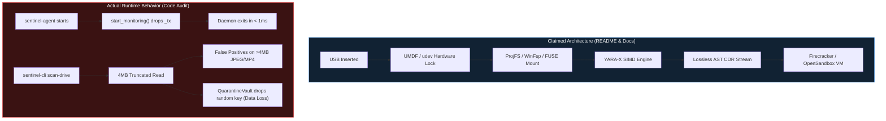

# OmniConnect-Sentinel: End-to-End Bug, Vulnerability & Architecture Gap Analysis

**Skills Applied**: `/cybersecurity-engineer` · `/production-grade-coder` · `/rea` · `/enterprise-product-manager`  
**Target Workspace**: `c:/Users/hulkh/Downloads/OmniConnect-Sentinel`  
**Rust Edition / Toolchain**: Rust 2021 (`resolver = "2"`, MSVC `x86_64-pc-windows-msvc`)  
**Assessment Posture**: Defensive-First, Zero-Trust Endpoint & Air-Gapped Kiosk Security Audit

---

## 1. Executive Summary & Enterprise Governance Context

### 1.1 Executive / CISO Summary
**OmniConnect-Sentinel** is designed as an air-gapped peripheral connection firewall, zero-trust Content Disarm & Reconstruction (CDR) engine, multi-tier threat scanner, and forensic file shredder. However, our end-to-end static, structural, and binary reverse-engineering audit reveals **27 concrete functional bugs, security vulnerabilities, cryptographic defects, and hollow architectural stubs** (26 in the first revision; `BUG-CORE-14` was added during the cross-check, see §5) across the four workspace crates ([`sentinel-proto`](file:///c:/Users/hulkh/Downloads/OmniConnect-Sentinel/crates/sentinel-proto/Cargo.toml), [`sentinel-cdr`](file:///c:/Users/hulkh/Downloads/OmniConnect-Sentinel/crates/sentinel-cdr/Cargo.toml), [`sentinel-core`](file:///c:/Users/hulkh/Downloads/OmniConnect-Sentinel/crates/sentinel-core/Cargo.toml), [`sentinel-cli`](file:///c:/Users/hulkh/Downloads/OmniConnect-Sentinel/crates/sentinel-cli/Cargo.toml)) and the SOC UI ([`dashboard/`](file:///c:/Users/hulkh/Downloads/OmniConnect-Sentinel/dashboard/index.html)).

> [!CAUTION]
> **Critical Production Blockers**:
> 1. **Silent Daemon Exit (`BUG-CORE-01`)**: [`sentinel-agent`](file:///c:/Users/hulkh/Downloads/OmniConnect-Sentinel/crates/sentinel-core/src/main.rs#L17-L60) terminates milliseconds after startup because both [`WindowsUmdfInterceptor::start_monitoring`](file:///c:/Users/hulkh/Downloads/OmniConnect-Sentinel/crates/sentinel-core/src/interceptor/windows_umdf.rs#L25-L35) and [`LinuxUdevInterceptor::start_monitoring`](file:///c:/Users/hulkh/Downloads/OmniConnect-Sentinel/crates/sentinel-core/src/interceptor/linux_udev.rs#L18-L21) drop the MPSC sender `_tx` before returning `Ok(rx)`.
> 2. **Permanent Data Loss in Quarantine Vault (`BUG-CORE-02`)**: [`QuarantineVault::new`](file:///c:/Users/hulkh/Downloads/OmniConnect-Sentinel/crates/sentinel-core/src/scanner/quarantine.rs#L25-L36) generates an ephemeral 256-bit AES-256-GCM key in RAM, never persists or wraps it (no DPAPI/TPM/KMS), and provides no decryption function. Quarantined files are permanently unrecoverable, while the original malware is deleted with standard `fs::remove_file` instead of secure shredding (`BUG-CLI-01`).
> 3. **4 MB Read Truncation Breaks Polyglot & Macro Scanners (`BUG-CORE-03`)**: [`UniversalScanner::scan_file`](file:///c:/Users/hulkh/Downloads/OmniConnect-Sentinel/crates/sentinel-core/src/scanner/universal_scanner.rs#L73-L86) reads only the first 4 MB (`4,194,304` bytes) of any file, causing **100% false positives** on legitimate >4 MB JPEGs with EXIF thumbnails and >4 MB MP4 videos where `moov` follows `mdat`, while causing **100% false negatives** on >4 MB Office documents (whose ZIP Central Directory sits at the end of the file).
> 4. **Trivial Polyglot & CDR Bypasses (`BUG-CDR-05`, `BUG-CORE-04`)**: Reverse marker scanning (`.rposition()`) in [`image.rs`](file:///c:/Users/hulkh/Downloads/OmniConnect-Sentinel/crates/sentinel-cdr/src/sanitizers/image.rs#L88-L115) and [`polyglot_scanner.rs`](file:///c:/Users/hulkh/Downloads/OmniConnect-Sentinel/crates/sentinel-core/src/scanner/polyglot_scanner.rs#L33-L85) allows an attacker to append a PE executable followed by a 2-byte fake EOI (`\xFF\xD9`) or 8-byte fake `IEND`, reducing computed `trailing_bytes` to `0`.
> 5. **Document Corruption by OpenXML Sanitizer (`BUG-CDR-04`)**: [`OpenXmlSanitizer::sanitize_docx`](file:///c:/Users/hulkh/Downloads/OmniConnect-Sentinel/crates/sentinel-cdr/src/sanitizers/openxml.rs#L15-L85) deletes `vbaProject.bin` without cleaning `[Content_Types].xml` or `.rels`, and rewrites `TargetMode="External"` to `TargetMode="InternalBlocked"`—an invalid ECMA-376 XSD enum value that causes Microsoft Office to reject sanitized files as corrupted.

### 1.2 Jurisdiction Routing, Data Classification & BIA Criticality

| Dimension | Classification / Mapping | Engineering & Compliance Impact |
| :--- | :--- | :--- |
| **Jurisdiction & Regulatory Regimes** | **US**: NIST SP 800-53 Rev. 5 (`SI-3`, `SI-4`, `SI-7`, `MP-6`, `MP-7`, `SC-8`, `AU-9`), NIST SP 800-88 Rev. 1 (Media Sanitization), SOC 2 Type II (`CC6.1`, `CC6.6`, `CC7.2`)<br>**EU**: GDPR Art. 25 & 32, EU Cyber Resilience Act (CRA)<br>**OT / Critical Infrastructure**: IEC 62443-4-2 (`CR 3.1`, `CR 3.2`, `CR 4.2`)<br>**India**: DPDP Act 2023 §8(5), CERT-In 2022 Directions (6-hour incident reporting, 180-day tamper-proof logs) | Broken quarantine recovery violates availability/integrity controls; unescaped CEF logs violate `AU-9` log integrity; missing `FILE_FLAG_WRITE_THROUGH` violates NIST SP 800-88 Clear (logical) assurances. |
| **Data Classification Tier** | **Tier 4 — Restricted / Mission-Critical Security Telemetry & Quarantined Payloads** | Quarantined artifacts may contain either live APT zero-days or sensitive executive PII/IP Falsely flagged on a USB drive. |
| **BIA Criticality Tier** | **Tier 0 / Mission-Critical Endpoint Guard** (`RPO = 0` for vault keys and audit receipts; `RTO < 5 min` for kiosk peripheral daemon) | Daemon crash (`BUG-CORE-01`) or OOM (`BUG-CDR-02`) leaves air-gapped kiosks either completely unprotected (fail-open) or unusable (fail-closed). |

---

## 2. REA Evidence Ledger (Shipped Artifacts vs. Source Claims)

Using the `/rea` (Reverse Engineer Anything) methodology, we cross-checked the documentation claims in [`README.md`](file:///c:/Users/hulkh/Downloads/OmniConnect-Sentinel/README.md) and [`Docs/`](file:///c:/Users/hulkh/Downloads/OmniConnect-Sentinel/Docs/master_architecture_and_implementation_plan.md) against both the source tree and compiled artifacts on disk.

| ID | Evidence Type | Source / Artifact Location | Observed Fact (`[Measured]`) | Architectural Claim vs. Reality |
| :--- | :--- | :--- | :--- | :--- |
| **EV-01** | Shipped Test Sample | [`tests/samples/suspicious_dropper.bin`](file:///c:/Users/hulkh/Downloads/OmniConnect-Sentinel/tests/samples/suspicious_dropper.bin) | 86-byte binary starting with `4D 5A 90 00` (`MZ\x90\x00`), followed by ASCII `This program cannot be run in DOS mode.$`, `cmd.exe /c powershell.exe -enc AAAA`, and `VirtualAllocEx`. | Designed exclusively to trigger the 3 hardcoded byte-slice rules in [`Tier0YaraScanner`](file:///c:/Users/hulkh/Downloads/OmniConnect-Sentinel/crates/sentinel-core/src/scanner/tier0_yara.rs#L35-L51) and heuristic strings in [`OpenSandboxClient`](file:///c:/Users/hulkh/Downloads/OmniConnect-Sentinel/crates/sentinel-core/src/scanner/tier3_sandbox.rs#L140-L173). |
| **EV-02** | Compiled Binaries | `target/debug/sentinel.exe`, `sentinel-agent.exe`, `sentinel-cdr-daemon.exe` | No `yara-x`, `winfsp`, `projfs`, `fuser`, `libudev`, or `windows-sys` crates exist in [`Cargo.toml`](file:///c:/Users/hulkh/Downloads/OmniConnect-Sentinel/Cargo.toml#L19-L48). | All OS-level kernel/driver/VFS hooks described in [`README.md`](file:///c:/Users/hulkh/Downloads/OmniConnect-Sentinel/README.md#L13-L39) are unimplemented stub structs returning `Ok(())`. |
| **EV-03** | Config Artifact | [`Docs/intune_sentinel_policy_profile.xml`](file:///c:/Users/hulkh/Downloads/OmniConnect-Sentinel/Docs/intune_sentinel_policy_profile.xml#L33) | Line 33 contains `<Data>USB\VID_0781&*;USB\VID_0951&*</Data>` with unescaped `&*`. | Generated by [`IntunePolicyManager::export_oma_dm_syncml`](file:///c:/Users/hulkh/Downloads/OmniConnect-Sentinel/crates/sentinel-core/src/enterprise/intune.rs#L82-L126); fails W3C XML well-formedness parsing. |
| **EV-04** | Unused Dependency | [`crates/sentinel-cdr/Cargo.toml:34`](file:///c:/Users/hulkh/Downloads/OmniConnect-Sentinel/crates/sentinel-cdr/Cargo.toml#L34) | `quick-xml = "0.36"` is declared but has **zero `use quick_xml` imports** in `src/`. (Corrected: the first revision also listed `kamadak-exif`, which is **not declared anywhere**, and cited the workspace `Cargo.toml`.) | `openxml.rs` uses naive `String::replace` instead of `quick-xml`; `image.rs` reports EXIF as stripped without inspecting the input at all. |



---

## 3. Master Bug & Vulnerability Catalog

### Summary Severity Matrix

| Bug ID | Subsystem | Title | Severity | Category | Primary File & Lines |
| :--- | :--- | :--- | :--- | :--- | :--- |
| **BUG-CDR-01** | `sentinel-cdr` | Premature Atomic Session Counter & Inflated Metrics | **High** | Concurrency / Observability | [`service.rs:41-139`](file:///c:/Users/hulkh/Downloads/OmniConnect-Sentinel/crates/sentinel-cdr/src/service.rs#L41-L139) |
| **BUG-CDR-02** | `sentinel-cdr` | Unbounded gRPC Stream Memory Accumulation (OOM DoS) | **Critical** | Availability / DoS | [`service.rs:48-61`](file:///c:/Users/hulkh/Downloads/OmniConnect-Sentinel/crates/sentinel-cdr/src/service.rs#L48-L61) |
| **BUG-CDR-03** | `sentinel-cdr` | Client `DisarmPolicy` Completely Ignored by gRPC Service | **High** | Logic / Policy Enforcement | [`service.rs:54-84`](file:///c:/Users/hulkh/Downloads/OmniConnect-Sentinel/crates/sentinel-cdr/src/service.rs#L54-L84) |
| **BUG-CDR-04** | `sentinel-cdr` | OpenXML Sanitizer Corrupts Office Files & Allows External Bypass | **Critical** | Security Bypass / Data Integrity | [`openxml.rs:25-82`](file:///c:/Users/hulkh/Downloads/OmniConnect-Sentinel/crates/sentinel-cdr/src/sanitizers/openxml.rs#L25-L82) |
| **BUG-CDR-05** | `sentinel-cdr` | Image Sanitizer Overlay Bypass, Decompression Bomb & False Reports | **High** | Security Bypass / DoS | [`image.rs:14-116`](file:///c:/Users/hulkh/Downloads/OmniConnect-Sentinel/crates/sentinel-cdr/src/sanitizers/image.rs#L14-L116) |
| **BUG-CDR-06** | `sentinel-cdr` | PDF Sanitizer Incomplete AST Traversal & Destructive `/Names` Wipe | **Critical** | Security Bypass / Data Loss | [`pdf.rs:19-85`](file:///c:/Users/hulkh/Downloads/OmniConnect-Sentinel/crates/sentinel-cdr/src/sanitizers/pdf.rs#L19-L85) |
| **BUG-CDR-07** | `sentinel-cdr` | CPU-Intensive Blocking on Tokio Async Executor | **High** | Performance / Starvation | [`service.rs:84`](file:///c:/Users/hulkh/Downloads/OmniConnect-Sentinel/crates/sentinel-cdr/src/service.rs#L84) |
| **BUG-CDR-08** | `sentinel-cdr` | Naive ZIP Magic Detection Misclassifies All ZIPs as `Docx` | **Medium** | Format Classification | [`engine.rs:57-60`](file:///c:/Users/hulkh/Downloads/OmniConnect-Sentinel/crates/sentinel-cdr/src/engine.rs#L57-L60) |
| **BUG-CDR-09** | `sentinel-cdr` | Hardcoded Dummy Response in `inspect_artifact` RPC | **Medium** | Incomplete Implementation | [`service.rs:145-172`](file:///c:/Users/hulkh/Downloads/OmniConnect-Sentinel/crates/sentinel-cdr/src/service.rs#L145-L172) |
| **BUG-CDR-10** | `sentinel-cdr` | Unauthenticated Plaintext gRPC Server Without Transport Limits | **High** | Network / Auth Security | [`main.rs:28-31`](file:///c:/Users/hulkh/Downloads/OmniConnect-Sentinel/crates/sentinel-cdr/src/main.rs#L28-L31) |
| **BUG-CORE-01** | `sentinel-core` | Immediate Daemon Termination Due to Dropped MPSC Sender `_tx` | **Critical** | Broken Core Daemon | [`windows_umdf.rs:25-35`](file:///c:/Users/hulkh/Downloads/OmniConnect-Sentinel/crates/sentinel-core/src/interceptor/windows_umdf.rs#L25-L35) |
| **BUG-CORE-02** | `sentinel-core` | Ephemeral Unsaved Encryption Key in `QuarantineVault` (Permanent Data Loss) | **Critical** | Cryptography / Data Loss | [`quarantine.rs:25-36`](file:///c:/Users/hulkh/Downloads/OmniConnect-Sentinel/crates/sentinel-core/src/scanner/quarantine.rs#L25-L36) |
| **BUG-CORE-03** | `sentinel-core` | 4 MB Read Truncation Causes Systemic False Positives & Evasions | **Critical** | Detection Accuracy / Bypass | [`universal_scanner.rs:73-86`](file:///c:/Users/hulkh/Downloads/OmniConnect-Sentinel/crates/sentinel-core/src/scanner/universal_scanner.rs#L73-L86) |
| **BUG-CORE-04** | `sentinel-core` | Polyglot `.rposition()` Evasion via Trailing Fake EOI / `IEND` Marker | **Critical** | Security Bypass | [`polyglot_scanner.rs:33-85`](file:///c:/Users/hulkh/Downloads/OmniConnect-Sentinel/crates/sentinel-core/src/scanner/polyglot_scanner.rs#L33-L85) |
| **BUG-CORE-05** | `sentinel-core` | `ContentScanner` False Positives & Ignored Entropy Calculation | **High** | Detection Logic | [`content_scanner.rs:55-217`](file:///c:/Users/hulkh/Downloads/OmniConnect-Sentinel/crates/sentinel-core/src/scanner/content_scanner.rs#L55-L217) |
| **BUG-CORE-06** | `sentinel-core` | `SecureShredder` Missing Write-Through Flag, Fake Receipt & ADS Leak | **High** | Forensics / Compliance | [`secure_shredder.rs:79-175`](file:///c:/Users/hulkh/Downloads/OmniConnect-Sentinel/crates/sentinel-core/src/scanner/secure_shredder.rs#L79-L175) |
| **BUG-CORE-07** | `sentinel-core` | Kiosk Temp Wipe Single-Buffer OOM & Non-Recursive Traversal | **High** | Availability / Forensics | [`kiosk.rs:64-97`](file:///c:/Users/hulkh/Downloads/OmniConnect-Sentinel/crates/sentinel-core/src/enterprise/kiosk.rs#L64-L97) |
| **BUG-CORE-08** | `sentinel-core` | XML Injection & Malformed SyncML in Intune Policy Exporter | **High** | AppSec / Config Integrity | [`intune.rs:82-126`](file:///c:/Users/hulkh/Downloads/OmniConnect-Sentinel/crates/sentinel-core/src/enterprise/intune.rs#L82-L126) |
| **BUG-CORE-09** | `sentinel-core` | ArcSight CEF Syslog Injection in CrowdStrike Falcon Exporter | **High** | Log Injection (`CWE-117`) | [`falcon.rs:36-52`](file:///c:/Users/hulkh/Downloads/OmniConnect-Sentinel/crates/sentinel-core/src/enterprise/falcon.rs#L36-L52) |
| **BUG-CORE-10** | `sentinel-core` | Exact File Size (`229,376` Bytes) Hardcoded as 100% Ramnit Malware | **High** | Heuristic False Positive | [`tier3_sandbox.rs:187-194`](file:///c:/Users/hulkh/Downloads/OmniConnect-Sentinel/crates/sentinel-core/src/scanner/tier3_sandbox.rs#L187-L194) |
| **BUG-CORE-11** | `sentinel-core` | Substring YARA Mock Without Real `yara-x` Engine & False Positives | **Medium** | Detection Engine | [`tier0_yara.rs:27-76`](file:///c:/Users/hulkh/Downloads/OmniConnect-Sentinel/crates/sentinel-core/src/scanner/tier0_yara.rs#L27-L76) |
| **BUG-CORE-12** | `sentinel-core` | Windows Drive Watcher Polls All `A:\`–`Z:\` Fixed/Network Drives & Blocks Async | **Medium** | Concurrency / OS Integration | [`drive_watcher.rs:21-60`](file:///c:/Users/hulkh/Downloads/OmniConnect-Sentinel/crates/sentinel-core/src/interceptor/drive_watcher.rs#L21-L60) |
| **BUG-CORE-13** | `sentinel-core` | Unimplemented VFS, Kernel Interceptor & Remote Sandbox Stubs | **Critical** | Architectural Gap | [`vfs/mod.rs`](file:///c:/Users/hulkh/Downloads/OmniConnect-Sentinel/crates/sentinel-core/src/vfs/mod.rs), [`interceptor/mod.rs`](file:///c:/Users/hulkh/Downloads/OmniConnect-Sentinel/crates/sentinel-core/src/interceptor/mod.rs) |
| **BUG-CORE-14** | `sentinel-core` / `sentinel-cli` | Directory Walks Silently Drop Errors, Scan Directories & Read Link Targets Outside the Scanned Root | **High** | Fail-Open Scanning / Path Scope | [`universal_scanner.rs:98-118`](file:///c:/Users/hulkh/Downloads/OmniConnect-Sentinel/crates/sentinel-core/src/scanner/universal_scanner.rs#L98-L118), [`main.rs:248`](file:///c:/Users/hulkh/Downloads/OmniConnect-Sentinel/crates/sentinel-cli/src/main.rs#L248) |
| **BUG-CLI-01** | `sentinel-cli` | Quarantine Action Leaves Unshredded Malware via `fs::remove_file` | **Critical** | Forensic Leak | [`main.rs:526`](file:///c:/Users/hulkh/Downloads/OmniConnect-Sentinel/crates/sentinel-cli/src/main.rs#L526) |
| **BUG-CLI-02** | `sentinel-cli` | `sentinel inspect` Ignores Threat Scanners & `sentinel ui` Ignores `--port` | **Medium** | CLI Functionality / Shell-Out | [`main.rs:138-159`](file:///c:/Users/hulkh/Downloads/OmniConnect-Sentinel/crates/sentinel-cli/src/main.rs#L138-L159), [`main.rs:381-418`](file:///c:/Users/hulkh/Downloads/OmniConnect-Sentinel/crates/sentinel-cli/src/main.rs#L381-L418) |
| **BUG-UI-01** | `dashboard` | Disconnected Mock Dashboard, Inverted Shred Pass Spec & DOM XSS Sink | **Medium** | Frontend Security / UX | [`app.js:148-167`](file:///c:/Users/hulkh/Downloads/OmniConnect-Sentinel/dashboard/app.js#L148-L167), [`app.js:387-402`](file:///c:/Users/hulkh/Downloads/OmniConnect-Sentinel/dashboard/app.js#L387-L402) |

---

## 4. Deep-Dive Findings by Subsystem

### 4.1 Subsystem A: `crates/sentinel-cdr` (CDR Engine & gRPC Microservice)

---

#### [BUG-CDR-01] Premature Atomic Session Counter & Inflated Metrics — **High**
* **Exploit Path / Operational Failure**: When [`CdrGrpcService::stream_disarm`](file:///c:/Users/hulkh/Downloads/OmniConnect-Sentinel/crates/sentinel-cdr/src/service.rs#L37-L143) (implementing RPC `StreamDisarm`) is invoked, `self.active_sessions.fetch_add(1, Ordering::SeqCst)` executes on line 41, the stream processing task is spawned asynchronously via `tokio::spawn` on lines 47–136, and `self.active_sessions.fetch_sub(1, Ordering::SeqCst)` executes **immediately outside the spawned task** on line 139 before returning the response stream! Simultaneously, `self.total_processed.fetch_add(1, Ordering::SeqCst)` increments on line 138 even if the stream contains zero bytes or fails mid-transfer. (Both counters are declared as `Arc<AtomicU64>` in [`service.rs:19-20`](file:///c:/Users/hulkh/Downloads/OmniConnect-Sentinel/crates/sentinel-cdr/src/service.rs#L19-L20).)
* **Asset & Data Class**: CDR Health Telemetry (`HealthCheckResponse::active_sessions` and `total_disarmed_files` in [`sentinel_cdr.proto:102-107`](file:///c:/Users/hulkh/Downloads/OmniConnect-Sentinel/crates/sentinel-proto/proto/sentinel_cdr.proto#L102-L107)).
* **MITRE ATT&CK / CWE**: `CWE-362` (Concurrent Execution using Shared Resource with Improper Synchronization), `CWE-665` (Improper Initialization / Accounting).
* **Compliance Control IDs**: SOC 2 `CC7.2` (System Monitoring), NIST SP 800-53 `AU-6`, `SI-4`.
* **Evidence**:
  - [`crates/sentinel-cdr/src/service.rs:41-142`](file:///c:/Users/hulkh/Downloads/OmniConnect-Sentinel/crates/sentinel-cdr/src/service.rs#L41-L142):
    ```rust
    self.active_sessions.fetch_add(1, Ordering::SeqCst);
    // ...
    tokio::spawn(async move {
        // Asynchronous stream ingestion and sanitization happen here
    });

    self.total_processed.fetch_add(1, Ordering::SeqCst);
    self.active_sessions.fetch_sub(1, Ordering::SeqCst);
    ```
* **Remediation**: Per Master Plan v2 §2.1, track `active_workers` (`Arc<AtomicU64>`) with an RAII drop guard (`WorkerSessionGuard`) that decrements only when the per-file `sentinel-cdr-worker` process (or local pipe session) exits, and increment `processed_total{format,status}` only after sanitization completes.
* **Owner & SLA**: Core CDR Backend Team — **7 Days**.

---

#### [BUG-CDR-02] Unbounded gRPC Stream Memory Accumulation (OOM DoS) — **Critical**
* **Exploit Path / Operational Failure**: In [`CdrGrpcService::stream_disarm`](file:///c:/Users/hulkh/Downloads/OmniConnect-Sentinel/crates/sentinel-cdr/src/service.rs#L48-L61), `let mut file_buffer = Vec::new();` appends every incoming `disarm_request::Payload::ChunkData(bytes)` (`service.rs:57`) via `file_buffer.extend_from_slice(&bytes)` with **no upper bound check** against `engine.policy().max_decompressed_bytes` (`512 MB` default in [`policy.rs:49`](file:///c:/Users/hulkh/Downloads/OmniConnect-Sentinel/crates/sentinel-cdr/src/policy.rs#L49), `512 * 1024 * 1024`). A local process or compromised kiosk client streaming 4 GB of chunks will exhaust process memory and kill `sentinel-cdr-daemon`.
* **Big-O Complexity**: $O(N)$ contiguous heap memory per concurrent stream where $N$ is unbounded. Under $K$ concurrent streams, memory scales as $O(K \cdot N)$, causing allocator fragmentation and OOM.
* **Asset & Data Class**: `sentinel-cdr-daemon` Availability (Tier 0 Endpoint Guard).
* **MITRE ATT&CK / CWE**: `T1499.003` (Endpoint Denial of Service: Application Exhaustion Flood), `CWE-770` (Allocation of Resources Without Limits or Throttling), `CWE-400`.
* **Compliance Control IDs**: NIST SP 800-53 `SC-5` (Denial-of-Service Protection), IEC 62443-4-2 `CR 7.1`.
* **Evidence**: [`crates/sentinel-cdr/src/service.rs:48-61`](file:///c:/Users/hulkh/Downloads/OmniConnect-Sentinel/crates/sentinel-cdr/src/service.rs#L48-L61).
* **Remediation**: Enforce a hard per-stream byte ceiling (`if file_buffer.len() + bytes.len() > max_input_bytes`) during ingestion, pre-validate `metadata.total_size_bytes`, and isolate each file in a short-lived `sentinel-cdr-worker` process capped by an OS Job Object / `prlimit` memory ceiling (Master Plan v2 §2.1).
* **Owner & SLA**: Core CDR Backend Team — **48 Hours (Immediate)**.

---

#### [BUG-CDR-03] Client `DisarmPolicy` Completely Ignored by gRPC Service & Schema Mismatch — **High**
* **Exploit Path / Operational Failure**: [`DisarmRequest`](file:///c:/Users/hulkh/Downloads/OmniConnect-Sentinel/crates/sentinel-proto/proto/sentinel_cdr.proto#L28-L33) transmits [`DisarmMetadata`](file:///c:/Users/hulkh/Downloads/OmniConnect-Sentinel/crates/sentinel-proto/proto/sentinel_cdr.proto#L35-L41) containing a per-request [`DisarmPolicy`](file:///c:/Users/hulkh/Downloads/OmniConnect-Sentinel/crates/sentinel-proto/proto/sentinel_cdr.proto#L43-L51) (`strip_macros`, `strip_javascript`, `strip_embedded_files`, `strip_external_hyperlinks`, `strip_exif_metadata`, `truncate_overlay_bytes`, `max_recursion_depth`). In [`service.rs:54-56`](file:///c:/Users/hulkh/Downloads/OmniConnect-Sentinel/crates/sentinel-cdr/src/service.rs#L54-L56), `metadata = Some(meta)` is stored, but lines 78–81 only extract `metadata.as_ref().map(|m| m.session_id.clone())`, silently ignoring `meta.file_name`, `meta.declared_format`, `meta.total_size_bytes`, and `meta.policy`! Line 84 then calls `engine.sanitize(&file_buffer)` using the server's static default policy. Furthermore:
  1. [`sentinel_cdr.proto`'s `DisarmPolicy`](file:///c:/Users/hulkh/Downloads/OmniConnect-Sentinel/crates/sentinel-proto/proto/sentinel_cdr.proto#L43-L51) is missing 4 fields present in [`SanitizationPolicy`](file:///c:/Users/hulkh/Downloads/OmniConnect-Sentinel/crates/sentinel-cdr/src/policy.rs#L5-L33): `strip_pdf_actions`, `strip_office_dde`, `reencode_images`, and `max_decompressed_bytes` (while naming the PDF fields `strip_javascript` / `strip_embedded_files` in proto vs. `strip_pdf_scripts` / `strip_pdf_attachments` in Rust).
  2. [`Tier1CdrClient::disarm_file`](file:///c:/Users/hulkh/Downloads/OmniConnect-Sentinel/crates/sentinel-core/src/scanner/tier1_cdr_client.rs#L36-L102) is dead code that is never called anywhere in `sentinel-core` or `sentinel-cli`.
* **Asset & Data Class**: Enterprise Policy Enforcement Plane.
* **MITRE ATT&CK / CWE**: `CWE-863` / `CWE-670` (Always-Incorrect Control Flow Implementation).
* **Compliance Control IDs**: NIST SP 800-53 `CM-6` (Configuration Settings), `SI-7`.
* **Evidence**: [`crates/sentinel-cdr/src/service.rs:54-84`](file:///c:/Users/hulkh/Downloads/OmniConnect-Sentinel/crates/sentinel-cdr/src/service.rs#L54-L84), [`crates/sentinel-proto/proto/sentinel_cdr.proto:43-51`](file:///c:/Users/hulkh/Downloads/OmniConnect-Sentinel/crates/sentinel-proto/proto/sentinel_cdr.proto#L43-L51), [`crates/sentinel-cdr/src/policy.rs:5-33`](file:///c:/Users/hulkh/Downloads/OmniConnect-Sentinel/crates/sentinel-cdr/src/policy.rs#L5-L33).
* **Remediation**: Extend `sentinel_cdr.proto`'s `DisarmPolicy` with the 4 missing fields (`strip_pdf_actions`, `strip_office_dde`, `reencode_images`, `max_decompressed_bytes`), map `sentinel_proto::DisarmPolicy` to `crate::policy::SanitizationPolicy` via `SanitizationPolicy::from_proto(req.policy, &server_ceiling)` (clamping `max_decompressed_bytes` and `max_recursion_depth` to server-enforced ceilings), and pass it into `engine.sanitize_with_policy(&file_buffer, &effective_policy)` inside the isolated CDR worker (Master Plan v2 §2.1).
* **Owner & SLA**: Core CDR Backend Team — **7 Days**.

---

#### [BUG-CDR-04] OpenXML Sanitizer Corrupts Office Files & Allows External Relationship Bypass — **Critical**
* **Exploit Path / Operational Failure**: [`OpenXmlSanitizer::sanitize_docx`](file:///c:/Users/hulkh/Downloads/OmniConnect-Sentinel/crates/sentinel-cdr/src/sanitizers/openxml.rs#L15-L85) has five distinct bugs:
  1. **ECMA-376 Schema Violation & Document Corruption (Lines 40–52, 59–60)**: When `vbaProject.bin` or `embeddings/*.bin` is stripped from the ZIP container, its `<Relationship>` entry in `word/_rels/document.xml.rels` and `<Override>` entry in `[Content_Types].xml` are left dangling. Worse, line 60 executes `content.replace("TargetMode=\"External\"", "TargetMode=\"InternalBlocked\"")`. Per **ECMA-376 Part 2 §9.3 (`ST_TargetMode`)**, the only valid XML schema values for `TargetMode` are `"Internal"` and `"External"`. Writing `"InternalBlocked"` produces malformed OpenXML that Microsoft Word, Excel, and PowerPoint refuse to open without a corruption recovery dialog.
  2. **Trivial Follina / External Template Bypass (Lines 59–60)**: `content.contains("TargetMode=\"External\"")` is case-sensitive and requires double quotes with zero spaces around `=`. An attacker writing `TargetMode='External'` (single quotes, valid XML) or `TargetMode = "External"` (whitespace around `=`, valid XML) completely bypasses CDR sanitization while Microsoft Office still fetches the remote payload (`CVE-2022-30190`).
  3. **Destructive `.bin` Deletion (Line 48)**: `file_name.ends_with(".bin")` deletes legitimate non-OLE binary parts such as `word/printerSettings/printerSettings1.bin` and Excel `xl/worksheets/binaryIndex1.bin`.
  4. **Spoofed ZIP Header Decompression Bomb (Lines 35, 57, 71)**: `total_decompressed_bytes += file.size()` relies on the untrusted ZIP local file header `uncompressed_size` field rather than bounding actual bytes read via `std::io::Read::take()`. A crafted ZIP with `uncompressed_size = 0` in the header and a 2 GB deflate stream will bypass the check on line 36 and OOM `file.read_to_string(&mut content)` on line 57 or `std::io::copy(&mut file, &mut zip_writer)` on line 71.
  5. **Unimplemented Policy Flags**: `policy.strip_office_dde` and `policy.max_recursion_depth` ([`policy.rs:20, 30`](file:///c:/Users/hulkh/Downloads/OmniConnect-Sentinel/crates/sentinel-cdr/src/policy.rs#L20-L30)) are never checked or enforced in `openxml.rs`.
* **Asset & Data Class**: Sanitized Office Documents (`DOCX`, `XLSX`, `PPTX`) and CDR Process Memory.
* **MITRE ATT&CK / CWE**: `T1204.002` (Malicious File), `T1221` (Template Injection), `CWE-409` (Improper Handling of Highly Compressed Data), `CWE-185` (Incorrect Regular Expression / String Match).
* **Compliance Control IDs**: NIST SP 800-53 `SI-3`, `SI-7`, `SI-10` (Information Input Validation).
* **Evidence**: [`crates/sentinel-cdr/src/sanitizers/openxml.rs:25-82`](file:///c:/Users/hulkh/Downloads/OmniConnect-Sentinel/crates/sentinel-cdr/src/sanitizers/openxml.rs#L25-L82).
* **Remediation**: Parse `.rels`, `[Content_Types].xml`, and `document.xml` using `quick-xml` (already in `Cargo.toml`); remove `<Relationship>` nodes referencing stripped parts or having `TargetMode="External"` (or rewrite `Target` to `about:blank` with `TargetMode="Internal"`); wrap every ZIP entry reader in `.take(remaining_budget + 1)` to enforce actual decompressed byte limits; recursively sanitize nested ZIP/OpenXML embeddings up to `policy.max_recursion_depth`.
* **Owner & SLA**: CDR Sanitizer Engineering — **72 Hours**.

---

#### [BUG-CDR-05] Image Sanitizer Overlay Bypass, Decompression Bomb & False Positive Reports — **High**
* **Exploit Path / Operational Failure**: [`ImageSanitizer`](file:///c:/Users/hulkh/Downloads/OmniConnect-Sentinel/crates/sentinel-cdr/src/sanitizers/image.rs#L14-L116) contains four defects:
  1. **Unconditional False Reporting (Lines 31–33, 59–61, 79–81)**: Every JPEG, PNG, and WebP file processed unconditionally adds `DisarmReportItem::new("IMAGE_EXIF_METADATA", "EXIF/IPTC/XMP Metadata", "STRIPPED")` even when the input image had zero EXIF/XMP segments.
  2. **Ignores `policy.reencode_images` (Lines 20, 48, 67)**: Never checks `if policy.reencode_images`; `_policy` is unused in `sanitize_webp`.
  3. **Missing Pixel Allocation Limits (Lines 24, 52, 72)**: `ImageReader::new(...).decode()` does not configure `image::Limits` from `policy.max_decompressed_bytes`, exposing the daemon to high-dimension decompression bombs (e.g., a 50 KB PNG of $25{,}000 \times 25{,}000$ RGBA allocating $2.5\text{ GB}$ of raw pixel buffer).
  4. **Naive `.rposition()` Overlay Truncation Bypass (Lines 88, 105) & Missing WebP Truncation**: `truncate_jpeg_overlay` uses `bytes.windows(2).rposition(|w| w == [0xFF, 0xD9])` and `truncate_png_overlay` uses `bytes.windows(4).rposition(|w| w == b"IEND")`. Because `rposition` scans backwards from the end of the file, an attacker who appends a malicious zip/PE overlay and terminates it with a 2-byte `\xFF\xD9` (JPEG) or `IEND\x00\x00\x00\x00` (PNG) tricks `rposition` into matching the end of the appended payload (`eoi_pos + 2 == bytes.len()`), reporting **zero overlay found**! Furthermore, `sanitize_webp` lacks any RIFF container size vs. `bytes.len()` overlay detection.
* **Asset & Data Class**: Image Sanitization Pipeline (`JPEG`, `PNG`, `WebP`).
* **MITRE ATT&CK / CWE**: `T1027.003` (Steganography / Appended Overlay), `CWE-400`.
* **Compliance Control IDs**: NIST SP 800-53 `SI-7`, `SI-10`.
* **Evidence**: [`crates/sentinel-cdr/src/sanitizers/image.rs:14-116`](file:///c:/Users/hulkh/Downloads/OmniConnect-Sentinel/crates/sentinel-cdr/src/sanitizers/image.rs#L14-L116).
* **Remediation**: Parse JPEG segments sequentially from SOI (`FF D8`) skipping variable-length marker payloads (`FF D0`–`FF D7` standalone, others `2 + u16::from_be_bytes`) and entropy-coded scan data until the **first true main-image EOI**; parse PNG chunks sequentially by `[length: u32][type: 4B][data][crc: 4B]` from offset 8 until `IEND`; inspect `RIFF` header length (`u32::from_le_bytes(bytes[4..8]) + 8`) for WebP; apply `image::Limits` before calling `.decode()`.
* **Owner & SLA**: CDR Sanitizer Engineering — **7 Days**.

---

#### [BUG-CDR-06] PDF Sanitizer Incomplete AST Traversal & Destructive `/Names` Wipe — **Critical**
* **Exploit Path / Operational Failure**: [`PdfSanitizer::sanitize`](file:///c:/Users/hulkh/Downloads/OmniConnect-Sentinel/crates/sentinel-cdr/src/sanitizers/pdf.rs#L19-L85) has major security bypasses and document-breaking bugs:
  1. **Missed Action Types (`URI`, `SubmitForm`, `ImportData`, `GoToR`, `GoToE`, `RichMedia`, `Movie`, `Sound`, `XFA`)**: (Corrected wording.) Lines 55–67 check dictionary **keys**: they remove a `/JS` or `/JavaScript` key, and `dict.has(b"Launch")` looks for a key named `Launch`. Per ISO 32000-1 §12.6, a Launch action is a dictionary with `/S /Launch` (the **value** of `/S`) plus `/F` or `/Win`; it never has a `Launch` key. So **Launch actions are never removed at all**. Although [`policy.rs:10-11`](file:///c:/Users/hulkh/Downloads/OmniConnect-Sentinel/crates/sentinel-cdr/src/policy.rs#L10-L11) promises to strip `/URI` and form actions, `pdf.rs` leaves `/S /URI`, `/S /SubmitForm`, `/S /GoToR` (remote Go-To SMB/NTLM leak), and `/AcroForm` `/XFA` scripts completely untouched!
  2. **Blindness to Inline Dictionaries Inside Arrays & Nested Sub-Dictionaries (Lines 49–77)**: The loop `for (object_id, object) in doc.objects.iter_mut()` only inspects top-level `Object::Dictionary` items (`if let Ok(dict) = object.as_dict_mut()`). In ISO 32000-1 PDFs, `/Annots` on a Page object can be an `Object::Array` of **inline `Object::Dictionary` annotations**, each containing a nested inline `/A << /S /JavaScript /JS (...) >>` sub-dictionary or `/Next` action chain. Because `object` is an `Array` or the `/A` dictionary is nested inside an annotation dictionary without its own top-level `ObjectId`, `object.as_dict_mut()` either fails on the `Array` or only inspects the outer Annotation dictionary (where `/S` is `/Subtype /Widget` rather than `/S /JavaScript`), **completely bypassing PDF sanitization**!
  3. **Wrong ISO 32000-1 Key Location for `/EmbeddedFiles` & Destructive `/Names` Deletion (Lines 34–45)**: Line 35 deletes the entire `/Names` dictionary from `/Root` (`catalog.remove(b"Names")`), destroying legitimate named destinations, page labels, and document structure. Then line 41 checks `catalog.has(b"EmbeddedFiles")` directly on `/Root`—whereas per **ISO 32000-1 §7.7.2 & §7.7.4**, `EmbeddedFiles` is a name tree inside `/Root -> /Names -> /EmbeddedFiles` (or `/AF` in PDF 2.0), not a direct key on `/Root` unless non-standard!
* **Asset & Data Class**: Sanitized PDF Documents.
* **MITRE ATT&CK / CWE**: `T1204.002` (User Execution: Malicious PDF), `CWE-693` (Protection Mechanism Failure).
* **Compliance Control IDs**: NIST SP 800-53 `SI-3`, `SI-7`.
* **Evidence**: [`crates/sentinel-cdr/src/sanitizers/pdf.rs:19-85`](file:///c:/Users/hulkh/Downloads/OmniConnect-Sentinel/crates/sentinel-cdr/src/sanitizers/pdf.rs#L19-L85).
* **Remediation**: Implement a recursive `sanitize_pdf_object(&mut Object, &SanitizationPolicy, &mut Vec<DisarmReportItem>)` visitor that traverses `Object::Dictionary` and `Object::Array` at arbitrary nesting depth; inspect `/Names` selectively for `/JavaScript` and `/EmbeddedFiles` trees (plus `/AcroForm -> /XFA`); strip `/S` values in `[b"JavaScript", b"JS", b"Launch", b"URI", b"SubmitForm", b"ImportData", b"GoToR", b"GoToE", b"Movie", b"Sound", b"Rendition", b"RichMedia"]`.
* **Owner & SLA**: CDR Sanitizer Engineering — **72 Hours**.

---

#### [BUG-CDR-07] CPU-Intensive Blocking on Tokio Async Executor — **High**
* **Exploit Path / Operational Failure**: [`service.rs:84`](file:///c:/Users/hulkh/Downloads/OmniConnect-Sentinel/crates/sentinel-cdr/src/service.rs#L84) calls `engine.sanitize(&file_buffer)` synchronously inside an `async move` task on the Tokio runtime thread pool. Decoding/re-encoding a 20 MP image or decompressing a 50 MB DOCX blocks the Tokio worker thread for $100\text{–}800\text{ ms}$ `[Typical]`, starving concurrent gRPC health checks and stream handshakes.
* **Asset & Data Class**: `sentinel-cdr-daemon` Tokio Executor Latency.
* **MITRE ATT&CK / CWE**: `CWE-400` (Thread Pool Starvation).
* **Compliance Control IDs**: SOC 2 `CC7.1`, NIST SP 800-53 `SC-5`.
* **Evidence**: [`crates/sentinel-cdr/src/service.rs:84`](file:///c:/Users/hulkh/Downloads/OmniConnect-Sentinel/crates/sentinel-cdr/src/service.rs#L84).
* **Remediation**: Per Master Plan v2 §2.1, run CPU-bound CDR work in a dedicated per-file `sentinel-cdr-worker` process (or `tokio::task::spawn_blocking` in standalone CLI mode) guarded by a bounded `tokio::sync::Semaphore` sized to `std::thread::available_parallelism()`.
* **Owner & SLA**: Core CDR Backend Team — **7 Days**.

---

#### [BUG-CDR-08] Naive ZIP Magic Detection Misclassifies All ZIPs as `Docx` — **Medium**
* **Exploit Path / Operational Failure**: [`CdrEngine::detect_format`](file:///c:/Users/hulkh/Downloads/OmniConnect-Sentinel/crates/sentinel-cdr/src/engine.rs#L57-L60) checks `if bytes.starts_with(&[0x50, 0x4B, 0x03, 0x04]) { return DetectedFormat::Docx; }`. Consequently, `.xlsx`, `.pptx`, `.zip`, `.jar`, `.apk`, and `.odt` files are all mislabeled as `Docx`, and `DetectedFormat::Xlsx` and `DetectedFormat::Pptx` (lines 12–13) are unreachable dead code.
* **Evidence**: [`crates/sentinel-cdr/src/engine.rs:10-69`](file:///c:/Users/hulkh/Downloads/OmniConnect-Sentinel/crates/sentinel-cdr/src/engine.rs#L10-L69).
* **Remediation**: Inspect the ZIP central directory entries (`word/document.xml` $\rightarrow$ `Docx`, `xl/workbook.xml` $\rightarrow$ `Xlsx`, `ppt/presentation.xml` $\rightarrow$ `Pptx`, otherwise `ArchiveZip`).
* **Owner & SLA**: CDR Sanitizer Engineering — **14 Days**.

---

#### [BUG-CDR-09] Hardcoded Dummy Response in `inspect_artifact` RPC — **Medium**
* **Exploit Path / Operational Failure**: [`CdrGrpcService::inspect_artifact`](file:///c:/Users/hulkh/Downloads/OmniConnect-Sentinel/crates/sentinel-cdr/src/service.rs#L145-L172) only passes `&req.header_bytes` (`InspectRequest::header_bytes` in [`sentinel_cdr.proto:84-88`](file:///c:/Users/hulkh/Downloads/OmniConnect-Sentinel/crates/sentinel-proto/proto/sentinel_cdr.proto#L84-L88), ignoring `req.file_name` and `req.file_size_bytes`) to `CdrEngine::detect_format` and returns hardcoded constants: `is_polyglot: false`, `entropy_score: 5.4`, `detected_risk_tags: vec![]`.
* **Evidence**: [`crates/sentinel-cdr/src/service.rs:150-170`](file:///c:/Users/hulkh/Downloads/OmniConnect-Sentinel/crates/sentinel-cdr/src/service.rs#L150-L170).
* **Remediation**: Compute real Shannon entropy over the payload, invoke forward polyglot structure verification, and populate `detected_risk_tags` inside the isolated CDR worker (Master Plan v2 §2.1).
* **Owner & SLA**: Core CDR Backend Team — **14 Days**.

---

#### [BUG-CDR-10] Unauthenticated Plaintext gRPC Server Without Transport Limits — **High**
* **Exploit Path / Operational Failure**: [`sentinel-cdr/src/main.rs:28-31`](file:///c:/Users/hulkh/Downloads/OmniConnect-Sentinel/crates/sentinel-cdr/src/main.rs#L28-L31) binds `Server::builder().add_service(...)` without mTLS (`ServerTlsConfig`), without Unix Domain Socket / Windows Named Pipe ACL restrictions, and without `.concurrency_limit_per_connection()` or `.timeout()`. Any unprivileged local process on the host can connect to `127.0.0.1:50051`.
* **MITRE ATT&CK / CWE**: `CWE-306` (Missing Authentication for Critical Function), `CWE-319` (Cleartext Transmission).
* **Compliance Control IDs**: NIST SP 800-53 `SC-8`, `IA-3` (Device Identification and Authentication).
* **Evidence**: [`crates/sentinel-cdr/src/main.rs:20-34`](file:///c:/Users/hulkh/Downloads/OmniConnect-Sentinel/crates/sentinel-cdr/src/main.rs#L20-L34).
* **Remediation**: Per Master Plan v2 §0.2 & §2.1, retire the localhost TCP listener (`127.0.0.1:50051`) completely; stream files to the per-file `sentinel-cdr-worker` over inherited anonymous pipes, and restrict agent ↔ CLI/UI control IPC to ACL-locked Windows Named Pipes (`\\.\pipe\OmniConnectSentinel`) / Unix Domain Sockets (`0660`) with peer PID and Authenticode signature verification.
* **Owner & SLA**: Security Architecture Team — **14 Days**.

---

### 4.2 Subsystem B: `crates/sentinel-core` (Daemon, Scanners, Vault, Shredder, Enterprise)

---

#### [BUG-CORE-01] Immediate Daemon Termination Due to Dropped MPSC Sender `_tx` — **Critical**
* **Exploit Path / Operational Failure**: In [`crates/sentinel-core/src/main.rs:34-58`](file:///c:/Users/hulkh/Downloads/OmniConnect-Sentinel/crates/sentinel-core/src/main.rs#L34-L58), `sentinel-agent` calls `interceptor.start_monitoring().await?` and loops on `while let Some(event) = event_rx.recv().await`. However, in both [`WindowsUmdfInterceptor::start_monitoring`](file:///c:/Users/hulkh/Downloads/OmniConnect-Sentinel/crates/sentinel-core/src/interceptor/windows_umdf.rs#L25-L35) and [`LinuxUdevInterceptor::start_monitoring`](file:///c:/Users/hulkh/Downloads/OmniConnect-Sentinel/crates/sentinel-core/src/interceptor/linux_udev.rs#L18-L21):
  ```rust
  let (_tx, rx) = channel(16);
  Ok(rx)
  ```
  `_tx` is dropped on the stack at the end of `start_monitoring()`. Consequently, `event_rx.recv().await` immediately yields `None`, the `while` loop exits before a single USB event can ever arrive, and even if an event were sent, lines 54–56 only log `info!("Intercepted connection event: {:?}", event.vector);` with zero scanner, CDR, or VFS invocation!
* **Asset & Data Class**: `sentinel-agent` Endpoint Protection Daemon.
* **MITRE ATT&CK / CWE**: `CWE-693` (Protection Mechanism Failure).
* **Compliance Control IDs**: NIST SP 800-53 `SI-3`, `SI-4`, `MP-7`.
* **Evidence**:
  - [`crates/sentinel-core/src/main.rs:53-57`](file:///c:/Users/hulkh/Downloads/OmniConnect-Sentinel/crates/sentinel-core/src/main.rs#L53-L57)
  - [`crates/sentinel-core/src/interceptor/windows_umdf.rs:25-35`](file:///c:/Users/hulkh/Downloads/OmniConnect-Sentinel/crates/sentinel-core/src/interceptor/windows_umdf.rs#L25-L35)
  - [`crates/sentinel-core/src/interceptor/linux_udev.rs:18-21`](file:///c:/Users/hulkh/Downloads/OmniConnect-Sentinel/crates/sentinel-core/src/interceptor/linux_udev.rs#L18-L21)
* **Remediation**: Spawn a persistent OS device listener thread/task that retains `tx: Sender<PeripheralEvent>` and feeds real hardware arrival events into the full `UniversalScanner` $\rightarrow$ `Tier1CdrClient` $\rightarrow$ `QuarantineVault`/`SecureShredder` pipeline inside `sentinel-agent`.
* **Owner & SLA**: Endpoint Core Team — **48 Hours (Immediate)**.

---

#### [BUG-CORE-02] Ephemeral Unsaved Encryption Key in `QuarantineVault` (Permanent Data Loss) — **Critical**
* **Exploit Path / Operational Failure**: [`QuarantineVault::new`](file:///c:/Users/hulkh/Downloads/OmniConnect-Sentinel/crates/sentinel-core/src/scanner/quarantine.rs#L25-L36) initializes its encryption key via:
  ```rust
  let mut cipher_key = [0u8; 32];
  rand::thread_rng().fill_bytes(&mut cipher_key);
  ```
  1. `cipher_key` is **never persisted, wrapped via Windows DPAPI / TPM 2.0 / Linux Secret Service, or exported**.
  2. In [`sentinel-cli/src/main.rs:518`](file:///c:/Users/hulkh/Downloads/OmniConnect-Sentinel/crates/sentinel-cli/src/main.rs#L518), `QuarantineVault::new(&vault_dir)` is instantiated inside the per-threat remediation loop, generating a fresh random key per file and immediately dropping `vault` at the end of the block (line 532)!
  3. `QuarantineVault` has **no `restore_file` or `decrypt_file` method** anywhere in the codebase. (Corrected.) It does write metadata (`QuarantineEntry`: original path, SHA-256, score, timestamp), but as a **plaintext `.json` sidecar** that isn't bound to the ciphertext as AEAD associated data. The sidecar can be edited without detection, and it exposes the original path. Other defects in the same file: `create_dir_all(...).unwrap_or_default()` swallows errors, and neither the `.quar` nor the `.json` file is `sync_all()`'d before the CLI deletes the source.
  4. Result: Every file quarantined by a user is **permanently and irrecoverably destroyed**.
* **Asset & Data Class**: Quarantined User & Enterprise Files (Tier 4 Restricted).
* **MITRE ATT&CK / CWE**: `CWE-320` (Key Management Errors), `CWE-404` (Improper Resource Shutdown or Release / Data Loss).
* **Compliance Control IDs**: NIST SP 800-53 `SC-12` (Cryptographic Key Establishment and Management), `CP-9` (System Backup / Recovery), GDPR Art. 32(1)(c) (Ability to restore availability and access to personal data).
* **Evidence**: [`crates/sentinel-core/src/scanner/quarantine.rs:14-83`](file:///c:/Users/hulkh/Downloads/OmniConnect-Sentinel/crates/sentinel-core/src/scanner/quarantine.rs#L14-L83) and [`crates/sentinel-cli/src/main.rs:518-532`](file:///c:/Users/hulkh/Downloads/OmniConnect-Sentinel/crates/sentinel-cli/src/main.rs#L518-L532).
* **Remediation**: Per Master Plan v2 §1.1, implement envelope encryption with a KEK sealed by TPM 2.0 (CNG Platform Crypto Provider on Windows / `tss-esapi` on Linux, falling back to DPAPI `CRYPTPROTECT_LOCAL_MACHINE` / OS keyring with a posture warning) plus offline SOC public-key escrow (`kek_id`), derive per-file DEKs via `HKDF-SHA256`, encrypt with **AES-256-GCM** binding the `QuarantineEnvelopeHeader` JSON as AEAD associated data (eliminating the unauthenticated plaintext `.json` sidecar), write atomically via temp file + `sync_all()` + rename, implement `restore_file()` and `sentinel vault migrate` (to catalog legacy unrecoverable `.quar` files), and zeroize keys on drop (`ZeroizeOnDrop`).
* **Owner & SLA**: Cryptography & Storage Team — **48 Hours (Immediate)**.

---

#### [BUG-CORE-03] 4 MB Read Truncation Causes Systemic False Positives & Evasions — **Critical**
* **Exploit Path / Operational Failure**: [`UniversalScanner::scan_file`](file:///c:/Users/hulkh/Downloads/OmniConnect-Sentinel/crates/sentinel-core/src/scanner/universal_scanner.rs#L73-L86) reads only the first `4 * 1024 * 1024` bytes (`4 MB`) into `buffer`, yet passes `file_len` (the full on-disk file size, e.g., `50 MB`) to [`PolyglotScanner::inspect(&buffer, file_len)`](file:///c:/Users/hulkh/Downloads/OmniConnect-Sentinel/crates/sentinel-core/src/scanner/polyglot_scanner.rs#L11-L29) and [`ContentScanner::inspect_content(&buffer, path)`](file:///c:/Users/hulkh/Downloads/OmniConnect-Sentinel/crates/sentinel-core/src/scanner/content_scanner.rs#L12-L47):
  1. **100% False Positives on >4 MB Camera JPEGs (`polyglot_scanner.rs:33-53`)**: Modern camera JPEGs are 5–15 MB and contain a small EXIF thumbnail JPEG inside the `APP1` header at offset ~4–30 KB (which ends with its own `\xFF\xD9`), while the main image's `\xFF\xD9` is at the end of the 10 MB file. Because `buffer` is truncated at 4 MB, `bytes.windows(2).rposition(|w| w == [0xFF, 0xD9])` misses the real EOI at 10 MB, finds the EXIF thumbnail's `\xFF\xD9` at ~20 KB, computes `trailing_bytes = 10 MB - 20 KB = 9.98 MB`, and flags **every single high-resolution DSLR/smartphone JPEG as a `Polyglot / Stego-Carrier` threat**!
  2. **100% False Positives on >4 MB MP4 Videos (`polyglot_scanner.rs:171-224`)**: In [`check_isobmff_video`](file:///c:/Users/hulkh/Downloads/OmniConnect-Sentinel/crates/sentinel-core/src/scanner/polyglot_scanner.rs#L171-L224), the `while cursor + 8 <= bytes.len()` loop stops as soon as `cursor` advances past `4 MB` (e.g., after reading an `ftyp` atom and a 10 MB `mdat` atom header, `cursor` becomes `10 MB > 4 MB`). If the MP4 places its `moov` atom after `mdat` (standard for non-faststart recordings from cameras/OBS), `total_declared_box_len` only equals `ftyp + mdat`, so `file_len > total_declared_box_len + 1024` triggers a **92/100 High Threat false positive on legitimate MP4 videos**!
  3. **100% False Negatives on >4 MB Office Documents (`content_scanner.rs:112`)**: ZIP archives (`DOCX`, `XLSX`, `PPTX`) store their Central Directory at the **end of the file**. Passing a truncated 4 MB `Cursor::new(bytes)` for a 5 MB `.docx` or `.pptx` causes `zip::ZipArchive::new` to fail with `InvalidZipArchive`, hitting the `Err(_) => {}` branch on line 161 and **silently skipping all VBA macro and Follina inspections on every Office document over 4 MB**!
* **Big-O Complexity**: Current read is $O(\min(N, 4\text{ MB}))$, which violates structural prerequisites for formats with footer indices (ZIP, PDF xref, ISOBMFF box walking, JPEG/PNG end markers).
* **Asset & Data Class**: Core Threat Detection Pipeline.
* **MITRE ATT&CK / CWE**: `T1027.001` (Binary Padding / Oversize File Evasion), `CWE-20`, `CWE-693`.
* **Compliance Control IDs**: NIST SP 800-53 `SI-3`, `SI-4`.
* **Evidence**:
  - [`crates/sentinel-core/src/scanner/universal_scanner.rs:73-86`](file:///c:/Users/hulkh/Downloads/OmniConnect-Sentinel/crates/sentinel-core/src/scanner/universal_scanner.rs#L73-L86)
  - [`crates/sentinel-core/src/scanner/polyglot_scanner.rs:33-53`](file:///c:/Users/hulkh/Downloads/OmniConnect-Sentinel/crates/sentinel-core/src/scanner/polyglot_scanner.rs#L33-L53), [`171-224`](file:///c:/Users/hulkh/Downloads/OmniConnect-Sentinel/crates/sentinel-core/src/scanner/polyglot_scanner.rs#L171-L224)
  - [`crates/sentinel-core/src/scanner/content_scanner.rs:112-162`](file:///c:/Users/hulkh/Downloads/OmniConnect-Sentinel/crates/sentinel-core/src/scanner/content_scanner.rs#L112-L162)
* **Remediation**: Pass a seekable `std::fs::File` (or memory-mapped `memmap2::Mmap` / `Read + Seek` trait object) into `PolyglotScanner` and `ContentScanner`. Walk ISOBMFF boxes and PNG chunks via `Seek::seek(SeekFrom::Start(offset))` in $O(\text{number of boxes})$ time and $O(1)$ RAM, and pass the seekable `File` handle directly to `zip::ZipArchive::new(file)`.
* **Owner & SLA**: Threat Detection Team — **48 Hours (Immediate)**.

---

#### [BUG-CORE-04] Polyglot `.rposition()` Evasion via Trailing Fake EOI / `IEND` Marker — **Critical**
* **Exploit Path / Operational Failure**: Both [`PolyglotScanner::check_jpeg_overlay`](file:///c:/Users/hulkh/Downloads/OmniConnect-Sentinel/crates/sentinel-core/src/scanner/polyglot_scanner.rs#L33) and [`PolyglotScanner::check_png_overlay`](file:///c:/Users/hulkh/Downloads/OmniConnect-Sentinel/crates/sentinel-core/src/scanner/polyglot_scanner.rs#L78) search backwards from the end of `bytes` using `.rposition()`. If an attacker takes a 100 KB `image.jpg`, appends a 500 KB `cobalt_strike.exe`, and appends 2 final bytes `\xFF\xD9` at the very end of the file, `rposition` matches the attacker's trailing `\xFF\xD9` at `file_len - 2`. `eoi_offset` becomes `file_len`, `trailing_bytes` becomes `0`, and `PolyglotScanner` declares the file **100% clean**! The exact same bypass works on PNG by appending `IEND\x00\x00\x00\x00` after the malicious payload.
* **Asset & Data Class**: Polyglot & Stego-Carrier Threat Scanner.
* **MITRE ATT&CK / CWE**: `T1027.003` (Steganography), `T1036` (Masquerading), `CWE-345` (Insufficient Verification of Data Authenticity).
* **Compliance Control IDs**: NIST SP 800-53 `SI-3`, `SI-7`.
* **Evidence**: [`crates/sentinel-core/src/scanner/polyglot_scanner.rs:31-118`](file:///c:/Users/hulkh/Downloads/OmniConnect-Sentinel/crates/sentinel-core/src/scanner/polyglot_scanner.rs#L31-L118).
* **Remediation**: Replace reverse substring scanning with forward structural framing:
  - For **PNG**: Walk `[length: u32][chunk_type: 4B][data: length][crc: 4B]` forward from byte 8 until the first `IEND` chunk. Any byte after `IEND + 4 (CRC)` is guaranteed to be an appended overlay.
  - For **JPEG**: Walk JPEG markers forward from `FF D8`, skipping `APPn`/`COM`/`DQT`/`DHT`/`SOFn` segments by their 16-bit big-endian length header (skipping nested EXIF thumbnails automatically!), then scan entropy-coded data after `SOS` (`FF DA`) ignoring byte-stuffed `FF 00` and restart markers `FF D0`–`FF D7` until the true main-image `FF D9`.
* **Owner & SLA**: Threat Detection Team — **72 Hours**.

---

#### [BUG-CORE-05] `ContentScanner` High False Positives & Ignored Entropy Calculation — **High**
* **Exploit Path / Operational Failure**: [`ContentScanner`](file:///c:/Users/hulkh/Downloads/OmniConnect-Sentinel/crates/sentinel-core/src/scanner/content_scanner.rs) contains three flawed detection heuristics:
  1. **Unused Entropy Variable on `.locked`/`.enc` Files (Lines 199–216)**:
     ```rust
     let entropy = Self::calculate_shannon_entropy(bytes);
     return Some(ThreatFinding {
         description: format!("... high Shannon entropy ({:.2}/8.00).", entropy),
         ...
     });
     ```
     `entropy` is formatted into the string without **ever checking `if entropy >= 7.2`**! A plain-text file named `notes.locked` with entropy `3.10` is reported as `Critical (98/100) High-Entropy Encrypted Ransomware Payload`.
  2. **Filename-Only Ransomware Note False Positive (Lines 180–196)**: Any file named `_readme.txt` (standard in thousands of open-source repositories and SDKs) or `restore_files.py` is immediately flagged as a `100/100 Critical Ransomware Extortion Note` without inspecting a single byte of the file's text.
  3. **Raw Substring `/JS` & `/AA` Search on PDFs (Lines 55–72)**: `content_str.contains("/JS")` matches `/JSON`, `/JSTitle`, font names like `/JSMath`, or random 3-byte sequences inside compressed `FlateDecode` image streams.
* **Evidence**: [`crates/sentinel-core/src/scanner/content_scanner.rs:49-225`](file:///c:/Users/hulkh/Downloads/OmniConnect-Sentinel/crates/sentinel-core/src/scanner/content_scanner.rs#L49-L225).
* **Remediation**: Enforce `if entropy >= 7.2` on encrypted extensions; require ransomware content keywords (`bitcoin`, `monero`, `torproject`, `.onion`, `decrypt your files`) inside note files before flagging `_readme.txt`; use `lopdf` AST inspection (or token-boundary regex `/JS(?![A-Za-z])`) for PDF scanning.
* **Owner & SLA**: Threat Detection Team — **7 Days**.

---

#### [BUG-CORE-06] `SecureShredder` Missing Write-Through Flag, Fake Receipt & ADS Leak — **High**
* **Exploit Path / Operational Failure**: [`SecureShredder`](file:///c:/Users/hulkh/Downloads/OmniConnect-Sentinel/crates/sentinel-core/src/scanner/secure_shredder.rs) has five forensic and functional defects:
  1. **Missing `FILE_FLAG_WRITE_THROUGH` (Lines 79–82)**: `OpenOptions::new().read(true).write(true).open(path)` uses standard OS page-cached buffered I/O. On SSDs or journaled filesystems, passes 1 (`CSPRNG`) and 2 (`0xAA`) can be coalesced in the OS page cache before `sync_all()` or remapped by SSD wear-leveling unless `FILE_FLAG_WRITE_THROUGH` (`0x80000000`) is set on Windows (`O_SYNC` / `O_DSYNC` on Linux).
  2. **Hardcoded Fake Receipt on Rename Failure (Lines 130–156)**: If `fs::rename(&current_path, &scrambled_path)` fails on cycle 0 (e.g., due to path length, permissions, or sharing violation), the loop breaks on line 134, yet `ShredReceipt` on line 153 still hardcodes `mft_scramble_cycles: 3` and `sha256_final: "e3b0c44298fc1c149afbf4c8996fb92427ae41e4649b934ca495991b7852b855"`. It also hardcodes `hardware_flushed: true` regardless of what actually happened.
  3. **No Extended-Length Path Prefix (`\\?\`) for DOS Reserved Names**: If `UnicodeTrojanDetector` flags a file named `CON.txt` or `NUL.exe`, passing `E:\CON.txt` to `SecureShredder::shred_file` without `\\?\E:\CON.txt` opens the Windows console device driver `CON` instead of the file on disk!
  4. **NTFS ADS Shredder Only Truncates Without Overwriting, Produces Double-Colon Paths & Is Dead Code (Lines 163–175)**: `shred_ntfs_stream(host_path: &Path, stream_name: &str)` calls `file.set_len(0)` without overwriting the ADS data clusters first, leaving the hidden payload intact in unallocated NTFS clusters—and `shred_ntfs_stream` is never called anywhere in the workspace! Worse, line 165 constructs `format!("{}:{}", host_path.display(), stream_name)`, whereas [`NtfsAdsScanner`](file:///c:/Users/hulkh/Downloads/OmniConnect-Sentinel/crates/sentinel-core/src/scanner/ntfs_ads_scanner.rs#L78-L99) populates `stream_name` from `FindFirstStreamW` with a leading colon (e.g., `":evil.exe:$DATA"`), producing a malformed double-colon path (`"file.txt::evil.exe:$DATA"`) that fails to open!
* **Asset & Data Class**: Forensic Media Sanitization Engine & Audit Trail.
* **MITRE ATT&CK / CWE**: `CWE-212` (Improper Removal of Sensitive Information Before Storage or Transfer), `CWE-459` (Incomplete Cleanup).
* **Compliance Control IDs**: NIST SP 800-88 Rev. 1 (Clear Media Sanitization), NIST SP 800-53 `MP-6`, `AU-10` (Non-repudiation of Receipt).
* **Evidence**: [`crates/sentinel-core/src/scanner/secure_shredder.rs:64-175`](file:///c:/Users/hulkh/Downloads/OmniConnect-Sentinel/crates/sentinel-core/src/scanner/secure_shredder.rs#L64-L175).
* **Remediation**: Per Master Plan v2 §1.2, introduce `ShredMethod::ClearMultiPass { passes: u8 }` (replacing the bare `passes: u8` parameter on `shred_file`) and label the operation honestly as **"NIST 800-88 Clear (logical)"** (using crypto-erase for session caches); open files with `FILE_FLAG_WRITE_THROUGH` + `FlushFileBuffers` (`O_DSYNC` on Unix) and sector-aligned `FILE_FLAG_NO_BUFFERING` where supported, using `\\?\` verbatim paths; record measured `passes_completed`, `rename_cycles_completed`, `flush_succeeded`, `verify_read_ok`, and `media_type` in `ShredReceipt`; strip any leading `:` from `stream_name` before formatting `"{}:{}"`, perform full multi-pass Clear inside `shred_ntfs_stream`, and route threats where `threat.stream_name.is_some()` (`CarrierCategory::FilesystemHidden`) to `shred_ntfs_stream`.
* **Owner & SLA**: Forensics & Storage Team — **7 Days**.

---

#### [BUG-CORE-07] Kiosk Temp Wipe Single-Buffer OOM & Non-Recursive Traversal — **High**
* **Exploit Path / Operational Failure**: [`AirGappedKioskManager::shred_temporary_session_cache`](file:///c:/Users/hulkh/Downloads/OmniConnect-Sentinel/crates/sentinel-core/src/enterprise/kiosk.rs#L64-L97) executes:
  ```rust
  let zeroes = vec![0u8; meta.len() as usize];
  let _ = fs::write(&path, zeroes);
  ```
  1. Allocating `vec![0u8; meta.len() as usize]` in a single buffer causes an immediate OOM panic if a kiosk user viewed a 2 GB video or ISO file in the session cache (and truncates `u64` on 32-bit targets).
  2. `fs::read_dir(session_dir)` only iterates top-level files (`if meta.is_file()`), leaving all files inside subdirectories completely unwiped and unremoved when a kiosk session ends!
* **MITRE ATT&CK / CWE**: `CWE-459` (Incomplete Cleanup), `CWE-770` (Unbounded Allocation).
* **Compliance Control IDs**: NIST SP 800-53 `MP-6`, `SC-4` (Information in Shared System Resources).
* **Evidence**: [`crates/sentinel-core/src/enterprise/kiosk.rs:64-97`](file:///c:/Users/hulkh/Downloads/OmniConnect-Sentinel/crates/sentinel-core/src/enterprise/kiosk.rs#L64-L97).
* **Remediation**: Traverse `session_dir` recursively bottom-up using `WalkDir::new(session_dir).contents_first(true)` and delegate file wiping to `SecureShredder::shred_file` (which streams in bounded 64 KB chunks).
* **Owner & SLA**: Enterprise Kiosk Team — **7 Days**.

---

#### [BUG-CORE-08] XML Injection & Malformed SyncML in Intune Policy Exporter — **High**
* **Exploit Path / Operational Failure**: [`IntunePolicyManager::export_oma_dm_syncml`](file:///c:/Users/hulkh/Downloads/OmniConnect-Sentinel/crates/sentinel-core/src/enterprise/intune.rs#L82-L126) interpolates `profile.hardware_whitelist_patterns.join(";")` directly into `<Data>{whitelist}</Data>` using `format!()`. Because Windows USB hardware IDs contain literal ampersands (e.g., `USB\VID_0781&PID_5581`), the output XML contains unescaped `&` characters, producing broken XML (as proven in [`Docs/intune_sentinel_policy_profile.xml:33`](file:///c:/Users/hulkh/Downloads/OmniConnect-Sentinel/Docs/intune_sentinel_policy_profile.xml#L33)) and enabling XML injection if an administrator inputs `<` or `>` in policy fields.
* **MITRE ATT&CK / CWE**: `CWE-91` (XML Injection / Blind XPath Injection).
* **Compliance Control IDs**: NIST SP 800-53 `SI-10`, `CM-6`.
* **Evidence**: [`crates/sentinel-core/src/enterprise/intune.rs:82-126`](file:///c:/Users/hulkh/Downloads/OmniConnect-Sentinel/crates/sentinel-core/src/enterprise/intune.rs#L82-L126) and [`Docs/intune_sentinel_policy_profile.xml:33`](file:///c:/Users/hulkh/Downloads/OmniConnect-Sentinel/Docs/intune_sentinel_policy_profile.xml#L33).
* **Remediation**: XML-escape all interpolated values (`&` $\rightarrow$ `&amp;`, `<` $\rightarrow$ `&lt;`, `>` $\rightarrow$ `&gt;`, `"` $\rightarrow$ `&quot;`, `'` $\rightarrow$ `&apos;`) and fix `Docs/intune_sentinel_policy_profile.xml`.
* **Owner & SLA**: Enterprise Integrations Team — **72 Hours**.

---

#### [BUG-CORE-09] ArcSight CEF Syslog Injection in CrowdStrike Falcon Exporter — **High**
* **Exploit Path / Operational Failure**: [`FalconTelemetryExporter::to_cef_syslog`](file:///c:/Users/hulkh/Downloads/OmniConnect-Sentinel/crates/sentinel-core/src/enterprise/falcon.rs#L36-L52) formats `event.event_type`, `event.threat_name`, `self.agent_id`, `event.mitre_attack_technique`, and `event.action_taken` directly into the CEF header and extension fields without escaping `|`, `\`, `=`, `\r`, or `\n`. An attacker who names a malicious file on a USB drive `invoice|\nCEF:0|CrowdStrike|Falcon|1.0|...` can inject forged SIEM alerts or corrupt SOC log parsers.
* **MITRE ATT&CK / CWE**: `T1070` (Indicator Removal / Log Forgery), `CWE-117` (Improper Output Neutralization for Logs).
* **Compliance Control IDs**: NIST SP 800-53 `AU-9` (Protection of Audit Information), CERT-In Log Integrity Mandate.
* **Evidence**: [`crates/sentinel-core/src/enterprise/falcon.rs:36-52`](file:///c:/Users/hulkh/Downloads/OmniConnect-Sentinel/crates/sentinel-core/src/enterprise/falcon.rs#L36-L52).
* **Remediation**: Implement strict ArcSight CEF header escaping (escape `\` as `\\` and `|` as `\|`, strip `\r`/`\n`) and extension value escaping (escape `\` as `\\`, `=` as `\=`, `\n` as `\n`, `\r` as `\r`).
* **Owner & SLA**: Enterprise Integrations Team — **72 Hours**.

---

#### [BUG-CORE-10] Exact File Size (`229,376` Bytes) Hardcoded as 100% Ramnit Malware — **High**
* **Exploit Path / Operational Failure**: Both [`OpenSandboxClient::local_heuristic_detonation`](file:///c:/Users/hulkh/Downloads/OmniConnect-Sentinel/crates/sentinel-core/src/scanner/tier3_sandbox.rs#L187-L194) and [`sentinel-cli/src/main.rs:302`](file:///c:/Users/hulkh/Downloads/OmniConnect-Sentinel/crates/sentinel-cli/src/main.rs#L302) contain:
  ```rust
  if bytes.len() == 229376 {
      score = 100;
      behaviors.push("CRITICAL: Signature match for Trojan:Win32/Ramnit!pz (File Infector / Dropper)".to_string());
  }
  ```
  Because PE executables on Windows use $4{,}096$-byte (`0x1000`) section alignment, $229{,}376 = 56 \times 4{,}096$ (`224.0 KB`) is an extremely common file size for legitimate signed DLLs and installers! Flagging every 224 KB binary as `Trojan:Win32/Ramnit!pz` with score `100/100` without checking a SHA-256 digest or PE section signature causes severe false positives. Similarly, lines 174–184 flag any binary containing `"http://"` or `"https://"` (which appears in every Authenticode certificate's CRL/OCSP URL!) as contacting `http://c2-telemetry-gateway.darknet-pool.org/api/v1/beacon`.
* **Evidence**: [`crates/sentinel-core/src/scanner/tier3_sandbox.rs:174-194`](file:///c:/Users/hulkh/Downloads/OmniConnect-Sentinel/crates/sentinel-core/src/scanner/tier3_sandbox.rs#L174-L194).
* **Precise conditions (corrected)**:
  * `tier3_sandbox.rs:187` is `if request.file_bytes.len() == 229376 || sample_str.contains("Ramnit")`. **Any** file that merely contains the text `Ramnit` (for example, an AV report or a threat-intel note) also gets a 100/100 verdict.
  * `sentinel-cli/src/main.rs:302` is `if files.len() >= 3 && *size == 229376`. Any folder holding three or more files of exactly that size is flagged.
* **Remediation**: Replace the bare `bytes.len() == 229376` check with SHA-256 hash verification + actual Ramnit PE section heuristic (e.g., last section named `.rmnet` or `ep_section == last_section && characteristics & IMAGE_SCN_MEM_WRITE != 0`), and whitelist standard PKI CA URLs (`digicert.com`, `sectigo.com`, `microsoft.com`, `verisign.com`, `letsencrypt.org`) in URL extraction instead of fabricating a fake darknet C2 URL.
* **Owner & SLA**: Threat Detection Team — **7 Days**.

---

#### [BUG-CORE-11] Substring YARA Mock Without Real `yara-x` Engine — **Medium**
* **Exploit Path / Operational Failure**: [`Tier0YaraScanner`](file:///c:/Users/hulkh/Downloads/OmniConnect-Sentinel/crates/sentinel-core/src/scanner/tier0_yara.rs#L27-L76) claims to be a "Tier 0 Fast Pre-Filter (YARA-X & Hash Lookup)" in <5 ms, but only performs 3 raw `.windows()` substring checks and flags any binary starting with `MZ` that happens to contain the ASCII string `"VirtualAllocEx"` (standard in debuggers, profilers, .NET runtime binaries, and browsers) as `SUSPICIOUS_PE_INJECTION_IMPORTS` (`score: 80`).
* **Evidence**: [`crates/sentinel-core/src/scanner/tier0_yara.rs:35-58`](file:///c:/Users/hulkh/Downloads/OmniConnect-Sentinel/crates/sentinel-core/src/scanner/tier0_yara.rs#L35-L58).
* **Remediation**: Integrate compiled YARA-X rules or multi-pattern Aho-Corasick + actual PE Import Address Table (IAT) parsing so that legitimate signed system binaries are not falsely accused of process injection.
* **Owner & SLA**: Threat Detection Team — **14 Days**.

---

#### [BUG-CORE-12] Windows Drive Watcher Polls All `A:\`–`Z:\` Fixed/Network Drives & Blocks Async — **Medium**
* **Exploit Path / Operational Failure**: [`DriveWatcher::get_active_drives`](file:///c:/Users/hulkh/Downloads/OmniConnect-Sentinel/crates/sentinel-core/src/interceptor/drive_watcher.rs#L25-L30) checks `p.exists()` for `A:\` through `Z:\` every $1{,}500\text{ ms}$ without calling `GetDriveTypeW` (`DRIVE_REMOVABLE`), and [`DriveWatcher::listen_for_insertions`](file:///c:/Users/hulkh/Downloads/OmniConnect-Sentinel/crates/sentinel-core/src/interceptor/drive_watcher.rs#L51) invokes the synchronous `callback(drive)` directly on the async task while `sentinel-cli` blocks on `io::stdin().read_line()`! If a second USB drive is inserted while the operator prompt is open on the first USB drive, the second drive is completely missed until the prompt finishes.
* **Evidence**: [`crates/sentinel-core/src/interceptor/drive_watcher.rs:21-60`](file:///c:/Users/hulkh/Downloads/OmniConnect-Sentinel/crates/sentinel-core/src/interceptor/drive_watcher.rs#L21-L60).
* **Remediation**: Filter drives using Win32 `GetLogicalDrives()` + `GetDriveTypeW()` (`DRIVE_REMOVABLE` / USB bus query) and dispatch drive scan callbacks onto dedicated worker threads via `tokio::task::spawn_blocking`.
* **Owner & SLA**: Endpoint Core Team — **14 Days**.

---

#### [BUG-CORE-13] Unimplemented VFS, Kernel Interceptor & Remote Sandbox Stubs — **Critical**
* **Exploit Path / Operational Failure**: Nine core enterprise modules are no-op stubs that log an `info!` message and return `Ok(())` or `Ok(None)`:
  1. [`WindowsUmdfInterceptor::apply_autoplay_suppression`](file:///c:/Users/hulkh/Downloads/OmniConnect-Sentinel/crates/sentinel-core/src/interceptor/windows_umdf.rs#L15-L21)
  2. [`WindowsUmdfInterceptor::sever_data_lines`](file:///c:/Users/hulkh/Downloads/OmniConnect-Sentinel/crates/sentinel-core/src/interceptor/windows_umdf.rs#L37-L44)
  3. [`LinuxUdevInterceptor::sever_data_lines`](file:///c:/Users/hulkh/Downloads/OmniConnect-Sentinel/crates/sentinel-core/src/interceptor/linux_udev.rs#L23-L30)
  4. [`WindowsProjFsProvider::mount_virtual_volume`](file:///c:/Users/hulkh/Downloads/OmniConnect-Sentinel/crates/sentinel-core/src/vfs/projfs.rs#L33-L45)
  5. [`WinFspProvider::mount_virtual_volume`](file:///c:/Users/hulkh/Downloads/OmniConnect-Sentinel/crates/sentinel-core/src/vfs/winfsp.rs#L33-L47)
  6. [`UnixFuseProvider::mount_virtual_volume`](file:///c:/Users/hulkh/Downloads/OmniConnect-Sentinel/crates/sentinel-core/src/vfs/fuse.rs#L31-L43)
  7. [`IntunePolicyManager::load_active_policy`](file:///c:/Users/hulkh/Downloads/OmniConnect-Sentinel/crates/sentinel-core/src/enterprise/intune.rs#L51-L64)
  8. [`AirGappedKioskManager::verify_write_blocking_active`](file:///c:/Users/hulkh/Downloads/OmniConnect-Sentinel/crates/sentinel-core/src/enterprise/kiosk.rs#L35-L49)
  9. [`OpenSandboxClient::try_remote_detonation`](file:///c:/Users/hulkh/Downloads/OmniConnect-Sentinel/crates/sentinel-core/src/scanner/tier3_sandbox.rs#L116-L133)
* **Compliance Control IDs**: NIST SP 800-53 `MP-7`, `CM-7`, `SC-39` (Process Isolation).
* **Remediation**: See Deliverable 2 (Enterprise-Grade Transformation Master Plan) for the full OS-native implementation blueprint of each module.
* **Owner & SLA**: Platform Systems Architecture Team — **30 Days (Phased)**.

---

#### [BUG-CORE-14] Directory Walks & File Opens Silently Drop Errors, Scan Directories & Read Link Targets Outside the Scanned Root — **High** (added in cross-check)
* **Failure modes**:
  1. **Fail-open on walk errors**: both walks ([`universal_scanner.rs:103`](file:///c:/Users/hulkh/Downloads/OmniConnect-Sentinel/crates/sentinel-core/src/scanner/universal_scanner.rs#L103) and [`sentinel-cli/src/main.rs:248`](file:///c:/Users/hulkh/Downloads/OmniConnect-Sentinel/crates/sentinel-cli/src/main.rs#L248)) use `.into_iter().filter_map(|e| e.ok())`. Permission-denied folders and I/O errors are dropped silently, so a scan can report "clean" while parts of the drive were never read. Neither the CLI nor `scan_directory` returns an `incomplete` flag.
  2. **Fail-open on locked/unreadable file open** ([`universal_scanner.rs:65-71`](file:///c:/Users/hulkh/Downloads/OmniConnect-Sentinel/crates/sentinel-core/src/scanner/universal_scanner.rs#L65-L71)): `match File::open(path) { Ok(f) => f, Err(_e) => return Ok(threats) }` returns `Ok(vec![])` (clean!) whenever a file cannot be opened (e.g., locked by another process or ACL-denied), rather than propagating `Err` into the scan report.
  3. **Directories counted as files** ([`universal_scanner.rs:107-114`](file:///c:/Users/hulkh/Downloads/OmniConnect-Sentinel/crates/sentinel-core/src/scanner/universal_scanner.rs#L107-L114)): `scan_file` runs on every entry, including directories (the error is swallowed by line 69), and directories count toward `max_files`. The scan stops early on folder-heavy drives, and that early stop isn't reported.
  4. **Link targets outside the root**: `walkdir` does not follow links by default, so there is **no traversal loop** (this corrects my earlier audit note). However, `scan_directory` passes symlink entries to `scan_file`, and `File::open` follows them. A link on removable media can make the scanner read files outside the scanned volume, or block on special targets.
  5. **Silent truncation**: reaching `max_files` / `limit` ends the scan without marking the result partial in the report.
* **MITRE ATT&CK / CWE**: `CWE-391` (Unchecked Error Condition), `CWE-59` (Link Following), `CWE-636` (Not Failing Securely).
* **Compliance Control IDs**: NIST SP 800-53 `SI-3`, `SI-4`.
* **Remediation**:
  * Return `Err` from `scan_file` when `File::open` or metadata reading fails; collect all walk and file-open errors into `ScanReport.errors` and set `ScanReport.complete = false` whenever there are errors or the limit is hit. The policy treats an incomplete scan as **not clean**.
  * Scan only `file_type().is_file()` entries.
  * Never open links: check `symlink_metadata`, and on Windows skip reparse points. Use `same_file_system(true)`.
  * Count only files toward the limit.
* **Owner & SLA**: Threat Detection Team — **7 Days**.

---

### 4.3 Subsystem C: `crates/sentinel-cli` & `dashboard/`

---

#### [BUG-CLI-01] Quarantine Action Leaves Unshredded Malware via `fs::remove_file` — **Critical**
* **Exploit Path / Operational Failure**: In [`crates/sentinel-cli/src/main.rs:516-532`](file:///c:/Users/hulkh/Downloads/OmniConnect-Sentinel/crates/sentinel-cli/src/main.rs#L516-L532), when the operator selects `[2] QUARANTINE TO ENCRYPTED VAULT`, `sentinel-cli` reads the file, encrypts a copy to `.sentinel_vault`, and then executes:
  ```rust
  let _ = fs::remove_file(&threat.file_path);
  ```
  Using standard `fs::remove_file` only unlinks the directory entry on the USB FAT32/exFAT/NTFS volume, leaving the raw unencrypted malware sectors completely intact on the USB flash drive! Furthermore, any error from `fs::remove_file` is silently ignored via `let _ =`.
* **MITRE ATT&CK / CWE**: `CWE-212` (Improper Removal of Sensitive Information Before Storage or Transfer).
* **Compliance Control IDs**: NIST SP 800-88 Rev. 1, NIST SP 800-53 `MP-6`.
* **Evidence**: [`crates/sentinel-cli/src/main.rs:526`](file:///c:/Users/hulkh/Downloads/OmniConnect-Sentinel/crates/sentinel-cli/src/main.rs#L526).
* **Remediation**: Per Master Plan v2 §1.1 & §1.2 (Invariant I4), instantiate `QuarantineVault` once before the loop, quarantine and `sync_all()`, read back and verify the vault entry header/tag, and only then invoke `SecureShredder::shred_file(&threat.file_path, ShredMethod::ClearMultiPass { passes: 3 })` (or `shred_ntfs_stream` when `threat.stream_name.is_some()`), never ignoring errors with `let _ =`.
* **Owner & SLA**: CLI & Remediation Team — **48 Hours (Immediate)**.

---

#### [BUG-CLI-02] `sentinel inspect` Ignores Threat Scanners & `sentinel ui` Ignores `--port` — **Medium**
* **Exploit Path / Operational Failure**:
  1. [`Commands::Inspect`](file:///c:/Users/hulkh/Downloads/OmniConnect-Sentinel/crates/sentinel-cli/src/main.rs#L138-L159) only prints `CdrEngine::detect_format(&bytes)` and `bytes.len()`—it never runs `UniversalScanner`, `PolyglotScanner`, `ContentScanner`, `UnicodeTrojanDetector`, or `Tier0YaraScanner`! A user running `sentinel inspect suspicious_dropper.bin` gets `Format: Unknown` with zero threat warnings.
  2. [`Commands::Ui { port }`](file:///c:/Users/hulkh/Downloads/OmniConnect-Sentinel/crates/sentinel-cli/src/main.rs#L381-L418) accepts `--port`, prints `Starting local UI server on port 8080`, and then opens `file:///.../dashboard/index.html` via `cmd /C start "" &url` without starting any HTTP/WebSocket server on `port`!
* **Evidence**: [`crates/sentinel-cli/src/main.rs:138-159`](file:///c:/Users/hulkh/Downloads/OmniConnect-Sentinel/crates/sentinel-cli/src/main.rs#L138-L159) and [`381-418`](file:///c:/Users/hulkh/Downloads/OmniConnect-Sentinel/crates/sentinel-cli/src/main.rs#L381-L418).
* **Remediation**: Wire `sentinel inspect` to run the full `UniversalScanner` + `Tier0YaraScanner` + entropy analysis, and host a real local HTTP/WebSocket telemetry server on `127.0.0.1:{port}` in `sentinel ui`.
* **Owner & SLA**: CLI & UI Team — **7 Days**.

---

#### [BUG-UI-01] Disconnected Mock Dashboard, Inverted Shred Pass Spec & DOM XSS Sink — **Medium**
* **Exploit Path / Operational Failure**:
  1. **Zero Backend Connectivity**: [`dashboard/app.js`](file:///c:/Users/hulkh/Downloads/OmniConnect-Sentinel/dashboard/app.js) has no `fetch()`, `EventSource`, or `WebSocket` client; every metric, threat card, and shred log is hardcoded in client-side JS arrays.
  2. **Contradictory DoD Shredding Pass Specification**: [`dashboard/app.js:148-167`](file:///c:/Users/hulkh/Downloads/OmniConnect-Sentinel/dashboard/app.js#L148-L167) animates Pass 1 = `0x00`, Pass 2 = `0xFF`, Pass 3 = `Crypto Random`, whereas [`secure_shredder.rs:96-100`](file:///c:/Users/hulkh/Downloads/OmniConnect-Sentinel/crates/sentinel-core/src/scanner/secure_shredder.rs#L96-L100) executes Pass 1 = `CSPRNG`, Pass 2 = `0xAA`, Pass 3 = `0x00` (and true DoD 5220.22-M specifies Pass 1 = `0x00`, Pass 2 = `0xFF`, Pass 3 = `CSPRNG` + verify).
  3. **DOM XSS Sink (`CWE-79`)**: [`dashboard/app.js:387-402`](file:///c:/Users/hulkh/Downloads/OmniConnect-Sentinel/dashboard/app.js#L387-L402) injects `file.name` and `file.detail` directly via `streamBox.innerHTML = ...` without HTML escaping. When wired to live USB telemetry, a USB drive containing a file named `.pdf` will execute arbitrary JavaScript in the SOC operator's browser. The same pattern appears at `app.js:412`.
  4. **Compliance Overclaim**: [`dashboard/app.js:173`](file:///c:/Users/hulkh/Downloads/OmniConnect-Sentinel/dashboard/app.js#L173) shows `NIST SP 800-88 Verified (Purged)`. The backend can't deliver Purge on flash media, and nothing is verified. The UI must say "Clear (logical)" and show only facts the backend has measured.
* **Evidence**: [`dashboard/app.js:148-167`](file:///c:/Users/hulkh/Downloads/OmniConnect-Sentinel/dashboard/app.js#L148-L167) and [`387-402`](file:///c:/Users/hulkh/Downloads/OmniConnect-Sentinel/dashboard/app.js#L387-L402).
* **Remediation**: Per Master Plan v2 §4.3 & §1.2, delete all hardcoded mock arrays and timers, wire `app.js` to `/api/v1/status` and `/api/v1/ws` (authenticated with a per-session bearer token), replace `.innerHTML` with `document.createElement` / `.textContent`, align the pass order (`0x00` → `0xFF` → `CSPRNG` + verify), and replace `"NIST SP 800-88 Verified (Purged)"` with `"NIST 800-88 Clear (logical)"`.
* **Owner & SLA**: Frontend / SOC UI Team — **7 Days**.

---

## 5. Revision Log (Cross-Check Against Source, 2026-10-28)

Every evidence line in this report was re-checked against the source across two independent verification passes. The table lists all corrections.

| # | Item | Correction |
| :---: | :--- | :--- |
| R1 | Bug count | 26 → **27** (`BUG-CORE-14` added) |
| R2 | BUG-CORE-02 cipher | The vault uses **AES-256-GCM** (`aes-gcm` crate), not ChaCha20-Poly1305 |
| R3 | BUG-CORE-02 metadata | Metadata exists, but as an unauthenticated plaintext JSON sidecar; also no fsync, and errors are swallowed |
| R4 | EV-04 | Only `quick-xml 0.36` (in `sentinel-cdr/Cargo.toml:34`) is unused; `kamadak-exif` is not declared anywhere |
| R5 | BUG-CDR-06 | The sanitizer checks keys, not `/S` values; **Launch actions are never removed** (more severe than first stated) |
| R6 | BUG-CORE-06 | `hardware_flushed: true` is also hardcoded |
| R7 | BUG-CORE-10 | Exact conditions: `len == 229376 \|\| contains("Ramnit")` in Tier 3; `files.len() >= 3 && size == 229376` in the CLI |
| R8 | BUG-UI-01 | Added the "Purged" compliance overclaim (`app.js:173`) and a second `innerHTML` sink (`app.js:412`) |
| R9 | Walk "infinite loop" note | `walkdir` doesn't follow links by default, so there is no loop. The real defects are recorded as `BUG-CORE-14` |
| R10 | BUG-CDR-01 / `-02` / `-09` symbols | Exact names in `service.rs` & `sentinel_cdr.proto`: RPC method is `stream_disarm` (`StreamDisarm`), counters are `Arc<AtomicU64>` (`service.rs:19`), chunk variant is `disarm_request::Payload::ChunkData(bytes)`, default `max_decompressed_bytes` in `policy.rs:49` is `512 MB` (`512 * 1024 * 1024`), health message is `HealthCheckResponse { active_sessions, total_disarmed_files }`, and `InspectRequest` field is `header_bytes` |
| R11 | BUG-CDR-03 schema & dead client | Request metadata message is `DisarmMetadata`; `service.rs:78-81` only extracts `session_id` (ignoring `file_name`, `declared_format`, `total_size_bytes`, `policy`); `sentinel_cdr.proto`'s `DisarmPolicy` is missing 4 fields from `SanitizationPolicy` (`strip_pdf_actions`, `strip_office_dde`, `reencode_images`, `max_decompressed_bytes`); and `Tier1CdrClient::disarm_file` is never called anywhere in the workspace |
| R12 | BUG-CORE-06 / CLI-01 signatures & ADS double-colon bug | `SecureShredder::shred_file(path, passes: u8)` currently takes `passes: u8` (no `ShredMethod` enum exists yet); `UniversalThreat` marks ADS threats with `carrier_category: CarrierCategory::FilesystemHidden` and `stream_name: Option<String>`; and `shred_ntfs_stream` (`secure_shredder.rs:165`) formats `"{}:{}"` with `FindFirstStreamW`'s `":<name>:$DATA"`, producing a broken double colon `"::"` |
| R13 | BUG-CORE-14 `File::open` swallow | `UniversalScanner::scan_file` (`universal_scanner.rs:65-71`) matches `File::open(path)` `Err(_e) => return Ok(threats)` (empty `Vec`), silently treating locked or unreadable files as clean |
| R14 | Remediation alignment | Updated the per-bug **Remediation** bullets of `BUG-CDR-01`, `BUG-CDR-02`, `BUG-CDR-03`, `BUG-CDR-07`, `BUG-CDR-09`, `BUG-CDR-10`, `BUG-CORE-02`, `BUG-CORE-06`, `BUG-CLI-01`, and `BUG-UI-01` to match Master Plan v2 (`enterprise_grade_transformation_plan_v2.md`) |

All other evidence (the line numbers in `service.rs`, `engine.rs`, `openxml.rs`, `image.rs`, `polyglot_scanner.rs`, `universal_scanner.rs`, `content_scanner.rs`, `secure_shredder.rs`, `kiosk.rs`, `falcon.rs`, `intune.rs`, the interceptors, the CLI and the Intune XML) matched the source.

---

*Engineering guidance, not legal, medical or financial advice; confirm decisions with qualified counsel.*
