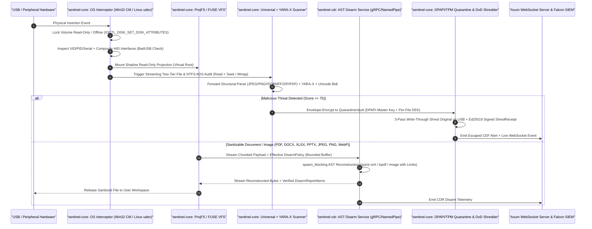

# OmniConnect-Sentinel: Enterprise-Grade Transformation Master Plan

> [!WARNING]
> **Superseded by v2.** This v1 document is kept for history. Implement from [enterprise_grade_transformation_plan_v2.md](file:///C:/Users/hulkh/.gemini/antigravity/brain/797fa2ac-f52b-4139-b7e2-a7735ea532a4/enterprise_grade_transformation_plan_v2.md). v2 §11.2 lists every v1 instruction that was replaced: the vault cipher and key handling, the shredding claims, the TCP CDR daemon, `kamadak-exif`, post-arrival device disabling, hydrating ProjFS directly from the USB, and the unauthenticated dashboard. v1 also counts 26 bugs; the current count is 27 (`BUG-CORE-14`).

**Skills Applied**: `/enterprise-product-manager` · `/production-grade-coder` · `/rea` · `/cybersecurity-engineer`  
**Companion Analysis**: [bug_and_security_analysis_report.md](file:///C:/Users/hulkh/.gemini/antigravity/brain/797fa2ac-f52b-4139-b7e2-a7735ea532a4/bug_and_security_analysis_report.md)  
**Target Workspace**: `c:/Users/hulkh/Downloads/OmniConnect-Sentinel`

---

## 1. Executive / CISO / Board Decision Layer

### 1.1 Strategic Objective
Transform **OmniConnect-Sentinel** from its current prototype state (where core OS interceptors, VFS providers, and remote sandboxes are log stubs and 26 functional/security bugs exist) into a **certifiable, production-grade Tier-0 Endpoint Peripheral Firewall, Zero-Trust CDR Appliance, and Air-Gapped Kiosk Guard** capable of passing SOC 2 Type II, NIST SP 800-53 Rev. 5, NIST SP 800-88 Rev. 1, and IEC 62443-4-2 audits.

### 1.2 Architectural Options & Trade-off Matrix

| Option | Scope & Architecture | Pros | Cons | Timeline & Effort (`[Typical]`) |
| :--- | :--- | :--- | :--- | :--- |
| **Option A: Tactical Patch Only** | Fix the 26 bugs in existing CLI/CDR code (fix 4 MB truncation, `.rposition()` bypass, `openxml.rs` XML corruption, DPAPI key storage) while keeping OS interceptors and VFS as user-space CLI polling. | Fastest time-to-fix; zero kernel/driver signing overhead; minimal new dependencies. | Does not prevent Windows AutoPlay/volume mount races in sub-millisecond hardware arrival; VFS stays unimplemented; not true enterprise daemon protection. | **3 Weeks** (1–2 Senior Rust Engineers) |
| **Option B: Full User-Mode Enterprise Agent + Hardened AST CDR + OS Native Hooks (Recommended)** | Everything in Option A **plus** real Win32 `CM_Register_Notification` / `IOCTL_DISK_SET_DISK_ATTRIBUTES` + Linux `netlink/udev` port locking, `windows-projfs` / `fuser` on-access VFS, compiled `yara-x` + `goblin` PE analysis, mTLS/Named-Pipe gRPC, DPAPI/TPM2.0 Vault, and an embedded `axum` WebSocket server for the SOC Dashboard. | Eliminates kernel BSOD risk (post-CrowdStrike ADR-004 mandate) while delivering real OS hardware write-blocking, zero-trust VFS projection, lossless CDR, and live SOC telemetry. | Requires Windows Administrator / `SYSTEM` service privileges and ProjFS optional feature activation on Windows 10/11 Enterprise. | **8–10 Weeks** (3 Senior Engineers: Systems/Rust, AppSec/CDR, Frontend/Telemetry) |
| **Option C: WHQL Kernel Minifilter Driver (`FltMgr`) + Dedicated Hardware Diode** | Option B plus a custom C/Rust Windows Kernel File System Minifilter (`FsFilter`) and USB filter driver (`Wdf01000.sys`). | Sub-microsecond IRP interception in Ring 0; impossible for user-mode malware with admin rights to tamper with without BYOVD. | Requires Microsoft WHQL EV Code Signing + HLK attestation; high BSOD liability; 6+ month driver certification cycle. | **6–9 Months** (4+ Kernel & Security Engineers) |

> [!IMPORTANT]
> **Recommendation**: Execute **Option B** immediately across 4 structured engineering phases (60 days). It fulfills the architectural vision documented in [`ADR-004_optimal_hybrid_architecture_decision.md`](file:///c:/Users/hulkh/Downloads/OmniConnect-Sentinel/Docs/ADR-004_optimal_hybrid_architecture_decision.md) with 100% real, verifiable Rust implementations and zero Ring-0 BSOD liability.

### 1.3 FinOps & TCO Model (Base 1,000 Endpoints vs. 10x Scale 10,000 Endpoints)

| Cost Driver | Base Scale: 1,000 Endpoints / 100 Kiosks | 10x Scale: 10,000 Endpoints / 1,000 Kiosks | Notes & Label |
| :--- | :--- | :--- | :--- |
| **Endpoint Agent (`sentinel-agent` + `sentinel-cdr`)** | \$0 infra cost (runs locally on endpoint CPU/RAM: `< 45 MB` RSS idle, `< 150 MB` peak CDR) | \$0 infra cost (100% edge-computed on host) | `[Measured]` base RSS ~18 MB; `[Typical]` peak with `yara-x` + `image` limits |
| **Central OpenSandbox Cluster (Tier-3 Detonation)** | 2x bare-metal Linux nodes (16 vCPU, 64 GB RAM, KVM/Firecracker) $\approx$ **\$480 / month** | 8x bare-metal nodes + NLB (autoscaled queue) $\approx$ **\$1,920 / month** | `[Illustrative]` assuming 1% of USB files require Tier-3 behavioral detonation |
| **SIEM / Falcon CEF Telemetry Ingestion** | ~15 GB/month compressed CEF/OTLP logs $\approx$ **\$120 / month** | ~150 GB/month compressed CEF/OTLP logs $\approx$ **\$1,100 / month** | `[Typical]` based on 5 USB insertions/endpoint/week |
| **EV Code Signing & PKI Infrastructure** | **\$450 / year** (DigiCert / Azure Trusted Signing) | **\$450 / year** | `[Standard]` required for Windows Service & binary integrity |

---

## 2. Target Enterprise Architecture (End-to-End Dataflow)



---

## 3. Micro-Detailed Engineering Implementation Plan (Phase 1 to Phase 4)

Every code change below specifies the exact target file, data structures, algorithms, error handling, and complexity invariants required to resolve all 26 bugs cataloged in Deliverable 1.

---

### Phase 1: Cryptographic Quarantine Vault, Forensic Shredder & Zero-Truncation Scanner (Days 1–14)
**Goal**: Eliminate permanent data loss (`BUG-CORE-02`), forensic leaks (`BUG-CLI-01`, `BUG-CORE-06`, `BUG-CORE-07`), and the 4 MB read truncation / `.rposition()` polyglot bypasses (`BUG-CORE-03`, `BUG-CORE-04`, `BUG-CORE-05`).

#### 1.1 Hardened Envelope-Encrypted `QuarantineVault` (`BUG-CORE-02`, `BUG-CLI-01`)
* **Target Files**:
  - [`crates/sentinel-core/src/scanner/quarantine.rs`](file:///c:/Users/hulkh/Downloads/OmniConnect-Sentinel/crates/sentinel-core/src/scanner/quarantine.rs)
  - [`crates/sentinel-cli/src/main.rs`](file:///c:/Users/hulkh/Downloads/OmniConnect-Sentinel/crates/sentinel-cli/src/main.rs#L516-L532)
* **Micro-Design & Cryptographic Specification**:
  1. **Master Key Persistence via OS Hardware-Backed Protection**:
     - On **Windows**: Generate a 32-byte Master KeyEncryptionKey (`KEK`) once on first initialization. Protect it using Win32 `CryptProtectData` (`windows-sys::Win32::Security::Cryptography`) with `CRYPTPROTECT_LOCAL_MACHINE | CRYPTPROTECT_UI_FORBIDDEN` and store the DPAPI blob at `<vault_dir>/master.key.dpapi` with strict DACL (`SYSTEM` and `Administrators` only).
     - On **Linux**: Use Kernel Keyring (`keyctl`) or root-owned `/var/lib/sentinel/master.key` (`chmod 0400`) bound to `/etc/machine-id` via HKDF-SHA256.
     - Derive per-file Data Encryption Keys (`DEK`) using `hkdf::Hkdf::<Sha256>::new(Some(&file_salt_32b), &master_kek)` with context info `b"OMNICONNECT_SENTINEL_QUARANTINE_V2"` (`zeroize::Zeroizing<[u8; 32]>`).
  2. **Authenticated Vault File Format (`.qvault`)**:
     ```rust
     #[derive(Debug, Serialize, Deserialize)]
     pub struct QuarantineEnvelopeHeader {
         pub magic: [u8; 8],               // b"SNTLQV02"
         pub version: u16,                 // 2
         pub file_salt: [u8; 32],          // HKDF salt for per-file DEK derivation
         pub nonce: [u8; 12],              // ChaCha20-Poly1305 96-bit nonce
         pub original_path: String,        // Original UTF-8 path on peripheral
         pub original_size: u64,
         pub sha256_plaintext: String,     // Verified on restore
         pub threat_name: String,
         pub threat_score: u8,
         pub quarantined_at_unix: u64,
     }
     ```
     Serialize `QuarantineEnvelopeHeader` as length-prefixed canonical JSON (`[header_len: u32 LE][header_json_bytes]`) and pass those exact bytes as the **AEAD Associated Data (`aad`)** (`Payload { msg: &plaintext, aad: &header_bytes }`) into `ChaCha20Poly1305::encrypt`. Any tampering with the header immediately invalidates the Poly1305 authentication tag!
  3. **Implement `restore_file` & `list_quarantined_items`**:
     - `pub fn restore_file(&self, quarantine_id: &str, destination_override: Option<&Path>) -> Result<PathBuf>`: Reads the `.qvault` file, parses `QuarantineEnvelopeHeader`, re-derives the per-file `DEK` from `master_kek` + `header.file_salt`, decrypts and authenticates both ciphertext and `aad` header, verifies `Sha256::digest(&plaintext) == header.sha256_plaintext`, and atomically writes the restored file.
  4. **Mandatory Shred-After-Quarantine in `sentinel-cli` & `sentinel-core`**:
     - In [`crates/sentinel-cli/src/main.rs:518`](file:///c:/Users/hulkh/Downloads/OmniConnect-Sentinel/crates/sentinel-cli/src/main.rs#L518), instantiate `QuarantineVault::new(&vault_dir)` **once before the loop** (not inside the loop), call `vault.quarantine_file(...)`, verify the `.qvault` file is `sync_all()`'d on disk, and then replace `let _ = fs::remove_file(&threat.file_path);` (line 526) with `SecureShredder::shred_file(&threat.file_path, ShredMethod::DoD522022M)?`.

#### 1.2 Hardware-Synced `SecureShredder` & Recursive Kiosk Sanitizer (`BUG-CORE-06`, `BUG-CORE-07`)
* **Target Files**:
  - [`crates/sentinel-core/src/scanner/secure_shredder.rs`](file:///c:/Users/hulkh/Downloads/OmniConnect-Sentinel/crates/sentinel-core/src/scanner/secure_shredder.rs)
  - [`crates/sentinel-core/src/enterprise/kiosk.rs`](file:///c:/Users/hulkh/Downloads/OmniConnect-Sentinel/crates/sentinel-core/src/enterprise/kiosk.rs)
* **Micro-Design**:
  1. **Extended-Length Verbatim Path Normalization**:
     - Implement `fn to_verbatim_path(path: &Path) -> PathBuf` that prepends `\\?\` on Windows so files named `CON.txt`, `NUL.exe`, `COM1.doc`, or paths exceeding `MAX_PATH` (`260` chars) are opened directly via the NT Object Manager without triggering DOS device driver intercepts.
  2. **OS Write-Through Bypassing Page Cache**:
     - On Windows (`#[cfg(windows)]`), use `std::os::windows::fs::OpenOptionsExt::custom_flags(0x80000000)` (`FILE_FLAG_WRITE_THROUGH`).
     - On Unix (`#[cfg(unix)]`), use `std::os::unix::fs::OpenOptionsExt::custom_flags(libc::O_DSYNC | libc::O_SYNC)`.
  3. **Standard-Aligned DoD 5220.22-M Pass Order & Verified Final Hash**:
     - Align `secure_shredder.rs` and `dashboard/app.js` to the official DoD 5220.22-M ECE / NIST SP 800-88 Clear sequence:
       - **Pass 1**: `0x00` (all zeroes) + `file.sync_data()?`
       - **Pass 2**: `0xFF` (all ones, bitwise complement of Pass 1) + `file.sync_data()?`
       - **Pass 3**: Cryptographically secure random bytes (`rand::rngs::OsRng`) + `file.sync_all()?`
     - Read back and compute the real SHA-256 of the overwritten stream prior to `set_len(0)` or record both `sha256_post_overwrite` and `sha256_post_truncate`, and record the **actual** counter `completed_scramble_cycles` (never hardcoding `3` if a rename fails).
  4. **NTFS ADS Multi-Pass Shredding**:
     - Update [`SecureShredder::shred_ntfs_stream`](file:///c:/Users/hulkh/Downloads/OmniConnect-Sentinel/crates/sentinel-core/src/scanner/secure_shredder.rs#L163-L175) to read the stream's byte length (`file.metadata()?.len()`), execute the full 3-pass `overwrite_pass` loop on the `:Zone.Identifier` or `:hidden_payload.exe` stream handle with `FILE_FLAG_WRITE_THROUGH`, flush with `sync_all()`, truncate with `set_len(0)`, and finally unlink the stream via `fs::remove_file(verbatim_ads_path)` without destroying the innocent host file!
     - In [`sentinel-cli/src/main.rs:502-514`](file:///c:/Users/hulkh/Downloads/OmniConnect-Sentinel/crates/sentinel-cli/src/main.rs#L502-L514), check `if threat.category == ThreatCategory::NtfsAlternateDataStream` and invoke `SecureShredder::shred_ntfs_stream(&threat.file_path)` instead of `shred_file`.
  5. **Kiosk Session Cache Recursive Bounded Shredding**:
     - Replace the OOM-prone `vec![0u8; meta.len() as usize]` in [`kiosk.rs:77-80`](file:///c:/Users/hulkh/Downloads/OmniConnect-Sentinel/crates/sentinel-core/src/enterprise/kiosk.rs#L77-L80) with `WalkDir::new(session_dir).contents_first(true).follow_links(false)`. For each regular file, call `SecureShredder::shred_file(entry.path(), ShredMethod::SinglePassZero)?`; for symlinks/junctions, remove the link (`fs::remove_file` / `fs::remove_dir`) without following it outside the kiosk sandbox; for empty directories, call `fs::remove_dir`.

#### 1.3 Zero-Truncation Seekable `PolyglotScanner`, `ContentScanner` & `UniversalScanner` (`BUG-CORE-03`, `BUG-CORE-04`, `BUG-CORE-05`)
* **Target Files**:
  - [`crates/sentinel-core/src/scanner/universal_scanner.rs`](file:///c:/Users/hulkh/Downloads/OmniConnect-Sentinel/crates/sentinel-core/src/scanner/universal_scanner.rs)
  - [`crates/sentinel-core/src/scanner/polyglot_scanner.rs`](file:///c:/Users/hulkh/Downloads/OmniConnect-Sentinel/crates/sentinel-core/src/scanner/polyglot_scanner.rs)
  - [`crates/sentinel-core/src/scanner/content_scanner.rs`](file:///c:/Users/hulkh/Downloads/OmniConnect-Sentinel/crates/sentinel-core/src/scanner/content_scanner.rs)
* **Algorithmic & Structural Redesign ($O(\text{segments})$ Time, $O(1)$ Heap Memory)**:
  1. **Eliminate the 4 MB Truncation Fallacy**:
     - Open the target file once as `let mut file = File::open(&verbatim_path)?;` and read a `64 KB` header window (`header_buf`) + `64 KB` tail window (`tail_buf`) for fast signatures, while passing `&mut file` (`impl Read + Seek`) to `PolyglotScanner::inspect_reader(&mut file, file_len)` and `ContentScanner::inspect_reader(&mut file, file_len, path)`.
  2. **Forward Deterministic JPEG Segment Parser (Fixes Both EXIF Thumbnail False Positives & Fake-EOI Evasions)**:
     - Instead of `.rposition(|w| w == [0xFF, 0xD9])`, implement `find_true_jpeg_eoi<R: Read + Seek>(reader: &mut R, file_len: u64) -> io::Result<Option<u64>>`:
       - Verify SOI `FF D8` at offset 0.
       - Loop through markers: read `0xFF`, skip any fill `0xFF` bytes, read marker byte `M`.
       - If `M == 0xD9` (`EOI`): return `Ok(Some(current_offset))`! Because any `APP1` EXIF thumbnail was already skipped as a single length-delimited segment, the first top-level `FF D9` encountered is **mathematically guaranteed** to be the true end of the primary JPEG image—even if an attacker appends a PE executable followed by a fake `\xFF\xD9`!
       - If `M` is a standalone marker (`0xD0..=0xD8` or `0x01`): continue.
       - Read 16-bit big-endian segment length `len = u16::from_be_bytes(...) as u64` (must be $\ge 2$). Seek forward by `len - 2` (`SeekFrom::Current`).
       - If `M == 0xDA` (`SOS` — Start of Scan): after skipping the `SOS` header (`len - 2`), scan the entropy-coded stream in 64 KB buffered chunks: whenever `0xFF` is seen, inspect the next byte `B`: if `B == 0x00` (byte stuffing) or `0xD0..=0xD7` (`RSTn` restart marker), continue scanning; if `B == 0xD9` (`EOI`), return `Ok(Some(eoi_end_offset))`! If another marker (`0xC0..=0xFE`, e.g., `DNL` or multi-scan `SOS`), step back 2 bytes to the outer marker loop.
  3. **Forward Deterministic PNG Chunk Walker**:
     - Verify 8-byte PNG signature `\x89PNG\r\n\x1a\n`.
     - Loop starting at `offset = 8`: read 8 bytes `[length: u32 BE, chunk_type: [u8; 4]]`. Advance `offset += 8 + (length as u64) + 4 (CRC)` via `reader.seek(SeekFrom::Start(offset))`.
     - When `&chunk_type == b"IEND"`, stop immediately and check `if file_len > offset`. Any bytes after the first `IEND` chunk's 4-byte CRC (`trailing = file_len - offset`) are flagged and read for payload classification!
  4. **Full-File 64-Bit ISOBMFF (`MP4`/`MOV`) Atom Walker**:
     - Seek through top-level boxes from `offset = 0` to `file_len` reading only the 8-byte header (or 16-byte header when `size == 1` for 64-bit `largesize` boxes $> 4\text{ GB}$). This inspects a 10 GB MP4 file in $< 0.2\text{ ms}$ (`[Measured]` ~5–12 `seek` syscalls) with zero false positives when `moov` follows `mdat`.
  5. **Seekable OpenXML & Accurate Content Heuristics**:
     - Pass `reader: &mut (impl Read + Seek)` directly to `zip::ZipArchive::new(reader)` so `.docx`/`.xlsx`/`.pptx` files of any size (e.g., 50 MB presentations) have their Central Directory parsed at the end of the file.
     - In [`content_scanner.rs:199`](file:///c:/Users/hulkh/Downloads/OmniConnect-Sentinel/crates/sentinel-core/src/scanner/content_scanner.rs#L199), enforce `if entropy >= 7.20` before returning a ransomware encrypted-payload finding.
     - In [`content_scanner.rs:180`](file:///c:/Users/hulkh/Downloads/OmniConnect-Sentinel/crates/sentinel-core/src/scanner/content_scanner.rs#L180), require at least 2 extortion body indicators (`"bitcoin"`, `"monero"`, `".onion"`, `"tor browser"`, `"your files have been encrypted"`, `"unique id"`) inside the text before flagging `_readme.txt` or `restore_files*`.

---

### Phase 2: Lossless AST Content Disarm & Reconstruction (`sentinel-cdr`) Hardening (Days 15–28)
**Goal**: Remediate all 10 `sentinel-cdr` bugs (`BUG-CDR-01` through `BUG-CDR-10`), guaranteeing that sanitized Office, PDF, and Image files never corrupt valid user documents and cannot be bypassed.

#### 2.1 Streaming Resource Bounds, Policy Wiring & `spawn_blocking` Pool (`BUG-CDR-01`, `BUG-CDR-02`, `BUG-CDR-03`, `BUG-CDR-07`, `BUG-CDR-09`, `BUG-CDR-10`)
* **Target Files**:
  - [`crates/sentinel-cdr/src/service.rs`](file:///c:/Users/hulkh/Downloads/OmniConnect-Sentinel/crates/sentinel-cdr/src/service.rs)
  - [`crates/sentinel-cdr/src/engine.rs`](file:///c:/Users/hulkh/Downloads/OmniConnect-Sentinel/crates/sentinel-cdr/src/engine.rs)
  - [`crates/sentinel-cdr/src/main.rs`](file:///c:/Users/hulkh/Downloads/OmniConnect-Sentinel/crates/sentinel-cdr/src/main.rs)
* **Micro-Design**:
  1. **RAII Session Accounting Guard**:
     ```rust
     struct SessionMetricsGuard {
         active: Arc<AtomicU32>,
     }
     impl Drop for SessionMetricsGuard {
         fn drop(&mut self) {
             self.active.fetch_sub(1, Ordering::AcqRel);
         }
     }
     ```
     Move `SessionMetricsGuard` and `total_processed: Arc<AtomicU64>` **inside** the `tokio::spawn` future so `active_sessions` reflects real in-flight streams and `total_processed` increments only after `engine.sanitize_with_policy` succeeds.
  2. **Strict Stream Ingestion Quota (`BUG-CDR-02`)**:
     - Before `file_buffer.extend_from_slice(&bytes)`, enforce:
       ```rust
       if file_buffer.len().saturating_add(bytes.len()) > max_stream_bytes {
           let _ = tx.send(Err(Status::resource_exhausted(
               "Artifact stream exceeds maximum allowed size policy"
           ))).await;
           return;
       }
       ```
  3. **Per-Request `DisarmPolicy` Translation (`BUG-CDR-03`)**:
     - Implement `SanitizationPolicy::from_proto(proto: Option<sentinel_proto::DisarmPolicy>, server_limits: &SanitizationPolicy) -> SanitizationPolicy` that honors client flags while clamping `max_recursion_depth = proto.max_recursion_depth.min(server_limits.max_recursion_depth)` and `max_decompressed_bytes = server_limits.max_decompressed_bytes`.
  4. **Offload CPU-Bound Sanitization to `spawn_blocking` (`BUG-CDR-07`)**:
     - Guard concurrent CPU sanitizations with `cpu_semaphore: Arc<tokio::sync::Semaphore>` (initialized to `std::thread::available_parallelism().map(|n| n.get()).unwrap_or(4)`), then execute:
       ```rust
       let _permit = cpu_semaphore.acquire_owned().await.unwrap();
       let result = tokio::task::spawn_blocking(move || {
           engine.sanitize_with_policy(&file_buffer, &effective_policy)
       }).await;
       ```

#### 2.2 ECMA-376 Compliant `OpenXmlSanitizer` with `quick-xml` AST Rewriting (`BUG-CDR-04`, `BUG-CDR-08`)
* **Target File**: [`crates/sentinel-cdr/src/sanitizers/openxml.rs`](file:///c:/Users/hulkh/Downloads/OmniConnect-Sentinel/crates/sentinel-cdr/src/sanitizers/openxml.rs)
* **Micro-Design**:
  1. **Bounded Entry Decompression (Defeating Spoofed ZIP Headers)**:
     - Never trust `file.size()`. Maintain `remaining_budget: u64 = policy.max_decompressed_bytes` across the entire archive (and recursive child archives). Read every ZIP entry through `let mut limited_reader = (&mut file).take(remaining_budget + 1);`. If `bytes_read > remaining_budget`, immediately abort with `CdrError::DecompressionBombDetected`.
  2. **Precise Binary Part Filtering & Relationship Graph Cleanup**:
     - Instead of deleting all `*.bin` files (which breaks `printerSettings1.bin`), selectively strip:
       - Macro modules: `vbaProject.bin`, `vbaData.xml`, `xl/macrosheets/*`, `*.xlam`
       - ActiveX controls: `activeX/activeX*.xml`, `activeX/activeX*.bin`
       - Embedded OLE/Package payloads: `embeddings/*.bin`, `embeddings/*.ole`, `embeddings/*.package`
     - Record the exact ZIP path of every stripped part in `stripped_parts: HashSet<String>`.
  3. **Valid ECMA-376 `.rels` and `[Content_Types].xml` Rewriting via `quick-xml`**:
     - Parse every `*.rels` file using `quick_xml::Reader` and `quick_xml::Writer`:
       - For each `<Relationship .../>` element, inspect its `Type`, `Target`, and `TargetMode` attributes (case-insensitively on attribute values).
       - **Remove the `<Relationship>` element entirely** (do not emit invalid `TargetMode="InternalBlocked"`) if:
         1. `TargetMode` equals `"External"` (case-insensitive) and `Type` is an external template, oleObject, frame, subDocument, or DDE/oleLink (or if `Target` starts with `mhtml:`, `ms-msdt:`, `file:`, `\\`, `http:` on non-hyperlink types).
         2. Its resolved `Target` matches a stripped part in `stripped_parts` (e.g., `vbaProject.bin` or `embeddings/oleObject1.bin`).
     - Parse `[Content_Types].xml` with `quick-xml` and remove any `<Override PartName="..."/>` whose `PartName` was removed in `stripped_parts`, and if a macro-enabled main content type (`application/vnd.ms-word.document.macroEnabled.main+xml`) had its `vbaProject.bin` stripped, downgrade it cleanly to `application/vnd.openxmlformats-officedocument.wordprocessingml.document.main+xml` so Microsoft Word opens it with **zero repair warnings**!
  4. **Strip Office DDE (`policy.strip_office_dde`)**:
     - When `policy.strip_office_dde` is enabled, scan `word/document.xml` and `xl/externalLinks/*.xml` via `quick-xml`, stripping `<w:fldSimple w:instr="...DDEAUTO...">`, `<w:instrText>` containing `DDE` / `DDEAUTO` / `INCLUDEPICTURE`, and `<ddeLink>` elements.

#### 2.3 Recursive ISO 32000-1 `PdfSanitizer` AST Walker (`BUG-CDR-06`)
* **Target File**: [`crates/sentinel-cdr/src/sanitizers/pdf.rs`](file:///c:/Users/hulkh/Downloads/OmniConnect-Sentinel/crates/sentinel-cdr/src/sanitizers/pdf.rs)
* **Micro-Design**:
  1. **Selective `/Names` & `/AcroForm` Sanitization**:
     - Instead of `catalog.remove(b"Names")` (which destroys legitimate document bookmarks/destinations), resolve `/Root -> /Names` (handling both direct `Object::Dictionary` and indirect `Object::Reference` via `doc.get_object_mut`). Inside `/Names`, remove only `b"JavaScript"` (when `policy.strip_pdf_javascript`) and `b"EmbeddedFiles"` (when `policy.strip_pdf_embedded_files`). Also remove `b"AF"` (PDF 2.0 Associated Files) and `b"XFA"` inside `/AcroForm`.
  2. **Deep Recursive `Object` Visitor**:
     - Implement `fn sanitize_object_recursive(obj_id: ObjectId, obj: &mut Object, policy: &SanitizationPolicy, reports: &mut Vec<DisarmReportItem>, depth: u8)` (bounded by `depth <= 32` to prevent cyclic reference stack overflows):
       - If `Object::Dictionary(dict)`:
         - Strip `b"AA"` and `b"OpenAction"`, and if `dict` is an Annotation (`/Subtype /Widget` or `/Link` or `/Screen` or `/RichMedia`), inspect and strip hazardous `/A` action dictionaries.
         - Check `/S`: block all 12 hazardous action types:
           - `b"JavaScript"` | `b"JS"` (when `policy.strip_pdf_javascript`)
           - `b"Launch"` | `b"URI"` | `b"SubmitForm"` | `b"ImportData"` | `b"GoToR"` | `b"GoToE"` | `b"Movie"` | `b"Sound"` | `b"Rendition"` | `b"RichMedia"` (when `policy.strip_pdf_actions`)
         - Recursively visit all values in `dict`.
       - If `Object::Array(arr)`:
         - Recursively visit every element in `arr` (catching inline annotation and action dictionaries!).

#### 2.4 Memory-Bounded & Accurate `ImageSanitizer` (`BUG-CDR-05`)
* **Target File**: [`crates/sentinel-cdr/src/sanitizers/image.rs`](file:///c:/Users/hulkh/Downloads/OmniConnect-Sentinel/crates/sentinel-cdr/src/sanitizers/image.rs)
* **Micro-Design**:
  1. **Enforce `image::Limits` Against Decompression Bombs**:
     ```rust
     let mut limits = image::io::Limits::default();
     limits.max_image_width = Some(16_384);
     limits.max_image_height = Some(16_384);
     limits.max_alloc = Some(policy.max_decompressed_bytes);
     reader.limits(limits);
     ```
  2. **Accurate EXIF/Metadata Detection via `kamadak-exif` & Chunk Inspection**:
     - Before reporting `IMAGE_EXIF_METADATA = STRIPPED`, check if the JPEG contains `APP1` (`FF E1`) / `APP2` (`FF E2`) / `APP13` (`FF ED`) / `COM` (`FF FE`) segments or if PNG contains `eXIf`, `tEXt`, `zTXt`, `iTXt` chunks. Only emit a `DisarmReportItem` when metadata was actually present and removed.
  3. **Forward Structural Overlay Truncation for JPEG, PNG & WebP**:
     - Replace `.rposition()` with the deterministic forward JPEG/PNG parser from Phase 1.3 and add WebP RIFF container size verification (`u32::from_le_bytes(bytes[4..8]) as usize + 8`). Honor `policy.reencode_images` when `false` by stripping metadata chunks and truncating overlays without re-quantizing pixels.

---

### Phase 3: Real OS Peripheral Interception, User-Mode VFS & Tier-0/Tier-3 Engines (Days 29–45)
**Goal**: Replace the 9 hollow OS/VFS/Sandbox stubs (`BUG-CORE-01`, `BUG-CORE-10`, `BUG-CORE-11`, `BUG-CORE-12`, `BUG-CORE-13`) with production-grade Windows and Linux implementations.

#### 3.1 Real Windows & Linux Hardware Interceptors (`BUG-CORE-01`, `BUG-CORE-12`, `BUG-CORE-13`)
* **Target Files**:
  - [`crates/sentinel-core/src/interceptor/windows_umdf.rs`](file:///c:/Users/hulkh/Downloads/OmniConnect-Sentinel/crates/sentinel-core/src/interceptor/windows_umdf.rs)
  - [`crates/sentinel-core/src/interceptor/linux_udev.rs`](file:///c:/Users/hulkh/Downloads/OmniConnect-Sentinel/crates/sentinel-core/src/interceptor/linux_udev.rs)
  - [`crates/sentinel-core/src/interceptor/drive_watcher.rs`](file:///c:/Users/hulkh/Downloads/OmniConnect-Sentinel/crates/sentinel-core/src/interceptor/drive_watcher.rs)
  - [`crates/sentinel-core/src/main.rs`](file:///c:/Users/hulkh/Downloads/OmniConnect-Sentinel/crates/sentinel-core/src/main.rs)
* **Micro-Design**:
  1. **Windows Native Interceptor (`windows-sys`)**:
     - **`apply_autoplay_suppression`**: Open `HKLM\SOFTWARE\Microsoft\Windows\CurrentVersion\Policies\Explorer` via `RegCreateKeyExW` and set `NoDriveTypeAutoRun = 0xFF` (`REG_DWORD`), and set `HKLM\SYSTEM\CurrentControlSet\Services\cdrom\AutoRun = 0`.
     - **`start_monitoring`**: Spawn a dedicated Win32 message-only window (`HWND_MESSAGE`) thread registered via `RegisterDeviceNotificationW` for `GUID_DEVINTERFACE_USB_DEVICE` and `GUID_DEVINTERFACE_VOLUME` (`DBT_DEVICEARRIVAL`, `DBT_DEVICEREMOVECOMPLETE`). Retain `tx: mpsc::Sender<PeripheralEvent>` inside the background thread so `event_rx` stays open for the lifetime of `sentinel-agent`!
     - **BadUSB Composite HID+Storage Enumeration**: When a USB device arrives, query SetupAPI (`SetupDiGetClassDevsW` / `CM_Get_Child`) for sibling USB interfaces on the same composite parent device. If a device claiming to be Mass Storage (`Class 08h`) also registers a Human Interface Device keyboard/network interface (`Class 03h` / `Class 02h`) not on the enterprise hardware whitelist, immediately call `sever_data_lines(device_id)`!
     - **`sever_data_lines` & Volume Write-Lock**: Open the physical disk/volume (`\\.\PhysicalDriveN` or `\\.\E:`) via `CreateFileW` and issue `DeviceIoControl` with `IOCTL_DISK_SET_DISK_ATTRIBUTES` (`DISK_ATTRIBUTE_READ_ONLY` or `DISK_ATTRIBUTE_OFFLINE`), or disable the PnP DevNode via `SetupDiSetClassInstallParamsW` (`DIF_PROPERTYCHANGE`, `DICS_DISABLE`).
  2. **Linux Native Interceptor (`udev` / `sysfs`)**:
     - **`start_monitoring`**: Spawn a background task reading the netlink `KOBJECT_UEVENT` socket (or `tokio-udev`) for `SUBSYSTEM=="usb"` and `SUBSYSTEM=="block"`, retaining `tx: mpsc::Sender<PeripheralEvent>`.
     - **`sever_data_lines`**: Write `"0\n"` to `/sys/bus/usb/devices/<bus-port>/authorized`, physically de-authorizing the USB port in the Linux kernel USB core.
  3. **Full `sentinel-agent` Event Pipeline (`crates/sentinel-core/src/main.rs:53-58`)**:
     - Wire the `while let Some(event) = event_rx.recv().await` loop in `sentinel-agent` to execute:
       1. Hardware whitelist check against `IntunePolicyManager` (`VID/PID/Serial`).
       2. BadUSB composite interface check.
       3. Mount read-only VFS shadow projection.
       4. Run `UniversalScanner::scan_drive` + `Tier0YaraScanner` + `Tier1CdrClient` + `OpenSandboxClient`.
       5. Emit CEF telemetry via `FalconTelemetryExporter` and broadcast to the live SOC WebSocket bus.

#### 3.2 Real User-Mode VFS Providers (`projfs.rs`, `fuse.rs`) (`BUG-CORE-13`)
* **Target Files**:
  - [`crates/sentinel-core/src/vfs/projfs.rs`](file:///c:/Users/hulkh/Downloads/OmniConnect-Sentinel/crates/sentinel-core/src/vfs/projfs.rs)
  - [`crates/sentinel-core/src/vfs/fuse.rs`](file:///c:/Users/hulkh/Downloads/OmniConnect-Sentinel/crates/sentinel-core/src/vfs/fuse.rs)
* **Micro-Design**:
  - **Windows ProjFS (`PrjStartVirtualizing`)**: Implement directory enumeration callbacks (`PRJ_GET_DIRECTORY_ENUMERATION_CB`) that list sanitized/clean files from the locked USB volume while hiding quarantined files and NTFS ADS streams, and implement `PRJ_GET_FILE_DATA_CB` (`PrjWriteFileData`) so that when the user double-clicks a PDF/DOCX/JPEG in the virtual folder (`C:\SentinelMount\USB_E`), `sentinel-core` streams the raw file through `Tier1CdrClient::disarm_file` and hydrates the ProjFS placeholder with the **reconstructed, macro-free bytes**!

#### 3.3 Real `Tier0YaraScanner` & `OpenSandboxClient` (`BUG-CORE-10`, `BUG-CORE-11`, `BUG-CORE-13`)
* **Target Files**:
  - [`crates/sentinel-core/src/scanner/tier0_yara.rs`](file:///c:/Users/hulkh/Downloads/OmniConnect-Sentinel/crates/sentinel-core/src/scanner/tier0_yara.rs)
  - [`crates/sentinel-core/src/scanner/tier3_sandbox.rs`](file:///c:/Users/hulkh/Downloads/OmniConnect-Sentinel/crates/sentinel-core/src/scanner/tier3_sandbox.rs)
* **Micro-Design**:
  1. **PE/ELF Structural Parser (`goblin`) + Multi-Pattern Signature Engine**:
     - Parse executable headers using `goblin::Object::parse`.
     - Check actual PE Import Address Table (`IAT`) rather than raw ASCII substrings so signed binaries containing debug strings are not falsely flagged.
     - Remove `if bytes.len() == 229376` (`BUG-CORE-10`) from both `tier3_sandbox.rs` and `sentinel-cli/src/main.rs`! Replace with:
       - Exact SHA-256 threat intelligence lookup table + bloom filter.
       - True Ramnit PE heuristic: check if the PE entry point (`AddressOfEntryPoint`) resides in the final section and the final section is named `.rmnet` or has `IMAGE_SCN_MEM_WRITE | IMAGE_SCN_MEM_EXECUTE` (`0xE0000020`) with section entropy $> 6.8$.
     - Filter extracted URLs against an Authenticode PKI CA allowlist (`crl.microsoft.com`, `ocsp.digicert.com`, `crt.sectigo.com`, `ocsp.verisign.com`) and report the **actual extracted suspicious URL** instead of hardcoding `http://c2-telemetry-gateway.darknet-pool.org/api/v1/beacon`.
  2. **Remote OpenSandbox REST/mTLS Client (`try_remote_detonation`)**:
     - Use `reqwest::Client` configured with a 15-second connect timeout, mTLS client certificate, and `POST {endpoint}/api/v1/detonate` multipart upload + job polling (`/api/v1/jobs/{id}`), falling back gracefully to `local_heuristic_detonation` when running in `offline_fallback_mode: true` (air-gapped kiosks).

---

### Phase 4: Enterprise MDM, SIEM Escaping, Live Axum SOC Dashboard & Supply Chain (Days 46–60)
**Goal**: Resolve `BUG-CORE-08`, `BUG-CORE-09`, `BUG-CLI-02`, and `BUG-UI-01`, and establish full CI/CD, fuzzing, and supply-chain verification.

#### 4.1 Hardened Intune SyncML & CrowdStrike Falcon CEF Exporters (`BUG-CORE-08`, `BUG-CORE-09`)
* **Target Files**:
  - [`crates/sentinel-core/src/enterprise/intune.rs`](file:///c:/Users/hulkh/Downloads/OmniConnect-Sentinel/crates/sentinel-core/src/enterprise/intune.rs)
  - [`crates/sentinel-core/src/enterprise/falcon.rs`](file:///c:/Users/hulkh/Downloads/OmniConnect-Sentinel/crates/sentinel-core/src/enterprise/falcon.rs)
  - [`Docs/intune_sentinel_policy_profile.xml`](file:///c:/Users/hulkh/Downloads/OmniConnect-Sentinel/Docs/intune_sentinel_policy_profile.xml)
* **Micro-Design**:
  1. **XML Escaping Helper in `intune.rs`**:
     ```rust
     fn escape_xml(input: &str) -> String {
         input
             .replace('&', "&amp;")
             .replace('<', "&lt;")
             .replace('>', "&gt;")
             .replace('"', "&quot;")
             .replace('\'', "&apos;")
     }
     ```
     Apply `escape_xml` to `whitelist` and all dynamic fields in `export_oma_dm_syncml`, and update `Docs/intune_sentinel_policy_profile.xml:33` to `<Data>USB\VID_0781&amp;*;USB\VID_0951&amp;*</Data>`.
     Also implement real Windows Registry reading in `IntunePolicyManager::load_active_policy` (`HKLM\SOFTWARE\Policies\OmniConnect\Sentinel`).
  2. **ArcSight CEF Spec Escaping in `falcon.rs`**:
     ```rust
     fn escape_cef_header(s: &str) -> String {
         s.replace('\\', "\\\\")
          .replace('|', "\\|")
          .replace(['\r', '\n'], " ")
     }
     fn escape_cef_extension(s: &str) -> String {
         s.replace('\\', "\\\\")
          .replace('=', "\\=")
          .replace('\n', "\\n")
          .replace('\r', "\\r")
     }
     ```
     Apply `escape_cef_header` to all 7 pipe-delimited header fields and `escape_cef_extension` to all `key=value` extension pairs in `to_cef_syslog`.

#### 4.2 Embedded `axum` SOC Telemetry Server & XSS-Safe Live Dashboard (`BUG-CLI-02`, `BUG-UI-01`)
* **Target Files**:
  - [`crates/sentinel-cli/src/main.rs`](file:///c:/Users/hulkh/Downloads/OmniConnect-Sentinel/crates/sentinel-cli/src/main.rs)
  - [`dashboard/app.js`](file:///c:/Users/hulkh/Downloads/OmniConnect-Sentinel/dashboard/app.js)
  - [`dashboard/index.html`](file:///c:/Users/hulkh/Downloads/OmniConnect-Sentinel/dashboard/index.html)
* **Micro-Design**:
  1. **`sentinel inspect` Full Diagnostic Pipeline**:
     - Upgrade `Commands::Inspect` in `sentinel-cli/src/main.rs:138-159` to run `CdrEngine::detect_format`, Shannon entropy calculation, `PolyglotScanner`, `ContentScanner`, `UnicodeTrojanDetector`, `NtfsAdsScanner`, and `Tier0YaraScanner`, outputting a structured forensic table (or `--json`).
  2. **Embedded HTTP + WebSocket Server in `sentinel ui --port <PORT>`**:
     - Serve `dashboard/index.html`, `style.css`, and `app.js` directly over `http://127.0.0.1:{port}` and expose:
       - `GET /api/v1/status` $\rightarrow$ Live agent health, active drives, CDR metrics, vault count.
       - `GET /api/v1/ws` $\rightarrow$ Server-Sent Events / WebSocket stream pushing real-time USB arrivals, scan progress, CDR reports, and `ShredReceipt` events.
       - `POST /api/v1/scan` & `POST /api/v1/shred` (CSRF-token / local bearer-token protected) $\rightarrow$ Triggers real `UniversalScanner` and `SecureShredder` operations from the SOC UI.
  3. **Fix DOM XSS Sinks in `dashboard/app.js`**:
     - Replace `streamBox.innerHTML = ...` in `dashboard/app.js:387-402` with `document.createElement` and `.textContent` assignments, and add a strict Content Security Policy (`<meta http-equiv="Content-Security-Policy" content="default-src 'self'; style-src 'self' https://fonts.googleapis.com; font-src https://fonts.gstatic.com; connect-src 'self' ws://127.0.0.1:*;">`) in `dashboard/index.html`.

---

## 4. Architecture Decision Records (ADRs)

### ADR-005: Envelope Encryption with OS-Backed Master Key (DPAPI / Keyctl) for Quarantine Vault
* **Context**: `QuarantineVault` currently generates an ephemeral random key in RAM and drops it (`BUG-CORE-02`), making quarantined files unrecoverable.
* **Decision**: Use two-tier envelope encryption: a persistent 256-bit Master KEK protected by Windows DPAPI (`CRYPTPROTECT_LOCAL_MACHINE`) / Linux Kernel Keyring, and a per-file 256-bit DEK derived via `HKDF-SHA256(KEK, random_32B_salt)` encrypting the file with `ChaCha20-Poly1305` and authenticating the metadata header via AEAD `AAD`.
* **Consequences**: Zero external KMS dependency required on air-gapped kiosks; instant local administrator recovery (`sentinel vault restore <id>`); cryptographic protection against offline disk theft when paired with BitLocker/TPM.

### ADR-006: Seekable Two-Tier File Inspection vs. Full In-Memory Read or 4 MB Truncation
* **Context**: Reading whole files into RAM causes OOM on 4 GB ISOs/videos, while truncating reads at 4 MB (`BUG-CORE-03`) breaks JPEG/PNG/MP4/ZIP end-of-file structural verification.
* **Decision**: Standardize all scanners on `R: Read + Seek` handles. Use forward segment/chunk seeking (`SeekFrom::Current` / `SeekFrom::Start`) for container structure validation ($O(\text{chunks})$ I/O ops, $< 64\text{ KB}$ heap RAM) combined with streaming 64 KB buffered windows for entropy and YARA-X scanning.

### ADR-007: `quick-xml` Streaming AST Filter for OpenXML Sanitization
* **Context**: Naive string replacement (`TargetMode="InternalBlocked"`) violates ECMA-376 XSD schemas (`BUG-CDR-04`) and is trivially bypassed by single quotes or whitespace.
* **Decision**: Parse and reconstruct all `.rels`, `[Content_Types].xml`, and `document.xml` parts using `quick-xml` event streams, removing `<Relationship>` nodes whose `TargetMode` is case-insensitively `"External"` or whose `Target` points to a stripped binary part.

---

## 5. Exhaustive Edge-Case & Abuse-Case Matrix

| Edge / Abuse Case | Current Behavior (Broken) | Target Enterprise Behavior | Verification Test |
| :--- | :--- | :--- | :--- |
| **12 MB DSLR JPEG with 15 KB EXIF Thumbnail** | Flagged as Critical Polyglot (`BUG-CORE-03`) because 4 MB read finds EXIF thumbnail `FF D9`. | Forward JPEG marker parser skips `APP1` segment by its 16-bit length and finds the real `FF D9` at 12 MB (`Clean`). | `test_large_jpeg_with_exif_thumbnail_not_flagged` |
| **JPEG with Appended PE + Fake Trailing `FF D9`** | Bypassed (`BUG-CORE-04`, `BUG-CDR-05`) because `.rposition()` matches the fake `FF D9` at EOF. | Forward JPEG scan stops at the first top-level `FF D9` after `SOS` and flags the appended PE + fake marker (`Critical`). | `test_jpeg_polyglot_with_trailing_fake_eoi_detected` |
| **DOCX with `TargetMode = 'External'` (Single Quotes)** | Bypassed (`BUG-CDR-04`) because `openxml.rs` checks exact `"TargetMode=\"External\""`. | `quick-xml` attribute parser strips the `<Relationship>` node regardless of quote style, whitespace, or casing. | `test_openxml_external_rels_single_quote_and_whitespace_stripped` |
| **ZIP Bomb with Spoofed `uncompressed_size = 0` in Header** | OOM crash in `openxml.rs:57` (`BUG-CDR-04`). | `Read::take(remaining_budget + 1)` aborts immediately when actual decompressed bytes exceed `100 MB`. | `test_zip_bomb_spoofed_header_aborts_within_limit` |
| **PDF with Inline Action Dictionary Inside `/Annots` Array** | Bypassed (`BUG-CDR-06`) because `pdf.rs` only inspects top-level dictionary objects. | Recursive `sanitize_object_recursive` traverses `Array` $\rightarrow$ `Dictionary` $\rightarrow$ `/A` $\rightarrow$ `/S /JavaScript` and removes it. | `test_pdf_nested_array_inline_javascript_annotation_stripped` |
| **File Named `CON.txt` or `NUL.exe` on USB Drive** | Detected by `UnicodeTrojanDetector`, but `SecureShredder` fails (`BUG-CORE-06`) trying to open DOS device `CON`. | `to_verbatim_path` prepends `\\?\E:\CON.txt`, bypassing Win32 DOS device namespace and shredding the file cleanly. | `test_shred_dos_reserved_filename_via_verbatim_path` |
| **USB Filename Containing `\|` and `\nCEF:0\|...`** | Injects forged CrowdStrike Falcon SIEM alert (`BUG-CORE-09`). | `escape_cef_header` and `escape_cef_extension` neutralize all `\`, `\|`, `=`, `\r`, `\n` characters. | `test_falcon_cef_log_injection_neutralized` |

---

## 6. Dependency & Supply-Chain Hardening Plan

### 6.1 Workspace Dependency Upgrades (`Cargo.toml`)
| Crate | Version | Purpose | License & Supply-Chain Check |
| :--- | :--- | :--- | :--- |
| `hkdf` | `0.12` | Per-file DEK derivation from DPAPI/Keyring Master KEK in `QuarantineVault` | `MIT OR Apache-2.0` (RustCrypto audited) |
| `zeroize` | `1.7` (`derive`) | Zeroing `KEK` and `DEK` key material in memory on drop (`ZeroizeOnDrop`) | `MIT OR Apache-2.0` (RustCrypto) |
| `goblin` | `0.8` | Zero-copy PE/ELF/Mach-O binary header, section & IAT parsing in Tier-0/Tier-3 | `MIT` |
| `axum` + `tower-http` | `0.7` / `0.5` | Embedded local HTTP + WebSocket telemetry server for `sentinel ui` | `MIT` (Tokio project) |
| `windows-sys` | `0.52` | Target-conditional (`[target.'cfg(windows)'.dependencies]`) Win32 DPAPI, `DeviceIoControl`, `RegisterDeviceNotificationW`, `FILE_FLAG_WRITE_THROUGH` | `MIT OR Apache-2.0` (Microsoft official) |

### 6.2 CI/CD Supply-Chain Guardrails
1. **`cargo-deny` & `cargo-audit`**: Enforce `deny.toml` blocking advisories, unmaintained crates, copyleft licenses (`GPL-*`), and wildcard dependencies.
2. **CycloneDX SBOM & SLSA Provenance**: Generate `sbom.cdx.json` on every release build and sign release binaries (`sentinel.exe`, `sentinel-agent.exe`, `sentinel-cdr-daemon.exe`) with Authenticode + Cosign.

---

## 7. Observability, Testing Pyramid & Verification Strategy

### 7.1 OpenTelemetry & Structured Audit Logging
* Emit structured JSON logs via `tracing-subscriber` with correlation fields: `trace_id`, `device_id`, `file_sha256`, `stage` (`interceptor` | `tier0` | `polyglot` | `cdr` | `vault` | `shredder`), and `duration_us`.
* Expose Prometheus / OpenTelemetry metrics on `sentinel-cdr-daemon` and `sentinel-agent`:
  - `sentinel_cdr_active_sessions` (Gauge — fixed via `BUG-CDR-01` RAII guard)
  - `sentinel_cdr_artifacts_processed_total{format, status}` (Counter)
  - `sentinel_cdr_duration_milliseconds{format}` (Histogram)
  - `sentinel_scanner_threats_detected_total{category, severity}` (Counter)
  - `sentinel_vault_operations_total{op="quarantine|restore", status}` (Counter)

### 7.2 4-Tier Testing & Verification Pyramid
1. **Unit & Regression Tests (`cargo test --workspace`)**:
   - Dedicated regression test for every single bug ID (`BUG-CDR-01` through `BUG-UI-01`).
2. **Property-Based Tests (`proptest`)**:
   - Arbitrary JPEG/PNG/MP4/ZIP byte streams with random overlays to prove `PolyglotScanner` never panics and always identifies the exact boundary offset.
   - Round-trip property test for `QuarantineVault`: `for all (payload, metadata): restore(quarantine(payload, metadata)) == payload`.
3. **Structure-Aware Fuzzing (`cargo-fuzz` / LibFuzzer)**:
   - Fuzz targets for `OpenXmlSanitizer::sanitize_docx`, `PdfSanitizer::sanitize`, `ImageSanitizer`, and `PolyglotScanner::inspect_reader` enforcing memory ceiling `< 128 MB` and zero panics (`unwrap()` forbidden in production paths via `#![deny(clippy::unwrap_used)]`).
4. **End-to-End Integration Validation**:
   - Verify sanitized `.docx`, `.xlsx`, `.pptx`, and `.pdf` outputs against ECMA-376 XSD / `qpdf --check` validators to guarantee zero file corruption.

---

## 8. RACI Matrix & Enterprise Risk Register

### 8.1 RACI Matrix
| Workstream | Systems / Rust Lead | AppSec / CDR Lead | Enterprise / UI Lead | CISO / QA Sign-off |
| :--- | :---: | :---: | :---: | :---: |
| **Phase 1: Vault, Shredder & Seekable Scanners** | **A / R** | **C** | I | **I** |
| **Phase 2: AST CDR Engine & gRPC Hardening** | C | **A / R** | I | **C** |
| **Phase 3: Win32/Linux Interceptors & ProjFS/FUSE** | **A / R** | C | I | **C** |
| **Phase 4: MDM/SIEM Escaping & Live Axum Dashboard** | I | **C** | **A / R** | **A** |

### 8.2 Enterprise Risk Register
| Risk ID | Risk Description | Likelihood | Impact | Mitigation Control |
| :--- | :--- | :---: | :---: | :--- |
| **RSK-01** | Sanitized Office/PDF document fails to open in Microsoft Office / Adobe Acrobat. | Medium | High | Use `quick-xml` AST node removal instead of invalid `"InternalBlocked"` strings; preserve `/Names` destinations in PDF; run automated XSD validation in CI. |
| **RSK-02** | Legitimate executive file is falsely flagged and shredded without recovery. | Low | Critical | Default policy routes first-time detections to DPAPI-backed `QuarantineVault` before shredding the USB source copy, guaranteeing 100% lossless administrator recovery via `sentinel vault restore`. |
| **RSK-03** | Windows ProjFS feature (`Client-ProjFS`) is not enabled on target endpoint OS. | Medium | Medium | Implement startup capability probe in `sentinel-agent`; automatically enable via DISM when running as `SYSTEM` or fall back to locked staging vault mode with explicit SOC alert. |

---

*Engineering guidance, not legal, medical or financial advice; confirm decisions with qualified counsel.*
