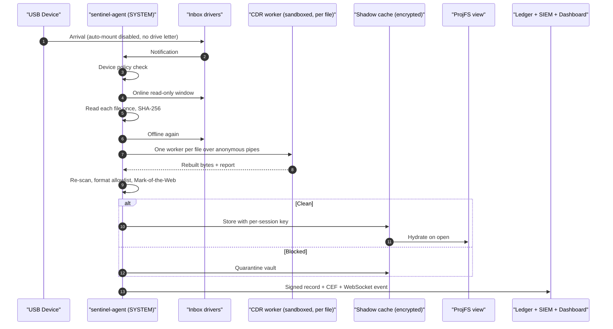

# OmniConnect-Sentinel: Enterprise-Grade Transformation Master Plan (v2, Hardened Option B)

**Skills applied:** `/enterprise-product-manager` · `/production-grade-coder` · `/rea` · `/cybersecurity-engineer`
**Supersedes:** [enterprise_grade_transformation_plan.md](file:///C:/Users/hulkh/.gemini/antigravity/brain/797fa2ac-f52b-4139-b7e2-a7735ea532a4/enterprise_grade_transformation_plan.md) (v1). v1's structure and designs are kept.
**Companion analysis:** [bug_and_security_analysis_report.md](file:///C:/Users/hulkh/.gemini/antigravity/brain/797fa2ac-f52b-4139-b7e2-a7735ea532a4/bug_and_security_analysis_report.md)
**Chosen track:** Option B, a user-mode agent that drives Microsoft-signed inbox drivers. No custom kernel driver is needed.

> [!NOTE]
> **v1 → v2 summary.** Kept: the envelope vault, seekable forward parsers, `quick-xml` OpenXML rewrite, recursive PDF walker, native OS hooks and the `axum` dashboard. Added:
> - An honest threat model (§1.4)
> - Phase 0 fail-closed mounting
> - A read-once shadow cache
> - Layered device allowlisting
> - A sandboxed per-file CDR worker
> - A default-deny format allowlist with Mark-of-the-Web
> - A TPM-sealed vault key with escrow
> - Shredding labelled "NIST 800-88 Clear", plus crypto-erase
> - A signed audit ledger, signed policies, WDAC and a health beacon
> - A degradation matrix and a verification rig
> - 27-bug traceability (§9) and a three-way cross-check against v1 and the report (§11)
>
> Timeline: 60 → **75 days**.

---

## 1. Executive Decision Layer

### 1.1 Objective
Move OmniConnect-Sentinel from prototype to a production-grade peripheral firewall, CDR appliance and kiosk guard that can pass SOC 2 Type II, NIST SP 800-53 Rev. 5, NIST SP 800-88 Rev. 1 (Clear) and IEC 62443-4-2 audits, without a custom kernel driver.

### 1.2 Options

| Option | Scope | Pros | Cons | Effort `[Typical]` |
| :--- | :--- | :--- | :--- | :--- |
| A: Tactical patch | Fix the 27 bugs only | Fastest | Mount race, no VFS, no device control | 3 weeks |
| **B: Hardened user-mode agent (recommended)** | A + fail-closed mounting, volume locking, PnP install policy, ProjFS over a shadow cache, sandboxed CDR worker, TPM vault, signed ledger, SOC server | All Ring-0 code is Microsoft-signed; Secure Boot and HVCI stay on; no BSOD risk; fails closed | An administrator can stop the service (mitigated, see L1); needs a SYSTEM service, ProjFS and TPM 2.0 for the full posture | **75 days**, 3 engineers |
| C: Custom signed drivers + protected service | B + custom drivers + PPL | Protects the service even from administrators | WDK, HLK, EV signing, BSOD risk | 6–9 months |

> [!IMPORTANT]
> Execute **Option B** in six phases (§3). Revisit Option C only if the threat model must cover a malicious local administrator.

### 1.3 TCO (1,000 vs. 10,000 endpoints)

| Driver | 1k endpoints | 10k endpoints | Label |
| :--- | :--- | :--- | :--- |
| Agent + CDR workers | \$0 infra; worker capped at 256 MB | \$0 | `[Typical]` |
| Shadow cache disk | 2–8 GB per kiosk (BitLocker) | same | `[Illustrative]` |
| Central sandbox cluster | ≈ \$480/month | ≈ \$1,920/month | `[Illustrative]` |
| SIEM / ledger ingestion | ≈ \$120/month | ≈ \$1,100/month | `[Typical]` |
| User-mode code signing | ≈ \$450/year | ≈ \$450/year | `[Standard]` |
| TPM 2.0 | \$0 on modern hardware | \$0 | `[Standard]` |

### 1.4 Threat Model & Honest Limits

| # | Limit | Mitigation in this plan |
| :---: | :--- | :--- |
| **L1** | A local administrator can stop a user-mode service; only a protected-process design (Option C) prevents that. | **Fail closed:** volumes stay unmounted without the agent (Phase 0). **Detect:** service-stop and heartbeat-loss alerts (Phase 4). **WDAC:** blocks binary replacement. |
| **L2** | Software overwrites cannot guarantee erasure on flash media because controllers remap blocks. | Label as **NIST 800-88 Clear (logical)**; use **crypto-erase** for data Sentinel stores; leave Purge to device Secure Erase. |
| **L3** | Device identifiers (VID/PID/serial) are not proof of identity. | Composite-interface check plus a user-presence confirmation for new input devices (Phase 3.1). |
| **L4** | A volume without a drive letter can still be reachable by its volume GUID path. | Keep volumes offline except during the agent's read window; apply the removable-storage deny policy to users; verify with gate G0.3. |
| **L5** | CDR parsers process untrusted input. | Sandboxed per-file worker, output re-scan, fuzzing. |

**Assumptions:** the agent runs as SYSTEM; Windows 10 21H2+/11 or Linux ≥ 5.13; the system volume is encrypted with BitLocker or LUKS.

---

## 2. Target Architecture



**Invariants** (each enforced by a Phase 5 test):
- **I1 Fail closed:** with no agent running, no new removable volume is reachable.
- **I2 Read once:** users only read from the shadow cache, never from the device.
- **I3 Isolated parsing:** untrusted bytes are parsed only inside a sandboxed worker.
- **I4 No silent loss:** nothing is deleted before a verified quarantine copy is synced to disk.
- **I5 Tamper-evident:** every security action produces a signed ledger record.

---

## 3. Phased Implementation Plan

### Phase 0: Fail-Closed Foundation (Days 1–7), new

**0.1 Mount control** (fixes `BUG-CORE-01`, `BUG-CORE-12`; addresses L4)
- At service start, disable auto-mount with `IOCTL_MOUNTMGR_SET_AUTO_MOUNT` (same effect as `mountvol /N`). On Linux, set `authorized_default=0` on USB root hubs.
- Remove stale removable-media entries under `HKLM\SYSTEM\MountedDevices`, and remove any drive letter that appears on a volume that hasn't been approved (`DeleteVolumeMountPointW`).
- Keep new volumes offline (`IOCTL_VOLUME_OFFLINE` / `IOCTL_DISK_SET_DISK_ATTRIBUTES`). Bring a volume online read-only only during the agent's read window.
- Apply the RemovableStorageDevices deny policy to interactive users.
- A reconciliation loop runs every 60 s; any drift raises a SIEM alert.
- **Real posture check (gap fix, `BUG-CORE-13`):** replace the stub [`AirGappedKioskManager::verify_write_blocking_active`](file:///c:/Users/hulkh/Downloads/OmniConnect-Sentinel/crates/sentinel-core/src/enterprise/kiosk.rs#L35-L49), which always returns `true`, with `verify_posture() -> PostureReport`. It queries the real state of each control and reports one field per control:
  ```rust
  pub struct PostureReport {
      pub automount_disabled: bool,          // IOCTL_MOUNTMGR_QUERY_AUTO_MOUNT
      pub removable_volumes_offline: Vec<(String, bool)>, // per volume GUID: IOCTL_DISK_GET_DISK_ATTRIBUTES
      pub user_deny_policy_present: bool,    // RemovableStorageDevices registry values
      pub install_restrictions_active: bool, // DeviceInstall\Restrictions values
      pub linux_authorized_default_zero: Option<bool>,
  }
  ```
  `is_compliant()` requires every field to hold. Kiosk mode refuses to start a session when the check fails, and the result is written to the ledger.
- **Gates:**
  - **G0.1:** with the agent stopped, a new USB doesn't appear in Explorer.
  - **G0.2:** a volume seen before doesn't regain its old letter.
  - **G0.3:** a standard user can't list files through the volume GUID path.

**0.2 IPC boundaries** (fixes `BUG-CDR-10`)
- Retire the TCP listener on `127.0.0.1:50051`.
- Agent ↔ CLI/UI traffic uses a Named Pipe or Unix socket with an explicit ACL. Check the peer's PID and binary signature (`GetNamedPipeClientProcessId` / `SO_PEERCRED`).
- Agent ↔ worker traffic uses inherited anonymous pipes only.
- Keep the `sentinel-proto` messages, sent as length-prefixed protobuf frames.

**0.3 Code hygiene**
- Create a new `sentinel-sys` crate that is the only place `unsafe` FFI is allowed. All other crates use `#![forbid(unsafe_code)]`.
- Add `#![deny(clippy::unwrap_used, clippy::expect_used)]` on production paths.
- Introduce a typed `SentinelError` with stable codes and structured `tracing`.

---

### Phase 1: Vault, Shredder & Scanners (Days 8–21)

#### 1.1 `QuarantineVault` (fixes `BUG-CORE-02`, `BUG-CLI-01`)
Files: [`quarantine.rs`](file:///c:/Users/hulkh/Downloads/OmniConnect-Sentinel/crates/sentinel-core/src/scanner/quarantine.rs), [`sentinel-cli/src/main.rs`](file:///c:/Users/hulkh/Downloads/OmniConnect-Sentinel/crates/sentinel-cli/src/main.rs#L516-L532)

1. **Protect the master key (KEK):**
   - Preferred: TPM 2.0 via the CNG Platform Crypto Provider. Create a non-exportable RSA key and wrap the 32-byte KEK with it.
   - Fallback: DPAPI `CRYPTPROTECT_LOCAL_MACHINE`, logged as a reduced posture.
   - Linux: TPM2 (`tss-esapi`) or the kernel keyring; otherwise a root-only `0400` file.
2. **Escrow:** at provisioning, also seal the KEK to an offline recovery public key held by the SOC. Recovery then still works if the machine fails.
3. **Per-file key (DEK):** derive with `HKDF-SHA256(KEK, salt_32B, "OMNICONNECT_SENTINEL_QUARANTINE_V2")`, held in `Zeroizing<[u8; 32]>`. Pin key pages in memory (`VirtualLock` / `mlock`).
4. **File format (v1 design kept):**
   ```rust
   #[derive(Debug, Serialize, Deserialize)]
   pub struct QuarantineEnvelopeHeader {
       pub magic: [u8; 8],            // b"SNTLQV02"
       pub version: u16,
       pub kek_id: String,            // which KEK / escrow generation
       pub file_salt: [u8; 32],
       pub nonce: [u8; 12],
       pub original_path: String,
       pub original_size: u64,
       pub sha256_plaintext: String,
       pub threat_name: String,
       pub threat_score: u8,
       pub quarantined_at_unix: u64,
   }
   ```
   Layout: `[header_len u32][header JSON][ciphertext]`. The header bytes are the AEAD associated data.
   - **Cipher (correction R2):** keep **AES-256-GCM** (the `aes-gcm` crate already in the tree, hardware-accelerated by AES-NI). Nonces are 96-bit random values, and each DEK encrypts exactly one file, so nonce reuse is impossible.
   - **Replace the plaintext sidecar (correction R3):** the current unauthenticated `.json` sidecar goes away. Its fields move into the authenticated header, and `list()` reads headers, not sidecars. Write the vault file to a temp name, `sync_all()`, rename atomically, then `sync_all()` the directory. Directory-creation errors are returned, never swallowed.
   - **Legacy entries:** `.quar` files written by the current code **cannot be recovered**, because their keys were never stored. A one-time `sentinel vault migrate` lists them, marks them `UNRECOVERABLE_LEGACY` in the ledger, and gives the admin a choice: keep them as inert ciphertext, or delete them.
5. **API:** `quarantine_file`, `restore_file` (verifies tag and SHA-256, writes atomically via a temp file + rename), `list`, `purge` (crypto-erase by deleting the wrapped DEK material).
6. **CLI wiring (invariant I4):**
   1. Create the vault once, before the loop.
   2. Quarantine the file, then `sync_all`.
   3. Read the vault entry back and verify it.
   4. Only then remove the source with the Clear routine from 1.2.
   5. Never ignore errors with `let _ =`.

#### 1.2 Shredder: NIST 800-88 Clear + crypto-erase (fixes `BUG-CORE-06`, `BUG-CORE-07`; addresses L2)
Files: [`secure_shredder.rs`](file:///c:/Users/hulkh/Downloads/OmniConnect-Sentinel/crates/sentinel-core/src/scanner/secure_shredder.rs), [`kiosk.rs`](file:///c:/Users/hulkh/Downloads/OmniConnect-Sentinel/crates/sentinel-core/src/enterprise/kiosk.rs)

- **Signature & Naming (correction R12):** [`SecureShredder::shred_file`](file:///c:/Users/hulkh/Downloads/OmniConnect-Sentinel/crates/sentinel-core/src/scanner/secure_shredder.rs#L68) currently takes `(path: &Path, passes: u8)` (no `ShredMethod` enum exists yet in the codebase; v1 and earlier notes assumed one). Introduce `pub enum ShredMethod { ClearMultiPass { passes: u8 }, CryptoErase }` and update `shred_file(path: &Path, method: ShredMethod)`. The UI, README and receipts say "NIST 800-88 Clear (logical)", and the receipt includes the media type (HDD / SSD / USB flash) with a note that Purge is not guaranteed on flash.
- **Paths:** use `\\?\` verbatim paths so reserved names (`CON`, `NUL`) and long paths work.
- **I/O:**
  - `FILE_FLAG_WRITE_THROUGH` plus `FlushFileBuffers` after each pass.
  - Use `FILE_FLAG_NO_BUFFERING` only with sector-aligned buffers, offsets and lengths. Get the alignment from `IOCTL_STORAGE_QUERY_PROPERTY` (`StorageAccessAlignmentProperty`) and pad the final sector.
  - On Unix, use `O_DSYNC`.
- **Passes:** `0x00` → `0xFF` → CSPRNG, then a verify read. Align `dashboard/app.js` to the same order.
- **After the passes:**
  - Issue `FSCTL_FILE_LEVEL_TRIM` as a best-effort hint.
  - Rename up to N times, counting only the renames that actually succeed.
  - Truncate and unlink.
  - The receipt records real counts and hashes; it never hardcodes values. `ShredReceipt` fields become measured values: `passes_completed`, `rename_cycles_completed`, `flush_succeeded` (the result of `FlushFileBuffers`/`fsync`, replacing the hardcoded `hardware_flushed: true`), `verify_read_ok`, `media_type` and `sanitization_level: "NIST 800-88 Clear (logical)"`.
- **ADS streams (correction R12):** [`UniversalThreat`](file:///c:/Users/hulkh/Downloads/OmniConnect-Sentinel/crates/sentinel-core/src/scanner/universal_scanner.rs#L31-L42) marks ADS findings with `carrier_category: CarrierCategory::FilesystemHidden` and `stream_name: Option<String>` (populated by [`NtfsAdsScanner`](file:///c:/Users/hulkh/Downloads/OmniConnect-Sentinel/crates/sentinel-core/src/scanner/ntfs_ads_scanner.rs#L78-L99) from `FindFirstStreamW` as `":<name>:$DATA"` with a leading colon). In [`shred_ntfs_stream(host_path: &Path, stream_name: &str)`](file:///c:/Users/hulkh/Downloads/OmniConnect-Sentinel/crates/sentinel-core/src/scanner/secure_shredder.rs#L163-L175), strip any leading `:` via `stream_name.trim_start_matches(':')` before formatting `"{}:{}"` (fixing the current `file.txt::evil.exe:$DATA` double-colon bug on line 165), run the full Clear passes on the stream handle, then delete the stream only without unlinking the host file. Route threats in the CLI/agent where `threat.stream_name.is_some()` to `shred_ntfs_stream`.
- **Kiosk wipe:**
  - Encrypt the session cache with a per-session key and destroy the key at logout (crypto-erase).
  - Clean up the remaining files with `WalkDir::contents_first(true).follow_links(false)` and streamed 64 KB Clear passes, never allocating a whole-file buffer.
  - Remove links without following them.
- **Optional free-space fill** (`--fill-free-space`): best effort, documented as not reaching the controller's spare blocks.

#### 1.3 Seekable scanners (fixes `BUG-CORE-03`, `BUG-CORE-04`, `BUG-CORE-05`, `BUG-CORE-14`)
Files: [`universal_scanner.rs`](file:///c:/Users/hulkh/Downloads/OmniConnect-Sentinel/crates/sentinel-core/src/scanner/universal_scanner.rs), [`polyglot_scanner.rs`](file:///c:/Users/hulkh/Downloads/OmniConnect-Sentinel/crates/sentinel-core/src/scanner/polyglot_scanner.rs), [`content_scanner.rs`](file:///c:/Users/hulkh/Downloads/OmniConnect-Sentinel/crates/sentinel-core/src/scanner/content_scanner.rs)

- Remove the 4 MB truncation. Scanners take `R: Read + Seek` (or an `Mmap`) plus the real file length. The single read from the device (Phase 3.2) feeds a local, hashed copy, and scanners work on that copy.
- **JPEG:** walk markers forward from SOI. Skip length-delimited segments, which skips EXIF thumbnails. In entropy-coded data, ignore `FF 00` and `FF D0..D7`. The first top-level EOI is the true end; anything after it is reported as trailing data.
- **PNG:** walk chunks (`len | type | data | crc`) from offset 8 until the first `IEND`. Bytes after its CRC are trailing data. Optionally verify CRCs.
- **ISOBMFF:** seek through top-level boxes across the full length, supporting 64-bit `largesize` and `size==0`. Trailing data is judged only after reaching the real end of the file.
- **ZIP/OOXML:** pass the seekable reader to `ZipArchive::new`, so any size works.
- **Heuristics:**
  - Encrypted-extension findings require entropy ≥ 7.2.
  - Ransom-note findings need ≥ 2 content indicators, not just a filename.
  - PDF checks use `lopdf` structure or token-boundary matching (`/JS` not followed by a letter).
- Complexity: O(number of segments) seeks and O(64 KB) memory.
- **Directory walk & file-open hardening (gap fix, `BUG-CORE-14` + correction R13)** in `UniversalScanner::scan_file`, `UniversalScanner::scan_directory`, and the CLI `scan-drive` loop:
  - In [`UniversalScanner::scan_file`](file:///c:/Users/hulkh/Downloads/OmniConnect-Sentinel/crates/sentinel-core/src/scanner/universal_scanner.rs#L65-L71), stop swallowing `File::open(path)` errors as `Ok(vec![])` (clean); return `Err` so locked or ACL-denied files are recorded in `ScanReport.errors`.
  - Replace `filter_map(|e| e.ok())` with explicit handling. Each walk or file-open error is pushed to `ScanReport.errors: Vec<WalkError { path, kind }>`.
  - Scan only entries where `file_type().is_file()`. Skip symlinks and, on Windows, reparse points (check `symlink_metadata` before opening anything). Set `same_file_system(true)`.
  - Count only files toward the limit.
  - Set `ScanReport.complete = errors.is_empty() && !limit_hit`. The agent and CLI treat `complete == false` as **not clean**: the volume stays offline and the UI shows "scan incomplete" with the reason.

---

### Phase 2: CDR Hardening & Isolated Worker (Days 22–35)

#### 2.1 Isolated per-file CDR worker (fixes `BUG-CDR-01`, `-02`, `-03`, `-07`, `-09`, `-10`; addresses L5)
Files: [`service.rs`](file:///c:/Users/hulkh/Downloads/OmniConnect-Sentinel/crates/sentinel-cdr/src/service.rs), [`engine.rs`](file:///c:/Users/hulkh/Downloads/OmniConnect-Sentinel/crates/sentinel-cdr/src/engine.rs), [`policy.rs`](file:///c:/Users/hulkh/Downloads/OmniConnect-Sentinel/crates/sentinel-cdr/src/policy.rs), [`sentinel_cdr.proto`](file:///c:/Users/hulkh/Downloads/OmniConnect-Sentinel/crates/sentinel-proto/proto/sentinel_cdr.proto), [`sentinel-cdr/src/main.rs`](file:///c:/Users/hulkh/Downloads/OmniConnect-Sentinel/crates/sentinel-cdr/src/main.rs)

- **New binary `sentinel-cdr-worker`:** reads one framed request from stdin, writes one framed response to stdout, then exits. The agent runs one worker per file, with a concurrency cap of `available_parallelism()`.
- **OS resource limits** (standard documented Windows/Linux features):
  - Windows: a Job Object with a memory cap (256 MB), a CPU-time cap, a single-process limit and kill-on-close; a low-privilege AppContainer token with no capabilities; process mitigation policies enabled (CFG, dynamic-code prohibition, Microsoft-signed-only DLL loading, child-process prohibition).
  - Linux: `prlimit`, Landlock filesystem rules, a seccomp allowlist and a private network namespace.
- **Parent-enforced deadline:** the agent kills the worker after N seconds (default 30 s). A timeout means the file goes to quarantine.
- **Size quota while streaming:** reject input once accumulated `disarm_request::Payload::ChunkData(bytes)` exceed `max_input_bytes` (and validate `DisarmMetadata.total_size_bytes` upfront). This replaces the unbounded `file_buffer`.
- **Proto & Policy wiring (correction R11):**
  - Extend [`sentinel_cdr.proto`'s `DisarmPolicy`](file:///c:/Users/hulkh/Downloads/OmniConnect-Sentinel/crates/sentinel-proto/proto/sentinel_cdr.proto#L43-L51) with the 4 fields currently present only in Rust [`SanitizationPolicy`](file:///c:/Users/hulkh/Downloads/OmniConnect-Sentinel/crates/sentinel-cdr/src/policy.rs#L5-L33): `strip_pdf_actions`, `strip_office_dde`, `reencode_images` and `max_decompressed_bytes`.
  - Implement `SanitizationPolicy::from_proto(req_meta.policy, &server_ceiling)` mapping all 11 fields (`strip_pdf_scripts`, `strip_pdf_actions`, `strip_pdf_attachments`, `strip_office_macros`, `strip_office_external_links`, `strip_office_dde`, `strip_image_metadata`, `reencode_images`, `truncate_polyglot_overlays`, `max_recursion_depth`, `max_decompressed_bytes`) while clamping `max_recursion_depth` and `max_decompressed_bytes` to server ceilings.
  - Wire [`Tier1CdrClient`](file:///c:/Users/hulkh/Downloads/OmniConnect-Sentinel/crates/sentinel-core/src/scanner/tier1_cdr_client.rs) (currently uncalled dead code) to dispatch through the worker launcher / local pipe instead of `http://127.0.0.1:50051`.
- **Metrics:**
  - The agent tracks `active_workers` (`Arc<AtomicU64>`) with an RAII guard; it is decremented on worker exit, including kills (and mapped to `HealthCheckResponse::active_sessions`).
  - `processed_total{status}` (`HealthCheckResponse::total_disarmed_files`) increments only on completion.
- **`inspect_artifact`:** real entropy over `InspectRequest.header_bytes`, forward polyglot check and risk tags, all computed inside the worker.
- **Compatibility:** `sentinel-cdr-daemon` stays available as an optional CLI mode, served over a local pipe, never over TCP.

#### 2.2 Cross-format budgets & output re-scan
- One `ResourceBudget { bytes_remaining, depth_remaining, objects_remaining, deadline }` is passed through every nested format (ZIP → OOXML → embedded PDF → image).
- The PDF walker keeps a visited-`ObjectId` set and a depth limit, so reference cycles terminate.
- Every rebuilt output is scanned again by the Phase 1.3 scanners. Any finding blocks the file and is recorded as `CDR_OUTPUT_REJECTED`.
- Output validity checks run in CI: `qpdf --check` for PDF, OOXML schema validation, and image decode round-trips.

#### 2.3 OpenXML sanitizer (fixes `BUG-CDR-04`, `BUG-CDR-08`; v1 design kept)
File: [`openxml.rs`](file:///c:/Users/hulkh/Downloads/OmniConnect-Sentinel/crates/sentinel-cdr/src/sanitizers/openxml.rs)
- Read every entry through `take(budget + 1)`. Never trust the size in the ZIP header.
- Remove only active parts: `vbaProject.bin`, `vbaData.xml`, `activeX/*`, `embeddings/*` OLE/package parts and macro sheets. Keep printer settings and other benign binary parts.
- Use `quick-xml` to rewrite `.rels`:
  - Drop `<Relationship>` elements that point to removed parts.
  - Drop elements with a case-insensitive `TargetMode` of `External`, on non-hyperlink types.
  - Never write values outside the schema.
- Remove matching `<Override>` entries from `[Content_Types].xml`, and switch the macro-enabled main content type to the standard one.
- When `strip_office_dde` is set, remove DDE field instructions and `ddeLink` elements.
- Detect DOCX, XLSX, PPTX or plain ZIP from the central directory.

#### 2.4 PDF sanitizer (fixes `BUG-CDR-06`; v1 design kept)
File: [`pdf.rs`](file:///c:/Users/hulkh/Downloads/OmniConnect-Sentinel/crates/sentinel-cdr/src/sanitizers/pdf.rs)
- Edit `/Names` selectively: remove `/JavaScript` and `/EmbeddedFiles`, and `/AF` and `/AcroForm /XFA` when the policy says so. Destinations and page labels are preserved.
- Recursive visitor over `Dictionary` and `Array` values with a depth limit and a visited set:
  - Remove `/AA` and `/OpenAction` when they carry active actions.
  - Strip actions whose `/S` is `JavaScript`, `Launch`, `URI`, `SubmitForm`, `ImportData`, `GoToR`, `GoToE`, `Movie`, `Sound`, `Rendition` or `RichMedia`, according to the policy flags.
  - Follow `/Next` chains.
- Walk every trailer and the incremental-update chain. Write the output as a fresh, fully rewritten file (no incremental append).
- **Match on `/S` values, not keys (correction R5):** the current code looks for a key named `Launch`, which never exists, so Launch actions survive. The visitor must read the **value** of `/S` (a `Name`) and compare it with the action list above. A JavaScript action is removed whole (the action dictionary is replaced by `null` in its parent), not just its `/JS` key.

#### 2.5 Image sanitizer (fixes `BUG-CDR-05`)
File: [`image.rs`](file:///c:/Users/hulkh/Downloads/OmniConnect-Sentinel/crates/sentinel-cdr/src/sanitizers/image.rs)
- Set `image::Limits` before decoding: max width and height of 16,384, and `max_alloc` taken from the policy.
- Report metadata as removed only if it was present (APPn/COM segments; `eXIf`/`tEXt`/`zTXt`/`iTXt` chunks).
- **Metadata detection without a new crate (gap fix, EV-04):** detection uses the native segment and chunk walkers from 1.3, so no EXIF crate is added. (`kamadak-exif` was never a dependency; the earlier mention was an error.) The one unused dependency, `quick-xml 0.36`, becomes used by 2.3 (OOXML) and 2.6 (SVG). CI runs `cargo-machete` / `cargo-udeps` so unused dependencies fail the build.
- Truncate trailing data using the forward parsers from 1.3, plus the RIFF length check for WebP.
- Respect `reencode_images = false`: strip metadata and truncate trailing data without re-encoding.

#### 2.6 Format allowlist & Mark-of-the-Web (new)
- **Default deny.** Only formats the CDR can rebuild are released: PDF, DOCX/XLSX/PPTX, JPEG/PNG/WebP, TXT and CSV. Everything else goes to quarantine or needs an admin release.
- **New sanitizers:**
  - `SvgSanitizer` (`quick-xml`): removes `<script>`, `<foreignObject>`, `on*` attributes and external references.
  - `Ole2Sanitizer` (`cfb` crate): removes VBA project storages and embedded OLE objects from legacy `.doc`/`.xls`, or converts them to quarantine when they can't be rebuilt.
- **Always quarantined:** shortcut, disk-image, script and help-container formats (`.lnk`, `.url`, `.iso`, `.img`, `.vhd(x)`, `.hta`, `.chm`, `.wsf`, `.scr`, `.one`, `.library-ms`), plus encrypted archives.
- Every released file gets a `Zone.Identifier` stream (`ZoneId=3`), so Office Protected View and SmartScreen still apply.

---

### Phase 3: OS Integration, Shadow Cache & Detection (Days 36–50)

#### 3.1 Device arrival & allowlisting (fixes `BUG-CORE-01`, `-12`, `-13`; addresses L3)
Files: [`windows_umdf.rs`](file:///c:/Users/hulkh/Downloads/OmniConnect-Sentinel/crates/sentinel-core/src/interceptor/windows_umdf.rs), [`linux_udev.rs`](file:///c:/Users/hulkh/Downloads/OmniConnect-Sentinel/crates/sentinel-core/src/interceptor/linux_udev.rs), [`drive_watcher.rs`](file:///c:/Users/hulkh/Downloads/OmniConnect-Sentinel/crates/sentinel-core/src/interceptor/drive_watcher.rs), [`sentinel-core/src/main.rs`](file:///c:/Users/hulkh/Downloads/OmniConnect-Sentinel/crates/sentinel-core/src/main.rs)

- **Listener lifetime:** a long-lived listener thread owns the channel sender (`CM_Register_Notification` on Windows, a netlink uevent monitor on Linux). This fixes the dropped sender.
- **Removable-only filtering:** filter by bus type (`IOCTL_STORAGE_QUERY_PROPERTY`). This replaces drive-letter polling.
- **Scans off the async runtime:** run scans in `spawn_blocking`, so a second device is never missed while the first is being handled.
- **Device installation policy** (Windows Group Policy, evaluated by the PnP manager):
  - Set `DenyUnspecified=1`, with `AllowDeviceIDs` / `AllowInstanceIDs` generated from the Intune profile.
  - Run a one-time cleanup of previously installed, unapproved devices.
- **Composite-device check:** a new device that exposes both storage and input interfaces is disabled (`CM_Disable_DevNode`) until a user confirms on screen that they intended to connect it.
- **AutoPlay:** suppress it with `NoDriveTypeAutoRun=0xFF`.
- **Linux per-device cutoff (gap fix, `BUG-CORE-13`):** implement `LinuxUdevInterceptor::sever_data_lines(device_id)`:
  - Write `0` to `/sys/bus/usb/devices/<bus-port>/authorized` to de-authorize the whole device.
  - For composite devices, write `0` to `/sys/bus/usb/devices/<bus-port>:<cfg>.<intf>/authorized` to drop only the unwanted interface.
  - Re-authorizing after approval writes `1`. Every change is written to the ledger.
  - `authorized_default=0` (Phase 0) covers new devices; this function handles devices already present.
- **Agent event pipeline:** policy check → offline/read-only control → read-once ingest (3.2) → workers (2.1) → vault/cache → ledger (4.2).

#### 3.2 Read-once shadow cache + ProjFS (new; invariant I2)
Files: [`projfs.rs`](file:///c:/Users/hulkh/Downloads/OmniConnect-Sentinel/crates/sentinel-core/src/vfs/projfs.rs), [`fuse.rs`](file:///c:/Users/hulkh/Downloads/OmniConnect-Sentinel/crates/sentinel-core/src/vfs/fuse.rs)

- **Read once:** during the read-only window, the agent copies each file **once** into `C:\ProgramData\OmniConnect\ShadowCache\<session>\`, records its SHA-256, and takes the volume offline again.
- **Encryption at rest:** cache entries are encrypted with a per-session key. The cache folder is writable only by SYSTEM.
- **ProjFS** (`PrjStartVirtualizing`):
  - Enumeration lists only released files.
  - The file-data callback decrypts the cache entry, verifies its hash, and writes the data with `PrjWriteFileData`.
  - The virtualization root sits on the BitLocker system volume and is read-only for the interactive user.
- **Unplug or logout:** stop virtualization, destroy the session key (crypto-erase), then remove the folders.
- **Linux:** `fuser` gives a read-only mount with the same cache semantics.
- **Fallback when ProjFS is unavailable:** copy released files to a read-only staging folder, and record a reduced-posture event.
- **WinFsp provider decision (gap fix, `BUG-CORE-13`):** [`winfsp.rs`](file:///c:/Users/hulkh/Downloads/OmniConnect-Sentinel/crates/sentinel-core/src/vfs/winfsp.rs) is a stub. WinFsp needs a separately installed third-party driver, which contradicts Option B's "inbox drivers only" principle. **Decision:** remove `WinFspProvider` from the default build. Keep the `VfsProvider` trait with three implementations: `ProjFsProvider`, `FuseProvider` and `StagingFolderProvider`. If a customer later requires WinFsp, it comes back behind an off-by-default `vfs-winfsp` cargo feature, with its own ADR and driver-signature verification.

#### 3.3 Detection engines (fixes `BUG-CORE-10`, `BUG-CORE-11`, `BUG-CORE-13`)
Files: [`tier0_yara.rs`](file:///c:/Users/hulkh/Downloads/OmniConnect-Sentinel/crates/sentinel-core/src/scanner/tier0_yara.rs), [`tier3_sandbox.rs`](file:///c:/Users/hulkh/Downloads/OmniConnect-Sentinel/crates/sentinel-core/src/scanner/tier3_sandbox.rs)

- **Executable parsing:** `goblin` for PE/ELF imports, sections and entropy, plus `yara-x` with signed rule packs (4.4).
- **Remove size-based verdicts:** delete `len == 229376 || contains("Ramnit")` in [`tier3_sandbox.rs:187`](file:///c:/Users/hulkh/Downloads/OmniConnect-Sentinel/crates/sentinel-core/src/scanner/tier3_sandbox.rs#L187) and the `files.len() >= 3 && size == 229376` cluster rule in [`sentinel-cli/src/main.rs:302`](file:///c:/Users/hulkh/Downloads/OmniConnect-Sentinel/crates/sentinel-cli/src/main.rs#L302). Use SHA-256 intel plus structural indicators instead. A family name in plain text is never a verdict.
- **URL findings:** report the URL actually found, after removing well-known PKI CRL/OCSP hosts. Never report a fabricated URL.
- **Remote sandbox client:** `reqwest` with mTLS, timeouts and job polling. Offline kiosks fall back to local heuristics, and the report states that this happened.

---

### Phase 4: Enterprise Integration & Integrity (Days 51–65)

#### 4.1 Intune & CEF exporters (fixes `BUG-CORE-08`, `BUG-CORE-09`)
- Add an XML escape helper for all interpolated values, regenerate [`intune_sentinel_policy_profile.xml`](file:///c:/Users/hulkh/Downloads/OmniConnect-Sentinel/Docs/intune_sentinel_policy_profile.xml), and read the real policy from `HKLM\SOFTWARE\Policies\OmniConnect\Sentinel`.
- **CEF escaping:**
  - Header fields escape `\` and `|` and replace line breaks.
  - Extension values escape `\`, `=`, `\n` and `\r`.
  - Cap field lengths (for example, 1,023 characters).

#### 4.2 Signed hash-chain audit ledger (new; invariant I5)
- Records are append-only JSON lines: `{seq, ts, event, data, prev_hash, hash}`.
- Sign the chain head every N records and at shutdown. Use ECDSA P-256 with a TPM-resident key through the Platform Crypto Provider (this is TPM-native). Without a TPM, use Ed25519 with the key sealed by DPAPI.
- Cover: shred receipts, quarantine and restore, CDR outcomes, policy changes, service start/stop and drift alerts.
- Forward to the SIEM as events happen, buffering on disk while offline. Retain at least 180 days to meet CERT-In and NIST `AU-9`/`AU-10`.
- Ship `sentinel ledger verify` for auditors.

#### 4.3 Dashboard & CLI (fixes `BUG-CLI-02`, `BUG-UI-01`)
- **`sentinel inspect`:** runs the full scanner stack, with `--json` output.
- **`sentinel ui --port`:** serves the dashboard with `axum`, bound to `127.0.0.1` only.
  - A random per-session bearer token is passed when the browser is launched; it's required for REST and WebSocket calls.
  - `Origin` / `Host` checks block cross-site WebSocket hijacking and DNS rebinding.
  - CSRF protection on POST requests.
- **Frontend:**
  - Replace `innerHTML` with `textContent` / `createElement`.
  - Use a strict CSP and self-host fonts so the dashboard also works on air-gapped machines.
  - Align the shred pass display with 1.2.
- **Retire `cmd /C start`:** open the browser with the `opener` crate and validate the URL.
- **Live data instead of mock data (gap fix, `BUG-UI-01`):** [`dashboard/app.js`](file:///c:/Users/hulkh/Downloads/OmniConnect-Sentinel/dashboard/app.js) currently renders only hardcoded arrays and timers. Change it as follows:
  - Delete all hardcoded threat, device, metric and shred-log arrays, and the simulated timers.
  - On load, call `GET /api/v1/status` (agent health, posture report, active devices, worker and vault counts), then subscribe to `GET /api/v1/ws` for events: device arrival/removal, scan progress (`complete` flag and errors), CDR results, quarantine/restore and Clear receipts.
  - Render every field with `textContent`.
  - Show explicit **empty**, **disconnected** (auto-reconnect with backoff) and **scan incomplete** states.
  - The shred panel shows only values from the backend receipt (passes completed, rename cycles, flush result, media type and the "Clear (logical)" label). Remove the `NIST SP 800-88 Verified (Purged)` text (`app.js:173`).
  - A `--demo` flag on `sentinel ui` may serve a clearly watermarked fixture feed for sales demos. It is never the default.

#### 4.4 Policy, rules & binary integrity (new)
- Policy files and rule packs are signed. The agent checks the signature and a monotonic version, rejecting rollbacks.
- Release binaries: Authenticode + Cosign signatures, a CycloneDX SBOM and SLSA provenance. CI enforces `cargo-deny` and `cargo-audit`.
- WDAC/AppLocker rules allow only signed Sentinel binaries to run from the install directory.

#### 4.5 Operational resilience (addresses L1)
- **Service recovery:** restart actions on failure. The agent and its workers exchange heartbeats.
- **Health beacon:** the agent sends a heartbeat every 60 s. Missing heartbeats raise a SIEM alert, and so does a service-stop event.
- **Break-glass:** a signed, time-limited maintenance token is required to stop the service or suspend policy. Its use is recorded in the ledger.

---

### Phase 5: Verification & Resilience (Days 66–75)

#### 5.1 Degradation matrix

| Condition | Behaviour | Event |
| :--- | :--- | :--- |
| Agent not running | Removable volumes stay unmounted (I1) | Heartbeat-loss alert |
| ProjFS missing | Read-only staging-folder fallback | `POSTURE_REDUCED_NO_PROJFS` |
| No TPM | DPAPI/keyring fallback for KEK and ledger key | `POSTURE_REDUCED_NO_TPM` |
| Disk full / cache quota hit | Stop ingest; keep the device offline | `CACHE_QUOTA_EXCEEDED` |
| Worker timeout or crash | File goes to quarantine | `CDR_WORKER_FAILED` |
| Vault header corrupt | Refuse restore, keep the ciphertext, require escrow recovery | `VAULT_INTEGRITY_FAIL` |
| Policy signature invalid | Keep the last good policy | `POLICY_REJECTED` |

#### 5.2 Test pyramid
1. **Unit/regression:** one named test per bug ID (§9).
2. **Property tests (`proptest`):**
   - Forward parsers find the exact end boundary for arbitrary trailing data.
   - `restore(quarantine(x)) == x`.
   - CEF and XML escaping never yield a parsable injected field.
3. **Fuzzing (`cargo-fuzz`):** one target per sanitizer and parser. CI runs a corpus regression with a 128 MB memory ceiling and fails on any panic.
4. **Output oracles:** `qpdf --check`, OOXML schema validation and image round-trips on every CDR output.
5. **Invariant tests:**
   - I1: agent stopped → no new mount.
   - I2: hash of the served file equals the hash of the cached file.
   - I3: worker limits verified, e.g. memory cap hit → killed, and child-process creation denied.
   - I4: a fault injected between quarantine and removal → source still present.
   - I5: `ledger verify` detects any edited record.
6. **Hardware validation rig:** a programmable USB test device that presents composite storage+input interfaces and changes its content between reads. It validates 3.1 and 3.2 in a lab.
7. **Chaos tests:** kill the agent mid-scan, unplug mid-read, fill the disk, corrupt the vault. Each must end in a safe, logged state.

#### 5.3 Observability
- Structured `tracing` JSON with `trace_id`, `device_id`, `file_sha256`, `stage` and `duration_us`.
- Metrics:
  - `sentinel_active_workers`
  - `sentinel_cdr_processed_total{format,status}`
  - `sentinel_cdr_duration_ms{format}`
  - `sentinel_threats_total{category,severity}`
  - `sentinel_vault_ops_total{op,status}`
  - `sentinel_posture{feature}`
  - `sentinel_policy_drift_total`

---

## 4. Architecture Decision Records

| ADR | Decision | Reason |
| :--- | :--- | :--- |
| **ADR-005 (revised)** | Envelope vault: KEK sealed by the TPM (DPAPI/keyring fallback) plus offline escrow; per-file DEK via HKDF; AES-256-GCM with the header as associated data | Fixes permanent loss; recovery survives hardware failure; header tampering is detected; no new cipher dependency |
| ADR-006 | Seekable forward parsers instead of the 4 MB truncation | Correct for any file size; O(segments) I/O |
| ADR-007 | `quick-xml` rewriting for OOXML | Schema-valid output; robust to quoting and case |
| **ADR-008 (new)** | Per-file isolated worker over anonymous pipes replaces the TCP gRPC daemon | Contains parser defects; removes the network surface; cleaner accounting |
| **ADR-009 (new)** | Fail-closed mounting (auto-mount off, volumes offline by default) | Removes the mount race; safe when the agent is down |
| **ADR-010 (new)** | Read-once encrypted shadow cache behind ProjFS | Device content can't change between scan and use; crypto-erase on unplug |
| **ADR-011 (new)** | Honest sanitization claims: NIST 800-88 Clear + crypto-erase | Accurate compliance statements for flash media |

---

## 5. Edge-Case Matrix

| Case | Target behaviour | Test |
| :--- | :--- | :--- |
| 12 MB camera JPEG with EXIF thumbnail | Clean (forward parser skips the APP1 segment) | `large_jpeg_exif_thumbnail_clean` |
| JPEG with data after EOI and a second EOI at the end | Trailing data detected | `jpeg_trailing_data_detected` |
| MP4 with `moov` after `mdat`, > 4 GB | Clean | `mp4_moov_after_mdat_clean` |
| 50 MB PPTX with macros | Macros found and removed | `large_pptx_macros_removed` |
| `.rels` with `TargetMode='External'` | Relationship removed, valid output | `rels_quote_variants` |
| ZIP whose header understates its size | Budget abort | `zip_header_size_mismatch_aborts` |
| PDF with an inline action in an `/Annots` array | Action removed | `pdf_inline_annot_action_removed` |
| PDF with a `/Next` reference cycle | Terminates within the budget | `pdf_next_cycle_terminates` |
| File named `CON.txt` | Cleared via the verbatim path | `clear_reserved_name` |
| Line break or pipe characters in a filename sent to CEF | Escaped | `cef_escaping` |
| Agent stopped, USB inserted | Not mounted | `invariant_i1` |
| Device content changes after the first read | User sees the cached copy only | `invariant_i2_rig` |
| Worker exceeds memory | Killed; file quarantined | `worker_memory_cap` |
| Crash between quarantine and removal | Source still present | `invariant_i4` |
| `.iso` / `.lnk` on USB | Quarantined by the allowlist | `allowlist_blocks_containers` |
| Unreadable folder on the USB | Scan marked incomplete → not clean, volume stays offline | `walk_error_marks_incomplete` |
| Symlink on the USB pointing outside the volume | Not opened; recorded as skipped | `walk_skips_links` |
| Folder-heavy drive hits the file limit | Only files counted; partial result flagged | `walk_counts_files_only` |
| PDF with a `/S /Launch` action | Action removed | `pdf_launch_action_removed` |
| Text file mentioning "Ramnit" | No verdict from the text alone | `no_verdict_from_family_name` |
| Legacy `.quar` file from the old vault | Listed as `UNRECOVERABLE_LEGACY`, never silently deleted | `vault_migrate_legacy` |
| Kiosk session start with automount re-enabled | Session refused; posture failure logged | `kiosk_posture_blocks_session` |
| Dashboard with the agent stopped | "Disconnected" state, no mock data | `ui_disconnected_state` |

---

## 6. Dependencies & Supply Chain

| Crate | Purpose |
| :--- | :--- |
| `windows-sys` (target-gated) | Mount manager, storage IOCTLs, CNG/TPM, DPAPI, PnP, ProjFS, Job Objects, AppContainer |
| `hkdf`, `zeroize`, `aes-gcm` (existing), `sha2`, `p256`/`ed25519-dalek` | Vault, ledger |
| `tss-esapi` (Linux, optional) | TPM2 |
| `goblin`, `yara-x` | Executable analysis, rules |
| `quick-xml`, `lopdf`, `image`, `zip`, `cfb` | Sanitizers |
| `memmap2` | Seekable scanning |
| `axum`, `tower-http`, `opener` | Dashboard |
| `landlock`, `seccompiler`, `fuser` (Linux) | Worker isolation, VFS |
| `proptest`, `cargo-fuzz` | Verification |

CI: `cargo-deny` (advisories, licences, sources), `cargo-audit`, CycloneDX SBOM, SLSA provenance, signed releases.

---

## 7. RACI

| Workstream | Systems/Rust | AppSec/CDR | Enterprise/UI | CISO/QA |
| :--- | :---: | :---: | :---: | :---: |
| Phase 0 Fail-closed foundation | **A/R** | C | I | C |
| Phase 1 Vault, shredder, scanners | **A/R** | C | I | I |
| Phase 2 CDR + isolated worker | C | **A/R** | I | C |
| Phase 3 OS integration + cache | **A/R** | C | I | C |
| Phase 4 Enterprise + integrity | I | C | **A/R** | A |
| Phase 5 Verification | R | R | R | **A** |

## 8. Risk Register

| ID | Risk | L | I | Mitigation |
| :--- | :--- | :---: | :---: | :--- |
| RSK-01 | Rebuilt documents fail to open | M | H | Schema-valid rewrites; output oracles in CI |
| RSK-02 | False positive destroys a needed file | L | Critical | Quarantine before removal (I4); escrowed recovery |
| RSK-03 | ProjFS not enabled | M | M | Startup probe; staging fallback; posture event |
| RSK-04 | Administrator stops the agent (L1) | M | H | Fail closed; heartbeat and stop alerts; WDAC; break-glass auditing |
| RSK-05 | Flash erasure overclaimed (L2) | M | H | Clear labelling; crypto-erase; documented limits |
| RSK-06 | Volume reachable by GUID path (L4) | M | H | Offline-by-default; user deny policy; gate G0.3 |
| RSK-07 | Parser defect in a third-party crate | M | H | Isolated worker; fuzzing; output re-scan |
| RSK-08 | Device policy blocks legitimate peripherals | M | M | Allowlist from Intune; user confirmation flow; break-glass |

---

## 9. Bug → Plan Traceability (all 27)

| Bug | Plan item | Bug | Plan item |
| :--- | :--- | :--- | :--- |
| BUG-CDR-01 | 2.1 | BUG-CORE-05 | 1.3 |
| BUG-CDR-02 | 2.1 | BUG-CORE-06 | 1.2 |
| BUG-CDR-03 | 2.1 | BUG-CORE-07 | 1.2 |
| BUG-CDR-04 | 2.3, 2.2 | BUG-CORE-08 | 4.1 |
| BUG-CDR-05 | 2.5 | BUG-CORE-09 | 4.1 |
| BUG-CDR-06 | 2.4 | BUG-CORE-10 | 3.3 |
| BUG-CDR-07 | 2.1 | BUG-CORE-11 | 3.3 |
| BUG-CDR-08 | 2.3 | BUG-CORE-12 | 0.1, 3.1 |
| BUG-CDR-09 | 2.1 | BUG-CORE-13 | 0.1 (kiosk posture), 3.1 (autoplay, Windows + Linux cutoff), 3.2 (ProjFS, FUSE, WinFsp decision), 3.3 (remote sandbox), 4.1 (Intune policy load) |
| BUG-CDR-10 | 0.2, 2.1 | **BUG-CORE-14** | 1.3 (walk hardening) |
| BUG-CORE-01 | 0.1, 3.1 | BUG-CLI-01 | 1.1 |
| BUG-CORE-02 | 1.1 | BUG-CLI-02 | 4.3 |
| BUG-CORE-03 | 1.3 | BUG-UI-01 | 4.3 (XSS, live data, Purged text), 1.2 (pass order) |
| BUG-CORE-04 | 1.3 | EV-04 (unused dependency) | 2.5, CI `cargo-machete` |

**BUG-CORE-13 stub-by-stub coverage (9 of 9):**

| Stub | Plan item |
| :--- | :--- |
| `WindowsUmdfInterceptor::apply_autoplay_suppression` | 3.1 |
| `WindowsUmdfInterceptor::sever_data_lines` | 3.1 (`CM_Disable_DevNode`) |
| `LinuxUdevInterceptor::sever_data_lines` | 3.1 (sysfs `authorized`) |
| `WindowsProjFsProvider::mount_virtual_volume` | 3.2 |
| `WinFspProvider::mount_virtual_volume` | 3.2 (removed from default build; ADR if ever needed) |
| `UnixFuseProvider::mount_virtual_volume` | 3.2 |
| `IntunePolicyManager::load_active_policy` | 4.1 |
| `AirGappedKioskManager::verify_write_blocking_active` | 0.1 (`verify_posture`) |
| `OpenSandboxClient::try_remote_detonation` | 3.3 |

---

## 10. Corrections Carried Over from the Review & Second-Pass Cross-Check

| Earlier statement | Corrected position in v2 |
| :--- | :--- |
| Removing rights from the process DACL stops administrators | Not a control; see L1 (fail closed + detection) |
| `FILE_FLAG_NO_BUFFERING` can simply be added | Requires sector alignment; see 1.2 |
| Three overwrite passes erase flash | Clear only; crypto-erase; see L2 |
| Blocking the whole keyboard class | Use `DenyUnspecified` plus an allowlist and a confirmation flow; see 3.1 |
| Ed25519 key inside the TPM | The TPM supports ECDSA P-256 natively; Ed25519 only as a sealed fallback; see 4.2 |
| No drive letter means unreachable | Volume GUID path still exists; offline-by-default; see L4 |
| The vault uses ChaCha20-Poly1305 (report and v1) | The current code uses AES-256-GCM, and v2 keeps it; see 1.1 |
| `kamadak-exif` is an unused dependency (report EV-04, v1 §2.4) | It was never declared; only `quick-xml` is unused; see 2.5 |
| Directory walks can loop on symlinks (audit note) | `walkdir` doesn't follow links; the real defects are `BUG-CORE-14`; see 1.3 |
| `ShredMethod::DoD522022M` & `ThreatCategory::NtfsAlternateDataStream` exist in source (v1, report) | `shred_file` currently takes `passes: u8` and `UniversalThreat` uses `CarrierCategory::FilesystemHidden` + `stream_name: Option<String>`; `shred_ntfs_stream` also had a `"::"` double-colon bug; see 1.2 (R12) |
| `sentinel_cdr.proto` `DisarmPolicy` matches `SanitizationPolicy` (v1) | Proto `DisarmPolicy` was missing 4 fields (`strip_pdf_actions`, `strip_office_dde`, `reencode_images`, `max_decompressed_bytes`), default `max_decompressed_bytes` is `512 MB` (`policy.rs:49`), and `Tier1CdrClient::disarm_file` was uncalled dead code; see 2.1 (R10, R11) |
| `UniversalScanner::scan_file` only failed open in directory walks | `scan_file` (`universal_scanner.rs:65-71`) also swallowed `File::open` errors as `Ok(vec![])` (clean); see 1.3 (R13) |

---

## 11. Three-Way Cross-Check: Report ↔ v1 ↔ v2

**Method:** every finding and sub-finding in the report (27 bugs and 4 evidence items) was compared with v1 and v2 across two independent source-verification passes (`R1`–`R14` in report §5).

### 11.1 Coverage by bug

| Bug (sub-items) | v1 coverage | v2 coverage | Status |
| :--- | :--- | :--- | :---: |
| CDR-01 counters (`Arc<AtomicU64>`, `stream_disarm`, `HealthCheckResponse`) | 2.1 RAII guard | 2.1 (moved to worker accounting + R10) | ✅ |
| CDR-02 unbounded buffer (`Payload::ChunkData`, `512 MB` default) | 2.1 quota | 2.1 quota + Job Object memory cap + R10 | ✅ |
| CDR-03 policy ignored (`DisarmMetadata`, 4 missing proto fields, dead `Tier1CdrClient`) | 2.1 `from_proto` | 2.1 + proto schema extension + R11 | ✅ |
| CDR-04 (5 sub-items: schema, quote bypass, `.bin` deletion, size spoof, DDE/recursion) | 2.2 | 2.3 + 2.2 budget | ✅ 5/5 |
| CDR-05 (4: false report, `reencode` ignored, limits, overlay + WebP) | 2.4 | 2.5 | ✅ 4/4 |
| CDR-06 (3: missing action types / Launch key, nested arrays, `/Names`) | 2.3 | 2.4 + R5 note | ✅ 3/3 |
| CDR-07 blocking executor | 2.1 `spawn_blocking` | 2.1 separate process (supersedes) | ✅ |
| CDR-08 ZIP misclassification | 2.2 note | 2.3 | ✅ |
| CDR-09 dummy RPC (`InspectRequest.header_bytes`) | not explicit | 2.1 + R10 | ✅ (v2 adds) |
| CDR-10 plaintext gRPC | 1.2 option text | 0.2 + 2.1 (TCP retired) | ✅ |
| CORE-01 dropped sender | 3.1 | 0.1 + 3.1 | ✅ |
| CORE-02 (4: key, per-file vault, restore, metadata) + R2/R3 | 1.1 | 1.1 + cipher, sidecar, legacy | ✅ 4/4 |
| CORE-03 (3 false-positive/negative classes) | 1.3 | 1.3 | ✅ 3/3 |
| CORE-04 reverse search | 1.3 | 1.3 | ✅ |
| CORE-05 (3 heuristics) | 1.3 | 1.3 | ✅ 3/3 |
| CORE-06 (5: write-through, fake receipt, `\\?\`, ADS overwrite + `"::"` double-colon fix, hardcoded flush) | 1.2 | 1.2 + measured receipt + R6/R12 | ✅ 5/5 |
| CORE-07 (OOM, non-recursive) | 1.2 | 1.2 + crypto-erase | ✅ 2/2 |
| CORE-08 XML injection + doc file | 4.1 | 4.1 | ✅ |
| CORE-09 CEF injection | 4.1 | 4.1 + length caps | ✅ |
| CORE-10 size/URL/"Ramnit" heuristics | 3.3 | 3.3 (exact conditions) | ✅ |
| CORE-11 substring YARA | 3.3 | 3.3 | ✅ |
| CORE-12 drive polling / blocking | 3.1 | 0.1 + 3.1 | ✅ |
| CORE-13 (9 stubs) | 3.1–3.3 (WinFsp, kiosk, Linux cutoff missing) | 0.1, 3.1, 3.2, 3.3, 4.1 | ✅ 9/9 |
| **CORE-14** walk & `File::open` defects (5) | ❌ absent | 1.3 + R13 | ✅ 5/5 |
| CLI-01 unlink after quarantine | 1.1 | 1.1 (verify then Clear) + R12 | ✅ |
| CLI-02 `inspect` / `ui --port` / `cmd` | 4.2 | 4.3 | ✅ |
| UI-01 (mock data, pass order, XSS ×2, Purged text) | 4.2 (partial) | 4.3 + 1.2 | ✅ 5/5 |
| EV-04 unused dependency | partly wrong (kamadak) | 2.5 + CI check | ✅ |

**Result:** 27/27 bugs and every sub-item have a v2 plan item; 0 open gaps.

### 11.2 v1 items superseded by v2 (do not implement from v1)

| v1 section | v1 instruction | Superseded by |
| :--- | :--- | :--- |
| 1.2 Option B text | Mount → then lock (race window) | v2 Phase 0 (fail closed) |
| 3/1.1 vault | ChaCha20 + DPAPI only | v2 1.1 (AES-256-GCM, TPM + escrow, legacy handling) |
| 3/1.2 shredder | "DoD / NIST Clear/Purge"; `NO_BUFFERING` without alignment | v2 1.2 (Clear label, alignment, crypto-erase) |
| 3/2.1 CDR | `spawn_blocking` in a TCP daemon | v2 2.1 (sandboxed worker, pipes) |
| 3/2.4 image | `kamadak-exif` | v2 2.5 (native segment walkers) |
| 3/3.1 interceptors | Disabling devices after arrival | v2 3.1 (install policy + confirmation) |
| 3/3.2 ProjFS | Hydrate directly from the USB | v2 3.2 (read-once shadow cache) |
| 4.2 dashboard | Server only, no auth tokens | v2 4.3 (tokens, Origin checks, live data) |
| 6 deps | `chacha20poly1305`, `kamadak-exif` | v2 §6 |

### 11.3 Verification ownership
- **Verifiable in CI / this workspace:** unit, property, fuzz and output-oracle tests; all parser, vault, CEF/XML, walk and UI-rendering fixes.
- **Needs an Administrator run on real hardware:**
  - G0.1–G0.3
  - TPM sealing
  - ProjFS
  - device-install policy
  - the composite-device confirmation
  - the I2 hardware rig

  Scripts for these are delivered with Phase 0 and Phase 3.

---

*Engineering guidance, not legal, medical or financial advice; confirm decisions with qualified counsel.*
