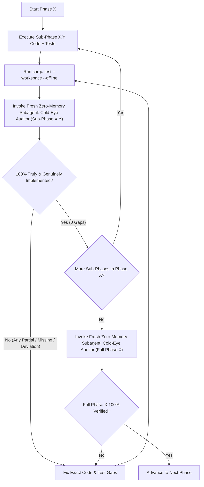

# OmniConnect-Sentinel — Master Remediation Plan v3 (Cold-Eye Audit Loop Edition)

> [!IMPORTANT]
> **Purpose & Execution Protocol**
> This plan remediates every single finding from the zero-memory audit ([independent_cold_audit_report.md](file:///C:/Users/hulkh/.gemini/antigravity/brain/797fa2ac-f52b-4139-b7e2-a7735ea532a4/independent_cold_audit_report.md) and the [Cold-Eye Compliance Auditor transcript](conversation://5e5e27ad-2eb1-4719-86d3-e5c5f36c9975)) against [enterprise_grade_transformation_plan_v2.md](file:///C:/Users/hulkh/.gemini/antigravity/brain/797fa2ac-f52b-4139-b7e2-a7735ea532a4/enterprise_grade_transformation_plan_v2.md), [bug_and_security_analysis_report.md](file:///C:/Users/hulkh/.gemini/antigravity/brain/797fa2ac-f52b-4139-b7e2-a7735ea532a4/bug_and_security_analysis_report.md), and [enterprise_grade_transformation_plan.md](file:///C:/Users/hulkh/.gemini/antigravity/brain/797fa2ac-f52b-4139-b7e2-a7735ea532a4/enterprise_grade_transformation_plan.md).
>
> **Mandatory Verification Loop (`Sub-Phase` & `Phase` Gates):**
> 1. Implement the code and tests for **`Sub-Phase X.Y`**, then run `cargo test --workspace --offline`.
> 2. **Sub-Phase Cold-Eye Gate:** Spawn a fresh, zero-memory `research` subagent (**Cold-Eye Compliance Auditor**) that has no context from this conversation, reads only the specification items for `Sub-Phase X.Y` and the live source files, ignores code comments, and grades every item as `IMPLEMENTED`, `PARTIAL`, `MISSING`, or `DEVIATES`.
> 3. If **any** item in `Sub-Phase X.Y` is not `100% IMPLEMENTED`, fix the discrepancy and spawn a **new** zero-memory Cold-Eye Compliance Auditor subagent in a loop until `Sub-Phase X.Y` achieves `0 PARTIAL / 0 MISSING / 0 DEVIATES`.
> 4. **Phase Cold-Eye Gate:** When all Sub-Phases of **`Phase X`** pass, spawn another fresh zero-memory Cold-Eye Compliance Auditor subagent to audit the entirety of **`Phase X`** end-to-end before advancing to **`Phase X+1`**.

---

## Baseline Audit Scorecard (Before Plan v3 Execution)

| Scope | Implemented | Partial | Missing | Deviates | Not Verifiable in Code | Total |
| :--- | :---: | :---: | :---: | :---: | :---: | :---: |
| **Plan v2 Requirements** | 67 | 72 | 50 | 36 | 5 | **230** |
| **§5 Named & Invariant Tests** | 9 | 11 | 4 | 1 | 0 | **25** |
| **Bugs (`BUG-*`)** | 10 | 17 | 0 | 0 | 0 | **27** |
| **Evasion & Residual (`EV-*`, `R*`)** | 8 | 5 | 0 | 1 | 4 | **18** |

---

## Phase 1: Critical Fail-Closed OS Controls, Symlink Safety & True Sandboxed CDR Worker

**Covers Audit Findings:** `Critical #1`, `Critical #2`, `Critical #4`, `Critical #5`, `Critical #8`, `High #12`, `High #13`, `High #14`, `High #16`, `High #17`, Plan v2 Rows `1, 3, 4, 5, 6, 8, 11–33, 51–63, 66–68, 86–107, 137–145, 207, 221, 226`, Bugs `BUG-CDR-01..03, 07, 09, 10`, `BUG-CORE-01, 06, 07, 12, 13`, `R10, R11, R12`.

### Sub-Phase 1.1: Symlink-Safe Shredding, Pinned Memory Guard & Cross-Platform Build Integrity
1. **Refuse & Unlink Symlinks Without Following (`Critical #1`, Rows `66, 67`, `BUG-CORE-06`, `BUG-CORE-07`)**:
   - In [`crates/sentinel-core/src/enterprise/kiosk.rs`](file:///c:/Users/hulkh/Downloads/OmniConnect-Sentinel/crates/sentinel-core/src/enterprise/kiosk.rs): inspect `fs::symlink_metadata(path)` and `is_reparse_point_or_symlink(&meta)` before calling the shredder. If an entry is a symlink or NTFS junction/reparse point, remove the link itself (`fs::remove_file` / `fs::remove_dir`) without opening or overwriting its target.
   - In [`crates/sentinel-core/src/scanner/secure_shredder.rs`](file:///c:/Users/hulkh/Downloads/OmniConnect-Sentinel/crates/sentinel-core/src/scanner/secure_shredder.rs): check `fs::symlink_metadata(&verbatim_path)` and `is_reparse_point_or_symlink` at the top of `shred_file` and return `Err` immediately if the path is a symlink or reparse point.
2. **Shredder API Signature, Rotational HDD Detection & Aligned `NO_BUFFERING` (`Rows 51–56, 61, 68`, `R12`)**:
   - Change `SecureShredder::shred_file(path: &Path, method: ShredMethod)` to accept `ShredMethod` directly (Plan v2 §1.2, `R12`), keeping `shred_file_with_passes(path, passes)` for custom pass counts.
   - In [`crates/sentinel-sys/src/fs_lowlevel.rs`](file:///c:/Users/hulkh/Downloads/OmniConnect-Sentinel/crates/sentinel-sys/src/fs_lowlevel.rs): query `IOCTL_STORAGE_QUERY_PROPERTY` with `PropertyId = StorageDeviceSeekPenaltyProperty (7)` in `query_media_type` so rotational HDDs (`IncursSeekPenalty == true`) return `MediaType::RotationalHdd` instead of always returning `SsdOrFlash` (`Row 52`). Include the explicit note in `ShredReceipt.method` that NIST 800-88 *Purge* is not guaranteed on flash/SSD media without hardware Secure Erase or crypto-erase.
   - Use `query_sector_alignment` (`StorageAccessAlignmentProperty`) in `SecureShredder` and `open_write_through` to align write chunks to the physical sector size and propagate `file.set_len(0)` errors (`Rows 55, 61`).
   - Remove the 64 MB artificial cap on `SecureShredder::fill_free_space` (allow configurable `max_bytes: Option<u64>` defaulting to available free space or policy ceiling) (`Row 68`).
3. **Fix `ZeroizingBytes` Page Locking & Non-Cloneable Semantics (`Row 39`)**:
   - In [`crates/sentinel-sys/src/mem_guard.rs`](file:///c:/Users/hulkh/Downloads/OmniConnect-Sentinel/crates/sentinel-sys/src/mem_guard.rs): back `ZeroizingBytes<const N: usize>` with `Pin<Box<[u8; N]>>` so the heap allocation address locked by `VirtualLock` (Windows) or `libc::mlock` (Unix) is never moved when `ZeroizingBytes` is returned by value. Remove `#[derive(Clone)]` so secret keys cannot be copied without an explicit `clone_key()` call, and zeroize temporary buffers on drop.
4. **Fix Linux Build & Eliminate Lying Non-Windows Stubs (`Critical #8`, `High #14`, `Row 56`)**:
   - Add `libc = "0.2"` under `[target.'cfg(unix)'.dependencies]` in [`crates/sentinel-sys/Cargo.toml`](file:///c:/Users/hulkh/Downloads/OmniConnect-Sentinel/crates/sentinel-sys/Cargo.toml) (using the cached crate in `Cargo.lock`) and fix missing `std::fs` imports in `#[cfg(not(windows))]` blocks in `fs_lowlevel.rs`.
   - Fix `is_volume_offline` on non-Windows to check `/proc/mounts` (returning `false` if mounted) instead of hardcoding `true`, and fix `verify_named_pipe_client_pid` on Unix to query `SO_PEERCRED` (`libc::getsockopt`) or return `Err(Unsupported)` instead of returning `std::process::id()`.
5. **Sub-Phase 1.1 Cold-Eye Gate**: Audit Sub-Phase 1.1 with a fresh zero-memory subagent.

### Sub-Phase 1.2: Fail-Closed Mount Control (`0x006DC040`), Volume GUIDs, `BusTypeUsb` & HKLM Policies
1. **Fix `IOCTL_MOUNTMGR_SET_AUTO_MOUNT` & Error Propagation (`Critical #2`, `Row 11`)**:
   - In [`crates/sentinel-sys/src/mount_control.rs`](file:///c:/Users/hulkh/Downloads/OmniConnect-Sentinel/crates/sentinel-sys/src/mount_control.rs): change `IOCTL_MOUNTMGR_SET_AUTO_MOUNT` from `0x006D0038` to the exact `mountmgr.h` value `0x006DC040` (`CTL_CODE(0x6D, 16, METHOD_BUFFERED, FILE_READ_ACCESS | FILE_WRITE_ACCESS)`), check the return value of `DeviceIoControl`, and propagate errors instead of discarding them with `let _ =`.
2. **Volume GUID Enumeration (`FindFirstVolumeW`), `BusTypeUsb` & Physical Disk Offline IOCTLs (`Critical #2`, `High #12`, `Rows 4, 14–16, 20, 138`)**:
   - Add `enumerate_usb_volumes() -> Vec<UsbVolumeInfo>` in `mount_control.rs` using `FindFirstVolumeW` / `FindNextVolumeW` (`\\?\Volume{GUID}\`), `GetVolumePathNamesForVolumeNameW`, and `IOCTL_STORAGE_QUERY_PROPERTY` (`StorageDeviceProperty`, `BusType == BusTypeUsb (0x07)`), so both `DRIVE_REMOVABLE` flash drives AND `DRIVE_FIXED` external USB SSDs/HDDs (even without drive letters!) are enumerated.
   - Fix `set_volume_online_readonly` to resolve the physical drive number via `IOCTL_VOLUME_GET_VOLUME_DISK_EXTENTS` (`\\.\PhysicalDriveN`) before issuing `IOCTL_DISK_SET_DISK_ATTRIBUTES`, and call `delete_volume_mount_point`, `set_volume_offline`, and `set_volume_online_readonly` in the volume arrival workflow.
   - Refine `purge_stale_mounted_devices` to inspect registry value data under `HKLM\SYSTEM\MountedDevices` and only delete `\DosDevices\` letters that are not currently mounted fixed/network/CD-ROM volumes, returning any registry error.
3. **HKLM AutoPlay, RemovableStorageDeny & DeviceInstall Restrictions (`High #13`, `Rows 17, 140, 141, 143, 226`)**:
   - Fix `apply_autoplay_suppression_policy` to write `NoDriveTypeAutoRun = 0xFF` to **`HKLM\SOFTWARE\Microsoft\Windows\CurrentVersion\Policies\Explorer`** AND `AutoRun = 0` to **`HKLM\SYSTEM\CurrentControlSet\Services\cdrom`** (propagating errors), in addition to `HKCU`.
   - Add `apply_usb_storage_and_install_policies(allowed_hw_ids: &[String]) -> io::Result<()>` writing `Deny_All = 1` under `HKLM\SOFTWARE\Policies\Microsoft\Windows\RemovableStorageDevices` and `DenyUnspecified = 1` + `AllowDeviceIDs` under `HKLM\SOFTWARE\Policies\Microsoft\Windows\DeviceInstall\Restrictions`.
4. **Strict `PostureReport::is_compliant()`, Real Composite BadUSB Enumeration & User Confirmation (`Rows 3, 18–24, 142`)**:
   - Require all 6 Windows posture booleans (`automount_disabled && user_deny_policy_present && install_restrictions_active && write_protect_active && autoplay_suppressed && removable_volumes_offline.iter().all(|(_, off)| *off)`) in `PostureReport::is_compliant()`.
   - Enumerate real USB PnP device instance IDs via `CM_Get_Device_ID_ListW` in `mount_control.rs` to detect composite HID+Storage devices, disable them via `CM_Disable_DevNode`, and require an explicit confirmation challenge token (`sentinel confirm-device --device-id <ID> --challenge <CODE>`) before re-enabling (`Row 3, 142`).
   - Update [`Docs/verify_admin_posture_gates.ps1`](file:///c:/Users/hulkh/Downloads/OmniConnect-Sentinel/Docs/verify_admin_posture_gates.ps1) to test G0.1 (MountMgr + registry), G0.2 (composite PnP & DeviceInstall restrictions), and G0.3 (`\\?\Volume{GUID}\` enumeration while unmounted).
5. **Sub-Phase 1.2 Cold-Eye Gate**: Audit Sub-Phase 1.2 with a fresh zero-memory subagent.

### Sub-Phase 1.3: True Sandboxed Worker (`CREATE_SUSPENDED` + `STARTUPINFOEXW`), Protobuf Framing, 30s Deadline & Invariant I3
1. **Enforce Invariant I3 Everywhere & Retire All `50051` TCP Client Code (`Critical #4`, `High #17`, `Rows 8, 25–30, 103, 106`)**:
   - Delete the in-process fallback thread in [`crates/sentinel-cdr/src/worker.rs`](file:///c:/Users/hulkh/Downloads/OmniConnect-Sentinel/crates/sentinel-cdr/src/worker.rs) — if the worker binary cannot be spawned or sandboxed, fail closed with `Err(CdrError::SandboxFailure(...))`.
   - Route `ShadowCacheVfs`, `Tier1CdrClient`, CLI `sentinel sanitize`, and CLI `sentinel inspect` through `WorkerLauncher` (`sanitize_isolated` and `inspect_isolated`) so untrusted file bytes are **never** parsed in the parent process.
   - Remove `"http://127.0.0.1:50051"` and the TCP gRPC client from `config.rs` and `tier1_cdr_client.rs`, replacing the default endpoint with `\\.\pipe\OmniConnectSentinel`.
   - Switch `WorkerRequest` / `WorkerResponse` pipe framing to length-prefixed `prost::Message` protobuf frames (`DisarmRequest` / `DisarmResponse` / `InspectRequest` / `InspectResponse` from `sentinel-proto`) (`Row 30`).
2. **`CREATE_SUSPENDED` + `STARTUPINFOEXW` Mitigation Attributes + AppContainer + CFG (`Critical #5`, `Rows 88–97`)**:
   - In [`crates/sentinel-sys/src/sandbox_worker.rs`](file:///c:/Users/hulkh/Downloads/OmniConnect-Sentinel/crates/sentinel-sys/src/sandbox_worker.rs): add `spawn_sandboxed_worker_process(exe_path: &Path, config: &JobSandboxConfig)` using `CreateProcessW` with `EXTENDED_STARTUPINFO_PRESENT | CREATE_SUSPENDED | CREATE_NO_WINDOW` and `InitializeProcThreadAttributeList`:
     - `PROC_THREAD_ATTRIBUTE_MITIGATION_POLICY`: `DEP_ENABLE | PROHIBIT_DYNAMIC_CODE_ALWAYS_ON | BLOCK_NON_MICROSOFT_BINARIES_ALWAYS_ON (CIG) | EXTENSION_POINT_DISABLE_ALWAYS_ON | IMAGE_LOAD_NO_REMOTE_ALWAYS_ON | IMAGE_LOAD_NO_LOW_LABEL_ALWAYS_ON`.
     - `PROC_THREAD_ATTRIBUTE_CHILD_PROCESS_POLICY`: `PROCESS_CREATION_CHILD_PROCESS_RESTRICTED`.
     - `PROC_THREAD_ATTRIBUTE_SECURITY_CAPABILITIES`: zero-capability AppContainer SID (`DeriveAppContainerSidFromAppContainerName` / `CreateAppContainerProfile`).
     - Assign the suspended process handle to the 256 MB Job Object (`AssignProcessToJobObject`) **before** calling `ResumeThread`, and propagate any failure as `Err` (no `.ok()` or `let _ =`)!
     - Inside `apply_worker_process_mitigations()`, also apply `ProcessSignaturePolicy` (`MicrosoftSignedOnly = 1`) and check return codes.
     - On Linux (`#[cfg(target_os = "linux")]`), apply `libc::setrlimit(RLIMIT_AS, 256 MiB)`, `libc::prctl(PR_SET_NO_NEW_PRIVS, 1)`, and `libc::unshare(CLONE_NEWNET)` (`Row 97`).
   - Add `-C control-flow-guard=yes` to [`.cargo/config.toml`](file:///c:/Users/hulkh/Downloads/OmniConnect-Sentinel/.cargo/config.toml) (`Row 93`).
3. **30-Second Parent Wall-Clock Deadline (Covering Stdin Write + Stdout Read), Semaphore & Floor Policy (`Rows 87, 98–105`, `High #16`)**:
   - Change the default worker timeout in `WorkerLauncher` from `15s` to **`30s`** (`Row 98`), run both the `stdin` write and `stdout` read on background threads watched by a single 30-second parent deadline, kill the child process on timeout, and return `CdrError::WorkerTimeout` (which triggers `CDR_WORKER_FAILED` degradation event + quarantine) (`Row 99`).
   - Add a process-wide concurrency semaphore (`available_parallelism()`) and RAII `active_workers` / `processed_total{status}` counters in `WorkerLauncher` (`Rows 87, 104, 105`).
   - Fix `SanitizationPolicy::from_proto` so strip booleans are combined with `server_ceiling.strip_* || proto.strip_*` (callers can never disable mandatory stripping) (`Row 102`, `High #16`).
   - Implement ACL-locked Named Pipe server/client helper in `sentinel-sys` (`CreateNamedPipeW` with SDDL `D:P(A;;GA;;;SY)(A;;GA;;;BA)`, `GetNamedPipeClientProcessId`, and `WinVerifyTrust` Authenticode signature check on the peer executable path) (`Rows 27, 28`, `High #17`).
4. **Sub-Phase 1.3 Cold-Eye Gate & Full Phase 1 Cold-Eye Gate**: Audit Sub-Phase 1.3 and then all of Phase 1 with fresh zero-memory subagents.

---

## Phase 2: Hardware Cryptographic Sealing, Quarantine Vault Integrity & Asymmetric Audit Ledger

**Covers Audit Findings:** `Critical #3`, `Critical #7`, `High #10`, `High #15`, Plan v2 Rows `2, 9, 10, 23, 34–50, 64, 165–170, 186, 189–191, 194, 197, 198, 208–210, 218, 224, 225`, Bugs `BUG-CORE-02`, `BUG-CLI-01`, `I4`, `I5`.

### Sub-Phase 2.1: Real CNG TPM 2.0 PCP Key Wrapping, RSA-OAEP Offline SOC Escrow, SYSTEM DACLs & Fail-Closed Vault
1. **True CNG TPM 2.0 PCP Sealing & Honest Posture Reporting (`Critical #3`, `Rows 34–36, 194, 210, 218`)**:
   - In [`crates/sentinel-sys/src/crypto_seal.rs`](file:///c:/Users/hulkh/Downloads/OmniConnect-Sentinel/crates/sentinel-sys/src/crypto_seal.rs): implement real key wrapping via `ncrypt.dll` (`NCryptOpenStorageProvider` with `MS_PLATFORM_CRYPTO_PROVIDER`, `NCryptCreatePersistedKey` / `NCryptOpenKey` with `NCRYPT_RSA_ALGORITHM`, `NCryptEncrypt` / `NCryptDecrypt` with `NCRYPT_PAD_OAEP_FLAG`).
   - Report `KeyProtectionPosture::Tpm2Assisted` **only** when `NCryptEncrypt` on `MS_PLATFORM_CRYPTO_PROVIDER` succeeds. When TPM PCP is unavailable on the host, fall back to DPAPI `CRYPTPROTECT_LOCAL_MACHINE`, report `KeyProtectionPosture::DpapiLocalMachine`, and emit `DegradationEvent` (`POSTURE_REDUCED_NO_TPM`).
2. **Offline SOC RSA-OAEP Public-Key Escrow & Fail-Closed Unsealing (`Critical #3`, `Rows 37, 45b, 197`)**:
   - Implement `encrypt_kek_for_soc_escrow(kek: &[u8; 32], soc_rsa_pub_der: &[u8]) -> io::Result<Vec<u8>>` using Windows CNG `BCryptOpenAlgorithmProvider(BCRYPT_RSA_ALGORITHM)` + `BCryptImportKeyPair` + `BCryptEncrypt(BCRYPT_PAD_OAEP)` so `vault_kek.escrow` is asymmetrically encrypted to the offline SOC public key (decryptable only by the SOC offline private key, surviving total host/motherboard failure).
   - **Never overwrite or regenerate `vault_kek.sealed` if it already exists on disk and fails to unseal**: return `Err(SentinelError::VaultIntegrityFail)` (`SNTL-ERR-007` / `VAULT_INTEGRITY_FAIL`) immediately (`Row 45b, 197`).
3. **SYSTEM-Only DACLs, Directory `sync_all`, Exact Envelope Header & ADS Quarantine (`High #10`, `High #15`, `Rows 40–50, 64, 224, 225`)**:
   - Add `apply_system_admin_dacl(path: &Path) -> io::Result<()>` in `sentinel-sys` using `ConvertStringSecurityDescriptorToSecurityDescriptorW` (`D:P(A;OICI;GA;;;SY)(A;OICI;GA;;;BA)`) + `SetNamedSecurityInfoW`, and apply it to the vault folder, key files, shadow cache folder, and audit ledger folder.
   - Propagate all `fs::create_dir_all` errors (`Row 45`) and call `sync_directory(vault_dir)` (`CreateFileW` with `FILE_FLAG_BACKUP_SEMANTICS` + `FlushFileBuffers` on Windows / `File::open(dir)?.sync_all()` on Unix) after atomic rename (`Row 44`).
   - Align `QuarantineEnvelopeHeader` exact field names and types with Plan v2 §1.1 (`magic: [u8; 8]` = `*b"SNTLQV02"`, `version: u16`, `file_salt: [u8; 32]`, `nonce: [u8; 12]`, `original_path: String`, `threat_name: String`, `threat_score: u8`, `sha256_plaintext: [u8; 32]`, `plaintext_len: u64`, `quarantined_at_unix: i64`) serialized as `[header_len: u32 LE][header_bytes][ciphertext_and_tag]` with `header_bytes` bound as AES-256-GCM AAD (`Rows 40, 41`).
   - Implement per-entry wrapped DEK storage (`<entry_id>.dek`) so `QuarantineVault::purge(entry_id)` destroys and overwrites the wrapped DEK (true cryptographic erasure) before unlinking the `.quar` ciphertext (`Rows 2, 49, 224`).
   - Fix `QuarantineVault::migrate_legacy` so it is invoked explicitly by `sentinel vault migrate --action keep|delete` (not silently in `new()`), scans all legacy `.quar` files, appends `UNRECOVERABLE_LEGACY` to `AuditLedger`, and honors `keep` vs `delete` (`Row 46`).
   - Fix ADS quarantine (`Row 50, 64`, `High #10`): add `quarantine_ntfs_stream(host_path: &Path, stream_name: &str, threat_name: &str, threat_score: u8)` which reads and quarantines `host_path:stream_name`, verifies the vault entry, and calls `SecureShredder::shred_ntfs_stream(host_path, stream_name)` so the host file is never destroyed!
4. **Sub-Phase 2.1 Cold-Eye Gate**: Audit Sub-Phase 2.1 with a fresh zero-memory subagent.

### Sub-Phase 2.2: Asymmetric ECDSA P-256 Signed Audit Ledger, SIEM Spool, Policy Signatures & Break-Glass Crypto
1. **Asymmetric ECDSA P-256 Chain-Head Signing & Tail-Truncation Detection (`Critical #7`, `Rows 10, 166–170, 209`)**:
   - In [`crates/sentinel-core/src/enterprise/ledger.rs`](file:///c:/Users/hulkh/Downloads/OmniConnect-Sentinel/crates/sentinel-core/src/enterprise/ledger.rs):
     - Align `LedgerRecord` fields with Plan v2 §4.2 (`seq`, `ts`, `event`, `data`, `prev_hash`, `hash`, keeping serde aliases for existing fields).
     - Sign the chain head (`seq|hash`) using **ECDSA P-256** (`BCryptOpenAlgorithmProvider(BCRYPT_ECDSA_P256_ALGORITHM)` / TPM PCP `NCryptSignHash` in `sentinel-sys`) and persist the signed head checkpoint (`ledger.head.sig` with `{head_seq, head_hash, pubkey_blob_hex, ecdsa_sig_hex}`).
     - In `verify_chain()`, verify every record's SHA-256 link, verify the ECDSA P-256 signature over the chain head using the persisted public key, AND verify that the final record's `seq` and `hash` match `ledger.head.sig` (detecting tail truncation!).
     - Fail closed (`Err`) if the ledger signing key exists on disk and cannot be unsealed — never silently generate a new key.
     - Update CLI `ledger verify` strings to accurately state `"ECDSA-P256 signed chain head"`.
2. **Full Security-Action Ledger Coverage, SIEM Disk Spool, Policy Signatures & Break-Glass (`Rows 165, 168, 169, 186, 189–191, 198`)**:
   - Wire `AuditLedger::append_event` into `QuarantineVault` (`quarantine`, `restore`, `purge`, `migrate`), `SecureShredder` (`shred`), `KioskManager` (`posture_check`, `session_start`, `session_end`), and `IntunePolicyManager` (`policy_loaded`, `policy_rejected`), propagating ledger write errors.
   - In [`crates/sentinel-core/src/enterprise/falcon.rs`](file:///c:/Users/hulkh/Downloads/OmniConnect-Sentinel/crates/sentinel-core/src/enterprise/falcon.rs): cap CEF header fields (`escape_cef_header`) at 255 bytes and extension fields at 1,023 bytes (`Row 165`), add an on-disk SIEM spool (`siem_spool.jsonl`) when UDP/TCP delivery fails or is offline, and implement 180-day retention pruning (`Row 169`).
   - Add ECDSA P-256 signature & monotonic version verification (`verify_signed_policy_bundle`) in `IntunePolicyManager` and `Tier0YaraScanner` (rejecting rollbacks or bad signatures with `SentinelError::PolicyRejected` and keeping the last known good policy, `Rows 186, 198`).
   - Replace the length check in `BreakGlassToken::verify` with real ECDSA P-256 signature verification (`verify_ecdsa_p256_signature` in `sentinel-sys`) (`Row 191`).
3. **Sub-Phase 2.2 Cold-Eye Gate & Full Phase 2 Cold-Eye Gate**: Audit Sub-Phase 2.2 and then all of Phase 2 with fresh zero-memory subagents.

---

## Phase 3: Read-Once Encrypted Shadow Cache, ProjFS Virtualization & Kiosk Session Encryption

**Covers Audit Findings:** `Critical #6`, `High #18`, Plan v2 Rows `7, 22, 65, 70, 85, 145–153, 193, 195, 223`, Bug `BUG-CORE-13`, Invariant `I2`, `ADR-010`.

### Sub-Phase 3.1: Encrypted-Only Shadow Cache (`%ProgramData%`), Single-Read Pipeline, ProjFS & Kiosk Encryption
1. **Single-Read TOCTOU Ingestion & Fail-Closed Completeness Gate (`Critical #6`, `Rows 7, 70, 85, 145, 146`)**:
   - Move `shadow_cache_dir` outside the user-visible projection root to `C:\ProgramData\OmniConnect\ShadowCache\<session_id>` (or `<temp>/ShadowCache/<session_id>` in test overrides) protected with `apply_system_admin_dacl` (`Rows 146, 147`) and a configurable quota (`max_cache_bytes`, emitting `CACHE_QUOTA_EXCEEDED` on overflow, `Row 195`).
   - During `ingest_usb_volume`, read each file from the USB volume **exactly once** into memory/local staging, compute its `source_sha256`, and run `UniversalScanner` and `WorkerLauncher::sanitize_isolated` against that single-read copy — never opening the file on the USB device a second time (`Rows 7, 70`).
   - If any walk error, read error, or file-count limit occurs (`!scan_report.complete`), abort projection, keep the USB volume offline, and return `Err` (`Row 85`).
2. **Ciphertext-Only At-Rest Storage & ProjFS / Read-Only Staging Serving (`Critical #6`, `Rows 147–153, 193, 223`)**:
   - Store sanitized files inside `ShadowCache\<session_id>` **exclusively as AES-256-GCM `.enc` ciphertexts** under the session's `ZeroizingBytes<32>` key (`Row 147, 223`). Do **not** write plaintext copies into the projection root during ingestion unless `StagingFolderProvider` is explicitly used as a fallback (in which case mark the files read-only, attach Mark-of-the-Web, and emit `DegradationEvent` `POSTURE_REDUCED_NO_PROJFS`, `Row 151, 193`).
   - In `ProjFsProvider::read_projected_file`, decrypt the `.enc` shadow cache entry on demand using the session key and verify its SHA-256 against `sanitized_sha256` before returning bytes (`Row 148`). Bind Windows `ProjectedFSLib.dll` (`PrjStartVirtualizing` / `PrjStopVirtualizing` dynamic load via `LoadLibraryW`) so hosts with the Windows Projected File System feature use native virtualization and hosts without it cleanly report `POSTURE_REDUCED_NO_PROJFS`.
   - Gate `winfsp` module compilation strictly behind `#[cfg(feature = "vfs-winfsp")]` in [`crates/sentinel-core/src/vfs/mod.rs`](file:///c:/Users/hulkh/Downloads/OmniConnect-Sentinel/crates/sentinel-core/src/vfs/mod.rs) (`Row 152`).
3. **Kiosk Session Key Encryption & CLI Posture Gate (`High #18`, `Rows 22, 65`)**:
   - In [`crates/sentinel-core/src/enterprise/kiosk.rs`](file:///c:/Users/hulkh/Downloads/OmniConnect-Sentinel/crates/sentinel-core/src/enterprise/kiosk.rs): add `write_encrypted_session_file` and `read_encrypted_session_file` that encrypt/decrypt session files with AES-256-GCM using the session's `ZeroizingBytes<32>` key, and destroy (`drop`) the key in `end_session_and_shred` before running the symlink-safe recursive Clear (`Row 65`).
   - In [`crates/sentinel-cli/src/main.rs`](file:///c:/Users/hulkh/Downloads/OmniConnect-Sentinel/crates/sentinel-cli/src/main.rs): wire `sentinel kiosk` to call `begin_kiosk_session_with_posture`, log the posture check to `AuditLedger`, and refuse to start (exiting non-zero without printing `"SL-3 ENFORCED"`) when posture is non-compliant (`Row 22`).
4. **Sub-Phase 3.1 Cold-Eye Gate & Full Phase 3 Cold-Eye Gate**: Audit Sub-Phase 3.1 and Phase 3 with fresh zero-memory subagents.

---

## Phase 4: Strict Default-Deny Format Allowlist, Fail-Closed CDR Sanitizers & Streaming O(64 KiB) Scanners

**Covers Audit Findings:** `High #11`, Plan v2 Rows `69, 71–84, 108–136, 154–159, 211–213, 219, 220, 222, 228, 229`, Bugs `BUG-CDR-04..06, 08`, `BUG-CORE-03..05, 10, 11, 14`, `EV-01..04`, `R5`.

### Sub-Phase 4.1: Default-Deny Allowlist (`PDF/OOXML/JPEG/PNG/WebP/TXT/CSV`), Fail-Closed Sanitizers & Output Re-Scan
1. **Strict Default-Deny Allowlist in `CdrEngine` (`High #11`, `Rows 132–136`)**:
   - Update [`crates/sentinel-cdr/src/engine.rs`](file:///c:/Users/hulkh/Downloads/OmniConnect-Sentinel/crates/sentinel-cdr/src/engine.rs) so `CdrEngine` by default permits only the 9 rebuildable formats from Plan v2 §2.6: `PDF`, `DOCX`, `XLSX`, `PPTX`, `JPEG`, `PNG`, `WebP`, `TXT`, and `CSV`.
   - Reject generic `.zip` archives, legacy `OLE2` (`.doc`/`.xls`/`.ppt`), and `.svg` in default strict policy mode with `CdrError::UnsupportedFormat` (sending them to quarantine), while keeping `allow_legacy_ole2` / `allow_svg` / `allow_generic_zip` opt-in policy flags (`default: false`) for admin-released workflows.
   - Harden `Ole2Sanitizer` (`Row 134`) to parse CFB sector chains (header `512` bytes, DIFAT, FAT sectors, directory entries, and data sectors) and zero out both the directory entry AND the macro/package stream data sectors.
   - Harden `SvgSanitizer` (`Row 133`) to reject or strip `<!DOCTYPE>` / `<!ENTITY>`, strip `<style>` tags containing `url(` or `@import`, and strip any `href` / `xlink:href` that does not start with `#` (internal anchor).
   - Harden `ImageSanitizer::sanitize_webp` (`Rows 128, 131`) so when `reencode_images == false`, RIFF `EXIF` and `XMP ` chunks are structurally stripped and the 4-byte RIFF container size is updated.
   - Propagate errors from `write_mark_of_the_web` (`Row 136`).
2. **Fail-Closed `OpenXmlSanitizer`, Cross-Format `ResourceBudget` & Full Output Re-Scan (`High #11`, `Rows 108, 110, 115, 118, 106, R5`)**:
   - Pass `&mut ResourceBudget` into `ImageSanitizer`, `SvgSanitizer`, `Ole2Sanitizer`, and `TextCsvSanitizer` (`Row 108`).
   - In [`crates/sentinel-cdr/src/sanitizers/openxml.rs`](file:///c:/Users/hulkh/Downloads/OmniConnect-Sentinel/crates/sentinel-cdr/src/sanitizers/openxml.rs): if `budget.descend()` or `CdrEngine::sanitize_nested_with_budget` returns `Err`, or if an unknown binary/executable part is embedded inside an OOXML container, return `Err` (or strip the unapproved embedded binary) — **never** keep unsanitized nested bytes on error (`Row 108`).
   - In `sanitize_office_xml_dde`, return `Err(CdrError::ParserCorruption(...))` on non-UTF-8 or malformed XML (`Row 118`), and strip dangling `r:id` hyperlink attributes when external relationships are removed (`Row 115`).
   - Fix `CdrEngine::inspect_bytes` (`engine.rs:503`, `Row 106, R5`) to inspect `/S` action subtype values (`b"Launch"`, `b"JavaScript"`) rather than key names.
   - Expand `CdrEngine::verify_sanitized_output` (`Row 110`) to re-parse and verify **all** output formats (`PDF` reloads cleanly in `lopdf` with zero `/JS`, `/JavaScript`, `/OpenAction`, `/AA`, or dangerous `/S` actions; `OOXML` has zero `vbaProject.bin`, external `.rels`, or DDE tags; `JPEG`/`PNG`/`WebP` have zero `trailing_overlay_bytes` and zero metadata when `strip_image_metadata` is set; `TXT`/`CSV` have zero BiDi overrides or unquoted DDE formulas).
3. **Sub-Phase 4.1 Cold-Eye Gate**: Audit Sub-Phase 4.1 with a fresh zero-memory subagent.

### Sub-Phase 4.2: Streaming O(64 KiB) Seekable Scanners, Fail-Closed Container Parsing, PE IAT & Host URL Filter
1. **O(64 KiB) Sliding-Window Scanners & Seekable Image/Container Walkers (`Rows 69, 72, 74, 78, 81, 82, 135`)**:
   - Refactor `UniversalScanner`, `PolyglotScanner`, `ContentScanner`, `UnicodeTrojanDetector`, and `Tier0YaraScanner` to stream files in 64 KiB windows (with a 4 KiB overlap across window boundaries so multi-byte signatures/tokens spanning chunk boundaries are never missed) and make `scan_jpeg_structure`, `scan_png_structure`, and `scan_webp_structure` operate on `R: Read + Seek` directly (`Rows 69, 78`).
   - Make malformed container headers (`PNG` missing `IEND`, truncated `JPEG`/`WebP` segments, corrupted `ZipArchive`) and encrypted ZIP entries (checking bit 0 of general-purpose flags across **all** central directory headers) **fail closed** by emitting a `UniversalThreat` (`Row 72, 74, 135`).
   - Inspect magic bytes in addition to extensions in `check_blocked_containers_and_encrypted_archives` (`.lnk` `4C 00 00 00 01 14 02 00`, `.iso` `CD001` at `0x8001`, `.vhd` `conectix`, `.vhdx` `vhdxfile`, `.chm` `ITSF`, `.one` `E4 52 5C 7B 8C D8 A7 4D`) (`Row 135`).
   - Add `.same_file_system(true)` to `WalkDir` in `UniversalScanner::scan_directory_detailed` and record any `entry.metadata()` failure as a `WalkError` (`Rows 81, 82`).
2. **Structural PE IAT / Section Entropy Inspection & Exact Domain Suffix PKI Filter (`Rows 154, 156, 158, 228, 229`)**:
   - In [`crates/sentinel-core/src/scanner/tier0_yara.rs`](file:///c:/Users/hulkh/Downloads/OmniConnect-Sentinel/crates/sentinel-core/src/scanner/tier0_yara.rs): add a full PE32/PE32+ structural parser (`parse_pe_structure`) that walks the Optional Header Data Directories, resolves RVAs to file offsets, parses the Import Directory Table (`IMAGE_IMPORT_DESCRIPTOR` + Import Lookup/Address Table function names), inspects section characteristics (`IMAGE_SCN_MEM_WRITE | IMAGE_SCN_MEM_EXECUTE`, entry-point in final section, section Shannon entropy > 7.4), and checks a SHA-256 known-threat intelligence table (`Rows 154, 156, 228, 229`).
   - In [`crates/sentinel-core/src/scanner/tier3_sandbox.rs`](file:///c:/Users/hulkh/Downloads/OmniConnect-Sentinel/crates/sentinel-core/src/scanner/tier3_sandbox.rs): parse the authority/hostname from each `http://` or `https://` URL before checking `BENIGN_HOSTS`, matching only exact domain or `.domain` suffix (`host == d || host.ends_with(&format!(".{}", d))`) so `microsoft.com.evil.io` and `crl.evil.io` are caught (`Row 158`).
3. **Sub-Phase 4.2 Cold-Eye Gate & Full Phase 4 Cold-Eye Gate**: Audit Sub-Phase 4.2 and Phase 4 with fresh zero-memory subagents.

---

## Phase 5: Axum Dashboard Server, DNS-Rebinding Protection, Real WebSocket & Clean UI

**Covers Audit Findings:** `High #9`, Plan v2 Rows `33, 171–185, 205, 206, 214, 227`, Bugs `BUG-CLI-02`, `BUG-UI-01`, `R8`.

### Sub-Phase 5.1: Axum Server, Exact Host/Origin Check, Bearer Header Auth, POST Routes, Metrics & Clean UI
1. **Axum HTTP Router with Exact Authority & Bearer Header Middleware (`High #9`, `Rows 172–175, 179, 181, 182, 214, 227`)**:
   - Add `axum`, `http`, `hyper`, `tower`, and `subtle` (all present in `Cargo.lock`) to `crates/sentinel-cli/Cargo.toml` and replace the raw TCP HTTP loop in [`crates/sentinel-cli/src/main.rs`](file:///c:/Users/hulkh/Downloads/OmniConnect-Sentinel/crates/sentinel-cli/src/main.rs) with an `axum::Router` bound strictly to `127.0.0.1:{port}` (`Row 172`).
   - Enforce **exact `Host` and `Origin` authority validation** (`127.0.0.1:{port}` or `localhost:{port}`), rejecting missing `Host` headers or DNS-rebinding domains (`127.0.0.1.attacker.tld`) with `StatusCode::FORBIDDEN` (`Row 174`, `High #9`).
   - Validate the per-session bearer token in constant time (`subtle::ConstantTimeEq`) via the `Authorization: Bearer <token>` header, and expose:
     - `GET /api/v1/status` (returning live health, posture report, connected USB volumes, active/total CDR worker counts, vault entry count, ledger verification status, and `last_scan_complete`).
     - `GET /api/v1/ws` (streaming real-time JSON events over chunked/SSE/WS upgrade).
     - `POST /api/v1/scan` and `POST /api/v1/shred` (authenticated + `X-Sentinel-CSRF` checked endpoints that trigger real `UniversalScanner` and `SecureShredder` operations and return JSON receipts, `Rows 175, 227`).
     - `GET /api/v1/metrics` (exporting all 7 labeled Prometheus metrics from `SentinelMetrics`, `Row 206`).
   - Validate the launch URL strictly against `^http://127\.0\.0\.1:\d+/` before opening the browser (`Row 179`).
2. **Strict CSP, Zero Un-Gated Mock Data & Structured JSON Tracing (`Rows 33, 177, 180, 183–185, 205`)**:
   - Remove `'unsafe-inline'` and external `fonts.googleapis.com` / `fonts.gstatic.com` from the `Content-Security-Policy` header and move any inline styles in `dashboard/index.html` into `dashboard/style.css` (`Row 177`).
   - Remove hardcoded `DEVICES`, `STREAM_ITEMS`, simulated kiosk timers, static `4,812`, and mock diff modal data from `dashboard/app.js` and `dashboard/index.html` so live mode displays only backend data (`GET /api/v1/status`, `POST /api/v1/scan`, `POST /api/v1/shred`), exponential-backoff `DISCONNECTED — NO LIVE DATA`, and `SCAN INCOMPLETE — VOLUME HELD OFFLINE` states (`Rows 180, 183–185`).
   - Enable structured JSON tracing (`tracing_subscriber::fmt().json()`) with `trace_id` and `device_id` fields when `SENTINEL_LOG_FORMAT=json` or `--json-logs` is active (`Rows 33, 205`).
3. **Sub-Phase 5.1 Cold-Eye Gate & Full Phase 5 Cold-Eye Gate**: Audit Sub-Phase 5.1 and Phase 5 with fresh zero-memory subagents.

---

## Phase 6: Genuine Verification Suite (`T1`–`T25`, Property Harnesses, `deny.toml` & Final Full-Workspace Audit)

**Covers Audit Findings:** `Medium Placeholder Tests`, Plan v2 Rows `199–204, 216, 230`, Tests `T1`–`T25`.

### Sub-Phase 6.1: Upgrade All 25 Named & Invariant Tests, Property Generators & Supply-Chain Config
1. **Replace Every Placeholder & Weak Test with Real Behavioral Assertions (`T1`–`T25`)**:
   - **`T1` (`large_jpeg_exif_thumbnail_clean`)**: >4.5 MB JPEG with embedded `APP1` EXIF thumbnail `FF D8 ... FF D9` -> clean (`0` threats).
   - **`T2` (`jpeg_trailing_data_detected`)**: JPEG with appended payload ending in a second `FF D9` -> detected at first main-image `EOI`.
   - **`T3` (`mp4_moov_after_mdat_clean`)**: >4.5 MB MP4 with `moov` after `mdat` + 64-bit `largesize` (`size == 1`) >4 GiB sparse stream -> clean.
   - **`T4` (`large_pptx_macros_removed`)**: >4.5 MB `.pptx` containing `ppt/vbaProject.bin` and macro `.rels` -> `vbaProject.bin` and its relationship stripped, main ContentType upgraded.
   - **`T5` (`rels_quote_variants`)**: single-quoted, whitespace-padded, and uppercase `TargetMode` attributes in `.rels` -> all external relationships stripped.
   - **`T6` (`zip_header_size_mismatch_aborts`)**: crafted ZIP header declaring `uncompressed_size = 64` bytes while deflate stream expands past `max_decompressed_bytes` -> aborted with `ResourceLimitExceeded`.
   - **`T7` (`pdf_inline_annot_action_removed`)**, **`T8` (`pdf_next_cycle_terminates`)**, **`T19` (`pdf_launch_action_removed`)**: verify AST action removal, `null` replacement, and cycle termination.
   - **`T9` (`clear_reserved_name`)**: compile on all platforms; on Windows test `CON` verbatim `\\?\` path creation and `SecureShredder::shred_file` with `ShredMethod::NistClearThreePass`.
   - **`T10` (`cef_escaping`)**: verify CEF header and extension escaping + 255 / 1,023 byte length caps.
   - **`T11` (`invariant_i1`)**: verify `IOCTL_MOUNTMGR_SET_AUTO_MOUNT` constant `0x006DC040`, volume GUID offline check, and fail-closed `PostureReport::is_compliant()`.
   - **`T12` (`invariant_i2_rig`)**: simulated mutating USB reader that changes bytes on read #2 -> assert `ShadowCacheVfs` reads only once, stores AES-256-GCM ciphertext in `ShadowCache`, and verifies SHA-256 on read.
   - **`T13` (`worker_memory_cap`)**: spawn `sentinel-cdr-worker` inside the 256 MB Job Object with an allocation stress request (>280 MB) -> assert the Job Object kills the worker and `WorkerLauncher` returns `Err`.
   - **`T14` (`invariant_i4`)** & **`T24` (`invariant_i3`)**: fault-injection test proving `quarantine_file` never shreds the source file if vault verification fails (`I4`), and process-isolation test proving `ShadowCacheVfs` / `Tier1CdrClient` run CDR inside `sentinel-cdr-worker` (`I3`).
   - **`T15` (`allowlist_blocks_containers`)**: verify all 12 container extensions + magic bytes + multi-entry encrypted ZIPs + generic ZIP rejection in `CdrEngine`.
   - **`T16` (`walk_error_marks_incomplete`)**, **`T17` (`walk_skips_links`)**, **`T18` (`walk_counts_files_only`)**: real unreadable/locked file (`T16`), real symlink/junction skipped by both `UniversalScanner` and `KioskManager::end_session_and_shred` (`T17`), and directory-heavy tree (`T18`).
   - **`T20` (`no_verdict_from_family_name`)**: verify benign text containing `"Ramnit"` or `"Emotet"` and benign PKI URLs (`crl.microsoft.com`) vs malicious lookalikes (`microsoft.com.evil.io`).
   - **`T21` (`vault_migrate_legacy`)**: create a real legacy v1 `.quar` file, run `QuarantineVault::migrate_legacy`, and verify `UNRECOVERABLE_LEGACY` is written to `AuditLedger`.
   - **`T22` (`kiosk_posture_blocks_session`)**: verify failed posture blocks kiosk session AND writes `KIOSK_POSTURE_BLOCKED` to `AuditLedger`.
   - **`T23` (`ui_disconnected_state`)**: spin up the `axum` router, assert `Host: 127.0.0.1.attacker.tld` returns `403`, missing bearer token returns `401`, valid bearer token returns `200`, and `dashboard/app.js` has no mock arrays.
   - **`T25` (`invariant_i5`)**: verify ECDSA P-256 chain-head signature and tail-truncation detection in `AuditLedger::verify_chain()`.
2. **Add `arbitrary`-Backed Property Harnesses & `deny.toml` (`Rows 200, 201, 230`)**:
   - Use the `arbitrary` crate (in `Cargo.lock`) to run 500 structured randomized inputs across `PdfSanitizer`, `OpenXmlSanitizer`, `ImageSanitizer`, `SvgSanitizer`, `Ole2Sanitizer`, and `PolyglotScanner`, asserting zero panics and bounded memory.
   - Create root [`deny.toml`](file:///c:/Users/hulkh/Downloads/OmniConnect-Sentinel/deny.toml) configuring license, ban, advisory, and source policies (`Row 230`).
3. **Sub-Phase 6.1 Cold-Eye Gate & Final Full-Workspace Cold-Eye Audit Gate**:
   - Invoke a fresh zero-memory `Cold-Eye Compliance Auditor` subagent to audit the entire repository against Plan v2, the Bug Report, Plan v1 carry-overs, and Plan v3.

*Engineering guidance, not legal, medical or financial advice; confirm decisions with qualified counsel.*
