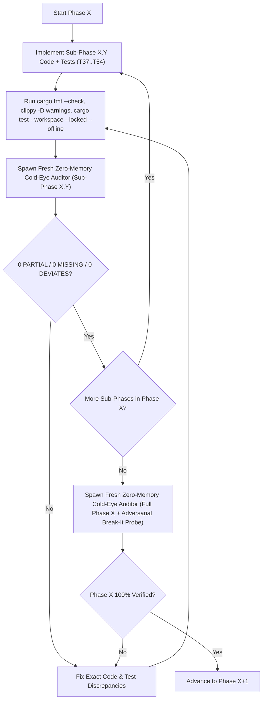

# OmniConnect-Sentinel: Master Security Hardening Plan v3 (Missing, Silently Passed, Half-Wired, Dead & Silently Bypassed Remediation Edition)

**Continuation of:** Master Security Hardening Plan v2 (`CSE-01..CSE-14`, commit `2378c53`) & Master Remediation Plan v3 ([enterprise_grade_transformation_master_plan_v2.md](file:///c:/Users/hulkh/Downloads/OmniConnect-Sentinel/Docs/enterprise_grade_transformation_master_plan_v2.md), [enterprise_grade_transformation_master_plan_v3_remediation.md](file:///c:/Users/hulkh/Downloads/OmniConnect-Sentinel/Docs/enterprise_grade_transformation_master_plan_v3_remediation.md))  
**Source Audits:** [mirofish_project_flaws_validation_report.md](file:///c:/Users/hulkh/Downloads/OmniConnect-Sentinel/Docs/mirofish_project_flaws_validation_report.md) · [dfir_pipeline_ideology_review.md](file:///C:/Users/hulkh/.gemini/antigravity/brain/cee02529-172a-4389-9c1f-d49ad395309e/dfir_pipeline_ideology_review.md)  
**Skills Applied:** `/egm-brainstorm` · `/enterprise-product-manager` · `/production-grade-coder` · `/rea`  
**Verified Baseline:** Branch `feature/universal-hidden-threat-detection-v2`, `HEAD` `aa1c8d4`, `Cargo.toml` `v0.1.0`, `rustc 1.99.1` (Workspace Edition `2021`, `sentinel-ui` Edition `2024`)  
**ID Range Assigned:** `CSE-15` .. `CSE-30` · Tests `T37` .. `T54` · ADRs `ADR-012` .. `ADR-017`

> [!IMPORTANT]
> **Mandatory Execution & Cold-Eye Verification Protocol (Identical to `security_hardening_v2` / Plan v3)**
> 1. Implement code and behavioral tests for **`Sub-Phase X.Y`**, then run `cargo fmt --all -- --check`, `cargo clippy --workspace --all-targets --offline -- -D warnings`, and `cargo test --workspace --locked --offline`.
> 2. **Sub-Phase Cold-Eye Gate:** Spawn a fresh, zero-memory **Cold-Eye Compliance Auditor** subagent that reads only the `CSE-*` requirements for `Sub-Phase X.Y` and the live source files (ignoring comments/doc claims), and grades every item as `IMPLEMENTED`, `PARTIAL`, `MISSING`, or `DEVIATES`.
> 3. If **any** item is not `100% IMPLEMENTED`, patch the gap and re-run a new zero-memory auditor until `0 PARTIAL / 0 MISSING / 0 DEVIATES`.
> 4. **Phase Cold-Eye Gate:** After all Sub-Phases in **`Phase X`** pass, run a full end-to-end Phase Cold-Eye audit (plus `cold_eye_subphase_X_Y_adversarial_break_it_probe.rs`) before advancing to **`Phase X+1`**.
> 5. **EGM Process Note:** A same-context plan draft is not a stateless Goldfish review; true stateless adversarial verification occurs at each Cold-Eye Gate below.

---

## 1. Executive Decision Layer *(Enterprise PM + EGM Stress-Test)*

### 1.1 Objective & Explicit "Not Doing" List
Close every verified **missing**, **silently passed**, **half-wired**, **dead**, and **silently bypassed** defect remaining in `HEAD` `aa1c8d4` (`F-01`, `F-03`–`F-19` plus 4 newly uncovered recovery/shredder/provenance defects), converting OmniConnect-Sentinel from audit-failing theater into an honest, fail-closed system.

**Explicit "Not Doing" List (Hard Scope Boundaries):**
- **NOT integrating [DFIR_FILE_RECOVERY_AND_FORENSIC_PIPELINE_PLAN.md](file:///c:/Users/hulkh/Downloads/OmniConnect-Sentinel/DFIR_FILE_RECOVERY_AND_FORENSIC_PIPELINE_PLAN.md):** Raw disk carving, `C:\` VSS/`$MFT` scraping, ShellBags parsing, and wrapping `WinFR`/`DMDE`/`FTK Imager`/`PhotoRec` are excluded from Sentinel binaries (gitignored in [.gitignore](file:///c:/Users/hulkh/Downloads/OmniConnect-Sentinel/.gitignore#L16-L22)).
- **NOT pursuing Mode B (Managed Corporate Endpoint USB Fleet at \$8–\$18/seat/mo `[Illustrative]`):** 0% commercial viability against \$0 `[Standard]` incremental Microsoft Defender/Intune and ~\$1/seat/mo `[Illustrative]` CrowdStrike Falcon Device Control.
- **NOT building a custom Windows Ring-0 kernel driver:** Retain Microsoft-signed inbox drivers / pure-Rust Ring-3 architecture.
- **NOT claiming FIPS 140-3 / 186-5 or IEC 62443 SL-3 compliance** until third-party cryptographic validation and hardware write-blocking exist.

### 1.2 Strategic Track Selection & Timeline

| Track | Phases Executed | Target Product Wedge | Effort `[Typical]` | Primary Residual Risk |
| :--- | :--- | :--- | :--- | :--- |
| **Track 1 (Primary Wedge): Pivot B — OEM Pure-Rust Sandboxed CDR SDK** | **Phase 0 + Phase 1 + Phase 2 + Phase 4** *(skip or archive Phase 3)* | Memory-safe `#![forbid(unsafe_code)]` CDR library & isolated worker licensed to SASE/SWG/EDR/OT OEMs (\$150K–\$500K/yr OEM `[Illustrative]`) | **24–30 eng-days** | Format breadth vs. OPSWAT (requires ongoing format expansion post-v3) |
| **Track 2 (Secondary Wedge): Pivot A — Hardware-Anchored OT Transfer Kiosk** | **Phase 0 + Phase 1 + Phase 2 + Phase 3 + Phase 4** | Dedicated mid-market OT/ICS USB transfer station paired with ~\$200 physical Bay-1 RO / Bay-2 RW write-blocker (\$3K–\$6K/kiosk/yr `[Illustrative]`) | **39–45 eng-days** | Legacy Win7/Server 2016 compatibility + hardware procurement & AV engine licensing |

### 1.3 Executive Traffic-Light Scorecard (`HEAD` `aa1c8d4` Baseline)
*Criteria: **Red** = open P0 legal/data-loss/silently-passed defect or unchosen wedge; **Amber** = partial remediation or unverified CI/hardware gate; **Green** = verified closed.*

| Dimension | Baseline (`aa1c8d4`) | Target After v3 | Evidence |
| :--- | :---: | :---: | :--- |
| **UI Honesty (`F-02`, `F-19` dashboard)** | **Green** | **Green** | Fixed in commit `aa1c8d4` (`sentinel-ui/` + `dashboard/`). |
| **Kiosk & Recovery Safety (`F-01`, `F-13`, `F-16`)** | **Red** | **Green** (Phase 0) | Hollow `sentinel kiosk`, `Default: 1` shred, unwired `recover_from_soc_escrow`. |
| **CDR Integrity & Bypass Resistance (`F-04`, `F-06`, `F-17`)** | **Red** | **Green** (Phase 1) | CSV negative-number corruption, global `rId`, stream-blind PDF lexer, missing `equation native`. |
| **Daemon IPC, Sandboxing & SIEM Wiring (`F-07`, `F-12`, `F-15`)** | **Red** | **Green** (Phase 2) | Stdio-only CDR daemon, `AC` pipe SDDL, fail-open CIG/`unshare`, dead `flush_spool`, zero-byte sandbox upload. |
| **OS/USB Attribution, Linux & OT Readiness (`F-03`, `F-05`, `F-08`, `F-11`, `F-14`, `F-18`)** | **Red** | **Green** (Phase 3 / De-scoped in Track 1) | `pnp_devices.first()`, Linux no-ops, `StagingFolderProvider` dropped threats, phantom `--break-glass-token`, fake NTP. |
| **Compliance Truthfulness & REA Binary Hygiene (`F-10`, `CSE-28..29`)** | **Red** | **Green** (Phase 4) | CBOM `hardware-tee`/`mTLS` overclaims, plaintext Linux `master.seed`, `binary_dep_v0_sha256` drift. |

### 1.4 Enterprise Routing, BIA, FinOps & Prioritization
- **Jurisdiction Routing (Strictest-Rule Resolution):** India first (DPDP Act 2023 / Rules 2025, CERT-In 2022), EU (GDPR, NIS2, EU CRA Reg. 2024/2847), US (NIST SP 800-88 Rev. 2, IEC 62443-4-2, FRCP 37(e)).
- **Data Classification & BIA Service Tiers:**
  - `sentinel-cdr` / Kiosk processing path = **Tier 1–2** (`RTO < 1–4 h` `[Typical]`), handling **Confidential** to **Restricted** customer documents, credentials, and signed legal contracts.
  - `QuarantineVault` / `AuditLedger` = **Tier 1** integrity/non-repudiation surface (spoliation or silent loss = critical breach).
- **Mandatory Override Lanes (Preempt WSJF):**
  - **Lane 1 (Legal / Compliance / Security):** `CSE-17` (`F-01` hollow kiosk), `CSE-19..20` (`F-06` CDR bypasses), `CSE-22` (`F-15` sandbox fail-open & `AC` SDDL), `CSE-28` (`F-10` CBOM/crypto overclaims).
  - **Lane 2 (Data-Loss / Operational Safety Debt):** `CSE-15` (`F-13` `Default: 1` shred & unchecked verification), `CSE-16` (unwired `recover-escrow`), `CSE-18` (`F-08` dropped fallback quarantine), `CSE-19..20` (`F-04` financial/legal document corruption), `CSE-24` (`F-03` wrong-device disable).
- **Illustrative WSJF Ranking (Fibonacci 1–20):**

| Work Package | Value | Time Crit. | Risk Red. | Cost of Delay | Effort | WSJF `[Illustrative]` | Confidence |
| :--- | :---: | :---: | :---: | :---: | :---: | :---: | :--- |
| **Phase 0 (`CSE-15..18`)** Safety, Kiosk, Recovery, Fallback | 13 | 13 | 20 | 46 | 3 | **15.3** | High (code-verified) |
| **Phase 1 (`CSE-19..21`)** CDR Correctness & Bypasses | 20 | 13 | 20 | 53 | 5 | **10.6** | High (code-verified) |
| **Phase 2 (`CSE-22..23`)** IPC Daemon, Sandbox, SIEM/Sandbox | 13 | 8 | 13 | 34 | 5 | **6.8** | High (code-verified) |
| **Phase 4 (`CSE-28..30`)** CBOM Honesty, Linux Key, REA CI | 8 | 8 | 13 | 29 | 3 | **9.7** | High (code-verified) |
| **Phase 3 (`CSE-24..27`)** OS/Linux/OT Kiosk *(Track 2 only)* | 13 | 5 | 13 | 31 | 13 | **2.4** | Medium (HW-dependent) |

- **FinOps 3-Year TCO & Cost of Doing Nothing:**
  - *Cost of Doing Nothing:* 100% enterprise pilot/ATO rejection (`F-01`, `F-04`, `F-10`, `F-13`) plus legal spoliation/FTC/GDPR exposure (up to EUR 20M or 4% global turnover `[Standard]`).
  - *Track 1 (Pivot B) Build Cost:* ~1–1.5 eng-months (`\$15K–\$30K` `[Illustrative]`), ~\$0 incremental cloud run cost (`[Typical]`), code-signing `\$450/yr` `[Standard]`.
  - *Track 2 (Pivot A) Build Cost:* ~2–3 eng-months (`\$30K–\$60K` `[Illustrative]`) + ~\$200/kiosk `[Typical]` physical write-blocker BOM + optional commercial AV SDK licensing (`\$5K–\$25K/yr` `[Illustrative]`).
  - *Decision Line:* Execute **Phase 0 + Phase 1** immediately (zero regret under both tracks); lock **Track 1 vs. Track 2** before starting Phase 3; revisit Track 2 hardware investment on **2027-02-19** (90 days) if no Pivot A pilot LOI is signed.

---

## 2. Baseline Defect Taxonomy (Observed in `HEAD` `aa1c8d4`)

Every defect below is directly verified in source files (**Observed** per REA evidence rules):

| Category | Count | `CSE` IDs | Verified Defects |
| :--- | :---: | :--- | :--- |
| **Silently Passed (False Success / Dishonest Output)** | 6 | `CSE-15`, `CSE-17`, `CSE-26`, `CSE-28` | `sentinel kiosk` signs untouched files as `"DEEP_CDR_SANITIZED"` / `"SL-3 ENFORCED"` (`main.rs:859-944`); `prompt_remediation` prints `PERMANENTLY ERADICATED` without checking `verification_passed` / `flush_succeeded` (`main.rs:1275-1282`); `SecureShredder` returns `Ok` when verification fails (`secure_shredder.rs:422-457`); `QuarantineVault::purge()` certifies `CryptographicErasePurge` while KEK/escrow live (`quarantine.rs:1368-1375`); `binary_dep_v0_sha256` hashes full exe (`kiosk.rs:1195-1202`); Windows NTP probe reports `ntp_synchronized: true` on air-gapped hosts (`mount_control.rs:2259-2303`). |
| **Half-Wired (Implemented in Lib or Exported, Never Wired End-to-End)** | 5 | `CSE-16`, `CSE-17`, `CSE-22`, `CSE-23`, `CSE-26` | `recover_from_soc_escrow` & `recover_from_hybrid_soc_escrow_v3` exist in `quarantine.rs:337,436` with no CLI subcommand (`main.rs:232-304`); `/api/v1/scan` confined to empty `ui_staging_root` (`main.rs:2057-2074`); `tier3_sandbox.rs:312-318` posts JSON metadata without `file_bytes`; `Docs/intune_sentinel_policy_profile.xml` never ingested by `load_active_policy()` (`intune.rs:526-674`); `sentinel-cdr/src/main.rs:52-86` runs stdio loop instead of Named Pipe gRPC. |
| **Dead (Zero Production Callers or Empty No-Op Stubs)** | 4 | `CSE-23`, `CSE-25`, `CSE-26`, `CSE-27` | `FalconTelemetryBridge::flush_spool()` (`falcon.rs:638`) has 0 production callers; Linux `set_volume_offline`, `delete_volume_mount_point`, and `apply_usb_storage_and_install_policies` are empty `Ok(())` no-ops (`mount_control.rs:1065-1577`); Linux device disable passes Windows `USB\VID_...` to non-existent sysfs path (`sentinel-core/src/main.rs:186`, `mount_control.rs:1861-1875`); `universal_scanner.rs:195` offline YARA rule-pack loading is dead. |
| **Silently Bypassed (Security/Safety Controls Evaded Without Error)** | 8 | `CSE-15`, `CSE-18`, `CSE-19`, `CSE-20`, `CSE-22`, `CSE-23`, `CSE-24` | `StagingFolderProvider` inherits empty `take_withheld_threats()` (`vfs/mod.rs:70, 1665-1692`) dropping quarantine; `pdf.rs:31-107` stream-blind lexer blinded by `(` and `/EF` survives (`:463-477`); `openxml.rs:650-1032` skips XML entity decode, misses split-run DDE, passes `.wmf`/`.emf`/`.bin`; `ole2.rs:199-218` omits `"equation native"`; `sandbox_worker.rs:653-659` retries without CIG & `:1047` allows `AC` pipe RW; `bpf_sandbox.rs:460-467` ignores `unshare` failure; `falcon.rs:700-705` silently evicts CERT-In logs past 128 MiB; `fill_free_space` (`secure_shredder.rs:746-755`) repeats one random chunk; `interceptor/mod.rs:327-329` swallows `enable_device_node` errors. |
| **Missing (Documented / Promised Capabilities Absent in Code)** | 6 | `CSE-19`, `CSE-21`, `CSE-23`, `CSE-26`, `CSE-27`, `CSE-28` | `--break-glass-token` CLI command (0 matches in `crates/`); real SIEM mTLS client auth (`falcon.rs` hardcodes `.with_no_client_auth()`) + private CIDR SIEM allowlist; RFC 4180 CSV & legal PDF signature/Factur-X handling; EXIF orientation bake & ICC preservation (`image.rs`); Windows SCM `StartServiceCtrlDispatcherW` + Session 0 compatibility + streaming >512 MiB firmware support + hardware write-blocker probe; Linux TPM2 sealing (replacing plaintext `master.seed`). |

---

## 3. Target Verification Architecture & Cold-Eye Loop

**Core Invariants Extended (Adding `I6` to `I1`–`I5` from Plan v2):**
- **I1–I5:** Unchanged from Plan v2 (Fail-Closed Mount, Read-Once Cache, Isolated Parsing, No Silent Loss, Tamper-Evident Ledger).
- **I6 (Zero Silent Pass / Zero Silent Bypass):** Every security verification, receipt assertion, sandbox confinement flag, threat handoff, and attestation hash MUST fail closed on error or mismatch—never returning `Ok(())`, empty `Vec`, or green success banners when a control did not execute.

**TRIZ Contradictions Resolved (EGM Inventive Catalyst):**
1. *Contradiction 1 (Legal PDF Integrity vs. Active Content Removal):* Mutating signed PDFs breaks DocuSign/PAdES signatures, while passing them unchecked risks embedded JS. **Resolution (Separation by Condition + Beforehand Cushioning):** Inspect read-only first; if `/ByteRange` + `/Sig` or `/AF` is present and zero active threats exist, emit `VerifiedSignedHoldForPolicy` (never silently corrupt); if active threats exist inside a signed PDF, quarantine rather than shipping a forged/broken signature.
2. *Contradiction 2 (128 MiB Disk Cap vs. 180-Day CERT-In Retention):* Bounded spool prevents disk exhaustion (`I4`), while `retained.remove(0)` silently destroys statutory logs. **Resolution (Segmentation + Warning Before Action):** Separate active spool from sealed cold-archive segments with a hard 80% high-watermark alert (`SIEM_SPOOL_WATERMARK`) and operator-configured retention policy—never silently deleting inside the 180-day window without an explicit audited rollover event.
3. *Contradiction 3 (Prove Shredding Without Shipping Disk Carving):* Proving `SecureShredder` works requires forensic verification, yet shipping carving code breaks mission/supply chain. **Resolution (Extraction / Taking Out):** Run the raw-image canary scan strictly as an out-of-band CI test harness (`CSE-29`), keeping 0 bytes of carving code in release binaries.

---

## 4. Phased Implementation Plan (`CSE-15` .. `CSE-30`)

### Phase 0: Immediate Stop-Bleeding — Silently Passed, Destructive Defaults & Unwired Recovery (Days 1–5)
**Track Applicability:** Mandatory for **Both** Track 1 (Pivot B) and Track 2 (Pivot A).  
**Covers:** `F-01`, `F-08`, `F-13`, `F-16` (partial), Items #1, #3, #7, #8 from audit.

#### Sub-Phase 0.1 (`CSE-15` — Remediation Safety & Fail-Closed `SecureShredder`)
- **Targets:** [`crates/sentinel-cli/src/main.rs`](file:///c:/Users/hulkh/Downloads/OmniConnect-Sentinel/crates/sentinel-cli/src/main.rs#L1250-L1285), [`crates/sentinel-core/src/scanner/secure_shredder.rs`](file:///c:/Users/hulkh/Downloads/OmniConnect-Sentinel/crates/sentinel-core/src/scanner/secure_shredder.rs#L138-L457), [`crates/sentinel-core/src/scanner/secure_shredder.rs`](file:///c:/Users/hulkh/Downloads/OmniConnect-Sentinel/crates/sentinel-core/src/scanner/secure_shredder.rs#L722-L762), [`crates/sentinel-core/src/scanner/quarantine.rs`](file:///c:/Users/hulkh/Downloads/OmniConnect-Sentinel/crates/sentinel-core/src/scanner/quarantine.rs#L1357-L1385).
- **Exact Code Changes:**
  1. In `prompt_remediation()` (`main.rs:1254-1263`): change prompt default from `(Default: 1)` to **`(Default: 3 — SKIP)`**, require explicit `"1"` (plus secondary confirmation or `--yes-shred` flag) before irreversible shredding, and return `Err` on EOF instead of shredding.
  2. In `prompt_remediation()` (`main.rs:1268-1283`) and `Commands::Shred` (`main.rs:659-697`): inspect `receipt.verification_passed && receipt.flush_succeeded`. Print `⚠️ [SHRED INCOMPLETE / UNVERIFIED]` and exit non-zero if either flag is `false`.
  3. In `SecureShredder::shred_file_to_sink` (`secure_shredder.rs:422-457`) and `shred_ntfs_stream_to_sink` (`:680-710`): fail closed (`return Err(...)`) when `!verification_passed` or `!all_flushes_ok` (after logging the failed receipt to the unified `AuditLedger` so failures remain tamper-evident).
  4. In `SecureShredder::fill_free_space` (`secure_shredder.rs:746-755`): move `rand::rngs::OsRng.fill_bytes(&mut aligned_chunk.data)` **inside** the write loop (or derive per-sector stream via CSPRNG keystream so compressing SSD controllers cannot deduplicate repeated blocks).
  5. Align MFT filename-scramble behavior (`secure_shredder.rs:378-405`) with `README.md:221`: scramble filename length matching the original filename length (clamped to filesystem max) *before* zero-truncation and unlink.
  6. In `QuarantineVault::purge()` (`quarantine.rs:1368-1375`): classify the `.quar` removal honestly as `ShredMethod::ClearMultiPass { passes: 3 }` (`Nist80088Rev2Category::Clear`) rather than `CryptographicErasePurge` whenever `vault_kek.sealed` / `vault_kek.escrow` remain live on wear-leveled storage (reserve `CryptographicErasePurge` exclusively for full KEK destruction or hardware-backed ephemeral-DEK-in-RAM destruction).
- **Tests:** `T37` (`remediation_default_skip_and_shred_verify_fail_closed`), `T38` (`fill_free_space_distinct_chunks_and_honest_purge_category`).
- **Sub-Phase 0.1 Cold-Eye Gate:** Verify `0` unchecked shred receipts, safe default `3`, per-chunk entropy, and honest `purge()` receipt.

#### Sub-Phase 0.2 (`CSE-16` — Wire Dead SOC Escrow Recovery CLI & Minimize `.quar` Header PII)
- **Targets:** [`crates/sentinel-cli/src/main.rs`](file:///c:/Users/hulkh/Downloads/OmniConnect-Sentinel/crates/sentinel-cli/src/main.rs#L232-L304), [`crates/sentinel-cli/src/main.rs`](file:///c:/Users/hulkh/Downloads/OmniConnect-Sentinel/crates/sentinel-cli/src/main.rs#L1180-L1230), [`crates/sentinel-core/src/scanner/quarantine.rs`](file:///c:/Users/hulkh/Downloads/OmniConnect-Sentinel/crates/sentinel-core/src/scanner/quarantine.rs#L65-L95).
- **Exact Code Changes:**
  1. Add two new `VaultAction` subcommands in `sentinel-cli`:
     - `RecoverEscrow { vault_dir: PathBuf, soc_priv_key: PathBuf }` -> calls `QuarantineVault::recover_from_soc_escrow(vault_dir, &priv_bytes)` ([quarantine.rs:337](file:///c:/Users/hulkh/Downloads/OmniConnect-Sentinel/crates/sentinel-core/src/scanner/quarantine.rs#L337)), atomically re-seals `vault_kek.sealed` on the replacement host, appends `VAULT_RECOVERED_FROM_ESCROW` to `AuditLedger`, and zeroizes key buffers.
     - `RecoverHybridEscrowV3 { vault_dir: PathBuf, hybrid_priv_key: PathBuf }` -> calls `QuarantineVault::recover_from_hybrid_soc_escrow_v3(vault_dir, &bundle)` ([quarantine.rs:436](file:///c:/Users/hulkh/Downloads/OmniConnect-Sentinel/crates/sentinel-core/src/scanner/quarantine.rs#L436)) with atomic re-seal and ledger entry.
  2. Upgrade `QuarantineEnvelopeHeader` to `version: 3` (`SNTLQV03`, retaining read backward-compatibility with `SNTLQV02`): move raw `original_path` inside the AES-256-GCM encrypted metadata payload and store only the HMAC-tokenized `original_path_token` in the unencrypted AAD header (closing `F-16` GDPR/HIPAA/DPDP plaintext-path leakage in `.quar` headers).
- **Tests:** `T39` (`cli_vault_recover_escrow_and_hybrid_v3_end_to_end`), `T40` (`quarantine_v3_header_contains_zero_plaintext_path_pii`).
- **Sub-Phase 0.2 Cold-Eye Gate:** Audit CLI recovery path (corrupt `vault_kek.sealed` -> run CLI recovery -> `vault restore` succeeds) and raw `.quar` byte scan for plaintext path absence.

#### Sub-Phase 0.3 (`CSE-17` — Replace Hollow `sentinel kiosk` Signing, Fix `/api/v1/scan` & Honest Binary Provenance)
- **Targets:** [`crates/sentinel-cli/src/main.rs`](file:///c:/Users/hulkh/Downloads/OmniConnect-Sentinel/crates/sentinel-cli/src/main.rs#L859-L944), [`crates/sentinel-cli/src/main.rs`](file:///c:/Users/hulkh/Downloads/OmniConnect-Sentinel/crates/sentinel-cli/src/main.rs#L2044-L2080), [`crates/sentinel-core/src/enterprise/kiosk.rs`](file:///c:/Users/hulkh/Downloads/OmniConnect-Sentinel/crates/sentinel-core/src/enterprise/kiosk.rs#L35-L85), [`crates/sentinel-core/src/enterprise/kiosk.rs`](file:///c:/Users/hulkh/Downloads/OmniConnect-Sentinel/crates/sentinel-core/src/enterprise/kiosk.rs#L1195-L1202).
- **Exact Code Changes:**
  1. In `Commands::Kiosk` (`main.rs:859-944`): require `--intake-dir <PATH>` (source media) and `--export-dir <PATH>` (clean destination). Execute real `UniversalScanner::scan_directory_detailed` + `WorkerLauncher::sanitize_isolated` for every file on `--intake-dir`. Quarantine any blocked/infected file; write **only** CDR-verified rebuilt bytes into `--export-dir`; abort with non-zero exit (writing **no** passport) if `!scan_report.complete` or any unhandled threat/worker error occurs.
  2. Remove hardcoded `"SL-3 ENFORCED"` stdout strings; emit honest posture label derived directly from `PostureReport` (e.g., `"SOFTWARE_POSTURE_VERIFIED (Hardware Write-Blocker: NOT_DETECTED)"`).
  3. In `KioskSanitizationPassport` (`kiosk.rs:57, 1195-1202`): rename/split provenance fields honestly into `binary_exe_sha256: String` (full executable SHA-256) and `binary_dep_v0_sha256: Option<String>` (computed strictly by parsing ELF/PE sections for `.dep-v0` via `goblin`/section header walk, returning `None` when absent rather than spoofing the full executable hash).
  4. In `/api/v1/scan` (`main.rs:2057-2074`): support scanning explicitly configured read-only intake mount roots (configured via `--kiosk-intake-root` with symlink/traversal rejection), returning explicit `400` if empty/unconfigured rather than pretending 0 scanned files in `ui_staging_root` means clean USB media.
- **Tests:** `T41` (`kiosk_cli_runs_real_scanner_and_cdr_and_refuses_dirty_passport`), `T42` (`passport_distinguishes_exe_sha256_from_real_dep_v0_section`).
- **Sub-Phase 0.3 Cold-Eye Gate:** Verify feeding an EICAR/macro-laced intake dir into `sentinel kiosk` quarantines the threat, refuses clean passport issuance, and never outputs `"SL-3 ENFORCED"`.

#### Sub-Phase 0.4 (`CSE-18` — Fix `StagingFolderProvider` Dropped Threats & OS-Aware Mount Paths)
- **Targets:** [`crates/sentinel-core/src/vfs/mod.rs`](file:///c:/Users/hulkh/Downloads/OmniConnect-Sentinel/crates/sentinel-core/src/vfs/mod.rs#L1616-L1692), [`crates/sentinel-core/src/main.rs`](file:///c:/Users/hulkh/Downloads/OmniConnect-Sentinel/crates/sentinel-core/src/main.rs#L270-L290), [`crates/sentinel-sys/src/fs_lowlevel.rs`](file:///c:/Users/hulkh/Downloads/OmniConnect-Sentinel/crates/sentinel-sys/src/fs_lowlevel.rs#L1060-L1080).
- **Exact Code Changes:**
  1. Implement `fn take_withheld_threats(&self, virtual_mount_point: &Path) -> Vec<UniversalThreat>` on `StagingFolderProvider` (`vfs/mod.rs:1665-1692`) delegating to `self.shadow_cache.take_withheld_threats(virtual_mount_point)` (matching `ProjFsProvider`).
  2. Replace hardcoded `C:\OmniConnect\SafeDrive` in `sentinel-core/src/main.rs:274` with OS-gated defaults (`C:\ProgramData\OmniConnect\SafeDrive` on Windows; `/run/omniconnect/safedrive` on Unix, overridable via `SENTINEL_SAFE_DRIVE_DIR`).
  3. On Windows `StagingFolderProvider`, keep the encrypted `ShadowCache` directory `SYSTEM`/`Administrators`-only while applying read-only ACE (`GR` / `FILE_GENERIC_READ`) for `Authenticated Users` (or the active interactive console user SID) on materialized sanitized staging output files so standard users do not hit `Access Denied`.
- **Tests:** `T43` (`staging_provider_quarantines_withheld_threats_and_standard_user_can_read_sanitized`).
- **Sub-Phase 0.4 & Full Phase 0 Cold-Eye Gate:** Full zero-memory Phase 0 audit + `cold_eye_phase_0_v3_adversarial_probe.rs`.

---

### Phase 1: CDR Correctness, Data Preservation & Active Parser Bypass Closure (Days 6–15)
**Track Applicability:** Mandatory for **Both** Track 1 (Pivot B) and Track 2 (Pivot A).  
**Covers:** `F-04`, `F-06`, `F-17`.

#### Sub-Phase 1.1 (`CSE-19` — RFC 4180 CSV & Per-Part Allowlist OOXML Reconstruction)
- **Targets:** [`crates/sentinel-cdr/src/sanitizers/text.rs`](file:///c:/Users/hulkh/Downloads/OmniConnect-Sentinel/crates/sentinel-cdr/src/sanitizers/text.rs#L59-L115), [`crates/sentinel-cdr/src/sanitizers/openxml.rs`](file:///c:/Users/hulkh/Downloads/OmniConnect-Sentinel/crates/sentinel-cdr/src/sanitizers/openxml.rs#L190-L240), [`crates/sentinel-cdr/src/sanitizers/openxml.rs`](file:///c:/Users/hulkh/Downloads/OmniConnect-Sentinel/crates/sentinel-cdr/src/sanitizers/openxml.rs#L545-L1045).
- **Exact Code Changes:**
  1. **CSV (`text.rs`):** Replace naive `line.split(',')` with a streaming RFC 4180 state-machine field parser (`O(N)` time, `O(max_cell)` bounded memory). Preserve valid signed numbers (`^[+-]?(?:\d+\.?\d*|\.\d+)(?:[eE][+-]?\d+)?$`, e.g., `-45000.00`, `+3.14`) untouched; disarm formula triggers (`=`, `@`, `\t`, `\r`, or non-numeric `+`/`-` expressions like `-1+cmd|...` or quoted `"=HYPERLINK(...)"`) inside both unquoted and quoted cells while preserving proper RFC 4180 quoting.
  2. **OOXML Per-Part `.rels` Scoping (`openxml.rs:207`):** Replace global `removed_rel_ids: HashSet<String>` with `removed_rel_ids_by_part: HashMap<String, HashSet<String>>` keyed by the exact owning part path derived from each `.rels` file (e.g., `word/_rels/document.xml.rels` -> `word/document.xml`) so removing `rId1` in one slide/sheet never deletes valid `rId1` targets in unrelated parts.
  3. **OOXML Entity Decoding & Scheme Allowlist (`openxml.rs:650-715`):** Decode XML numeric/named entities (`&#102;`, `&#x66;`, `&amp;`) via `quick-xml` unescaping *before* URI scheme inspection. Switch from scheme denylist to strict allowlist (`https:`, `http:`, `mailto:`, `#`, and relative intra-package paths)—blocking `file:`, `smb:`, `mhtml:`, `search-ms:`, `ms-appinstaller:`, `ms-msdt:`, and obfuscated whitespace/control prefixes.
  4. **Split-Run DDE & Allowlist Nested Parts (`openxml.rs:900-1035`):** Concatenate adjacent `<w:instrText>` / `<w:t>` run text across XML element boundaries before DDE/field-code detection (`DDEAUTO`, `DDE`, `INCLUDETEXT`, `INCLUDEPICTURE`). Enforce allowlist-only binary parts inside OOXML ZIPs: strip or fail closed on `.wmf`, `.emf`, `.bin`, `.exe`, `.ps1`, `.ole`, `.activex` (even when generic ZIP nesting is enabled). When macros are stripped from `.xlsm`/`.docm`/`.pptm`, update `[Content_Types].xml` AND record `recommended_extension: Some("xlsx" | "docx" | "pptx")` in `SanitizationReport` so callers/VFS rename consistently and Excel never rejects extension/ContentType mismatch.
- **Tests:** `T44` (`csv_rfc4180_signed_numbers_preserved_quoted_formulas_disarmed`), `T45` (`ooxml_scoped_rels_entity_smuggle_split_dde_and_part_allowlist`).
- **Sub-Phase 1.1 Cold-Eye Gate:** Adversarial corpus probe (`-45000.00`, `"=cmd|' /C calc'!A0"`, `&#102;ile://evil/share`, split `<w:instrText>DD</w:instrText><w:instrText>EAUTO</w:instrText>`, dual-sheet `rId1`).

#### Sub-Phase 1.2 (`CSE-20` — Stream-Aware PDF Lexer, Signature Policy & OLE2 `Equation Native`)
- **Targets:** [`crates/sentinel-cdr/src/sanitizers/pdf.rs`](file:///c:/Users/hulkh/Downloads/OmniConnect-Sentinel/crates/sentinel-cdr/src/sanitizers/pdf.rs#L31-L165), [`crates/sentinel-cdr/src/sanitizers/pdf.rs`](file:///c:/Users/hulkh/Downloads/OmniConnect-Sentinel/crates/sentinel-cdr/src/sanitizers/pdf.rs#L405-L490), [`crates/sentinel-cdr/src/sanitizers/ole2.rs`](file:///c:/Users/hulkh/Downloads/OmniConnect-Sentinel/crates/sentinel-cdr/src/sanitizers/ole2.rs#L195-L235).
- **Exact Code Changes:**
  1. **Stream-Aware PDF Depth Pre-Scanner (`pdf.rs:31-107`):** Replace raw byte scanning with a single-pass `O(N)` PDF tokenizer that tracks `stream\r?\n...endstream` (honoring dictionary `/Length` hints and `endstream` boundaries), comments (`%...\n`), escaped literal strings (`\(`, `\)`, `\\`), and hex strings (`<...>`) so binary stream bytes containing `(` or `[` can never blind the `RUSTSEC-2026-0187` recursion depth guard.
  2. **Unconditional `/EF` Stripping (`pdf.rs:463-477`):** Strip `/EF` (Embedded File streams) and `/EmbeddedFiles` name trees on **every** dictionary regardless of whether `/Type /Filespec` is explicitly declared.
  3. **Signed PDF, `/AF` (Factur-X) & `/XFA` Preservation Policy (`pdf.rs:132-160`):** Before mutating via `lopdf::Document::save_to`, detect `/ByteRange` + `/Sig` digital signatures, `/AF` (Factur-X e-invoices), and `/XFA`. Add explicit `SignedPdfPolicy` (`QuarantineWithReason` default for signed PDFs with active content; `AllowReadOnlyVerifiedClean` only if zero active threats exist AND operator explicitly opted into passthrough; `FlattenAndWarnSignatureBroken` if explicitly configured)—eliminating silent legal contract invalidation.
  4. **OLE2 CVE-2017-11882 (`ole2.rs:199-218`):** Add `"equation native"` (normalized lowercase + trimmed) and `"\x01ole10native"` / `"package"` to the mandatory zeroized/stripped OLE2 stream list.
- **Tests:** `T46` (`pdf_stream_aware_depth_guard_ef_without_filespec_and_signature_policy`), `T47` (`ole2_equation_native_stream_zeroed_and_verified`).
- **Sub-Phase 1.2 Cold-Eye Gate:** Verify crafted PDF with `(` inside image stream + deep nested arrays is rejected, `/EF` without `/Type /Filespec` is stripped, signed DocuSign-style PDF is never silently corrupted, and OLE2 `Equation Native` is eradicated.

#### Sub-Phase 1.3 (`CSE-21` — Image EXIF Orientation Bake & Color Profile Fidelity)
- **Targets:** [`crates/sentinel-cdr/src/sanitizers/image.rs`](file:///c:/Users/hulkh/Downloads/OmniConnect-Sentinel/crates/sentinel-cdr/src/sanitizers/image.rs#L270-L430).
- **Exact Code Changes:**
  1. Parse TIFF/EXIF Orientation tag (`0x0112`, values `1..=8`) from `APP1` *prior* to metadata stripping and apply lossless pixel rotation/flip (`rotate90`/`rotate180`/`rotate270`/`fliph`/`flipv`) before re-encoding so smartphone/field photos keep correct orientation.
  2. Raise default JPEG re-encode quality from `75` to configurable `90` (in `SanitizationPolicy`), detect CMYK `APP14` Adobe markers and convert cleanly to RGB instead of outputting color-inverted JPEGs, and preserve strictly validated sRGB ICC metadata (or document strip in `SanitizationReport`).
- **Tests:** `T48` (`image_orientation_6_rotated_before_exif_strip_and_cmyk_safe`).
- **Sub-Phase 1.3 & Full Phase 1 Cold-Eye Gate:** Full Phase 1 audit + `cargo test -p sentinel-cdr --offline` + 500-iteration `arbitrary` property fuzz regression check.

---

### Phase 2: Wire Dead IPC Daemon, Fail-Closed Sandboxes & SIEM/Sandbox Wiring (Days 16–24)
**Track Applicability:** Mandatory for **Both** Track 1 (Pivot B — completes OEM CDR SDK readiness) and Track 2 (Pivot A).  
**Covers:** `F-07` (SIEM), `F-12`, `F-15`, `F-16` (CERT-In spool).

#### Sub-Phase 2.1 (`CSE-22` — Wire Named Pipe / Unix Socket gRPC Daemon, Harden SDDL & Fail-Closed Sandbox)
- **Targets:** [`crates/sentinel-cdr/src/main.rs`](file:///c:/Users/hulkh/Downloads/OmniConnect-Sentinel/crates/sentinel-cdr/src/main.rs#L1-L89), [`crates/sentinel-sys/src/sandbox_worker.rs`](file:///c:/Users/hulkh/Downloads/OmniConnect-Sentinel/crates/sentinel-sys/src/sandbox_worker.rs#L640-L675), [`crates/sentinel-sys/src/sandbox_worker.rs`](file:///c:/Users/hulkh/Downloads/OmniConnect-Sentinel/crates/sentinel-sys/src/sandbox_worker.rs#L1035-L1065), [`crates/sentinel-sys/src/bpf_sandbox.rs`](file:///c:/Users/hulkh/Downloads/OmniConnect-Sentinel/crates/sentinel-sys/src/bpf_sandbox.rs#L450-L475), [`crates/sentinel-cli/src/main.rs`](file:///c:/Users/hulkh/Downloads/OmniConnect-Sentinel/crates/sentinel-cli/src/main.rs#L2415-L2460).
- **Exact Code Changes:**
  1. **Real IPC Listener in `sentinel-cdr-daemon` (`sentinel-cdr/src/main.rs`):** Bind ACL-hardened Named Pipe (`\\.\pipe\OmniConnectSentinelCdr`, Windows) or Unix Domain Socket (`/run/omniconnect/cdr.sock`, mode `0600` + `SO_PEERCRED`, Linux) serving framed `sentinel-proto` `DisarmRequest`/`InspectRequest` messages dispatched to `WorkerLauncher`. Retain `--stdio` strictly as an explicit flag for child-pipe harnesses.
  2. **Remove `AC` From Named Pipe SDDL (`sandbox_worker.rs:1047`):** Change SDDL from `D:P(A;;GA;;;SY)(A;;GA;;;BA)(A;;GRGW;;;AC)` to **`D:P(A;;GA;;;SY)(A;;GA;;;BA)`** so arbitrary Store/AppContainer processes on the host cannot connect to the privileged CDR pipe.
  3. **Fail-Closed Sandbox Enforcement (`sandbox_worker.rs:653-659`, `bpf_sandbox.rs:460-467`):** Remove the silent retry-without-CIG fallback on Windows and propagate `unshare(CLONE_NEWNET | CLONE_NEWIPC)` / Landlock / seccomp errors on Linux as `Err(CdrError::SandboxFailure(...))` (never silently continuing unsandboxed; gate dev-only bypass strictly behind `#[cfg(test)]` or explicit `SENTINEL_UNSAFE_DEV_SANDBOX=1` logged as `POSTURE_REDUCED_SANDBOX`).
  4. **Eliminate `#bootstrap=` CLI Arg Leak (`main.rs:2421-2453`):** Stop passing `#bootstrap=<token>` in `rundll32`/`xdg-open` process arguments (visible to same-user `Get-CimInstance Win32_Process` / `/proc/<pid>/cmdline`). Write a short-lived one-time bootstrap handoff file (`0600` / user-only DACL, 30 s TTL, deleted immediately after exchange) read by `sentinel-ui`, or serve a local one-time redirect file for browser mode.
- **Tests:** `T49` (`cdr_daemon_pipe_ipc_sddl_no_ac_and_fail_closed_sandbox`), `T50` (`ui_launch_command_line_contains_zero_bootstrap_token`).
- **Sub-Phase 2.1 Cold-Eye Gate:** Verify SDDL string excludes `(A;;...;;;AC)`, `sentinel-cdr-daemon` serves live pipe/socket requests, and failed `unshare`/CIG aborts worker launch.

#### Sub-Phase 2.2 (`CSE-23` — Wire Dead `flush_spool()`, Fix RFC 1918 SIEM Allowlist, Real mTLS & Sandbox Byte Upload)
- **Targets:** [`crates/sentinel-core/src/enterprise/falcon.rs`](file:///c:/Users/hulkh/Downloads/OmniConnect-Sentinel/crates/sentinel-core/src/enterprise/falcon.rs#L395-L450), [`crates/sentinel-core/src/enterprise/falcon.rs`](file:///c:/Users/hulkh/Downloads/OmniConnect-Sentinel/crates/sentinel-core/src/enterprise/falcon.rs#L635-L715), [`crates/sentinel-core/src/main.rs`](file:///c:/Users/hulkh/Downloads/OmniConnect-Sentinel/crates/sentinel-core/src/main.rs#L380-L420), [`crates/sentinel-core/src/scanner/tier3_sandbox.rs`](file:///c:/Users/hulkh/Downloads/OmniConnect-Sentinel/crates/sentinel-core/src/scanner/tier3_sandbox.rs#L290-L345).
- **Exact Code Changes:**
  1. **Wire `flush_spool()` (`sentinel-core/src/main.rs` + `sentinel-cli`):** Invoke `falcon_bridge.flush_spool()` on agent startup, inside the 60 s reconciliation loop, and via a new `sentinel siem flush` CLI command.
  2. **Operator-Pinned RFC 1918 Allowlist & Real mTLS (`falcon.rs:414-445`):** Permit operator-configured internal SIEM CIDRs (still unconditionally blocking loopback `127.0.0.0/8`, link-local `169.254.0.0/16`, and cloud metadata IPs). Wire `with_client_auth_cert(cert_chain, priv_key)` when `client_cert_pem` + `client_key_pem` are configured, and record `mtls_enforced: bool` truthfully in telemetry & CBOM.
  3. **CERT-In 180-Day Spool Protection (`falcon.rs:700-705`):** Replace silent `retained.remove(0)` eviction past 128 MiB with sealed rollover archive segments + `SIEM_SPOOL_HIGH_WATERMARK` ledger alert at 80% capacity; never silently drop records younger than 180 days without an explicit signed operator override event.
  4. **Remote Sandbox Payload Upload (`tier3_sandbox.rs:312-335`):** Either transmit bounded `file_bytes` (base64-encoded JSON or multipart body capped at `max_upload_bytes`, e.g., `32 MiB`, over TLS/mTLS with SHA-256 verification) to `/api/v1/detonate`, OR—if Track 1 removes Tier-3 remote detonation—delete the dead HTTP stub cleanly (YAGNI) rather than shipping a metadata-only sham endpoint.
- **Tests:** `T51` (`siem_spool_drains_on_reconnect_private_cidr_mtls_and_no_silent_eviction`), `T52` (`tier3_sandbox_transmits_payload_bytes_verified_by_mock_tls_server`).
- **Sub-Phase 2.2 & Full Phase 2 Cold-Eye Gate:** Full Phase 2 audit + `cold_eye_phase_2_v3_adversarial_probe.rs`. *(Milestone: **Track 1 Pivot B OEM CDR SDK** ready for Phase 4 final gate!)*

---

### Phase 3: OS/USB Attribution, Linux Enforcement, Phantom CLI Flags & OT Readiness (Days 25–38)
**Track Applicability:** Mandatory for **Track 2 (Pivot A — OT Transfer Kiosk)**; **SKIP / ARCHIVE** if committing strictly to **Track 1 (Pivot B — OEM CDR SDK)**.  
**Covers:** `F-03`, `F-05`, `F-07` (Intune), `F-08` (Linux FUSE), `F-11`, `F-14`, `F-18`.

#### Sub-Phase 3.1 (`CSE-24` — Exact Volume-to-USB Topology Attribution & Scoped Storage Restrictions)
- **Targets:** [`crates/sentinel-core/src/interceptor/windows_umdf.rs`](file:///c:/Users/hulkh/Downloads/OmniConnect-Sentinel/crates/sentinel-core/src/interceptor/windows_umdf.rs#L195-L235), [`crates/sentinel-core/src/interceptor/linux_udev.rs`](file:///c:/Users/hulkh/Downloads/OmniConnect-Sentinel/crates/sentinel-core/src/interceptor/linux_udev.rs#L180-L220), [`crates/sentinel-sys/src/mount_control.rs`](file:///c:/Users/hulkh/Downloads/OmniConnect-Sentinel/crates/sentinel-sys/src/mount_control.rs#L1520-L1575).
- **Exact Code Changes:**
  1. Remove `pnp_devices.first()` attribution completely. On Windows, map `\\?\Volume{GUID}\` -> `IOCTL_VOLUME_GET_VOLUME_DISK_EXTENTS` -> `DiskNumber` -> SetupAPI `SPDRP_DEVICEDESC` / `CM_Get_Parent` ancestor `USB\VID_...` instance ID (`O(depth)`, typically `<= 6` hops). On Linux, resolve `/sys/block/<dev>/device` canonical sysfs path to the exact USB bus-port identifier (`1-2.3`).
  2. Replace global `DeviceInstall\Restrictions\DenyUnspecified=1` with class-scoped removable storage controls (`USBSTOR` / `WPD` GUID policies) so USB-C docks, webcams, YubiKeys, headsets, and HMI touchscreens are never bricked.

#### Sub-Phase 3.2 (`CSE-25` — Real Linux USB Sysfs Blocking, Real Mount Controls & FUSE3)
- **Targets:** [`crates/sentinel-core/src/main.rs`](file:///c:/Users/hulkh/Downloads/OmniConnect-Sentinel/crates/sentinel-core/src/main.rs#L175-L210), [`crates/sentinel-sys/src/mount_control.rs`](file:///c:/Users/hulkh/Downloads/OmniConnect-Sentinel/crates/sentinel-sys/src/mount_control.rs#L1060-L1075), [`crates/sentinel-sys/src/mount_control.rs`](file:///c:/Users/hulkh/Downloads/OmniConnect-Sentinel/crates/sentinel-sys/src/mount_control.rs#L1855-L1885), [`crates/sentinel-core/src/vfs/fuse.rs`](file:///c:/Users/hulkh/Downloads/OmniConnect-Sentinel/crates/sentinel-core/src/vfs/fuse.rs#L75-L120).
- **Exact Code Changes:**
  1. Stop formatting Linux USB IDs as Windows `USB\VID_...` in `sentinel-core/src/main.rs:186`; pass canonical sysfs bus-port paths (`^[0-9]+-[0-9]+(\.[0-9]+)*$`) directly to `/sys/bus/usb/devices/<bus-port>/authorized`.
  2. Replace empty `Ok(())` Linux stubs in `mount_control.rs` (`set_volume_offline`, `delete_volume_mount_point`, `apply_usb_storage_and_install_policies`) with real Linux `umount2(MNT_DETACH)` / `BLKROSET` ioctl / `/etc/udev/rules.d/99-omniconnect-sentinel.rules` enforcement — returning `Err` on failure, never silent `Ok(())`.
  3. Replace `Command::new("bindfs")` in `fuse.rs` with native `fuser` read-only mount (feature-gated) or explicit `StagingFolderProvider` fallback emitting `POSTURE_REDUCED_NO_FUSE`.

#### Sub-Phase 3.3 (`CSE-26` — Implement `--break-glass-token`, Fix Error Swallowing, SCM/Session 0 & Honest Air-Gapped NTP)
- **Targets:** [`crates/sentinel-cli/src/main.rs`](file:///c:/Users/hulkh/Downloads/OmniConnect-Sentinel/crates/sentinel-cli/src/main.rs), [`crates/sentinel-core/src/interceptor/mod.rs`](file:///c:/Users/hulkh/Downloads/OmniConnect-Sentinel/crates/sentinel-core/src/interceptor/mod.rs#L315-L340), [`crates/sentinel-core/src/enterprise/intune.rs`](file:///c:/Users/hulkh/Downloads/OmniConnect-Sentinel/crates/sentinel-core/src/enterprise/intune.rs#L485-L675), [`crates/sentinel-sys/src/mount_control.rs`](file:///c:/Users/hulkh/Downloads/OmniConnect-Sentinel/crates/sentinel-sys/src/mount_control.rs#L665-L685), [`crates/sentinel-sys/src/mount_control.rs`](file:///c:/Users/hulkh/Downloads/OmniConnect-Sentinel/crates/sentinel-sys/src/mount_control.rs#L2255-L2310).
- **Exact Code Changes:**
  1. Wire `sentinel break-glass --token <PATH>` in `sentinel-cli` calling `BreakGlassToken::verify` (ECDSA P-256 + expiry + nonce replay guard) and appending `BREAK_GLASS_ACTIVATED` to `AuditLedger`; update `README.md` flag syntax to match 1:1.
  2. Propagate `enable_device_node` errors in `interceptor/mod.rs:327-329` instead of swallowing them.
  3. Lift the 1,024 UTF-16 char registry read cap in `mount_control.rs:672` (query exact byte length via two-call `RegQueryValueExW`), and either wire real signed policy ingestion from the Intune policy path or delete the dead `Docs/intune_sentinel_policy_profile.xml` export if Mode B stays retired.
  4. Add Windows SCM `StartServiceCtrlDispatcherW` entrypoint (`sentinel-agent --service`) and handle Session 0 AppContainer profile derivation cleanly.
  5. Fix `query_os_ntp_posture` (`mount_control.rs:2259-2303`): inspect actual `w32tm` sync age and clock source (marking `Local CMOS Clock` or stale `Last Successful Sync Time > 24 h` as `ntp_synchronized: false` instead of lying `stratum: Some(2)`), and support explicit air-gapped `IRIG-B`/`PTP` hardware clock attestation config.

#### Sub-Phase 3.4 (`CSE-27` — OT Large-File Streaming, Vendor Firmware Passthrough & Offline YARA Persistence)
- **Targets:** [`crates/sentinel-core/src/vfs/mod.rs`](file:///c:/Users/hulkh/Downloads/OmniConnect-Sentinel/crates/sentinel-core/src/vfs/mod.rs#L35-L45), [`crates/sentinel-core/src/vfs/mod.rs`](file:///c:/Users/hulkh/Downloads/OmniConnect-Sentinel/crates/sentinel-core/src/vfs/mod.rs#L730-L765), [`crates/sentinel-core/src/scanner/universal_scanner.rs`](file:///c:/Users/hulkh/Downloads/OmniConnect-Sentinel/crates/sentinel-core/src/scanner/universal_scanner.rs#L185-L210), [`crates/sentinel-core/src/scanner/tier0_yara.rs`](file:///c:/Users/hulkh/Downloads/OmniConnect-Sentinel/crates/sentinel-core/src/scanner/tier0_yara.rs).
- **Exact Code Changes:**
  1. Remove the whole-USB abort on `> 512 MiB` files: stream large files (`O(64 KiB)` RAM) for SHA-256, Authenticode/GPG vendor-signature verification, and YARA scanning; pass verified signed PLC firmware bundles via explicit allowlisted vendor signing keys while still rejecting unsigned large opaque binaries.
  2. Wire persisted signed offline YARA rule packs (`universal_scanner.rs:195`) loaded from `SYSTEM`-only directory with ECDSA P-256 signature verification, plus optional pluggable AV CLI/ICAP adapter interface.
  3. Add physical Bay-1 RO / Bay-2 RW hardware write-blocker state detection hook in `PostureReport` for Pivot A kiosk deployments.
- **Tests:** `T53` (`topology_attribution_linux_sysfs_and_break_glass_cli`), `T54` (`honest_airgapped_ntp_and_streaming_large_firmware_passthrough`).
- **Sub-Phase 3.1–3.4 & Full Phase 3 Cold-Eye Gate:** Full Phase 3 audit + real-hardware Admin verification script run (`Docs/verify_admin_posture_gates.ps1`).

---

### Phase 4: Compliance Truthfulness, Supply-Chain CI Gates & REA Release Binary Audit (Days 39–45)
**Track Applicability:** Mandatory for **Both** Track 1 (Pivot B) and Track 2 (Pivot A).  
**Covers:** `F-10`, `F-19`, REA Binary Provenance, Supply-Chain CI Hygiene.

#### Sub-Phase 4.1 (`CSE-28` — CBOM/README Truthfulness, Retire Hand-Rolled Crypto & Linux Hardware Key Sealing)
- **Targets:** [`sentinel-cbom.cdx.json`](file:///c:/Users/hulkh/Downloads/OmniConnect-Sentinel/sentinel-cbom.cdx.json), [`README.md`](file:///c:/Users/hulkh/Downloads/OmniConnect-Sentinel/README.md), [`crates/sentinel-sys/src/crypto_seal.rs`](file:///c:/Users/hulkh/Downloads/OmniConnect-Sentinel/crates/sentinel-sys/src/crypto_seal.rs#L460-L475), [`crates/sentinel-sys/src/crypto_seal.rs`](file:///c:/Users/hulkh/Downloads/OmniConnect-Sentinel/crates/sentinel-sys/src/crypto_seal.rs#L950-L1010), [`crates/sentinel-sys/src/crypto_seal.rs`](file:///c:/Users/hulkh/Downloads/OmniConnect-Sentinel/crates/sentinel-sys/src/crypto_seal.rs#L2735-L2830).
- **Exact Code Changes:**
  1. Update `sentinel-cbom.cdx.json` and `README.md`: set `"certificationLevel": ["none"]` for pure-Rust crypto crates, remove unimplemented `"hardware-tee"` and `"TLS-1.3-mTLS"` assertions unless dynamically verified, unify version to `0.1.0`, reconcile NIST SP 800-88 Rev. 2 consistently, and list all 9 SPDX licenses from `deny.toml` (adding `ISC` and `CDLA-Permissive-2.0` omitted in `README.md:234`).
  2. Replace hand-rolled Keccak/HKDF helpers (`crypto_seal.rs:2738-2824`, `quarantine.rs:762-814`) with audited crate primitives (`hkdf`, `sha2`/`sha3`) passing `cargo deny check`.
  3. Remove the SHA-1 RSA-OAEP decryption fallback (`crypto_seal.rs:467-468`) — enforce SHA-256 OAEP exclusively.
  4. On Linux (`crypto_seal.rs:954-1007`), prefer TPM 2.0 (`tss-esapi`, feature-gated) or Linux kernel keyring (`keyctl`) over plaintext `master.seed`, and emit `POSTURE_REDUCED_NO_TPM` + refusal in strict kiosk mode when falling back to file-backed keys.

#### Sub-Phase 4.2 (`CSE-29` — REA Binary Verification CI Gate & CI-Only Anti-Forensic Shred Oracle)
- **Targets:** [`.github/workflows/ci.yml`](file:///c:/Users/hulkh/Downloads/OmniConnect-Sentinel/.github/workflows/ci.yml), [`sentinel-ui/src/main.rs`](file:///c:/Users/hulkh/Downloads/OmniConnect-Sentinel/sentinel-ui/src/main.rs).
- **Exact Code Changes:**
  1. **Cross-Platform `cargo-auditable` + REA Binary Audit Gate (`.github/workflows/ci.yml`):** Run `cargo auditable build --workspace --release --locked` on **both** Linux and Windows CI runners, verify `.dep-v0` presence in ELF (`readelf -S`) and PE (`objdump -h` / section check), and document the offline REA release verification playbook (`inspect_rust_binary` + `inspect_pe_resources` on release artifacts — strictly external to Sentinel runtime).
  2. **CI-Only Anti-Forensic Verification Oracle (Zero Shipped Carving Code):** Add an out-of-band Linux CI test job (`tests/ci_shred_verify_oracle.sh`) that mounts a 16 MiB loopback ext4/FAT32 image, writes a unique 64-byte canary string, runs `sentinel shred --fill-free-space`, unmounts, and scans the raw loopback `.img` bytes with `grep -a` / `strings` asserting **0 matches** (proving logical Clear + free-space fill without bundling a single byte of DFIR carving code in Sentinel).
  3. Audit `sentinel-ui/src/main.rs` and add `#![forbid(unsafe_code)]` if compatible with `rune-kit` safe APIs.

#### Sub-Phase 4.3 (`CSE-30` — Grand Final Zero-Memory Cold-Eye Audit Gate)
- Run full CI verification gates: `cargo fmt --all -- --check`, `cargo clippy --workspace --all-targets --offline -- -D warnings`, `cargo test --workspace --locked --offline`, `cargo test --manifest-path sentinel-ui/Cargo.toml --offline`, `cargo deny check`, `cargo audit --deny yanked`, `cargo machete`, and zero-suppression grep gate (`allow(` / `thread_rng`).
- Spawn a final zero-memory **Cold-Eye Compliance Auditor** auditing `CSE-15..CSE-30` and `T37..T54` end-to-end with `0 PARTIAL / 0 MISSING / 0 DEVIATES` exit criterion.

---

## 5. Production-Grade Coder Checks (Steps 2A–2E)

### 5.1 Complexity & Alternatives Matrix (Step 2A)
| Component | Chosen Approach | Time Complexity | Space Complexity | Rejected Alternative & Reason |
| :--- | :--- | :--- | :--- | :--- |
| **CSV Sanitizer (`CSE-19`)** | Streaming RFC 4180 finite-state parser | `O(N)` bytes | `O(max_cell)` bounded | `line.split(',')` -> corrupts quoted commas & misses `"=..."`; regex -> backtracking ReDoS risk. |
| **OOXML `.rels` Rewrite (`CSE-19`)** | Per-part `HashMap<String, HashSet<String>>` + `quick-xml` unescape | `O(P + E)` parts & XML events | `O(R)` removed rel IDs | Global `HashSet<String>` -> destroys valid `rId1` across unrelated sheets/slides. |
| **PDF Depth Lexer (`CSE-20`)** | Single-pass stream-aware tokenizer | `O(N)` bytes | `O(D)` nesting depth (`<= 64`) | Raw byte loop -> blinded by `(` inside compressed image streams; full AST load first -> vulnerable to `RUSTSEC-2026-0187` stack overflow. |
| **USB Topology Attribution (`CSE-24`)** | SetupAPI `CM_Get_Parent` / sysfs `/sys/block/.../device` walk | `O(H)` USB hub depth (`<= 7`) | `O(1)` | `HashMap::values().next()` (`pnp_devices.first()`) -> non-deterministic; bricks wrong peripherals. |
| **Free-Space Fill (`CSE-15`)** | Per-chunk `OsRng` / ChaCha20 keystream fill | `O(F)` free bytes | `O(64 KiB)` aligned buffer | Single `OsRng` fill outside loop -> hardware-compressing SSDs deduplicate repeated sectors. |
| **Large OT Firmware Scan (`CSE-27`)** | 64 KiB streaming hash + signature verification | `O(N)` bytes | `O(64 KiB)` constant RAM | Loading full file into `Vec<u8>` -> OOMs or aborts >512 MiB PLC firmware bundles. |

### 5.2 Guardrails, Supply Chain, Observability & Language Rules (Steps 2B–2E)
- **Step 2B (Production-Readiness & Concurrency):** Every IPC pipe/socket enforces bounded message frame sizes and 30 s parent deadlines; `AuditLedger` writes use single-writer mutex + fsync; `recover-escrow` writes `vault_kek.sealed.tmp` -> `sync_all()` -> atomic rename -> `sync_directory()`. At 10x file volume, the first scaling bottleneck is concurrent CDR worker process spawn rate (bounded cleanly by `WorkerLauncher`'s `available_parallelism()` semaphore).
- **Step 2C (Supply-Chain Check):** Zero new proprietary, GPL, or Python dependencies. Every crate remains in `Cargo.lock`, passes `deny.toml` (`allow-git = []`, `yanked = "deny"`, `ignore = []`, 9 permissive SPDX licenses), `cargo audit`, CycloneDX SBOM, and `cargo auditable`.
- **Step 2D (Observability vs. Audit Trail):** Operational logs emit structured JSON via `tracing` (`trace_id`, `device_id`, `stage`, `duration_us`, zero plaintext PII/secrets). Security/compliance events (`VAULT_RECOVERED_FROM_ESCROW`, `SHRED_VERIFICATION_FAILED`, `KIOSK_POSTURE_BLOCKED`, `BREAK_GLASS_ACTIVATED`, `SIEM_SPOOL_HIGH_WATERMARK`) write exclusively to the tamper-evident ECDSA P-256 `AuditLedger`.
- **Step 2E (Language-Awareness — Rust `1.99.1`):** Workspace Edition `2021` (`sentinel-ui` Edition `2024`), `#![forbid(unsafe_code)]` across all non-`sentinel-sys` crates, `#![deny(clippy::unwrap_used, clippy::expect_used)]` on production paths, zero `allow(` suppressions outside `cold_eye`, zero `thread_rng` (`OsRng` only).

---

## 6. Architecture Decision Records (`ADR-012` .. `ADR-017`)

| ADR | Decision | Trade-Off Accepted |
| :--- | :--- | :--- |
| **ADR-012** | Reject integrating `DFIR_FILE_RECOVERY_AND_FORENSIC_PIPELINE_PLAN.md`; keep forensic shred verification strictly as an out-of-band CI loopback oracle (`CSE-29`). | Sentinel cannot market consumer/DFIR un-delete features; gains focus, pure-Rust supply chain, and zero resurrected-PII liability. |
| **ADR-013** | Default interactive remediation to `SKIP` (`Default: 3`) and fail closed on `SecureShredder` verification/flush failure (`CSE-15`). | Operators must explicitly type `1` + confirm to permanently shred; eliminates accidental false-positive spoliation. |
| **ADR-014** | Separate `binary_exe_sha256` from `binary_dep_v0_sha256: Option<String>` in `KioskSanitizationPassport` (`CSE-17`). | Local non-auditable dev builds emit `binary_dep_v0_sha256: null`; guarantees honest cryptographic attestation on CI release builds. |
| **ADR-015** | Scope OOXML relationship removal per `.rels` part and treat signed PDFs via explicit `SignedPdfPolicy` (`CSE-19`, `CSE-20`). | Slightly higher memory (`O(R)` map per document) and explicit policy configuration for signed contracts; eliminates silent financial/legal corruption. |
| **ADR-016** | Remove `ALL APPLICATION PACKAGES (AC)` from CDR Named Pipe SDDL and make CIG / Linux `unshare` fail closed (`CSE-22`). | Older/restricted environments without CIG or unprivileged user namespaces require explicit reduced-posture opt-in rather than silently running open. |
| **ADR-017** | Replace `pnp_devices.first()` with SetupAPI/sysfs topology walk and retire silent Linux `Ok(())` mount stubs (`CSE-24`, `CSE-25`). | Platform-specific topology code to test on real Win/Linux hardware; eliminates Day-1 dock/peripheral bricking and 0%-effective Linux blocking. |

---

## 7. Compliance & Regulatory Mapping

| Regime | Trigger in Sentinel | Controls Built in Plan v3 | Audit Evidence Produced | Breach Clock `[Standard]` |
| :--- | :--- | :--- | :--- | :--- |
| **India DPDP Act 2023 / Rules 2025 + CERT-In 2022** | Quarantined file paths (PII), 180-day security logs | `SNTLQV03` encrypted path metadata (`CSE-16`), 180-day non-evicting SIEM spool archive (`CSE-23`), honest NTP binding (`CSE-26`). *(Consent-manager provisions `2026-11-13` [verify]; core obligations `2027-05-13` [verify].)* | `T40`, `T51`, `T54` test reports + `AuditLedger` checkpoints | 6 hours (CERT-In) `[Standard]`; DPDP Board/subject intimation `[verify]` |
| **EU GDPR** | PII in `.quar` headers, accidental erasure vs. right to erasure | `SNTLQV03` tokenized headers (`CSE-16`), `vault recover-escrow` (`CSE-16`), safe `SKIP` default (`CSE-15`). Fines up to EUR 20M or 4% turnover `[Standard]`. | `T37`, `T39`, `T40` + DPIA record stub | 72 hours `[Standard]` |
| **EU CRA (Reg. 2024/2847)** | Commercial security product SBOM & truthful security claims | Honest CBOM (`CSE-28`), `cargo-auditable` `.dep-v0` on Win+Linux + REA binary gate (`CSE-29`), zero closed-source DFIR wrappers (`ADR-012`). *(Reporting `2026-09-11` [verify]; main obligations `2027-12-11` [verify].)* | CycloneDX SBOM + CBOM + CI `.dep-v0` logs | 24h early warning / 72h notification `[Standard]` `[verify]` |
| **NIST SP 800-88 Rev. 2 & FRCP 37(e)** | File shredding claims & litigation preservation | Fail-closed shred verification (`CSE-15`), honest `purge()` `Clear` receipt (`CSE-15`), `Default: 3` safe prompt, CI loopback shred oracle (`CSE-29`). | `T37`, `T38` + CI oracle log | Per litigation hold |

---

## 8. Master Traceability & Verification Ownership Matrix (`CSE-15` .. `CSE-30`)

| `CSE` ID | Defect Class | MiroFish / Audit Ref | Phase / Sub-Phase | Target Test | Verification Ownership |
| :--- | :--- | :--- | :--- | :--- | :--- |
| **CSE-15** | Silently Passed / Bypassed | `F-13`, Audit #8 | Phase 0.1 | `T37`, `T38` | CI / Local Workspace |
| **CSE-16** | Half-Wired / Missing | `F-16`, Audit #1 | Phase 0.2 | `T39`, `T40` | CI / Local Workspace |
| **CSE-17** | Silently Passed / Half-Wired | `F-01`, Audit #7 | Phase 0.3 | `T41`, `T42` | CI / Local Workspace |
| **CSE-18** | Silently Bypassed | `F-08`, Audit #3 | Phase 0.4 | `T43` | CI + Windows Non-Admin Check |
| **CSE-19** | Silently Bypassed / Corruptive | `F-04`, `F-06` | Phase 1.1 | `T44`, `T45` | CI / Local Workspace |
| **CSE-20** | Silently Bypassed / Destructive | `F-04`, `F-06` | Phase 1.2 | `T46`, `T47` | CI / Local Workspace |
| **CSE-21** | Missing Fidelity | `F-17` | Phase 1.3 | `T48` | CI / Local Workspace |
| **CSE-22** | Dead / Silently Bypassed | `F-15`, Audit #5 | Phase 2.1 | `T49`, `T50` | CI (Win + Linux Runners) |
| **CSE-23** | Dead / Half-Wired / Bypassed | `F-07`, `F-12`, `F-16`, Audit #2, #4 | Phase 2.2 | `T51`, `T52` | CI / Local Workspace |
| **CSE-24** | Silently Wrong Target | `F-03` | Phase 3.1 *(Track 2)* | `T53` | Real Win/Linux Hardware (Admin) |
| **CSE-25** | Dead No-Op Stubs | `F-05`, `F-08` (Linux), Audit #9 | Phase 3.2 *(Track 2)* | `T53` | Real Linux Hardware (Root) |
| **CSE-26** | Missing / Silently Passed | `F-07`, `F-14`, `F-18`, Audit #6, #9 | Phase 3.3 *(Track 2)* | `T53`, `T54` | CI + Real Win Hardware (Admin) |
| **CSE-27** | Missing OT Capability | `F-11` | Phase 3.4 *(Track 2)* | `T54` | CI + OT Kiosk Hardware Rig |
| **CSE-28** | Silently Passed / Overclaimed | `F-10`, `F-19` | Phase 4.1 | `T36` ext + CBOM check | CI + Linux TPM2 Host |
| **CSE-29** | Missing Verification Gate | REA Audit / `F-13` | Phase 4.2 | CI `.dep-v0` + Loopback Oracle | CI (Win + Linux Runners) |
| **CSE-30** | Grand Cold-Eye Closure | All (`CSE-15..29`) | Phase 4.3 | `T1..T54` + Cold-Eye Probe | Zero-Memory Cold-Eye Auditor |

---

*Engineering guidance, not legal, medical or financial advice; confirm decisions with qualified counsel.*
