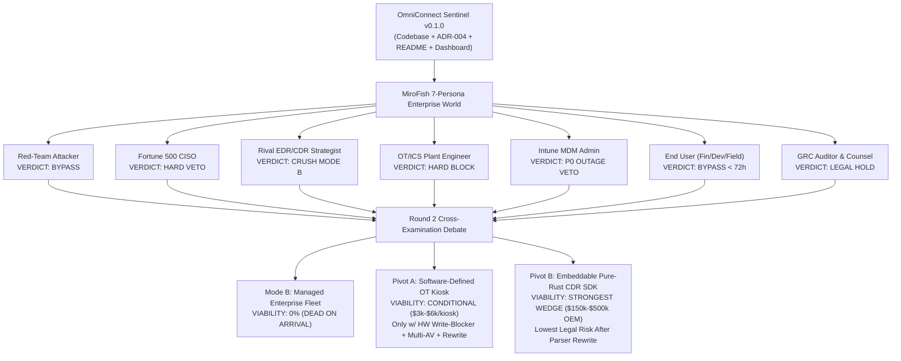

# MiroFish AI-Agents World Validation & Project Flaw Discovery Report: OmniConnect Sentinel

> **Simulation Methodology:** MiroFish-style 2-Round Multi-Agent Adversarial Digital World (`7` autonomous stakeholder personas with conflicting budgets, KPIs, and threat models + `4` cross-agent adversarial debate challenges in Round 2), grounded directly in `c:\Users\hulkh\Downloads\OmniConnect-Sentinel` source code (`file:line` verified) to eliminate LLM confirmation bias.
> **Reusable MiroFish (`666ghj/MiroFish`) Seed Pack:** [`Docs/mirofish_seed/01_project_seed_dossier.md`](file:///c:/Users/hulkh/Downloads/OmniConnect-Sentinel/Docs/mirofish_seed/01_project_seed_dossier.md), [`02_entity_ontology.json`](file:///c:/Users/hulkh/Downloads/OmniConnect-Sentinel/Docs/mirofish_seed/02_entity_ontology.json), [`03_simulation_prompts.md`](file:///c:/Users/hulkh/Downloads/OmniConnect-Sentinel/Docs/mirofish_seed/03_simulation_prompts.md).

---

## 1. Executive Simulation Forecast & Unanimous Verdict

### Stakeholder Vote Matrix

| Persona | Role & Real-World Incentive | Round 1 Verdict | Primary Deal-Killer Discovered |
| :--- | :--- | :---: | :--- |
| **1. Red-Team Attacker** | Bypass Ring 3 controls on Win/Linux | **BYPASS** | Invisible BadUSB HID/MTP/RNDIS/Thunderbolt; broken Linux sysfs paths; CDR entity/stream/passthrough bypasses |
| **2. Fortune 500 CISO** | Flat budget, 50k endpoints, E5 + Falcon | **HARD VETO** | \$8–\$18/seat/mo (\$18M–\$37M 3-yr TCO) for <5% threat vector; zero control plane; zero macOS/mobile |
| **3. Rival EDR/CDR Strategist** | Microsoft / CrowdStrike / OPSWAT | **CRUSH** | \$0–\$1/seat incumbent modules + Microsoft WESP killing kernel-BSOD wedge; 9 CDR formats vs OPSWAT's 200+ |
| **4. OT/ICS Plant Engineer** | IEC 62443 SL-3 substation (Siemens/GE) | **HARD BLOCK** | Hollow `sentinel kiosk` CLI/UI; 512 MiB abort on PLC firmware; CSV negative-number corruption; Win7/2016 crashes |
| **5. Intune MDM Admin** | 50k Win11 + Ubuntu/RHEL fleet | **P0 OUTAGE VETO** | Global `DenyUnspecified=1` + `NoAutoMount=1` + `pnp_devices.first()` bricks docks/WSL2/BitLocker; broken Intune XML |
| **6. Enterprise End User** | Finance / Senior Dev / Field Engineer | **REVOLT < 72h** | `.xlsm` bricking, global `rId` corruption, broken signed PDFs, CSV financial mutation, placebo UI -> Shadow IT |
| **7. GRC Auditor & Counsel** | FedRAMP, IEC 62443, GDPR, FTC, Tort | **LEGAL HOLD** | False `"0% risk"` pin-decoupling UI, fraudulent `"SL-3 ENFORCED"` kiosk output, unvalidated/hand-rolled crypto, spoliation |

### Bottom-Line Viability Split
1. **Mode B (Managed Enterprise Endpoint Fleet at \$8–\$18/seat/month): DEAD ON ARRIVAL (0% Viability).** Unanimously rejected by all 7 personas. Pricing a Windows/Linux-only USB point tool at full-EDR pricing against \$0 incremental Microsoft Defender/Intune and ~\$1/seat/mo CrowdStrike Falcon Device Control—with zero central management server, zero macOS support, broken Intune/SIEM wiring, and global OS locks that cause Day-1 outages—cannot survive any enterprise RFP or pilot.
2. **Pivot A (Air-Gapped OT/ICS Transfer Kiosk at \$3K–\$6K/kiosk/year): CONDITIONAL MID-MARKET SURVIVAL ONLY.** Fortune 500 utilities still prefer \$50k+ OPSWAT for career/audit indemnity, and the shipped `sentinel kiosk` CLI/UI is currently non-functional compliance theater. Viable *only* for mid-market utilities/defense sub-tiers if rebuilt as a dedicated DMZ appliance paired with a ~\$200 physical hardware write-blocker/dual-bay switch, 64 GB streaming scan, vendor Authenticode/GPG passthrough, and pluggable multi-AV.
3. **Pivot B (Embeddable Pure-Rust Sandboxed CDR SDK/Microservice for OEMs): STRONGEST & LOWEST-LIABILITY STRATEGIC PIVOT.** Licensing `sentinel-cdr` + `sentinel-cdr-worker` to SASE/SWG, EDR (moving to Ring 3 under Microsoft WESP), secure browser, and OT gateway OEMs (\$150K–\$500K/yr OEM) eliminates the endpoint agent-sprawl battle and strips away the toxic crypto/shredding/hardware-warranty legal surface—**provided** the shallow denylist AST mutation and data-corruption bugs are replaced with true schema-safe reconstruction and fail-closed worker sandboxing.

---

## 2. Master Ranked Flaw Ledger (Code-Verified & Cross-Examined)

### Tier P0 — Fatal / Existential Deal-Killers (Must Resolve Immediately)

| ID | Flaw Title | Tag | Verified Code / Architecture Evidence | Real-World Failure Scenario |
| :--- | :--- | :--- | :--- | :--- |
| **F-01** | **Hollow Kiosk CLI & Web UI Certify Unscanned Media as `"DEEP_CDR_SANITIZED"` / `"SL-3 ENFORCED"`** | `[CODE-VERIFIED FLAW]` `[COMPLIANCE]` | [`sentinel-cli/src/main.rs:859-931`](file:///c:/Users/hulkh/Downloads/OmniConnect-Sentinel/crates/sentinel-cli/src/main.rs#L859-L931) writes a dummy manifest string, prints *"Executing Offline YARA & Deep CDR disarm..."* without invoking scanner/CDR, signs untouched files in `--export-dir` as `"DEEP_CDR_SANITIZED"`, and prints `"SL-3 ENFORCED"`. Web UI ([`dashboard/app.js:564-585, 733-752`](file:///c:/Users/hulkh/Downloads/OmniConnect-Sentinel/dashboard/app.js#L564-L585), [`main.rs:2044-2061`](file:///c:/Users/hulkh/Downloads/OmniConnect-Sentinel/crates/sentinel-cli/src/main.rs#L2044-L2061)) scans empty `ui_staging_root` (`403` on real USB drives) and turns Step 3 green on `report.complete` without checking `threats.length === 0`. | A substation contractor clicks *"Execute Kiosk Scan"*, watches 0 files scan in `UIStaging`, receives a green *"Safe to Remove — signed audit certificate attached"*, and walks an infected USB onto a turbine EWS. |
| **F-02** | **Deceptive Placebo `"Physical Data Pins: DECOUPLED"` UI Switch & Fabricated Electrical Telemetry** | `[CODE-VERIFIED FLAW]` `[LEGAL]` | [`dashboard/index.html:83-94, 189-204`](file:///c:/Users/hulkh/Downloads/OmniConnect-Sentinel/dashboard/index.html#L189-L204) makes an express warranty (*"Disconnects D+/D- lines ... 0% risk of data theft or malware"*); [`dashboard/app.js:454-510`](file:///c:/Users/hulkh/Downloads/OmniConnect-Sentinel/dashboard/app.js#L454-L510) makes **zero backend calls** and repaints SVG lines only; [`app.js:313-315`](file:///c:/Users/hulkh/Downloads/OmniConnect-Sentinel/dashboard/app.js#L313-L315) hardcodes fake `5.00 V / 0.50 A / 2.50 W` readouts despite `T23` zero-fabrication claims. *(Fixed in the new native Rune UI `sentinel-ui/`.)* | Clinician or defense engineer plugs a phone/cable in trusting `"0% risk"`, exposing live D+/D- lines to BadUSB/MTP exploitation -> FTC Act §5 deceptive-practices & UCC §2-313 express-warranty liability. |
| **F-03** | **Global OS Lockdowns + Random `pnp_devices.first()` Bug Brick Corporate Peripherals, Docks, WSL2 & BitLocker** | `[CODE-VERIFIED FLAW]` `[OPERATIONAL]` | [`mount_control.rs:1526-1572, 829-907`](file:///c:/Users/hulkh/Downloads/OmniConnect-Sentinel/crates/sentinel-sys/src/mount_control.rs#L1526-L1572) sets `DeviceInstall\Restrictions\DenyUnspecified=1` (allowing only SanDisk/Kingston by default in [`intune.rs:40-43`](file:///c:/Users/hulkh/Downloads/OmniConnect-Sentinel/crates/sentinel-core/src/enterprise/intune.rs#L40-L43)), global `NoAutoMount=1`, global `WriteProtect=1`, and Linux `authorized_default=0`. Worse, [`windows_umdf.rs:202-224`](file:///c:/Users/hulkh/Downloads/OmniConnect-Sentinel/crates/sentinel-core/src/interceptor/windows_umdf.rs#L202-L224) and [`linux_udev.rs:189-211`](file:///c:/Users/hulkh/Downloads/OmniConnect-Sentinel/crates/sentinel-core/src/interceptor/linux_udev.rs#L189-L211) stamp `pnp_devices.first()` (arbitrary webcam/dock/touchscreen/dongle from unordered `HashMap`) onto every USB volume, causing [`sentinel-core/src/main.rs:189-203`](file:///c:/Users/hulkh/Downloads/OmniConnect-Sentinel/crates/sentinel-core/src/main.rs#L189-L203) to call `CM_Disable_DevNode` on the **wrong device**. | Day-1 rollout bricks USB-C docks, headsets, YubiKeys, WSL2/Docker VHDX, BitLocker To Go, IronKeys, and HMI touchscreens/PLC license dongles across 50,000 laptops. |
| **F-04** | **Silent Financial, Engineering & Legal Data Destruction Inside CDR (`openxml.rs`, `text.rs`, `pdf.rs`)** | `[CODE-VERIFIED FLAW]` `[LEGAL / UX]` | 1. **CSV (`text.rs:59-100`)**: Prepends `'` to *every* cell starting with `-` or `+` (`-45000.00` -> `'-45000.00`), corrupting financial debits, GPS coords, and SCADA negative calibration setpoints; naive `split(',')` breaks quoted fields and misses quoted formulas (`"=..."`). 2. **OOXML (`openxml.rs:207, 552-571, 900-913`)**: Single global `removed_rel_ids` across all `.rels` parts corrupts valid `rId1` sheets/charts in unrelated XML files; rewrites `.xlsm` ContentType to `.xlsx` without renaming `.xlsm` (Excel refuses to open). 3. **PDF (`pdf.rs:132-160, 228-286, 405-487`)**: Unconditional `lopdf::Document::save_to` cryptographically breaks 100% of DocuSign/PAdES/eIDAS signatures; strips `/AF` (Factur-X EU e-invoices), `/XFA` forms, and `/URI` hyperlinks. | Quarter-end `SUM()` omits negative expenses; SCADA turbine calibration offsets coerce to `0`; executed M&A DocuSign PDFs show `"Signature INVALID"` -> tort & spoliation exposure. |
| **F-05** | **Ring 3 Architectural Bypasses & 100% Broken Linux USB Blocking** | `[CODE-VERIFIED FLAW]` `[OS LIMITATION]` | Standalone BadUSB HID, RNDIS/ECM network gadgets, MTP/PTP phones, and Thunderbolt/USB4 NVMe (`BusTypeNvme`) are invisible ([`windows_umdf.rs:182-199`](file:///c:/Users/hulkh/Downloads/OmniConnect-Sentinel/crates/sentinel-core/src/interceptor/windows_umdf.rs#L182-L199), [`mount_control.rs:511, 1669-1683`](file:///c:/Users/hulkh/Downloads/OmniConnect-Sentinel/crates/sentinel-sys/src/mount_control.rs#L1669-L1683)). On Linux, `sentinel-agent` formats IDs as Windows `USB\VID_...` ([`sentinel-core/src/main.rs:186`](file:///c:/Users/hulkh/Downloads/OmniConnect-Sentinel/crates/sentinel-core/src/main.rs#L186)), so `disable_device_node` writes a non-existent sysfs path ([`mount_control.rs:1861-1875`](file:///c:/Users/hulkh/Downloads/OmniConnect-Sentinel/crates/sentinel-sys/src/mount_control.rs#L1861-L1875)), while `set_volume_offline`, `delete_volume_mount_point`, and `apply_usb_storage_and_install_policies` are empty `Ok(())` no-ops ([`mount_control.rs:1065-1577`](file:///c:/Users/hulkh/Downloads/OmniConnect-Sentinel/crates/sentinel-sys/src/mount_control.rs#L1065-L1069)). | Adversary plugs in standalone HID BadUSB, Android MTP phone, or Thunderbolt SSD with zero alerts. Linux endpoints execute 0% of USB blocks. |
| **F-06** | **Multiple Active CDR Parser Bypasses (XML Entity Smuggling, Stream-Blind PDF Lexer, Verbatim Passthrough)** | `[CODE-VERIFIED FLAW]` | [`pdf.rs:31-107`](file:///c:/Users/hulkh/Downloads/OmniConnect-Sentinel/crates/sentinel-cdr/src/sanitizers/pdf.rs#L31-L107) scans raw PDF bytes without skipping `stream...endstream` (a single `(` blinds the `RUSTSEC-2026-0187` guard); `/EF` without `/Type /Filespec` survives ([`pdf.rs:463-477`](file:///c:/Users/hulkh/Downloads/OmniConnect-Sentinel/crates/sentinel-cdr/src/sanitizers/pdf.rs#L463-L477)). [`openxml.rs:650, 700-713, 1012-1032`](file:///c:/Users/hulkh/Downloads/OmniConnect-Sentinel/crates/sentinel-cdr/src/sanitizers/openxml.rs#L650) skips XML entity decoding (`&#102;ile:`), allows `search-ms:`/`ms-appinstaller:` URIs, misses split-run DDE, passes `.wmf`/`.emf`/`.bin` (and `.exe`/`.ps1` when `allow_generic_zip=true`) verbatim. [`ole2.rs:199-218`](file:///c:/Users/hulkh/Downloads/OmniConnect-Sentinel/crates/sentinel-cdr/src/sanitizers/ole2.rs#L199-L218) omits `"equation native"` despite README CVE-2017-11882 claim. | Crafted `.docx` / `.pdf` passes CDR as "sanitized" and lands on ProjFS (which strips MotW `ZoneId=3` at [`fs_lowlevel.rs:2142-2153`](file:///c:/Users/hulkh/Downloads/OmniConnect-Sentinel/crates/sentinel-sys/src/fs_lowlevel.rs#L2142-L2153)), executing in Office without Protected View. |
| **F-07** | **Zero Fleet Control Plane, Disconnected Intune Profile & Internal SIEM Hard-Blocked as SSRF** | `[CODE-VERIFIED FLAW]` `[COMMERCIAL]` | `enterprise/` has only 4 local files—zero server/RBAC/console. [`intune.rs:597-674`](file:///c:/Users/hulkh/Downloads/OmniConnect-Sentinel/crates/sentinel-core/src/enterprise/intune.rs#L597-L674) exports unregistered OMA-URI XML that `load_active_policy()` ([`:526-544`](file:///c:/Users/hulkh/Downloads/OmniConnect-Sentinel/crates/sentinel-core/src/enterprise/intune.rs#L526-L544)) never reads; root signing CA keys are hardcoded ([`:68-97`](file:///c:/Users/hulkh/Downloads/OmniConnect-Sentinel/crates/sentinel-core/src/enterprise/intune.rs#L68-L97)); registry read caps at 1024 UTF-16 chars ([`mount_control.rs:672`](file:///c:/Users/hulkh/Downloads/OmniConnect-Sentinel/crates/sentinel-sys/src/mount_control.rs#L672)). [`falcon.rs:414-418`](file:///c:/Users/hulkh/Downloads/OmniConnect-Sentinel/crates/sentinel-core/src/enterprise/falcon.rs#L414-L418) & [`tier3_sandbox.rs:38-85`](file:///c:/Users/hulkh/Downloads/OmniConnect-Sentinel/crates/sentinel-core/src/scanner/tier3_sandbox.rs#L38-L85) hard-block all RFC 1918 private IPs (`10/8`, `172.16/12`, `192.168/16`), breaking internal enterprise SIEM collectors; `flush_spool()` is never called; `falcon.rs` hardcodes `.with_no_client_auth()` (contradicting CBOM mTLS claim) and has zero Falcon FDR/NDJSON. | Deploying to 50,000 hosts fails Intune MDM ingestion, silently falls back to SanDisk/Kingston defaults, and blocks 100% of internal corporate SIEM telemetry as `SSRF_VIOLATION`. |
| **F-08** | **Broken ProjFS Fallback Locks Out Standard Users (`Access Denied`) & Drops Threat Quarantine** | `[CODE-VERIFIED FLAW]` `[OPERATIONAL]` | `Client-ProjFS` is off by default on Win11 (requires FoD + fleet reboot). Fallback `StagingFolderProvider` ([`vfs/mod.rs:1380, 1616-1692`](file:///c:/Users/hulkh/Downloads/OmniConnect-Sentinel/crates/sentinel-core/src/vfs/mod.rs#L1616-L1692)) materializes plaintext files with `SYSTEM`/`Admins`-only SDDL ([`fs_lowlevel.rs:1068`](file:///c:/Users/hulkh/Downloads/OmniConnect-Sentinel/crates/sentinel-sys/src/fs_lowlevel.rs#L1068)) -> standard users get `Access Denied` on `C:\OmniConnect\SafeDrive` (also hardcoded on Linux at [`sentinel-core/src/main.rs:274`](file:///c:/Users/hulkh/Downloads/OmniConnect-Sentinel/crates/sentinel-core/src/main.rs#L274)), AND fails to override `take_withheld_threats()`, silently skipping quarantine. Linux [`fuse.rs:81-111`](file:///c:/Users/hulkh/Downloads/OmniConnect-Sentinel/crates/sentinel-core/src/vfs/fuse.rs#L81-L111) shells out to unlisted `bindfs -r` rather than a FUSE3 daemon. | Standard corporate users cannot read their own sanitized USB files; Linux agents literally create a root-only `C:\OmniConnect\SafeDrive` folder. |
| **F-09** | **Catastrophic Mode B Economics, Missing macOS/Mobile & Expiring Kernel-BSOD Wedge** | `[MARKET / COMMERCIAL]` | [`ADR-004:108-127`](file:///c:/Users/hulkh/Downloads/OmniConnect-Sentinel/Docs/ADR-004_optimal_hybrid_architecture_decision.md#L108-L127) claims universal Win/macOS/mobile support at \$8–\$18/seat/mo, but zero macOS/iOS/Android code exists (`macOS` falls back to `WindowsUmdfInterceptor` + no-op sandboxing). Competes against \$0 M365 E5 Defender Device Control + ~\$1/seat CrowdStrike Falcon Device Control while Microsoft WESP / MVI 3.0 moves incumbent EDRs to Ring 3 anyway. | 10k-seat enterprise rejects \$1.44M/yr pitch on Slide 3 because E5 costs \$0 incremental and Falcon covers Windows + macOS for ~\$100k/yr with zero extra agents. |
| **F-10** | **FIPS 140-3 / 186-5 Overclaiming, Hand-Rolled Crypto & Forgeable Linux Audit Ledger** | `[CODE-VERIFIED FLAW]` `[COMPLIANCE]` | Uses unvalidated pure-Rust crates (`aes-gcm`, `p256`, `rsa`, `ml-kem`, `ring`) + hand-rolled Keccak/HKDF ([`crypto_seal.rs:2738-2824`](file:///c:/Users/hulkh/Downloads/OmniConnect-Sentinel/crates/sentinel-sys/src/crypto_seal.rs#L2738-L2824), [`quarantine.rs:762-814`](file:///c:/Users/hulkh/Downloads/OmniConnect-Sentinel/crates/sentinel-core/src/scanner/quarantine.rs#L762-L814)), SHA-1 OAEP fallback ([`crypto_seal.rs:467-468`](file:///c:/Users/hulkh/Downloads/OmniConnect-Sentinel/crates/sentinel-sys/src/crypto_seal.rs#L467-L468)), and zero `BCryptGetFipsAlgorithmMode` check. Linux writes plaintext 32-byte `master.seed` (`0400`, [`crypto_seal.rs:954-1007`](file:///c:/Users/hulkh/Downloads/OmniConnect-Sentinel/crates/sentinel-sys/src/crypto_seal.rs#L954-L1007)), enabling full offline forgery of `audit.jsonl` + `.head.sig`. `sentinel-cbom.cdx.json` falsely attests SIEM mTLS and `hardware-tee`. | Immediate ATO denial on FedRAMP/DoD/SCIF audits; False Claims Act (31 U.S.C. §3729) exposure if pitched with FIPS compliance. |

---

### Tier P1 — Severe Architectural, Operational & Liability Flaws

| ID | Flaw Title | Tag | Verified Code Evidence | Impact |
| :--- | :--- | :--- | :--- | :--- |
| **F-11** | **OT Payload Blackout & Toy Malware Coverage (9 CDR Formats, 4 YARA Rules, 1 Hash, 512 MiB Abort)** | `[CODE-VERIFIED FLAW]` | [`vfs/mod.rs:38-39, 735-759`](file:///c:/Users/hulkh/Downloads/OmniConnect-Sentinel/crates/sentinel-core/src/vfs/mod.rs#L38-L39) aborts entire USB on any >512 MiB file; [`engine.rs:359-378`](file:///c:/Users/hulkh/Downloads/OmniConnect-Sentinel/crates/sentinel-cdr/src/engine.rs#L359-L378) allows only 9 formats (zero `.iso`, `.7z`, `.rar`, `.cab`, `.dwg`, `.dcm`, `.eml`, `.doc`, `.fw`, `.bin` verification); [`tier0_yara.rs:15-80`](file:///c:/Users/hulkh/Downloads/OmniConnect-Sentinel/crates/sentinel-core/src/scanner/tier0_yara.rs#L15-L80) has 4 hardcoded YARA rules + 1 EICAR hash with dead offline rule-pack persistence ([`universal_scanner.rs:195`](file:///c:/Users/hulkh/Downloads/OmniConnect-Sentinel/crates/sentinel-core/src/scanner/universal_scanner.rs#L195)). | Blocks 100% of real Siemens/Rockwell/GE firmware bundles and loses every bake-off against OPSWAT (200+ formats, 30+ AV engines). |
| **F-12** | **Non-Existent MicroVM Detonation & Remote Sandbox Never Uploads File Bytes** | `[CODE-VERIFIED FLAW]` | Zero WHVP/KVM/QEMU code in workspace; [`tier3_sandbox.rs:312-318`](file:///c:/Users/hulkh/Downloads/OmniConnect-Sentinel/crates/sentinel-core/src/scanner/tier3_sandbox.rs#L312-L318) sends only metadata (`file_name`, `sha256_hex`, `size_bytes`) — never `request.file_bytes`; offline fallback ([`:404-460`](file:///c:/Users/hulkh/Downloads/OmniConnect-Sentinel/crates/sentinel-core/src/scanner/tier3_sandbox.rs#L404-L460)) is 4 ASCII string checks. | Paid B2B "OpenSandbox" tier cannot detonate novel malware samples. |
| **F-13** | **Default-to-Permanent-Shred (`Default: 1`) on Aggressive False Positives & Invalid Flash `"Purge"` Receipts** | `[CODE-VERIFIED FLAW]` `[LEGAL]` | [`sentinel-cli/src/main.rs:1237-1270`](file:///c:/Users/hulkh/Downloads/OmniConnect-Sentinel/crates/sentinel-cli/src/main.rs#L1237-L1270) defaults empty Enter/EOF to irreversible 3-pass shred without quarantine backup on files flagged at 96–100 (any `.enc` backup, password-protected `.pdf`/`.zip`, packed vendor tool). [`quarantine.rs:1369-1375`](file:///c:/Users/hulkh/Downloads/OmniConnect-Sentinel/crates/sentinel-core/src/scanner/quarantine.rs#L1369-L1375) certifies `CryptographicErasePurge` after logical `.dek` overwrite while KEK/escrow remain live; [`secure_shredder.rs:422-457`](file:///c:/Users/hulkh/Downloads/OmniConnect-Sentinel/crates/sentinel-core/src/scanner/secure_shredder.rs#L422-L457) returns `Ok` even if verification fails; Rev 1 vs Rev 2 mismatch across README/code. | Sole copy of critical backup obliterated on Enter -> FRCP 37(e) spoliation & NISPOM flash-remanence audit failure. |
| **F-14** | **Zero Enterprise Packaging / Windows SCM / Legacy OT OS Crashes / Phantom `--break-glass-token`** | `[CODE-VERIFIED FLAW]` `[OPERATIONAL]` | Zero MSI/DEB/RPM/`systemd`/`udev` files; `sentinel-agent` lacks `StartServiceCtrlDispatcherW` (Error 1053 under SCM); `CreateAppContainerProfile` fails under `SYSTEM` Session 0 and crashes Win7; `ProcessChildProcessPolicy` fails 100% of CDR on Win10 1607 LTSB / Server 2016 ([`sandbox_worker.rs:568, 969`](file:///c:/Users/hulkh/Downloads/OmniConnect-Sentinel/crates/sentinel-sys/src/sandbox_worker.rs#L568)); `--break-glass-token` documented in `README.md:66, 324` does not exist in `sentinel-cli`; `confirm-device` uses CWD-relative `.sentinel_vault`, 300s TTL, and swallows `enable_device_node` errors ([`interceptor/mod.rs:327-329`](file:///c:/Users/hulkh/Downloads/OmniConnect-Sentinel/crates/sentinel-core/src/interceptor/mod.rs#L327-L329)). | Unusable under Intune/SCM, crashes legacy OT stations, and triggers 3 AM turbine-trip bypasses. |
| **F-15** | **Unwired Named Pipe Daemon, Over-Permissive `AC` SDDL, Worker Sandbox Fail-Open & UI Token Leak** | `[CODE-VERIFIED FLAW]` | [`sentinel-cdr/src/main.rs:52-86`](file:///c:/Users/hulkh/Downloads/OmniConnect-Sentinel/crates/sentinel-cdr/src/main.rs#L52-L86) never serves Named Pipe gRPC; [`sandbox_worker.rs:1047`](file:///c:/Users/hulkh/Downloads/OmniConnect-Sentinel/crates/sentinel-sys/src/sandbox_worker.rs#L1047) grants pipe RW to `ALL APPLICATION PACKAGES (AC)`; Windows retries without CIG ([`:653-659`](file:///c:/Users/hulkh/Downloads/OmniConnect-Sentinel/crates/sentinel-sys/src/sandbox_worker.rs#L653-L659)); Linux ignores `unshare` failure ([`bpf_sandbox.rs:460-467`](file:///c:/Users/hulkh/Downloads/OmniConnect-Sentinel/crates/sentinel-sys/src/bpf_sandbox.rs#L460-L467)); `sentinel ui` exposes `#bootstrap=` in `rundll32`/`xdg-open` process args ([`main.rs:2421-2453`](file:///c:/Users/hulkh/Downloads/OmniConnect-Sentinel/crates/sentinel-cli/src/main.rs#L2421-L2453)) and serves assets from untrusted CWD (`:2455`). | Same-user malware hijacks localhost UI session; Linux CDR runs without network/IPC namespace isolation; BadUSB can self-confirm via `.token` file path ([`main.rs:1151-1158`](file:///c:/Users/hulkh/Downloads/OmniConnect-Sentinel/crates/sentinel-cli/src/main.rs#L1151-L1158)). |
| **F-16** | **GDPR / HIPAA / DPDP PII Leakage, 128 MiB CERT-In Log Eviction & Un-HSM'd Single-Key Escrow** | `[CODE-VERIFIED FLAW]` `[COMPLIANCE]` | `.quar` headers store plaintext `original_path` JSON ([`quarantine.rs:67-91`](file:///c:/Users/hulkh/Downloads/OmniConnect-Sentinel/crates/sentinel-core/src/scanner/quarantine.rs#L67-L91)); `siem_spool.sealed` silently evicts oldest logs (`retained.remove(0)`) past 128 MiB regardless of 180-day CERT-In window ([`falcon.rs:700-705`](file:///c:/Users/hulkh/Downloads/OmniConnect-Sentinel/crates/sentinel-core/src/enterprise/falcon.rs#L700-L705)); single host `privacy_hmac.sealed` breaks per-subject GDPR Art. 17 erasure; default `SocEscrowUnconfigured` causes total data loss on TPM reset while optional escrow uses a single un-quorumed JSON private key file. | Statutory GDPR/DPDP/CERT-In penalties and unrecoverable false-positive data loss on hardware replacement. |

---

### Tier P2/P3 — Additional Fidelity & UX Flaws
- **F-17 (P2) Image CDR Degradation (`image.rs:286-288, 396-409`)**: Ignores EXIF Orientation (rotates smartphone photos 90°), re-encodes JPEGs at Q75, and strips `APP2` (ICC) + `APP14` (Adobe CMYK transform -> inverted colors) + FLIR radiometric telemetry.
- **F-18 (P2) Windows Air-Gapped NTP Fraud (`mount_control.rs:2259-2303`)**: Marks air-gapped hosts with `W32Time` pointing at unreachable `time.windows.com` as `ntp_synchronized: true, stratum: Some(2)`, while marking IRIG-B/PTP substations as unsynchronized.
- **F-19 (P3) Version & Branding Drift**: `Cargo.toml` (`0.1.0`) vs. `dashboard/index.html` (`v2.4.0 Ring 3`) vs. `README.md` (`v3`) breaks SBOM/CBOM configuration traceability.

---

## 3. Round 2 Strategic Convergence & Concrete Remediation Roadmap

### Immediate "Stop-Bleeding" Actions (Before Any External Demo, Pitch, or Audit)
1. **Retract Misleading Claims & Placebo Controls:**
   - Remove `"Physical Data Pins: DECOUPLED"`, `"0% risk"`, `"0% BSOD Risk"`, and fake `5.00 V / 0.50 A` telemetry from `dashboard/` (already fixed in the new native Rune UI `sentinel-ui/`).
   - Remove `"SL-3 ENFORCED"` and unscanned `"DEEP_CDR_SANITIZED"` passport signing from `sentinel kiosk` (`crates/sentinel-cli/src/main.rs:859-931`).
   - Change `prompt_remediation()` default (`main.rs:1237-1270`) from `[1] PERMANENT SHRED` to `[3] SKIP`.
   - Update `README.md` and `sentinel-cbom.cdx.json` to mark pure-Rust crypto `"certificationLevel": ["none"]`, remove the false SIEM mTLS claim, reconcile NIST 800-88 Rev 1 vs Rev 2, and align version numbers (`0.1.0`).
2. **Fix High-Blast-Radius Data Corruption & Hardware Bugs:**
   - Fix `TextCsvSanitizer` (`text.rs:59-100`) to use an RFC 4180 parser that never corrupts numeric `-42.5` / `+5.0` cells while neutralizing quoted formulas (`"=..."`).
   - Fix `OpenXmlSanitizer` (`openxml.rs:207, 552-571, 650`) to scope `removed_rel_ids` per `.rels` part, decode XML entities before scheme inspection, enforce allowlist-only nested parts, and preserve/rename `.xlsm` consistently.
   - Detect digitally signed PDFs, XFA forms, and Factur-X `/AF` payloads in `pdf.rs` rather than silently invalidating legal contracts, and fix the stream-blind nesting pre-scanner (`pdf.rs:31-107`).
   - Fix `pnp_devices.first()` attribution (`windows_umdf.rs:202`, `linux_udev.rs:189`) to correlate exact volume-to-USB-device-instance parent nodes via SetupAPI / sysfs topology, and scope OS holds away from `DenyUnspecified=1`.

### Strategic Product Direction (Choose ONE — Kill Mode B Corporate Fleet)
- **Recommended Primary Path — Pivot B (`sentinel-cdr` OEM Pure-Rust Sandboxed CDR SDK):**
  - Strip away the unwinable corporate USB-agent battle against Microsoft E5 / CrowdStrike.
  - Upgrade `sentinel-cdr` + `sentinel-cdr-worker` from shallow AST denylist mutation to **strict allowlist structural reconstruction** (PDF re-rendering / strict schema rebuild, RFC 4180 CSV, per-part OOXML, fail-closed CIG/Landlock/`unshare`), expand format coverage (archives, CAD, email, DICOM), and license as a memory-safe `#![forbid(unsafe_code)]` CDR engine to SASE/SWG, EDR (WESP Ring 3), and OT gateway OEMs.
- **Alternative Secondary Path — Pivot A (Hardware-Anchored Mid-Market OT Transfer Appliance):**
  - Target mid-market utilities/manufacturing priced out of \$50k+ OPSWAT at **\$3K–\$6K/kiosk/year** — strictly as a dedicated DMZ appliance image paired with a ~\$200 physical Bay-1 RO / Bay-2 RW hardware write-blocker, 64 GB streaming scan with bit-exact Authenticode/GPG firmware passthrough, pluggable multi-AV (ClamAV + persisted YARA/Defender), discrete TPM 2.0 + WORM logging, and glove-ready touchscreen UI (where the new native Rune GPU `sentinel-ui` Kiosk surface shines!).
