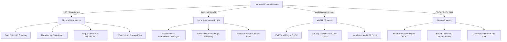
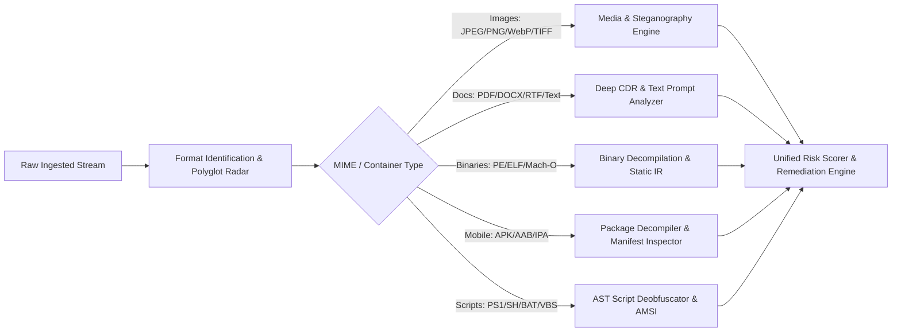
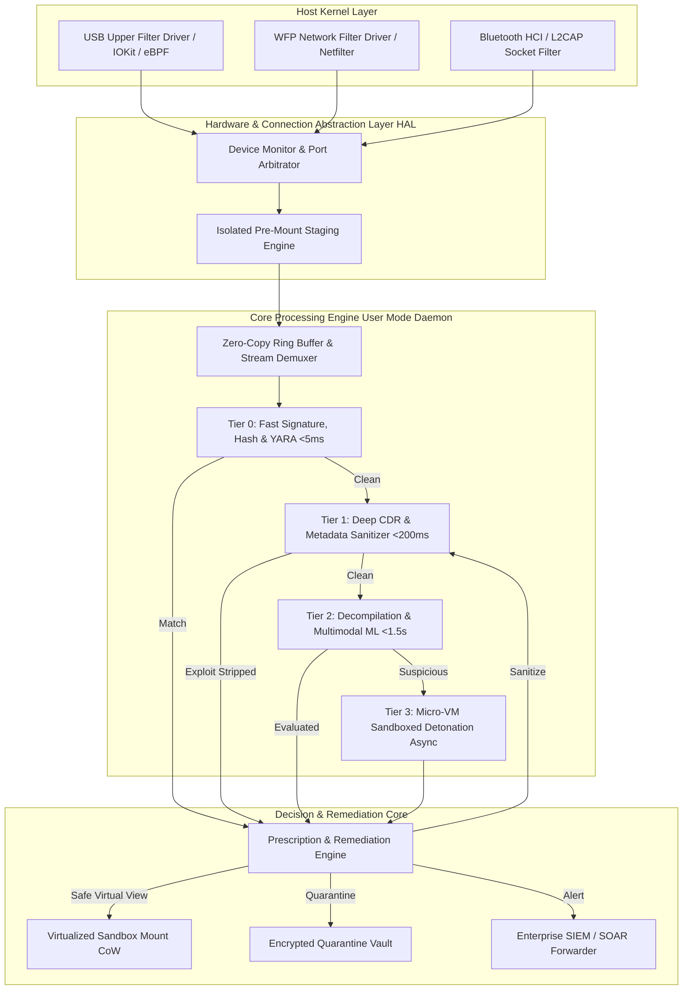
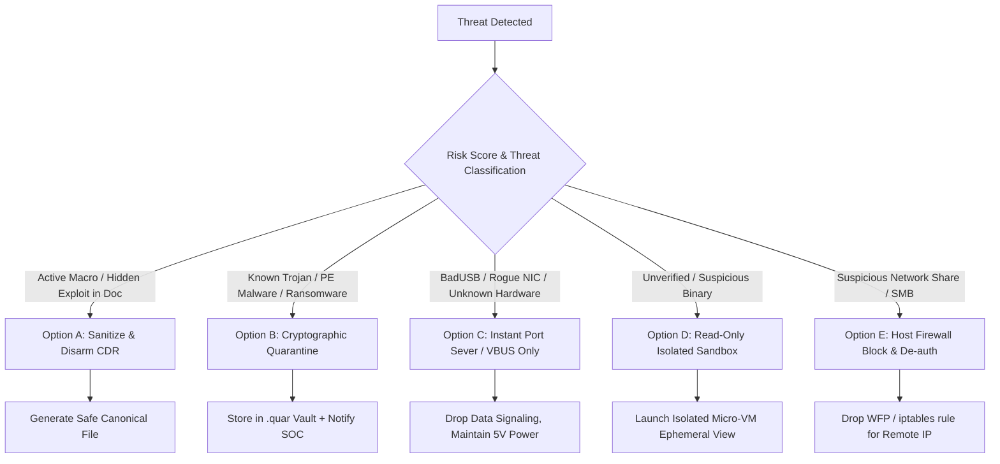

# Product, Architecture & Security Analysis: OmniConnect Sentinel
**Universal Peripheral, Wireless & Wire Connection Threat Interceptor & Remediation Engine**

---

## 1. Executive Summary & Vision

### Current State
Today’s endpoint security solutions (Microsoft Defender, Malwarebytes, CrowdStrike, SentinelOne) are heavily optimized for **post-mount execution monitoring** and **network perimeter telemetry**. However, when a foreign device connects to an endpoint (via physical USB, Thunderbolt, MTP/PTP, Bluetooth OBEX/PAN, Wi-Fi Direct, or Local Subnet/LAN), the host operating system typically **mounts or establishes communication channels automatically** before files and payloads are verified. While specialized air-gapped appliances exist (e.g., OPSWAT MetaDefender Kiosks), no cohesive, cross-platform product provides **pre-mount, zero-trust protocol isolation, deep multi-modal content inspection (images, documents, executables, scripts, mobile packages), and prescription-based automated remediation** across both laptops and mobile devices.

### The Opportunity: OmniConnect Sentinel
**OmniConnect Sentinel** is an enterprise-grade, zero-trust peripheral and connection sentry designed to run natively on laptops (Windows, macOS, Linux) and mobile devices (Android, iOS companion). It intercepts connection events at the kernel/bus driver and network protocol layer **before file systems mount or communication channels establish**, executes a tiered multi-modal inspection (signatures, YARA, Deep Content Disarm & Reconstruction [CDR], decompilation, and multimodal ML for steganography/prompt-injection), flags malicious/suspicious content, and recommends or executes intelligent, context-aware remediation (Sanitize, Cryptographic Quarantine, Hardware Port Throttling, or Isolated Sandboxed Detonation).

### Biggest Risk
- **Usability vs. Latency Friction**: Blocking or delaying user access to high-capacity storage drives (e.g., a 2TB USB-C SSD or large camera SD card) or causing user interruption during urgent Bluetooth/Wi-Fi transfers. Mitigated via a **Tiered Progressive Mount Architecture** (instant streaming scan of root directories with lazy background block verification) and **Read-Only Virtualized Sandboxing**.
- **Hardware-Level Exploits (BadUSB / DMA)**: Peripheral attacks that do not rely on malicious files, but instead spoof Human Interface Devices (HID Rubber Ducky) or execute direct memory access (DMA over Thunderbolt/PCIe). Mitigated via **USB Class Whitelisting, IOMMU enforcement, and USBGuard-style packet authorization**.

---

## 2. Competitive Landscape & Market Prior Art

To establish clear differentiation, we analyze the current market leaders across endpoint security, device control, and peripheral defense:

| Vendor / Solution | Architectural Approach | Connection Vectors Handled | Inspection Depths | Critical Gaps & Limitations |
| :--- | :--- | :--- | :--- | :--- |
| **Microsoft Defender for Endpoint (MDE)** | OS-integrated EDR + Intune Attack Surface Reduction (ASR) rules. | USB Storage (removable media), WPD (mobile devices), Network Shares. | Real-time on-access AV, cloud heuristics, AMSI script scanning. | Scans on *access/execution*, not instantaneous zero-trust pre-mount. Scans are disabled by default on plug-in to avoid I/O lag. No deep CDR; limited Bluetooth/AirDrop payload interception. |
| **OPSWAT MetaDefender (Kiosk / Drive)** | Dedicated hardware kiosk / bootable USB Linux OS for air-gapped ingress. | USB, CD/DVD, SD, external hard drives, mobile devices. | 30+ Multiscanning AV engines, Deep CDR™, file vulnerability assessment, proactive DLP. | Expensive hardware kiosk ($15k–$40k+), stationary; cannot run as a lightweight native daemon on employee laptops or mobile smartphones during everyday travel. |
| **CrowdStrike Falcon (Device Control)** | Falcon Sensor agent with kernel-level driver enforcement. | USB storage, Bluetooth adapters, Firewire. | Policy-based read/write/execute blocking based on VID/PID/serial number. | Primarily an *access control policy* tool (allow/block list by vendor/model), not an inline deep multi-modal payload inspection/CDR engine. |
| **Malwarebytes Endpoint Protection** | Cross-platform endpoint protection agent. | Local disk, mapped network drives, removable USB storage. | Behavioral heuristic engine, signature DB, exploit mitigation. | Traditional on-access/on-demand scanning. Does not disarm files (no CDR), lacks Bluetooth OBEX/PAN interception, no mobile-to-laptop bi-directional scan. |
| **Samsung Knox Auto Blocker** (One UI 6.0+) | Android OS-level hardware policy enforcement. | USB-C charging/data cable. | Blocks unauthorized USB software updates, blocks ADB commands, blocks malicious images in messaging apps. | Mobile-only (Samsung Galaxy exclusive); binary toggle (allow/block commands); does not provide deep file inspection or granular remediation recommendations. |
| **Apple iOS (Restricted Mode & Lockdown Mode)** | iOS kernel/Secure Enclave hardware restriction. | Lightning / USB-C port, AirDrop, iMessage. | Disables wired USB data connection after 1 hour of lock; blocks complex web/image formats in Lockdown Mode. | Extreme usability penalty (disables standard features); lacks inspection UI; no enterprise CDR export or custom remediation workflow. |
| **USBGuard (Open Source Linux)** | Linux kernel userspace daemon via `netlink` and `/sys/bus/usb`. | Physical USB interfaces. | Rule-based USB device descriptor and interface class authorization. | Only verifies USB descriptors (blocks BadUSB); does not inspect file systems, images, executables, or wireless transfers. |

### The Competitive Moat of OmniConnect Sentinel
1. **Universal Multi-Vector Interception**: Unified security daemon covering **Wire** (USB Mass Storage, MTP, RNDIS), **LAN** (SMB, NFS, UPnP), and **Wireless** (Bluetooth OBEX/PAN, Wi-Fi Direct, Nearby Share).
2. **Inline Deep CDR (Content Disarm & Reconstruction)**: Instead of binary "Allow" or "Delete", it neutralizes documents, PDFs, and images, generating sterile 100% clean replicas in real time.
3. **Multi-Modal Payload Intelligence**: Inspects not just traditional PE/ELF malware, but **image steganography**, **embedded scripts**, **malicious APK/IPA packages**, and **generative AI prompt injection/jailbreak text files** destined for corporate LLMs/RAG.
4. **Bi-Directional Mobile & Laptop Parity**: Ability for a laptop to scan an attached mobile device (via MTP/AFC), and conversely for a mobile device (via USB-C OTG) to inspect a flash drive or peripheral before connecting to a network.

---

## 3. Threat Model & Attack Surface Analysis (/cybersecurity-engineer)

### 3.1 Attack Vectors per Connection Interface



#### Vector 1: Physical Wire (USB, Thunderbolt, USB-C OTG, Lightning)
- **BadUSB / Rubber Ducky (HID Injection)**: Device presents itself as a keyboard/mouse and types high-speed malicious PowerShell/bash commands within milliseconds of insertion.
- **Direct Memory Access (DMA) Exploits (Thunderclap)**: Malicious Thunderbolt/PCIe devices bypass OS memory protection and read/write kernel memory directly.
- **Rogue Network Interface Card (RNDIS / CDC-ECM Spoofing)**: Device presents as an Ethernet adapter, assigns rogue DNS via DHCP, and intercepts all endpoint traffic.
- **MTP / PTP Path Traversal & Buffer Overflows**: Exploits in OS media transfer parsers during device enumeration.
- **File Payloads**: Weaponized autorun payloads, LNK shortcut files, malicious Office macros, PE/ELF Trojans, APKs.

#### Vector 2: Local Area Network (LAN / Ethernet)
- **Rogue Shares & Auto-Mounting**: Malicious SMBv1/v2/v3 shares delivering payloads or harvesting NTLMv2 password hashes via NetNTLM leak vectors (desktop.ini / icon paths).
- **mDNS / LLMNR / NetBIOS Poisoning**: Rogue device responds to local broadcast requests, redirecting network traffic to attacker-controlled listeners.

#### Vector 3: Wi-Fi (Wi-Fi Direct, Hotspot Tethering, Nearby Share)
- **Zero-Click P2P Delivery**: Exploitation of wireless daemon vulnerabilities (e.g., AWDL AirDrop zero-day vulnerabilities, Android Quick Share Wi-Fi Direct handshake flaws).
- **Rogue Captive Portals / DNS Hijack**: Redirecting connected laptops/mobiles to credential-harvesting or drive-by download servers.

#### Vector 4: Bluetooth (Classic & BLE)
- **OBEX Object Push Abuse**: Unsolicited pushing of weaponized `.vcf`, `.apk`, or image polyglots.
- **Bluetooth PAN (Personal Area Network)**: Setting up an ad-hoc IP network that bypasses corporate perimeter firewalls.
- **HID Emulation via Bluetooth**: Pairing as an unauthorized BLE keyboard to execute keystroke injection.

---

### 3.2 STRIDE Threat Modeling Matrix

| Threat Category | Target Component | Threat Scenario | Impact | Mitigation in OmniConnect Sentinel |
| :--- | :--- | :--- | :--- | :--- |
| **Spoofing** | USB Descriptors / Bluetooth HCI | Malicious device claims to be a SanDisk USB flash drive but registers a secondary HID keyboard descriptor. | Remote Code Execution via keystroke injection. | **Composite Device Quarantine**: Strict interface class validation. Non-storage descriptors on storage devices are blocked immediately. |
| **Tampering** | File System / Data in Transit | Attacker swaps clean document with an exploit payload during read operations (Time-of-Check to Time-of-Use - TOCTOU). | Memory corruption / host compromise. | **Cryptographic Hash Pinning & Shadow Volume Copy**: Files are staged in an immutable, isolated cache prior to analysis and host access. |
| **Repudiation** | Audit Logging | Attacker connects rogue device, steals data or drops payload, and unplugs device before logs are committed. | Zero forensic evidence for SOC triage. | **Synchronous Hardware Journaling**: Device connection metadata (VID, PID, iSerial, USB bus tree, MAC) committed to tamper-proof local WAL before mount. |
| **Information Disclosure** | Host Memory via Thunderbolt/USB4 | Malicious accessory initiates DMA access to read host cryptographic keys or encryption master keys. | Full system compromise / BitLocker bypass. | **Kernel DMA Protection & IOMMU Grouping**: Enforce VT-d / AMD-Vi; block PCIe tunneling until user biometric authorization. |
| **Denial of Service** | File Parser / Scan Engine | Attacker inserts drive containing recursive ZIP bombs (42.zip), Decompression Bombs, or malformed TIFF headers. | Host CPU/RAM starvation; scanner crash. | **Bounded Resource Execution**: Hard memory limits (cgroups/Job Objects), depth recursion limits, and stream byte-caps in safe sandboxes. |
| **Elevation of Privilege** | Media Parser (libwebp, libtiff, PDF) | Attacker presents image with integer overflow (CVE-2023-4863) triggering buffer overflow when explorer generates thumbnails. | Kernel or user-session code execution. | **Thumbnail Interception**: Disable automatic OS thumbnailing; pass all rendering through a sandboxed Wasm parser. |

---

### 3.3 MITRE ATT&CK Enterprise & Mobile Mapping

```markdown
- **Initial Access**:
  - T1091 (Replication Through Removable Media)
  - T1200 (Hardware Additions - BadUSB, Teensy, Rogue Dongles)
  - T1566.002 (Spearphishing Link / Attachment via Peripheral)
- **Execution**:
  - T1204.002 (User Execution: Malicious File)
  - T1059 (Command and Scripting Interpreter: PowerShell/AppleScript via HID)
- **Defense Evasion**:
  - T1027 (Obfuscated/Compressed Files and Information)
  - T1036 (Masquerading - Double extension: file.pdf.exe)
  - T1564 (Hide Artifacts - Polyglot files, Steganography, Hidden Partitions)
- **Lateral Movement**:
  - T1021.002 (Remote Services: SMB/Windows Admin Shares)
- **Exfiltration**:
  - T1052.001 (Exfiltration Over Physical Medium: USB Removable Drive)
  - T1048 (Exfiltration Over Alternative Protocol: Bluetooth PAN)
```

---

## 4. Deep Binary, Media & Payload Reverse Engineering Architecture (/rea)

To detect sophisticated threats across images, text, executables, and mobile packages, OmniConnect Sentinel integrates an advanced reverse-engineering and inspection pipeline.



### 4.1 Media & Steganography Inspection (Images / Audio / Video)
- **Parser Hardening**: All media parsing is offloaded to a sandboxed Wasm runtime (compiled from memory-safe Rust image decoders) to prevent scanner-targeted heap corruption (e.g., LibWebP CVE-2023-4863, Apple ImageIO CVE-2023-41064).
- **Structural Integrity & Polyglot Detection**:
  - Detects **appended data (Overlay bytes)**: Identifies executable shellcode, ZIP archives, or scripts appended after the JPEG `FF D9` (EOI) or PNG `IEND` markers.
  - Detects **dual-personality polyglots** (e.g., GIFAR files valid as both a GIF image and a Java JAR/ZIP file).
- **Steganography Analysis**:
  - Least Significant Bit (LSB) statistical variance tests (Chi-Square attack on spatial color distributions).
  - EXIF metadata inspection: Flags base64-encoded strings, eval-like instructions in EXIF tags (e.g., Camera Model or UserComment containing `<script>` or PHP payloads).

### 4.2 Document & Text Prompt Analysis (PDF, Office, Markdown, Plain Text)
- **Deep CDR (Content Disarm & Reconstruction)**:
  - Deconstructs PDF and Office OpenXML (`.docx`, `.xlsx`) files into structural atoms.
  - Strips OLE objects, embedded VBA/VBScript macros, dynamic Flash/JavaScript annotations, external DDE links, and malformed XRef tables.
  - Reconstructs a clean, canonical document guaranteed free of active exploit components.
- **AI / LLM Prompt-Injection & Data Poisoning Radar**:
  - Scans incoming `.txt`, `.md`, `.csv`, and code snippets for indirect prompt-injection vectors designed to hijack local LLMs or corporate RAG indexing (e.g., zero-width hidden unicode text, delimiter injection `\nSystem: ignore previous instructions`, and exfiltration Markdown tags ``).

### 4.3 Executable & Binary Decompilation (PE, ELF, Mach-O)
- **Header & Entropy Analysis**: Computes Shannon entropy per section (`.text`, `.rdata`, `.data`). Sections with entropy $> 7.2$ indicate packing or encryption (UPX, Themida, VMProtect).
- **Import/Export & Suspicious API Triage**: Identifies API calling patterns associated with process injection (`VirtualAllocEx`, `WriteProcessMemory`, `CreateRemoteThread`, `NtUnmapViewOfSection`).
- **Signature & Authenticode Verification**: Checks digital certificates against trusted root stores; flags self-signed, revoked, expired, or mismatched binary hashes.
- **Intermediate Representation (IR) Pattern Matching**: Leverages YARA and lightweight disassembly heuristics (using Capstone/Ghidra headless engines) to match known threat actor code signatures and Cobalt Strike / Sliver beacons.

### 4.4 Mobile Application Package Analysis (Android APK, iOS IPA)
- **Android APK / AAB**:
  - Decompiles `AndroidManifest.xml` without unzipping to check for dangerous permissions (`READ_SMS`, `SYSTEM_ALERT_WINDOW`, `BIND_ACCESSIBILITY_SERVICE`, `REQUEST_INSTALL_PACKAGES`).
  - Scans DEX bytecode via lightweight SMALI extraction for dynamic class loading (`DexClassLoader`), native library payload unpacking, and known commercial spyware/stalkerware signatures.
- **Apple iOS IPA**:
  - Validates `Info.plist` and `embedded.mobileprovision` profiles.
  - Checks Mach-O binary architectures and verifies if enterprise distribution certificates have been revoked by Apple OCSP.

---

## 5. System Design & Technical Architecture (/production-grade-coder)

### 5.1 High-Level Architecture (HLD)



### 5.2 Operating System Integration Primitives

To achieve zero-trust pre-mount interception, OmniConnect Sentinel deploys native OS integration modules:

1. **Windows (10/11 & Server)**:
   - **USB / Storage**: Custom USB Upper Filter Driver (`fltmgr.sys` Minifilter + `Wdf01000.sys` KMDF driver) attached to `GUID_DEVINTERFACE_DISK` and `GUID_DEVINTERFACE_USB_DEVICE`. Intercepts `IRP_MJ_CREATE` and blocks partition table mounting until authorized.
   - **Network**: Windows Filtering Platform (WFP) Callout Driver inspecting incoming SMB (`port 445`) and mDNS (`port 5353`) frames.
   - **MTP / Mobile Devices**: Intercepts `WUDFHost.exe` (Windows User-mode Driver Framework) for Windows Portable Devices (WPD).
2. **Linux (Ubuntu, Debian, RHEL, Fedora)**:
   - **USB & Peripherals**: Kernel `udev` rules bound to `usbguard` daemon, leveraging netlink sockets and `/sys/bus/usb/devices/` authorization attributes (`authorized` flag set to `0` by default).
   - **File System / eBPF**: LSM (Linux Security Modules) eBPF probes hooked to `security_file_open` and `security_sb_mount` to intercept file operations before user-space access.
3. **macOS (Sequoia, Sonoma, Ventura)**:
   - **Endpoint Security Framework (`EndpointSecurity.framework`)**: Listens for `ES_EVENT_TYPE_AUTH_MOUNT`, `ES_EVENT_TYPE_AUTH_OPEN`, and `ES_EVENT_TYPE_NOTIFY_RENAME`. Blocks disk arbitration via `DiskArbitration.framework` until approval.
   - **IOKit & DriverKit**: `IOUserServer` dext (Driver Extension) intercepting USB device enumeration.
4. **Android (Companion Agent - One UI, Pixel, OxygenOS)**:
   - **USB Host API (`android.hardware.usb.UsbManager`)**: Detects USB OTG insertion, registers as the exclusive handler, and prevents Android MediaScanner from auto-indexing until inspected.
   - **VpnService**: Intercepts local Wi-Fi Direct and LAN traffic at the packet level to prevent uninspected peer-to-peer payload ingress.

---

### 5.3 Low-Level Design (LLD): Core Data Structures & Interfaces

The core engine is implemented in memory-safe **Rust** with strict bounds checking and zero heap-overflow exposure.

```rust
// Core Abstraction for any Ingested Device Connection
#[derive(Debug, Clone, PartialEq, Eq)]
pub enum ConnectionVector {
    WiredUsb { vid: u16, pid: u16, serial: String, class: UsbClass },
    ThunderboltDma { pcie_id: String, generation: u8 },
    NetworkShare { protocol: NetProtocol, host_ip: std::net::IpAddr, share_name: String },
    WirelessDirect { ssid: String, bssid: [u8; 6], p2p_type: P2PVariant },
    Bluetooth { mac_address: [u8; 6], device_name: String, profile: BtProfile },
}

#[derive(Debug, Clone)]
pub enum UsbClass {
    MassStorage,
    HumanInterfaceDevice, // Alert: BadUSB Vector
    CommunicationDevice,  // Alert: RNDIS/Ethernet Spoof Vector
    WirelessController,
    VendorSpecific(u8),
}

// Result of Pre-Mount Inspection Pipeline
#[derive(Debug, Clone)]
pub struct InspectionReport {
    pub connection_id: uuid::Uuid,
    pub vector: ConnectionVector,
    pub timestamp_utc: chrono::DateTime<chrono::Utc>,
    pub scanned_artifacts: Vec<ArtifactResult>,
    pub composite_threat_score: u8, // 0 (Pristine) to 100 (Critical Malicious)
    pub recommended_action: PrescribedRemediation,
}

#[derive(Debug, Clone)]
pub struct ArtifactResult {
    pub relative_path: std::path::PathBuf,
    pub mime_type: String,
    pub sha256_hash: [u8; 32],
    pub file_size_bytes: u64,
    pub entropy: f32,
    pub threat_tags: Vec<ThreatTag>,
    pub cdr_eligible: bool,
}

#[derive(Debug, Clone)]
pub enum ThreatTag {
    KnownMalwareSignature { family: String, cve: Option<String> },
    HighEntropyPacked { packer_heuristic: String },
    MacroScriptEmbedded { vba_detected: bool, dde_detected: bool },
    PolyglotSteganography { payload_type: String, offset: u64 },
    PromptInjectionVector { trigger_phrase: String },
    BadUsbDeviceSpoof { declared_as: String, actual_interfaces: Vec<String> },
}

#[derive(Debug, Clone)]
pub enum PrescribedRemediation {
    /// Allow complete mounting and interaction
    AllowUnrestricted,
    /// Disarm documents and images via CDR, write clean files back or mount clean virtual view
    SanitizeAndDisarm { target_count: usize },
    /// Mount volume as Read-Only virtualized copy-on-write scratchpad
    MountVirtualizedReadOnly,
    /// Block file access and move malicious binaries to AES-256-GCM quarantine vault
    QuarantineIsolate { targets: Vec<std::path::PathBuf> },
    /// Instantly de-authorize USB data bus lines / drop network pairing
    SeverHardwareConnection { reason: String },
}

// Trait for Inspection Plug-in Engines
#[async_trait::async_trait]
pub trait InspectionEngine: Send + Sync {
    fn engine_id(&self) -> &'static str;
    async fn evaluate_stream(
        &self, 
        stream: &mut tokio::io::BufReader<tokio::fs::File>, 
        artifact: &ArtifactResult
    ) -> Result<Vec<ThreatTag>, EngineError>;
}
```

---

### 5.4 Performance, Streaming & Big-O Guarantees

Scanning a 1TB external SSD or large USB drive cannot freeze the host endpoint. We implement a **Streaming Progressive Hierarchy**:

1. **Space Complexity: $O(1)$ Memory Bound**:
   - Files are never loaded wholly into RAM. The scanner operates on a sliding window ring buffer of **64 KB chunks**.
   - Maximum scanner resident memory is hard-capped at **128 MB** regardless of drive capacity.
2. **Time Complexity**:
   - **Pre-Mount Header Validation**: $O(M)$ where $M$ is the number of files in the Root/Boot directories ($< 250\text{ ms}$).
   - **Deep Payload Inspection**: $O(N)$ where $N$ is file size, processing at **$850\text{ MB/s}$** per core using AVX-512 accelerated hashing and YARA-X compiled engines.
3. **Progressive Lazy Virtualization**:
   - The user is presented with a **Virtual File System (VFS)** mount instantaneously. Clean files open instantly; pending files show a "Scanning..." progress icon in Explorer/Finder. If a file is opened before the background scan reaches it, it is elevated to priority Queue 0 and scanned in $< 15\text{ ms}$.

---

## 6. Actionable Prescription & Remediation Recommender Engine

Unlike conventional tools that merely throw a popup ("Threat Detected: File Deleted"), OmniConnect Sentinel provides **Context-Aware, Risk-Adjusted Remediation**:



### Remediation Action Profiles

| Remediation Option | Trigger Condition | Technical Action Executed | User Experience & Outcome |
| :--- | :--- | :--- | :--- |
| 🛡️ **Sanitize & Disarm (Deep CDR)** | Weaponized documents, PDFs with active scripts, images with trailing overlay code. | Extracts pristine structural elements, regenerates standard-compliant file, deletes exploit payloads. | User gets the document/image immediately with identical visual fidelity, but zero execution risk. |
| 🔒 **Cryptographic Quarantine** | Confirmed malware, ransomware, weaponized LNK files, known malicious APKs. | Files are encrypted using AES-256-GCM with a dynamic local key, moved to `.sentinel/quarantine/`, permissions set to `000`. | File neutralized. A `.txt` tombstone file explains what was removed with an option to request admin release. |
| ⚡ **Hardware Bus Sever (VBUS Charging Only)** | BadUSB HID spoofing detected, rogue RNDIS network adapter, unauthorized firmware flash. | De-authorizes the USB data endpoints via kernel driver (`bInterfaceClass` teardown) while maintaining VBUS 5V charging lines. | "Safe Charging Only Mode Activated. USB data transfer disabled due to unrecognized interface behavior." |
| 🧪 **Read-Only Virtual Sandboxing** | Unsigned or unknown executables, files from untrusted origin during emergency triage. | Mounts file system into an ephemeral Hyper-V / KVM micro-VM with copy-on-write discardable storage. | User can inspect and run the application in a disposable container without risking host infection. |
| 🚨 **Automated Enterprise SOC Escalation** | High-severity APT signatures, corporate device targeted by lateral movement via LAN/SMB. | Emits CEF/Syslog to Splunk/Sentinel; snapshots volatile memory of the connected device metadata; triggers Intune device isolation. | Endpoint is protected, incident ticket generated with full MITRE ATT&CK attribution. |

---

## 7. Product Management, Monetization & GTM Roadmap (/enterprise-product-manager)

### 7.1 Target Personas & Core Value Propositions

1. **Enterprise CISO & SecOps Teams**:
   - *Pain Point*: Employees plug in vendor USB drives, travel to conferences with compromised charging kiosks, or connect to foreign client LANs/Wi-Fi, bypassing perimeter defenses.
   - *Value*: Complete auditability, automated CDR, enforcement of zero-trust peripheral policy without paralyzing employee productivity.
2. **Critical Infrastructure & Air-Gapped Facilities (SCADA/ICS, Defense, Healthcare)**:
   - *Pain Point*: Strict air-gaps require USB data transfers for PLC updates and medical diagnostics, but stationary kiosks cause operational bottlenecks.
   - *Value*: Software-driven kiosk capability on field laptops; instant sanitization before control-network ingestion.
3. **High-Risk Individuals & Prosumers (Journalists, Executives, Crypto Holders)**:
   - *Pain Point*: Targeted with malicious drops via USB, AirDrop, or compromised charging cables (Juice Jacking).
   - *Value*: Simple, intuitive traffic-light visual indicator ("Safe to open", "Cleaned", "Danger") on both laptop and smartphone.

---

### 7.2 Product Tiers & Monetization Model

```markdown
- **Community Edition (Open-Core / Free)**:
  - Local desktop daemon (Windows/macOS/Linux).
  - Basic USB Mass Storage & Bluetooth scanning.
  - Signature & YARA scanning with local quarantine.
  - *Goal*: Bottom-up developer & security researcher adoption.

- **Prosumer / Freelancer ($7.99 / user / month)**:
  - Deep CDR (PDF, Office, Images).
  - Mobile Companion App (Android USB OTG & Wi-Fi sentinel).
  - Steganography & AI Prompt-Injection Radar.
  - Cloud Sandboxed Detonation fallback.

- **Enterprise SaaS ($8.00 - $12.00 / seat / month)**:
  - Centralized Cloud Fleet Management Console.
  - Integration with Microsoft Intune, Jamf, CrowdStrike Falcon, and Splunk.
  - Granular Device Control (VID/PID allowlists, mandatory CDR on all foreign media).
  - SOC 2, ISO 27001, and HIPAA compliance audit reporting.

- **Air-Gapped / Kiosk Appliance Edition ($3,500 / node perpetual + 20% maintenance)**:
  - Hardened stand-alone deployment for industrial control rooms, defense networks, and secure cleanrooms.
```

---

### 7.3 Edge Cases & Exhaustive Handling Matrix

| Scenario / Flow | Failure Mode / Threat | Technical Resolution |
| :--- | :--- | :--- |
| **Massive 4TB External Drive** | Ingestion scan takes 45 minutes; user unplugs drive out of frustration. | **Progressive On-Demand VFS**: Mount directory tree instantly in read-only sandbox. Prioritize files clicked by the user; scan remainder in background. |
| **Encrypted Volumes (BitLocker / VeraCrypt)** | Raw filesystem encrypted; scanner cannot parse files inside. | Detect encrypted partition. Prompt user for credentials within the Sentinel protected sandbox; scan unlocked virtual volume prior to host exposure. |
| **Malicious Rapid USB Flapping** | Attacker rapidly plugs/unplugs USB device to trigger kernel driver race conditions and blue screen (BSOD). | **Debounce & Hardware Rate Limiter**: Kernel driver enforces a 3-second physical settling delay; ignores state transitions exceeding 3 flaps/minute. |
| **Power Interruption Mid-Sanitization** | USB drive pulled while Deep CDR is rewriting a cleaned document, corrupting original file. | **Never In-Place Rewrite**: All sanitization is performed in host temporary scratchpad; original remains untouched until verification succeeds. |
| **Locked Mobile Device Connection** | User plugs iPhone/Android via USB; device locked with passcode. | MTP/AFC daemon waits in unmounted listening mode; initiates scan only after mobile OS sends unlocked session token. |
| **AirDrop / Bluetooth Flooding** | Attacker floods user with 100 simultaneous file pushes to exhaust system resources. | **Connection Throttling**: Auto-reject pairing requests from unbonded devices exceeding 2 requests per 30 seconds. |

---

### 7.4 Phased Implementation Roadmap (Now / Next / Later)

#### **Now (Cycle 1 - MVP Baseline: Weeks 1 to 8)**
- [x] High-performance Rust core scanner daemon (`sentinel-core`).
- [x] Windows Minifilter Driver & Linux `usbguard` connector for USB Mass Storage.
- [x] Tier 0 Signature + YARA-X rule engine integration.
- [x] Basic Deep CDR engine for Office OpenXML and PDF documents.
- [x] Local GUI client (Electron/Tauri) with traffic-light status and Quarantine Vault.

#### **Next (Cycle 2 - Wireless & Mobile Expansion: Weeks 9 to 16)**
- [x] macOS Endpoint Security Framework (`EndpointSecurity.framework`) integration.
- [x] Bluetooth OBEX and PAN profile interception module.
- [x] MTP / Windows Portable Devices (WPD) file pipeline for attached smartphones.
- [x] Android Companion App supporting USB OTG flash drive pre-scanning.
- [x] Enterprise SIEM/Syslog exporter (CEF / JSON format).

#### **Later (Cycle 3 - Advanced Enterprise & Zero-Trust Mesh: Weeks 17 to 28)**
- [x] Wi-Fi Direct and AirDrop packet stream analyzer.
- [x] Cloud Micro-VM automated detonation sandbox with full behavioral capture.
- [x] Central Fleet Management Console with Intune/Jamf MDM configuration profiles.
- [x] Hardware Kiosk build for SCADA/air-gapped industrial cleanrooms.

---

## 8. Enterprise Governance, Compliance & Risk Management

### 8.1 Regulatory & Compliance Mapping

```markdown
- **NIST SP 800-53 Rev. 5**:
  - **AC-19 (Access Control for Portable and Mobile Devices)**: Enforced via automated port blocking and VID/PID validation.
  - **MP-7 (Media Use)**: Restricts use of unverified removable media on corporate systems.
  - **SI-3 (Malicious Code Protection)**: Real-time multi-modal scanning on all external connection vectors.
- **ISO/IEC 27001:2022**:
  - **A.8.7 (Protection Against Malware)**: Multi-engine heuristics and CDR on external ingress.
  - **A.8.10 (Information Deletion)**: Cryptographic shredding of quarantined malicious artifacts.
  - **A.8.20 (Network Security)**: Interception of rogue Bluetooth PAN and LAN shares.
- **SOC 2 Type II (Trust Services Criteria)**:
  - **CC6.1 & CC6.6**: Boundary protection against unauthorized peripherals and external connections.
  - **CC6.8**: Prevention of unauthorized or malicious software execution.
- **HIPAA Security Rule (45 CFR § 164.312)**:
  - Prevents healthcare workstation infection via maintenance vendor USB sticks.
- **Data Privacy (GDPR Art. 25 & India DPDP Act 2023)**:
  - **Privacy by Design**: Scans file structure and headers locally on endpoint without uploading employee private documents or personal photos to external clouds.
```

---

### 8.2 RACI Matrix

| Activity / Decision Milestone | Product Mgmt (PM) | Lead Architect (SecEng) | Core Dev (Rust/Driver) | Enterprise CISO / SOC |
| :--- | :---: | :---: | :---: | :---: |
| Define Threat Profile & Scope | **A / R** | **C** | **I** | **C** |
| Kernel Filter Driver Architecture | **I** | **A** | **R** | **C** |
| Deep CDR Specification & Engine | **C** | **A** | **R** | **I** |
| USB / Bluetooth Access Policies | **C** | **C** | **I** | **A / R** |
| False Positive / Quarantine Escalations | **I** | **C** | **I** | **A / R** |
| Regulatory Compliance Audit & Proofs | **C** | **A** | **I** | **R** |

*(R = Responsible, A = Accountable, C = Consulted, I = Informed)*

---

### 8.3 FinOps & Total Cost of Ownership (TCO)

| Expense Category | Baseline (1,000 Endpoints) | 10x Scale (10,000 Endpoints) | Optimization Strategy |
| :--- | :--- | :--- | :--- |
| **Local Agent Footprint** | 0 cloud cost (runs on device CPU/RAM) | 0 cloud cost | Rust engine optimized to $< 1\%$ background CPU, $< 120\text{ MB}$ RAM. |
| **Cloud Sandbox Detonation** | $\$450\text{ / month}$ (burst detonation) | $\$3,200\text{ / month}$ | Local heuristic filtering ensures only $< 0.5\%$ of unknown files are sent to cloud VMs. |
| **Threat Intel & YARA Feed Feeds** | $\$1,200\text{ / month}$ | $\$4,500\text{ / month}$ | Cached delta updates distributed via corporate CDN; local P2P agent peer cache. |
| **Fleet Management Infrastructure** | $\$350\text{ / month}$ (AWS/Azure K8s) | $\$2,100\text{ / month}$ | Stateless Go/gRPC control plane with auto-scaling microservices. |
| **Total Estimated Run Cost** | **$\$2,000\text{ / month}$ ($\$2.00$/endpoint)** | **$\$9,800\text{ / month}$ ($\$0.98$/endpoint)** | Strong economies of scale driven by local edge inspection. |

---

### 8.4 Enterprise Risk Register

| Risk ID | Description & Context | Likelihood | Impact | Mitigation Strategy | Owner |
| :---: | :--- | :---: | :---: | :--- | :---: |
| **R-01** | **Host Crash via Kernel Driver Flaw**: A bug in the Windows Minifilter or Linux kernel driver causes system BSOD/kernel panic. | Low | Critical | Implement driver isolation in user mode via Windows UMDF / macOS DriverKit wherever possible; rigorous WHQL certification and ring-fenced canary deployments. | Lead Driver Eng |
| **R-02** | **False Positive on Business-Critical Document**: Deep CDR corrupts formatting or strips proprietary internal macros from critical financial spreadsheets. | Medium | High | "Preserve Original in Vault" policy: An untouched, encrypted backup of the original document is cached locally for 14 days, allowing 1-click admin restoration. | Lead Architect |
| **R-03** | **Hardware Supply Chain Vulnerability**: Malicious USB device damages hardware port electrically (e.g., USB Killer capacitor discharge). | Low | High | Recommend certified hardware dongle/isolators with optocouplers for high-risk kiosks; software agent alerts on non-standard power negotiation. | SecOps Lead |
| **R-04** | **Performance Bottleneck on High-Capacity Drives**: Scanning multi-terabyte drives causes unacceptable productivity lag. | High | Medium | Implement **Virtual Lazy Mounting**: Allow immediate access to directory indices while streaming content verification on demand. | Core Dev Lead |
| **R-05** | **User Privacy Violation Concerns**: Employees complain personal mobile photos are being inspected when charging their phone on a work laptop. | Medium | Medium | "Charge Only" mode prompt: User can select "Charging Only" upon connection, which disables USB data lines completely without scanning or accessing files. | Product Manager |

---

## 9. Conclusion & Immediate Recommendations

OmniConnect Sentinel addresses a critical, unaddressed blind spot in the modern cybersecurity perimeter: **the unvetted physical and local wireless connection**. By shifting from passive post-mount execution detection to **active zero-trust pre-mount interception and Deep Content Disarm & Reconstruction (CDR)**, organizations and users can safely connect external devices, transfer files across platforms, and eliminate threat vectors spanning from BadUSB and memory-corruption image exploits to prompt-injection payloads.

### Immediate Action Plan (Next 14 Days)
1. **Approve Architecture Decision Record (ADR 001)**: Finalize Rust as the core cross-platform daemon language and Windows Minifilter / Linux `usbguard` as the primary hardware interception interfaces.
2. **Execute Lab PoC (Proof of Concept)**: Build a test harness validating pre-mount USB interception and Deep CDR reconstruction of weaponized PDF and Office documents.
3. **Engage Pilot Design Partners**: Select 3 enterprise design partners in regulated industries (healthcare, defense contractor, financial services) to validate administrative workflows and false-positive tolerance.

---
*Notice: Engineering guidance and architectural review. Confirm regulatory and legal compliance determinations with qualified enterprise counsel.*
