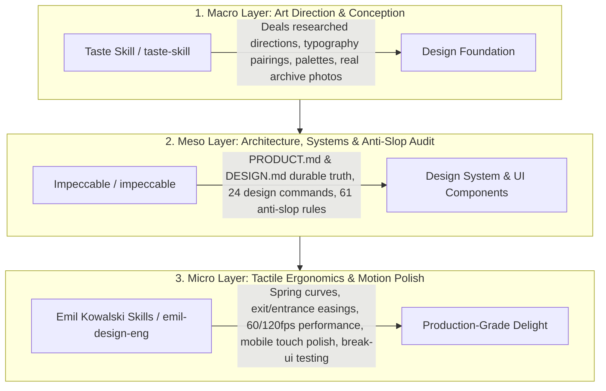

# Antigravity UI/UX Design Engine: Tri-Lens Integration & Architecture Report

> **Target Repositories Evaluated & Installed:**
> 1. [Emil Kowalski Skills](https://github.com/emilkowalski/skills.git) — *Micro-interactions, spring physics, animation ergonomics, and mobile-native polish.*
> 2. [Impeccable](https://github.com/pbakaus/impeccable.git) — *24-command design vocabulary, durable product truth (`PRODUCT.md`/`DESIGN.md`), and 61 AI-slop detector rules.*
> 3. [Taste Skill](https://github.com/Leonxlnx/taste-skill.git) — *Research-backed art direction (247 award-winning sites), open-archive photography, and real-browser visual audit loop.*
>
> **Global Installation Destination:**
> `C:\Users\hulkh\.gemini\config\skills\` (Antigravity Global Customization Root)

---

## 1. Executive Summary & Synergy Model

LLM-generated frontend design suffers from systematic homogeneity: generic typography (Inter or Roboto), purple-to-blue linear gradients, nested cards inside cards, un-tinted gray text on dark backgrounds, and linear or sluggish `ease-in` animations. 

The installation of these three repositories creates a unified **Tri-Layer Design Stack** inside Google Antigravity:



---

## 2. Multi-Lens Analysis

### 📊 Lens 1: Enterprise Product Manager (`/enterprise-product-manager`)

From an enterprise product perspective, design is not merely decoration—it is functional clarity, cognitive load reduction, and user trust.

#### A. Surface-Mode Taxonomy (Avoid "One Size Fits All")
Enterprise software fails when agents apply marketing splash page animations to dense operational software. With `impeccable` and `taste-skill`, Antigravity distinguishes between four distinct operating modes:
1. **Persuade (Landing Pages, Marketing, Pricing)**: High visual ambition, expressive typography, rich color fields, and authentic imagery (driven by `/taste-skill` and `/impeccable bolder`).
2. **Operate (Dashboards, Admin Portals, Data Grids, Settings)**: Scannability, consistency, quiet borders, zero distracting bouncy animations, instant feedback (governed by `references/mode-operate.md` and `/animation-performance`).
3. **Read (Documentation, Legal, Knowledge Bases)**: Clear typographic rhythm, readable measure (45–75 characters per line), high contrast (governed by `/impeccable typeset` and `references/mode-read.md`).
4. **Experience (Showcases, Interactive Tools, Creative Media)**: Immersive, layout-first canvas where the interface recedes to let the content lead.

#### B. Durable Truth Architecture
Agents typically suffer from amnesia across chat sessions. Impeccable solves this enterprise pain point by introducing persistent specification contracts:
- `PRODUCT.md`: Records audience, business goal, tone, and constraints.
- `DESIGN.md`: Records color tokens, font scales, component conventions, and design system choices.

#### C. Edge-Case Resilience
Emil Kowalski's `break-ui` skill provides an automated QA stress-test framework to verify layouts against worst-case enterprise data: 60-character emails, localized German nouns, null/empty collections, integer overflows, and single-character initials.

---

### 💻 Lens 2: Production Grade Coder (`/production-grade-coder`)

From an engineering and systems architecture perspective, all installed capabilities must comply with the Antigravity Customization Specification, maintain a low runtime overhead, and execute reliably in the user's Windows environment.

#### A. Antigravity Customization Specification Conformance
- **Discovery Root**: All skills are installed into the machine-local global root `~/.gemini/config/skills/` (`C:\Users\hulkh\.gemini\config\skills\`).
- **Progressive Disclosure**: Each skill defines clean YAML frontmatter (`name`, `description`). The agent only loads the high-level intent into the context window and loads deep playbooks (e.g., `reference/new-work.md`, `RECIPES.md`) on demand, preventing token exhaustion.
- **Dual-Alias Routing**: `taste-skill` is mapped to both `/taste-skill` and `/design-taste-frontend` to support both native commands and standard slash command conventions.

#### B. Tooling & Platform Compatibility
- **Node.js Environment**: Verified host runtime is **Node.js v24.1.0**, which exceeds the Node 18+/22+ requirements of `taste-skill` (`scripts/draw.mjs`, `scripts/inspect.mjs`, `scripts/assets.mjs`).
- **Windows Script Execution**: `impeccable` ships a native Windows launcher (`scripts/impeccable.cmd`) alongside its bash script. Tested and validated: `impeccable.cmd --version` executed cleanly with exit code `0`, confirming engine version `4.7.0`.
- **Zero Heavy Dependencies**: `taste-skill` uses 100% native Node.js standard library modules (`node:fs`, `node:path`, `node:crypto`, `node:os`). No `node_modules` pollution or bloat is introduced.

---

### 🛡️ Lens 3: Cybersecurity Engineer (`/cybersecurity-engineer`)

From a defensive security, supply-chain, and governance perspective, external AI skills represent potential code injection or credential leakage vectors if not audited prior to installation.

#### A. Supply-Chain & Code Audit Findings
1. **Emil Kowalski Skills (`emilkowalski/skills`)**:
   - **Artifact Type**: 100% pure Markdown (`.md`).
   - **Audit**: Zero executable scripts, zero binaries, zero network calls, zero npm packages.
   - **Risk Rating**: **NONE (Informational Only)**.

2. **Impeccable (`pbakaus/impeccable`)**:
   - **Artifact Type**: Native compiled binary engine + shell launchers (`.cmd` / `.sh`) + node scripts.
   - **Security Review of `impeccable.cmd`**:
     - Downloads assets only from official GitHub releases (`api.github.com/repos/pbakaus/impeccable`).
     - Uses Windows `certutil -hashfile ... SHA256` to strictly enforce cryptographic integrity against signed `.sha256` checksums.
     - **Fail-Closed Policy**: If the checksum sidecar is unavailable or fails validation, execution halts immediately.
     - **Graceful Fallback**: The skill contains built-in instructions: if the launcher is blocked or restricted, the agent falls back to parsing `PRODUCT.md` and `DESIGN.md` directly without executing binaries.
     - No telemetry, no token harvesting, no privilege escalation.
   - **Risk Rating**: **LOW (Approved)**.

3. **Taste Skill (`Leonxlnx/taste-skill`)**:
   - **Artifact Type**: JavaScript (`.mjs`) scripts with a local JSON direction library.
   - **Dependency Review**: Zero external npm dependencies. No post-install hooks.
   - **Network Egress**: `assets.mjs` queries public image archives (Wikimedia Commons) over HTTPS without API keys.
   - **Prompt Injection Defense**: Untrusted content policy is strictly observed. External titles and tags retrieved from open web archives are handled as pure data and never executed as prompt instructions.
   - **Headless Browser Sandbox**: `inspect.mjs` executes via local Chrome/Chromium using standard automation flags.
   - **Risk Rating**: **LOW (Approved)**.

#### B. Legal & Intellectual Property Compliance
- All three repositories are licensed under standard permissive open-source licenses (**MIT License**).
- Open-archive photography fetched via `taste-skill` includes automated CC/public-domain attribution comments.

---

## 3. Directory Inventory of Installed Skills

The following skills are now permanently available in `C:\Users\hulkh\.gemini\config\skills/`:

| Skill Name | Command / Trigger | Core Capability | Source Repository |
|---|---|---|---|
| `taste-skill` | `/taste-skill` | Research-backed art direction, typography pairings, color palettes, real-browser audit | `Leonxlnx/taste-skill` |
| `design-taste-frontend` | `/design-taste-frontend` | Alias for taste-skill | `Leonxlnx/taste-skill` |
| `impeccable` | `/impeccable <cmd>` | 24-command design vocabulary, anti-slop rules, durable `PRODUCT.md` & `DESIGN.md` | `pbakaus/impeccable` |
| `emil-design-eng` | `/emil-design-eng` | Emil Kowalski's master design engineering philosophy & craft principles | `emilkowalski/skills` |
| `animate` | `/animate` | Construction of production-grade animations (springs, curves, easings, durations) | `emilkowalski/skills` |
| `animate-expo` | `/animate-expo` | React Native & Expo motion (reanimated, gestures, sheets, haptics) | `emilkowalski/skills` |
| `animation-performance`| `/animation-performance` | 60fps/120fps profiling, `will-change`, GPU composite layer optimization | `emilkowalski/skills` |
| `animation-vocabulary` | `/animation-vocabulary` | Exact motion terminology to communicate transitions accurately to LLMs | `emilkowalski/skills` |
| `apple-design` | `/apple-design` | Apple WWDC fluid motion principles translated to web interfaces | `emilkowalski/skills` |
| `ask-sonner` | `/ask-sonner` | Sonner toast component setup, styling, custom recipes, and troubleshooting | `emilkowalski/skills` |
| `break-ui` | `/break-ui` | Stress-testing UI components with extreme edge-case data | `emilkowalski/skills` |
| `find-animation-opportunities` | `/find-animation-opportunities` | Auditing UI to identify where motion adds value vs. where it should be removed | `emilkowalski/skills` |
| `improve-animations` | `/improve-animations` | Codebase-wide motion audit with prioritized remediation plans | `emilkowalski/skills` |
| `mobile-native` | `/mobile-native` | Mobile web polish: 100vh bugs, tap highlight flashes, focus zoom, safe areas | `emilkowalski/skills` |
| `pick-ui-library` | `/pick-ui-library` | Curated recommendations for trusted UI component primitives | `emilkowalski/skills` |
| `prototype` | `/prototype` | Rapid prototyping of multiple UI variants with interactive switcher | `emilkowalski/skills` |
| `review-animations` | `/review-animations` | Strict markdown table review (Before / After / Why) for UI motion code | `emilkowalski/skills` |
| `write-swift` | `/write-swift` | Modern Swift, SwiftUI, and concurrency patterns | `emilkowalski/skills` |

---

## 4. How to Use in Your Antigravity Workflow

### Workflow 1: Designing a Greenfield Web Page or Surface
1. **Art Direction**:
   ```bash
   node ~/.gemini/config/skills/taste-skill/scripts/draw.mjs --sector saas --brief "Enterprise Sentinel Threat Detection"
   ```
   Or invoke `/taste-skill` in chat: *"Help me design a hero section for an enterprise security tool with award-winning art direction."*
2. **Design Language & System**:
   Use `/impeccable init` to establish durable context, followed by `/impeccable typeset` or `/impeccable bolder`.
3. **Motion Polish**:
   Use `/animate` or `/emil-design-eng` to build interaction transitions.
4. **Stress Testing**:
   Use `/break-ui` to verify layout stability under heavy or missing data.

### Workflow 2: Auditing & Polishing Existing Code
1. Audit for AI tells & design hierarchy:
   ```
   /impeccable critique <target-component>
   /impeccable polish <target-component>
   ```
2. Audit and optimize animations:
   ```
   /review-animations
   /animation-performance
   ```
