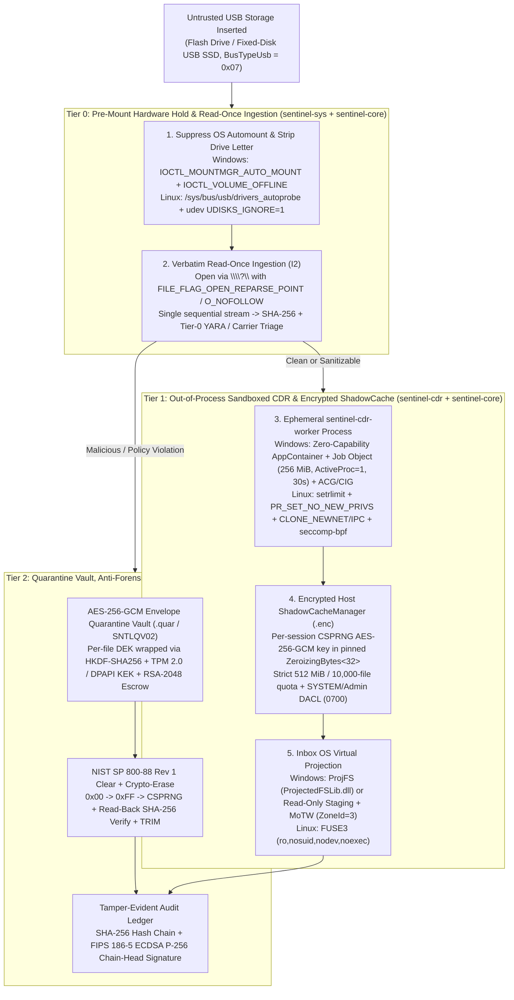

# OmniConnect Sentinel 🛡️
### Enterprise-Grade Zero-Trust Peripheral Interceptor, Read-Once ShadowCache VFS, Sandboxed CDR Engine & NIST SP 800-88 Anti-Forensic Sanitizer

[](https://www.rust-lang.org)
[](https://csrc.nist.gov/publications/detail/sp/800-88/rev-1/final)
[](https://csrc.nist.gov/publications/detail/sp/800-207/final)
[](https://www.isa.org/standards-and-publications/isa-standards/isa-iec-62443-series)
[](#10-supply-chain-security--vex-defense-in-depth-ledger)
[](#2-system-architecture--3-tier-zero-trust-data-flow)
[](https://attack.mitre.org)
[](Cargo.toml)

**OmniConnect Sentinel** is an enterprise-grade, memory-safe endpoint and OT/ICS peripheral security platform written in **Rust**. It replaces reactive post-mount antivirus scanning with **fail-closed pre-mount hardware hold**, **read-once encrypted host shadow caching (eliminating USB Flash TOCTOU attacks)**, **OS-sandboxed out-of-process Content Disarm & Reconstruction (CDR)**, **hardware-sealed AES-256-GCM quarantine vaults (TPM 2.0 / DPAPI + SOC RSA-2048-OAEP escrow)**, **FIPS 186-5 ECDSA P-256 tamper-evident audit ledgers**, and **NIST SP 800-88 Rev 1 Clear & Cryptographic Erase sanitization**.

---

## 📑 Table of Contents
1. [Executive Summary & Enterprise Differentiation](#1-executive-summary--enterprise-differentiation)
2. [System Architecture & 3-Tier Zero-Trust Data Flow](#2-system-architecture--3-tier-zero-trust-data-flow)
3. [Workspace Crate & Shipped Binary Inventory](#3-workspace-crate--shipped-binary-inventory)
4. [Core Security & Correctness Invariants (`I1`–`I5`)](#4-core-security--correctness-invariants-i1i5)
5. [Algorithmic Complexity, Resource Bounds & Trade-Offs](#5-algorithmic-complexity-resource-bounds--trade-offs)
6. [Universal Hidden Threat Carrier Detection & Sandboxed CDR](#6-universal-hidden-threat-carrier-detection--sandboxed-cdr)
7. [OS-Enforced Untrusted Parser Sandboxing (`sentinel-cdr-worker`)](#7-os-enforced-untrusted-parser-sandboxing-sentinel-cdr-worker)
8. [Hardware-Backed Cryptographic Custody & Audit Ledger](#8-hardware-backed-cryptographic-custody--audit-ledger)
9. [NIST SP 800-88 Rev 1 Anti-Forensic Shredder](#9-nist-sp-800-88-rev-1-anti-forensic-shredder)
10. [Supply-Chain Security & VEX Defense-in-Depth Ledger](#10-supply-chain-security--vex-defense-in-depth-ledger)
11. [Enterprise Fleet Management, SIEM/XDR & Compliance Mapping](#11-enterprise-fleet-management-siemxdr--compliance-mapping)
12. [Structured Degradation & Error Event Taxonomy](#12-structured-degradation--error-event-taxonomy)
13. [CLI & Localhost Defense Station Reference](#13-cli--localhost-defense-station-reference)
14. [Building, Running & Physical Hardware Verification](#14-building-running--physical-hardware-verification)
15. [Verification Matrix (`T1`–`T25`) & 10-Gate CI/CD Pipeline](#15-verification-matrix-t1t25--10-gate-cicd-pipeline)

---

## 1. Executive Summary & Enterprise Differentiation

Conventional endpoint security agents allow the operating system to auto-mount untrusted USB storage (`BusTypeUsb`) directly into the user's namespace before scanning finishes. This architectural gap exposes endpoints to **USB microcontroller double-read Time-of-Check-to-Time-of-Use (TOCTOU) spoofing**, **shell AutoRun/LNK/CLSID execution**, **in-process parser memory corruption**, and **forensic data remanence**.

OmniConnect Sentinel closes these gaps in **100% Ring 3 userspace** (zero custom `.sys` or `.ko` kernel drivers required):

| Capability Pillar | Legacy Endpoint AV / EDR | Dedicated Hardware Kiosk (\$50k+ `[Typical]`) | **OmniConnect Sentinel (v3)** |
| :--- | :--- | :--- | :--- |
| **Pre-Mount Volume Hold** | Post-mount reactive scan (Explorer races scanner) | Physical bay isolation | **Pre-mount hold** via Windows `MountMgr` (`IOCTL_MOUNTMGR_AUTO_MOUNT` + `IOCTL_VOLUME_OFFLINE`) & Linux `udev` / `usb_authorized_default` |
| **USB Flash TOCTOU Defense** | Vulnerable (reads file for scan, re-reads from USB on open) | Copy-to-internal SSD | **Read-Once Encrypted ShadowCache (`I2`)**: single read from USB -> `SHA-256` -> `AES-256-GCM` `<sha256_prefix>.enc` on host disk via `ShadowCacheManager` |
| **Userspace VFS Projection** | Third-party kernel driver (`WinFsp` / `Dokan` BSOD risk) | Network file share / physical copy | **Inbox OS Virtualization**: Windows **ProjFS** (`ProjectedFSLib.dll`) with read-only staging fallback + Linux **FUSE3** |
| **CDR Parser Isolation** | In-process C/C++ parsers running as `SYSTEM` | Separate VM / appliance | **Out-of-process `sentinel-cdr-worker`** locked in Win32 Zero-Capability AppContainer + Job Object (`256 MiB`) or Linux `seccomp-bpf` + namespaces |
| **Key & Audit Custody** | Plaintext local key files & unsigned JSON logs | Hardware HSM (appliance-only) | **TPM 2.0 (`NCrypt`) & Machine DPAPI** (Windows) / **`UnixLocalKeyring` (`0600`->`0400` root-only)** (Linux) KEK sealing + **FIPS 186-5 ECDSA P-256** signed hash-chained audit ledger |
| **Media Sanitization** | Standard `unlink` / `DeleteFileW` (trivial carving recovery) | Physical degaussing / station wipe | **NIST SP 800-88 Rev 1 Clear** (3-pass write-through + read-back `SHA-256` verify + MFT scrambling) + **Cryptographic Erase** |

### 1.1 Target Personas & Jobs-To-Be-Done (JTBD)

| Persona | Core Job-To-Be-Done (JTBD) | Primary Sentinel Surface |
| :--- | :--- | :--- |
| **SecOps / SOC Incident Responder** | Triage blocked USB threats, verify cryptographic quarantine envelopes, and correlate endpoint alerts in CrowdStrike Falcon or ArcSight SIEM without log-forging noise. | `sentinel telemetry`, `sentinel vault`, `sentinel detonate`, `GET /api/v1/metrics` |
| **OT / ICS Kiosk Operator** | Inspect and sanitize vendor firmware/maintenance USB drives at an air-gapped boundary (IEC 62443-3-3 SL-3) with automatic anti-forensic session wipe on close. | `sentinel kiosk --media <ID>`, `sentinel confirm-device` |
| **Endpoint Security / MDM Engineer** | Deploy zero-trust USB policies across Windows and Linux fleets via Microsoft Intune SyncML with ECDSA P-256 anti-rollback verification and zero kernel BSOD risk. | `sentinel intune --export`, `sentinel-agent`, `sentinel-cdr-daemon` |
| **CISO / GRC & Supply-Chain Auditor** | Prove continuous compliance (NIST SP 800-53, 800-88, SOC 2, ISO 27001, CIS v8) using tamper-evident ECDSA P-256 audit ledgers, CycloneDX SBOMs, and VEX proofs. | `sentinel ledger verify`, `sbom.cdx.json`, CI 10-Gate Pipeline |

### 1.2 Enterprise Deployment Topologies

| Topology Dimension | Mode A: Air-Gapped Industrial Kiosk Station | Mode B: Managed Enterprise Endpoint Fleet |
| :--- | :--- | :--- |
| **Target Environment** | Substations, SCADA/ICS control rooms, defense SCIFs, manufacturing floors (IEC 62443-3-3 SL-3) | Corporate Windows 11 & Ubuntu/RHEL developer and executive laptops |
| **Runtime Entrypoint** | `sentinel kiosk --media <ID>` ([`kiosk.rs`](file:///c:/Users/hulkh/Downloads/OmniConnect-Sentinel/crates/sentinel-core/src/enterprise/kiosk.rs)) | `sentinel-agent` + `sentinel-cdr-daemon` + `sentinel watch` |
| **Hardware Hold & Presence** | Enforces `KioskEnforcer::verify_posture` ([`kiosk.rs:89-150`](file:///c:/Users/hulkh/Downloads/OmniConnect-Sentinel/crates/sentinel-core/src/enterprise/kiosk.rs#L89-L150)) via `PostureReport::is_compliant()` ([`mount_control.rs:47-84`](file:///c:/Users/hulkh/Downloads/OmniConnect-Sentinel/crates/sentinel-sys/src/mount_control.rs#L47-L84), 6 checks: `automount_disabled`, `removable_volumes_offline`, `user_deny_policy_present`, `install_restrictions_active`, `write_protect_active`, and `autoplay_suppressed` / `linux_authorized_default_zero`) before starting session | Holds `BusTypeUsb` (`0x07`) offline until challenge-response (`sentinel confirm-device`) or ECDSA P-256 `--break-glass-token` |
| **Session Data Lifecycle** | Encrypts session staging under ephemeral `ZeroizingBytes<32>` `AES-256-GCM` key and shreds all session artifacts bottom-up via `SecureShredder` on exit | Ingests USB files once into `<sha256_prefix>.enc` via `ShadowCacheManager` and projects clean files via Windows ProjFS or Linux FUSE3 |
| **Policy & Telemetry Sink** | Local offline ECDSA P-256 `SignedPolicyBundle` + local `AuditLedger` (`<ledger>.head.sig`) | Intune OMA-URI SyncML policy distribution + CrowdStrike Falcon FDR NDJSON & ArcSight CEF streaming |

---

## 2. System Architecture & 3-Tier Zero-Trust Data Flow



---

## 3. Workspace Crate & Shipped Binary Inventory

OmniConnect Sentinel is organized as a Cargo workspace (`resolver = "2"`, Rust 2021 Edition) with strict `#![deny(clippy::unwrap_used, clippy::expect_used)]` and zero lint suppressions (`0` `#[allow(...)]` attributes across the entire codebase):

| Crate | Type | Shipped Binary | Responsibility & Security Boundary |
| :--- | :--- | :--- | :--- |
| [`crates/sentinel-proto`](file:///c:/Users/hulkh/Downloads/OmniConnect-Sentinel/crates/sentinel-proto) | Library (`#![forbid(unsafe_code)]`) | — | Protobuf schema ([`sentinel_cdr.proto`](file:///c:/Users/hulkh/Downloads/OmniConnect-Sentinel/crates/sentinel-proto/proto/sentinel_cdr.proto)) and `tonic 0.13` / `prost 0.13` generated gRPC server bindings with build-time multi-line attribute sanitization ([`build.rs`](file:///c:/Users/hulkh/Downloads/OmniConnect-Sentinel/crates/sentinel-proto/build.rs)). |
| [`crates/sentinel-sys`](file:///c:/Users/hulkh/Downloads/OmniConnect-Sentinel/crates/sentinel-sys) | Library (Isolated FFI Boundary) | — | The **only** crate permitted to invoke OS FFI (`windows-sys 0.61`, `libc 0.2`): MountMgr/Volume offline IOCTLs ([`mount_control.rs`](file:///c:/Users/hulkh/Downloads/OmniConnect-Sentinel/crates/sentinel-sys/src/mount_control.rs)), TPM 2.0 / DPAPI / ECDSA P-256 crypto sealing ([`crypto_seal.rs`](file:///c:/Users/hulkh/Downloads/OmniConnect-Sentinel/crates/sentinel-sys/src/crypto_seal.rs)), Verbatim I/O & ProjFS loader ([`fs_lowlevel.rs`](file:///c:/Users/hulkh/Downloads/OmniConnect-Sentinel/crates/sentinel-sys/src/fs_lowlevel.rs)), `VirtualLock`/`mlock` pinned memory ([`mem_guard.rs`](file:///c:/Users/hulkh/Downloads/OmniConnect-Sentinel/crates/sentinel-sys/src/mem_guard.rs)), and OS process sandboxing ([`sandbox_worker.rs`](file:///c:/Users/hulkh/Downloads/OmniConnect-Sentinel/crates/sentinel-sys/src/sandbox_worker.rs)). |
| [`crates/sentinel-cdr`](file:///c:/Users/hulkh/Downloads/OmniConnect-Sentinel/crates/sentinel-cdr) | Library + 2 Binaries (`#![forbid(unsafe_code)]`) | `sentinel-cdr-daemon`<br>`sentinel-cdr-worker` | Pure-Rust Content Disarm & Reconstruction engine for PDF ([`pdf.rs`](file:///c:/Users/hulkh/Downloads/OmniConnect-Sentinel/crates/sentinel-cdr/src/sanitizers/pdf.rs)), Office OpenXML & `.zip` archives ([`openxml.rs`](file:///c:/Users/hulkh/Downloads/OmniConnect-Sentinel/crates/sentinel-cdr/src/sanitizers/openxml.rs)), Legacy OLE2 ([`ole2.rs`](file:///c:/Users/hulkh/Downloads/OmniConnect-Sentinel/crates/sentinel-cdr/src/sanitizers/ole2.rs)), SVG ([`svg.rs`](file:///c:/Users/hulkh/Downloads/OmniConnect-Sentinel/crates/sentinel-cdr/src/sanitizers/svg.rs)), Raster Images ([`image.rs`](file:///c:/Users/hulkh/Downloads/OmniConnect-Sentinel/crates/sentinel-cdr/src/sanitizers/image.rs)), and Plain Text/CSV ([`text.rs`](file:///c:/Users/hulkh/Downloads/OmniConnect-Sentinel/crates/sentinel-cdr/src/sanitizers/text.rs)), plus the hardened gRPC server ([`service.rs`](file:///c:/Users/hulkh/Downloads/OmniConnect-Sentinel/crates/sentinel-cdr/src/service.rs)) and isolated worker launcher ([`worker.rs`](file:///c:/Users/hulkh/Downloads/OmniConnect-Sentinel/crates/sentinel-cdr/src/worker.rs)). |
| [`crates/sentinel-core`](file:///c:/Users/hulkh/Downloads/OmniConnect-Sentinel/crates/sentinel-core) | Library + Binary (`#![forbid(unsafe_code)]`) | `sentinel-agent` | Core endpoint daemon: USB arrival interceptors ([`windows_umdf.rs`](file:///c:/Users/hulkh/Downloads/OmniConnect-Sentinel/crates/sentinel-core/src/interceptor/windows_umdf.rs), [`linux_udev.rs`](file:///c:/Users/hulkh/Downloads/OmniConnect-Sentinel/crates/sentinel-core/src/interceptor/linux_udev.rs)), 6-carrier universal threat scanner ([`universal_scanner.rs`](file:///c:/Users/hulkh/Downloads/OmniConnect-Sentinel/crates/sentinel-core/src/scanner/universal_scanner.rs)), Read-Once `ShadowCacheManager` & ProjFS/FUSE providers ([`vfs/mod.rs`](file:///c:/Users/hulkh/Downloads/OmniConnect-Sentinel/crates/sentinel-core/src/vfs/mod.rs)), AES-256-GCM Quarantine Vault ([`quarantine.rs`](file:///c:/Users/hulkh/Downloads/OmniConnect-Sentinel/crates/sentinel-core/src/scanner/quarantine.rs)), NIST 800-88 Shredder ([`secure_shredder.rs`](file:///c:/Users/hulkh/Downloads/OmniConnect-Sentinel/crates/sentinel-core/src/scanner/secure_shredder.rs)), and Enterprise SIEM/Intune/Kiosk/Ledger modules ([`enterprise/`](file:///c:/Users/hulkh/Downloads/OmniConnect-Sentinel/crates/sentinel-core/src/enterprise/mod.rs)). |
| [`crates/sentinel-cli`](file:///c:/Users/hulkh/Downloads/OmniConnect-Sentinel/crates/sentinel-cli) | Binary (`#![forbid(unsafe_code)]`) | `sentinel` | Unified operator CLI and localhost (`127.0.0.1`) Axum 0.8 Cyber Defense Station web server with per-session 256-bit bearer token, `Host`/`Origin` DNS-rebinding guards, and constant-time `X-Sentinel-CSRF` enforcement ([`main.rs`](file:///c:/Users/hulkh/Downloads/OmniConnect-Sentinel/crates/sentinel-cli/src/main.rs)). |

---

## 4. Core Security & Correctness Invariants (`I1`–`I5`)

Every subsystem in OmniConnect Sentinel is engineered and tested against five non-negotiable security invariants:

- **`I1` — Fail-Closed Hardware Hold Before Userspace Mount**: Untrusted external USB storage (`BusTypeUsb = 0x07`, covering both removable USB flash drives and fixed-disk USB enclosures) must have OS auto-mounting disabled and any assigned drive letter stripped (`DeleteVolumeMountPointW` + `IOCTL_VOLUME_OFFLINE` on Windows; `authorized=0` / `UDISKS_IGNORE=1` on Linux) before user processes can open files.
- **`I2` — Read-Once Elimination of USB Microcontroller TOCTOU**: Every file on untrusted USB flash media is read from physical hardware **at most once** during `ShadowCacheManager::ingest_usb_volume` (`ingest_volume_read_once`). The single byte stream is simultaneously hashed (`SHA-256`), scanned/sanitized in-memory, and encrypted with an ephemeral session `AES-256-GCM` key into host-local `<sha256_prefix>.enc` storage. Subsequent file opens serve exclusively from the verified host `.enc` cache, neutralizing evil-maid USB microcontroller block-switching attacks.
- **`I3` — Zero-Residual Ephemeral Lifecycle & Crash Recovery**: Unmounting a virtualized session (`unmount_volume` / `teardown_session`) or initializing `ShadowCacheManager` sweeps and cryptographically zeroizes the `ZeroizingBytes<32>` session key in RAM and deletes all `.enc` ciphertext artifacts on host storage.
- **`I4` — Bounded Resource Consumption Under Adversarial Input**: Every parser, archive extractor, and RPC stream enforces compile-time and policy-capped ceilings: max PDF token nesting depth (`64`), max XML element depth (`256`), max XML attributes per element (`256`), max `xmlns` declarations per element (`32`), max ZIP entries (`4,096` in `OpenXmlSanitizer`; `2,048` scanner alert threshold in `ContentScanner`), max decompression ratio (`5:1` default), max initial entry allocation (`64 KiB` against spoofed ZIP headers), max worker RAM (`256 MiB`), and max worker wall-clock/CPU deadline (`30 s`).
- **`I5` — Verbatim Path Canonicalization & Cryptographic Non-Repudiation**: All host and USB filesystem mutations open handles via canonicalized verbatim paths (`\\?\`) with symlink/reparse-point rejection (`FILE_FLAG_OPEN_REPARSE_POINT` / `O_NOFOLLOW`), and every security event or degradation state is recorded in a SHA-256 hash-chained audit ledger whose chain-head checkpoint (`<ledger>.head.sig`) is signed via **FIPS 186-5 ECDSA P-256**.

### 4.1 STRIDE Threat Model & Trust Boundaries

| Trust Boundary | STRIDE Category | Adversary Attack Vector | Sentinel Technical Control & Code Evidence |
| :--- | :--- | :--- | :--- |
| **TB-1: Physical USB Bus -> Tier 0 Interceptor** | **Spoofing (`S`) & Tampering (`T`)** | BadUSB / custom microcontroller presenting a fixed-disk USB SSD (`BusTypeUsb = 0x07`) or switching flash blocks between scan read #1 and execution read #2 (USB TOCTOU). | Pre-mount hold (`IOCTL_MOUNTMGR_AUTO_MOUNT` + `IOCTL_VOLUME_OFFLINE`, [`mount_control.rs`](file:///c:/Users/hulkh/Downloads/OmniConnect-Sentinel/crates/sentinel-sys/src/mount_control.rs)) + Read-Once ingestion into host `AES-256-GCM` `<sha256_prefix>.enc` ([`vfs/mod.rs`](file:///c:/Users/hulkh/Downloads/OmniConnect-Sentinel/crates/sentinel-core/src/vfs/mod.rs), `I1`/`I2`). |
| **TB-2: Untrusted File Stream -> Tier 1 CDR Worker** | **Elevation of Privilege (`E`) & DoS (`D`)** | Weaponized PDF/ZIP/XML/OLE2/Image triggering parser memory corruption, stack overflow (`RUSTSEC-2026-0187`), quadratic attribute stall (`RUSTSEC-2026-0194`), or decompression bomb. | `#![forbid(unsafe_code)]` parsers + pre-parse token/attribute/ratio ceilings (`I4`) + ephemeral `sentinel-cdr-worker` in Zero-Capability AppContainer / `seccomp-bpf` (`256 MiB` RAM, `30 s` wall-clock cap, [`sandbox_worker.rs`](file:///c:/Users/hulkh/Downloads/OmniConnect-Sentinel/crates/sentinel-sys/src/sandbox_worker.rs)). |
| **TB-3: Host Filesystem -> Quarantine & Shredder** | **Information Disclosure (`I`) & Tampering (`T`)** | Symlink/junction race redirecting shredder to host OS files, forensic carving of deleted malware, or offline tampering with `.quar` headers. | Verbatim `\\?\` + `FILE_FLAG_OPEN_REPARSE_POINT` / `O_NOFOLLOW` ([`secure_shredder.rs`](file:///c:/Users/hulkh/Downloads/OmniConnect-Sentinel/crates/sentinel-core/src/scanner/secure_shredder.rs)), 3-pass write-through + read-back `SHA-256` verify, and `SNTLQV02` `.quar` AAD header binding ([`quarantine.rs`](file:///c:/Users/hulkh/Downloads/OmniConnect-Sentinel/crates/sentinel-core/src/scanner/quarantine.rs)). |
| **TB-4: Policy / Audit Storage -> Local Admin / SIEM** | **Repudiation (`R`) & Tampering (`T`)** | Attacker deleting tail entries from the audit log, forging SIEM syslog lines via embedded newlines/pipes (`CWE-117`), or downgrading security policy (`SignedPolicyBundle`). | `SHA-256` hash-chained JSONL + FIPS 186-5 ECDSA P-256 `<ledger>.head.sig` ([`ledger.rs`](file:///c:/Users/hulkh/Downloads/OmniConnect-Sentinel/crates/sentinel-core/src/enterprise/ledger.rs)), CEF/SyncML escaping ([`falcon.rs`](file:///c:/Users/hulkh/Downloads/OmniConnect-Sentinel/crates/sentinel-core/src/enterprise/falcon.rs), [`intune.rs`](file:///c:/Users/hulkh/Downloads/OmniConnect-Sentinel/crates/sentinel-core/src/enterprise/intune.rs)), and monotonic `version` anti-rollback. |
| **TB-5: Browser / Network -> Localhost UI (`127.0.0.1:8088`)** | **Spoofing (`S`) & Elevation (`E`)** | Malicious website performing DNS rebinding or cross-origin `POST /api/v1/shred` against localhost UI. | Strict `127.0.0.1` loopback bind, `Host`/`Origin` allowlist, 256-bit CSPRNG bearer token (`subtle::ConstantTimeEq`), and constant-time `X-Sentinel-CSRF` verification ([`main.rs:1485-1507`](file:///c:/Users/hulkh/Downloads/OmniConnect-Sentinel/crates/sentinel-cli/src/main.rs#L1485-L1507)). |

---

## 5. Algorithmic Complexity, Resource Bounds & Trade-Offs

Per production-grade systems engineering standards, every hot-path scanner and sanitizer in OmniConnect Sentinel operates within deterministic time and memory bounds (where $N$ is input byte length, $E$ is archive entry count, $A$ is attributes per XML element, and $B$ is top-level container boxes):

| Subsystem / Algorithm | Source Location | Time Complexity | Space Complexity | Alternative Considered & Why Rejected |
| :--- | :--- | :--- | :--- | :--- |
| **PDF Token Nesting Pre-Scanner** (`validate_pdf_token_nesting_depth`) | [`pdf.rs:31-116`](file:///c:/Users/hulkh/Downloads/OmniConnect-Sentinel/crates/sentinel-cdr/src/sanitizers/pdf.rs#L31-L116) | $\mathcal{O}(N)$ single-pass byte state machine | $\mathcal{O}(1)$ (`usize` depth counters, cap `64`) | *Recursive AST catch after `lopdf::Document::load_mem`*: Rejected because `lopdf`'s recursive parser overflows the thread stack *during* `load_mem` (`RUSTSEC-2026-0187`) before AST inspection can run. |
| **XML Attribute & Namespace Guard** (`collect_validated_xml_attributes`) | [`sanitizers/mod.rs:33-89`](file:///c:/Users/hulkh/Downloads/OmniConnect-Sentinel/crates/sentinel-cdr/src/sanitizers/mod.rs#L33-L89) | $\mathcal{O}(A)$ per element ($A \le 256$) | $\mathcal{O}(A)$ `HashSet<Vec<u8>>` | *`quick-xml` built-in duplicate check (`.with_checks(true)`)*: Rejected because `quick-xml` performs $\mathcal{O}(A^2)$ pairwise comparisons (`RUSTSEC-2026-0194`); disabling built-in checks and using a capped `HashSet` gives $\mathcal{O}(A)$ time with hard cap $A \le 256$. |
| **ZIP Central Directory SUID/Symlink & Ratio Guard** | [`openxml.rs:26-96`](file:///c:/Users/hulkh/Downloads/OmniConnect-Sentinel/crates/sentinel-cdr/src/sanitizers/openxml.rs#L26-L96) | $\mathcal{O}(N + E)$ ($E \le 4,096$) | $\mathcal{O}(E)$ entry set + $\le 64\text{ KiB}$ initial read | *Pre-allocating `Vec::with_capacity(entry.size())`*: Rejected because a 100-byte spoofed ZIP header can claim `entry.size() = 64 GiB` and trigger an instant OOM panic before `Read::take` reads a single byte. |
| **ISOBMFF (MP4/MOV) Atom Hierarchy Walker** (`PolyglotScanner::scan_mp4_seekable`) | [`polyglot_scanner.rs:555-635`](file:///c:/Users/hulkh/Downloads/OmniConnect-Sentinel/crates/sentinel-core/src/scanner/polyglot_scanner.rs#L555-L635) | $\mathcal{O}(B)$ over $B$ top-level boxes (8–16 byte header seeks) | $\mathcal{O}(1)$ stack buffer | *Full-file buffer read into RAM*: Rejected because 4K video files on USB media routinely exceed 4–16 GiB; seeking across 64-bit `LargeSize` atom headers inspects structural bounds in $\mathcal{O}(1)$ memory. |
| **Tier-0 YARA / Signature & Sliding-Window Entropy** | [`tier0_yara.rs`](file:///c:/Users/hulkh/Downloads/OmniConnect-Sentinel/crates/sentinel-core/src/scanner/tier0_yara.rs) | $\mathcal{O}(N)$ single-pass byte histogram ($256$-bin table) | $\mathcal{O}(1)$ (`[u64; 256]` frequency array) | *Regex backtracking engine per rule*: Rejected due to catastrophic backtracking risk ($\mathcal{O}(2^N)$) on adversarial binary inputs. |
| **Read-Once ShadowCache Ingestion & Projection** (`ShadowCacheManager`) | [`vfs/mod.rs:260-420`](file:///c:/Users/hulkh/Downloads/OmniConnect-Sentinel/crates/sentinel-core/src/vfs/mod.rs#L260-L420) | $\mathcal{O}(N)$ single sequential USB read + `AES-256-GCM` seal | $\mathcal{O}(F)$ metadata index ($F \le 10,000$, disk $\le 512\text{ MiB}$) | *Pass-through on-access FUSE/WinFsp reads from USB*: Rejected because a malicious USB microcontroller can return clean bytes on scan read #1 and weaponized PE bytes on execution read #2 (USB TOCTOU). |

---

## 6. Universal Hidden Threat Carrier Detection & Sandboxed CDR

OmniConnect Sentinel inspects and sanitizes all six primary peripheral threat carrier classes before projecting clean data to the user:

| Carrier Class | Threat Vectors & CVEs Mitigated | Detection & Mathematical CDR Reconstruction Mechanism |
| :--- | :--- | :--- |
| **1. Office & PDF Documents** | PDF `/JavaScript`, `/JS`, `/Launch`, `/AA`, `/OpenAction`, `/EmbeddedFiles`, `/RichMedia`, `/XFA`<br>Office OpenXML VBA Macros (`vbaProject.bin`), ActiveX, DDE (`ddeLink`), External Relationships (`TargetMode="External"` / **CVE-2022-30190 Follina**)<br>Legacy OLE2 Compound Documents (`Macros`, `_VBA_PROJECT_CUR`, `Ole10Native`, **CVE-2017-11882** `Equation Native`) | **PDF**: Pre-scans raw input bytes via `precheck_stream_nesting_and_counts` (`validate_pdf_token_nesting_depth`, depth $\le 64$) before `lopdf::Document::load_mem`, strips active dictionary keys, and validates output with `qpdf --check` when installed.<br>**OpenXML**: Rebuilds ZIP container from scratch (`MAX_ZIP_ENTRIES = 4,096`), drops macro/ActiveX entries, rewrites `.rels` and XML streams via `quick-xml`, and strips `ddeService`/`ddeTopic`.<br>**OLE2**: Parses MS-CFB sectors/FAT/directory entries (`2..=64` byte UTF-16LE names) and rejects macro/exploit streams. |
| **2. Images, SVG & Polyglots** | PE (`MZ`), ELF (`\x7FELF`), or ZIP (`PK\x03\x04`) payloads appended past natural EOF (JPEG `0xFFD9`, PNG `IEND`, WebP `RIFF` size)<br>SVG `<script>`, `<foreignObject>`, `onload`/`onerror` handlers, `javascript:`/`data:` URIs, and XXE/entity expansion | **Raster (`JPEG`/`PNG`/`WebP`)**: Decodes raw pixel matrix via `image` crate (`Limits` enforced: $\le 8192 \times 8192$, $\le 128\text{ MiB}$ RAM) and re-encodes a brand-new pixel buffer, destroying all EXIF metadata, steganographic LSB perturbations, and trailing polyglot overlays.<br>**SVG**: Event-driven XML sanitizer removing script elements, `on*` event attributes, external `xlink:href`/`href` targets, and non-standard XML entity references. |
| **3. Video & Audio Containers** | ISOBMFF (`MP4`/`MOV`/`M4V`) containers with trailing executables appended past `mdat`/`moov`/`ftyp` boxes or integer-overflow `size == 1` (`LargeSize` 64-bit) atom headers | [`PolyglotScanner::scan_mp4_seekable`](file:///c:/Users/hulkh/Downloads/OmniConnect-Sentinel/crates/sentinel-core/src/scanner/polyglot_scanner.rs#L555-L635) walks 32-bit and 64-bit ISOBMFF box headers with checked arithmetic, verifying exact structural EOF alignment and flagging trailing executable/archive payloads. |
| **4. Executables & Packers** | High-entropy packed/crypted droppers (UPX, Themida, VMProtect; Shannon entropy $> 7.5\text{ bits/byte}$ `[Standard]`), writable `.rsrc`/entry-point sections (`Trojan:Win32/Ramnit`), and masqueraded double extensions (`.pdf.exe`, `.scr`, `.cpl`) | Static PE/ELF/Mach-O header analyzer, section permission inspector, and sliding-window Shannon entropy calculator. |
| **5. Scripts & Source Code** | Unicode Trojan Source (**CVE-2021-42574**) and Right-to-Left Override (`U+202E`) extension spoofing (`receipt_[RLO]cod.exe`), AMSI memory patching (`AmsiScanBuffer`), PowerShell `-EncodedCommand` stagers | Scans filenames and file contents for bidirectional control codepoints (`U+202A`–`U+202E`, `U+2066`–`U+2069`), zero-width characters (`U+200B`–`U+200D`, `U+FEFF`), and encoded script stagers. |
| **6. Filesystem & Metadata Cloaking** | NTFS Alternate Data Streams (`Brief.docx:evil.exe`), Windows Shell CLSID directory cloaking (`Folder.{21EC2020-3AEA-1069-A2DD-08002B30309D}`), `.lnk` RelativePath/Arguments command injection, DOS reserved names (`CON`, `PRN`, `AUX`, `NUL`, `COM1`–`COM9`, `LPT1`–`LPT9`), and symlink/junction traversal | Enumerates non-default `:$DATA` streams via Win32 `FindFirstStreamW`/`FindNextStreamW`, parses MS-SHLLINK binary structures (`HasLinkTargetIDList`, `HasArguments`, `HasRelativePath`), blocks CLSID/DOS reserved names, and opens all files with `FILE_FLAG_OPEN_REPARSE_POINT` / `O_NOFOLLOW`. |

---

## 7. OS-Enforced Untrusted Parser Sandboxing (`sentinel-cdr-worker`)

Because file format parsers process untrusted bytes from unknown external media, OmniConnect Sentinel never runs CDR parsing inside the privileged daemon in production mode. Instead, [`WorkerLauncher`](file:///c:/Users/hulkh/Downloads/OmniConnect-Sentinel/crates/sentinel-cdr/src/worker.rs) spawns an ephemeral `sentinel-cdr-worker` process per sanitization job over length-prefixed `stdin`/`stdout` pipes:

| Isolation Control | Windows Implementation ([`sandbox_worker.rs`](file:///c:/Users/hulkh/Downloads/OmniConnect-Sentinel/crates/sentinel-sys/src/sandbox_worker.rs)) | Linux Implementation ([`sandbox_worker.rs:967-1118`](file:///c:/Users/hulkh/Downloads/OmniConnect-Sentinel/crates/sentinel-sys/src/sandbox_worker.rs#L967-L1118)) |
| :--- | :--- | :--- |
| **Privilege & Capability Drop** | `CreateProcessW(CREATE_SUSPENDED \| EXTENDED_STARTUPINFO_PRESENT)` with a **Zero-Capability AppContainer SID** (`CreateAppContainerProfile` / `PROC_THREAD_ATTRIBUTE_SECURITY_CAPABILITIES`) | `prctl(PR_SET_NO_NEW_PRIVS, 1)` + `prctl(PR_SET_DUMPABLE, 0)` |
| **Memory Ceiling** | Win32 Job Object (`JOB_OBJECT_LIMIT_PROCESS_MEMORY = 256 MiB`, `JOB_OBJECT_LIMIT_DIE_ON_UNHANDLED_EXCEPTION`) assigned while suspended before `ResumeThread` | `setrlimit(RLIMIT_AS, 256 MiB)` + `setrlimit(RLIMIT_CORE, 0)` |
| **Child Process Prevention** | `PROC_THREAD_ATTRIBUTE_CHILD_PROCESS_POLICY` (`PROCESS_CREATION_CHILD_PROCESS_RESTRICTED`) + `JOB_OBJECT_LIMIT_ACTIVE_PROCESS = 1` + `JOB_OBJECT_LIMIT_KILL_ON_JOB_CLOSE` | `setrlimit(RLIMIT_NPROC, 0)` + `seccomp-bpf` blocking `SYS_fork` (`57`) & `SYS_vfork` (`58`) |
| **Network & IPC Severance** | Zero-Capability AppContainer (zero network/filesystem capabilities granted) + `JOB_OBJECT_UILIMIT_ALL` (blocks clipboard, global atoms, desktop switching) | `unshare(CLONE_NEWNET \| CLONE_NEWIPC)` + `seccomp-bpf` blocking `SYS_socket` (`41`) & `SYS_connect` (`42`) |
| **Exec / Exploit Mitigation** | `PROC_THREAD_ATTRIBUTE_MITIGATION_POLICY` & `SetProcessMitigationPolicy` (`DEP`, `SEHOP`, `ProhibitDynamicCode` ACG, `ExtensionPointDisable`, `MicrosoftSignedOnly` CIG, `ImageLoadNoRemote`/`NoLowLabel`) + MSVC Control Flow Guard (`-C control-flow-guard=yes`) | **11-instruction `x86_64` `seccomp-bpf` filter** (`PR_SET_SECCOMP = SECCOMP_MODE_FILTER`) returning `SECCOMP_RET_ERRNO \| EPERM` on `SYS_execve` (`59`) and `SYS_execveat` (`322`) |
| **Wall-Clock / CPU Watchdog** | `30 s` (`Duration::from_secs(30)`) deadline (`JOB_OBJECT_LIMIT_PROCESS_TIME` + parent watchdog terminating Job Object) | `30 s` (`Duration::from_secs(30)`) parent watchdog (`SIGKILL`) |

---

## 8. Hardware-Backed Cryptographic Custody & Audit Ledger

### 8.1 Envelope-Encrypted Quarantine Vault ([`quarantine.rs`](file:///c:/Users/hulkh/Downloads/OmniConnect-Sentinel/crates/sentinel-core/src/scanner/quarantine.rs) & [`crypto_seal.rs`](file:///c:/Users/hulkh/Downloads/OmniConnect-Sentinel/crates/sentinel-sys/src/crypto_seal.rs))
- **Envelope Format (`.quar` / `SNTLQV02`)**: Every quarantined payload is encrypted with a fresh CSPRNG 256-bit Data Encryption Key (**DEK**) using **AES-256-GCM** (`96-bit` random nonce) via [`QuarantineVault::seal_bytes_into_vault`](file:///c:/Users/hulkh/Downloads/OmniConnect-Sentinel/crates/sentinel-core/src/scanner/quarantine.rs#L753-L868) (writing the envelope at [`quarantine.rs:818-833`](file:///c:/Users/hulkh/Downloads/OmniConnect-Sentinel/crates/sentinel-core/src/scanner/quarantine.rs#L818-L833)) into the binary wire layout `[header_len: u32 LE][QuarantineEnvelopeHeader JSON][ciphertext]`, where `magic: [u8; 8]` (`ENVELOPE_MAGIC_V2_FULL = b"SNTLQV02"`, [`quarantine.rs:26, 88, 784`](file:///c:/Users/hulkh/Downloads/OmniConnect-Sentinel/crates/sentinel-core/src/scanner/quarantine.rs#L26-L88)) is serialized inside `QuarantineEnvelopeHeader` and the 16-byte AES-256-GCM authentication tag is appended at the end of `ciphertext` (`Aes256Gcm::new(...).encrypt(Nonce::from_slice(&nonce), Payload { msg: raw_bytes, aad: &header_json })` at [`quarantine.rs:803-812`](file:///c:/Users/hulkh/Downloads/OmniConnect-Sentinel/crates/sentinel-core/src/scanner/quarantine.rs#L803-L812)).
- **Authenticated Metadata Binding (AAD)**: The serialized `QuarantineEnvelopeHeader` JSON (`magic`, `version`, `kek_id`, `file_salt`, `nonce`, `original_path`, `original_size`, `sha256_plaintext`, `threat_name`, `threat_score`, `quarantined_at_unix`, `entry_id`, `quarantined_at_utc`, `recovery_status` — [`quarantine.rs:62-85`](file:///c:/Users/hulkh/Downloads/OmniConnect-Sentinel/crates/sentinel-core/src/scanner/quarantine.rs#L62-L85)) is passed as **Additional Authenticated Data (AAD)** into `Aes256Gcm::encrypt`. Modifying any metadata byte in the `.quar` header causes AEAD tag verification to fail immediately.
- **HKDF-SHA256 DEK Wrapping, Hardware KEK Sealing & Offline SOC Escrow**:
  1. Each per-entry `<entry_id>.dek` is wrapped under a Key Encryption Key (**KEK**) derived via `HKDF-SHA256(KEK, file_salt, "OMNICONNECT_SENTINEL_QUARANTINE_V2")`.
  2. **Windows KEK Custody (`vault_kek.sealed`)**: Sealed to the **TPM 2.0 Platform Crypto Provider** (`MS_PLATFORM_CRYPTO_PROVIDER` RSA-2048 OAEP via `NCrypt`) with automatic fallback to Machine-scope **DPAPI** (`CryptProtectData` with `CRYPTPROTECT_LOCAL_MACHINE` + explicit `SYSTEM`/Administrators DACL).
  3. **Linux KEK Custody (`vault_kek.sealed`)**: Sealed via [`KeyProtectionPosture::UnixLocalKeyring`](file:///c:/Users/hulkh/Downloads/OmniConnect-Sentinel/crates/sentinel-sys/src/crypto_seal.rs#L13-L20) and [`load_or_create_unix_root_wrapping_key`](file:///c:/Users/hulkh/Downloads/OmniConnect-Sentinel/crates/sentinel-sys/src/crypto_seal.rs#L826-L864) (`0600` creation tightened to `0400` root-only read), emitting `POSTURE_REDUCED_NO_TPM` degradation telemetry on non-TPM Linux hosts ([`crypto_seal.rs:13-20, 750-864, 1364-1407`](file:///c:/Users/hulkh/Downloads/OmniConnect-Sentinel/crates/sentinel-sys/src/crypto_seal.rs#L750-L864)).
  4. **Offline SOC Escrow (`vault_kek.escrow`)**: Also wraps the KEK under an offline SOC RSA-2048-OAEP public key for disaster-recovery forensics if the endpoint motherboard/TPM fails.
- **Pinned Memory Zeroization ([`mem_guard.rs`](file:///c:/Users/hulkh/Downloads/OmniConnect-Sentinel/crates/sentinel-sys/src/mem_guard.rs))**: Secret keys reside in `ZeroizingBytes<N>` backed by heap-pinned `Pin<Box<[u8; N]>>` locked into physical RAM (`VirtualLock` on Windows, `mlock` + `MADV_DONTDUMP` on Linux) and scrubbed via `std::ptr::write_volatile` + compiler fences on `Drop`.

### 8.2 Tamper-Evident ECDSA P-256 Audit Ledger ([`ledger.rs`](file:///c:/Users/hulkh/Downloads/OmniConnect-Sentinel/crates/sentinel-core/src/enterprise/ledger.rs))
- Every security action is appended as a JSONL record (`{seq, ts, event, data, prev_hash, hash}`) linked to the previous record's `SHA-256` digest.
- `AuditLedger::sign_chain_head()` signs the chain-head checkpoint (`<ledger>.head.sig` over `SENTINEL-LEDGER-HEAD-V2:{head_seq}|{head_hash}`) using a hardware-sealed **FIPS 186-5 ECDSA P-256 (`NistP256`)** key (`NCryptSignHash` / `BCryptSignHash` on Windows CNG; P-256 scalar signing on Linux).
- Run `sentinel ledger verify` (`AuditLedger::verify_chain()`) at any time to verify the genesis-to-head `SHA-256` hash chain and the `ECDSA P-256` chain-head signature, detecting any mid-log modification, reordering, or tail truncation.

---

## 9. NIST SP 800-88 Rev 1 Anti-Forensic Shredder

Standard file deletion (`DeleteFileW` / `unlink`) only removes the directory pointer while leaving file contents recoverable via forensic block carving. [`SecureShredder`](file:///c:/Users/hulkh/Downloads/OmniConnect-Sentinel/crates/sentinel-core/src/scanner/secure_shredder.rs) implements **NIST SP 800-88 Rev 1** with strict media-honesty distinctions between magnetic/block storage and Wear-Leveled Flash (FTL/SSD/USB):

1. **Symlink & Reparse-Point Guard**: Opens the target via canonical verbatim path (`\\?\`) with `FILE_FLAG_OPEN_REPARSE_POINT` (Windows) or `O_NOFOLLOW` (Linux) and aborts if the target is a symlink or NTFS junction, preventing arbitrary host file destruction.
2. **Attribute Normalization**: Clears `FILE_ATTRIBUTE_READONLY`, `HIDDEN`, and `SYSTEM` flags.
3. **3-Pass Direct Write-Through Overwrite (`ShredMethod::NIST_CLEAR_THREE_PASS`)**:
   - Opens the file handle with hardware write-through caching disabled (`FILE_FLAG_WRITE_THROUGH` on Windows; `O_DSYNC` / `fsync` on Unix).
   - **Pass 1**: Fixed zeroes (`0x00`).
   - **Pass 2**: Bitwise complement (`0xFF`).
   - **Pass 3**: Cryptographic CSPRNG stream (`OsRng`), computing the expected `SHA-256` digest of the random stream during write.
4. **Hardware Flush, Read-Back Verification & TRIM**:
   - Invokes `FlushFileBuffers()` / `sync_all()`.
   - Rewinds the descriptor to offset `0`, reads the entire physical file back from storage, and verifies that the read-back `SHA-256` matches the Pass 3 CSPRNG `SHA-256`.
   - Issues `FSCTL_FILE_LEVEL_TRIM` (Windows) to notify flash controllers that underlying blocks are discarded.
5. **MFT / Directory Entry Scrambling**: Renames the file across 3 measured cycles using random hex filenames of equal length to scrub residual filename characters in NTFS `$MFT` / FAT directory slots, truncates the file to `0` bytes, and unlinks it.
6. **NIST SP 800-88 Rev 1 Media Classification Honesty**:
   - Because USB flash drives and SSDs use Flash Translation Layers (FTL) with out-of-place wear leveling, multi-pass file overwrites are classified strictly as **NIST SP 800-88 Rev 1 `Clear (logical)`**, never falsely claimed as `Purge (physical)` on raw flash files.
   - For ephemeral `.enc` ShadowCache and `.quar` Quarantine Vault artifacts that are encrypted from birth with `AES-256-GCM`, zeroizing the `ZeroizingBytes<32>` key material executes a **NIST SP 800-88 Rev 1 `Cryptographic Erase`**.

---

## 10. Supply-Chain Security & VEX Defense-in-Depth Ledger

OmniConnect Sentinel enforces a **zero-ignore, zero-suppression** software supply-chain policy across [`deny.toml`](file:///c:/Users/hulkh/Downloads/OmniConnect-Sentinel/deny.toml), [`.cargo/audit.toml`](file:///c:/Users/hulkh/Downloads/OmniConnect-Sentinel/.cargo/audit.toml), [`.cargo/config.toml`](file:///c:/Users/hulkh/Downloads/OmniConnect-Sentinel/.cargo/config.toml), and [`.github/workflows/ci.yml`](file:///c:/Users/hulkh/Downloads/OmniConnect-Sentinel/.github/workflows/ci.yml):

- **Zero Advisory or Yanked Ignores**: `ignore = []` and `yanked = "deny"` in both `deny.toml` and `.cargo/audit.toml`.
- **Zero Unused Dependencies**: Verified on every commit by `cargo-machete` with zero `[package.metadata.cargo-machete]` suppressions.
- **Strict SPDX License Allowlist**: Only `MIT`, `Apache-2.0`, `Apache-2.0 WITH LLVM-exception`, `BSD-2-Clause`, `BSD-3-Clause`, `Unicode-3.0`, and `Zlib` are permitted (`unused-allowed-license` warnings denied).
- **SBOM & SLSA v1.0 Provenance**: Every CI run generates a **CycloneDX JSON SBOM** (`sbom.cdx.json`) via `cargo-cyclonedx` and attests release binaries (`sentinel`, `sentinel-agent`, `sentinel-cdr-daemon`, `sentinel-cdr-worker`) via `actions/attest-build-provenance`.

### VEX & Defense-in-Depth Mitigation Ledger

In addition to upgrading all vulnerable dependencies to patched releases, Sentinel implements permanent in-code pre-parse and runtime defense-in-depth guards against every historical parser advisory class:

| Advisory / CVE ID | Upstream Crate | Patched Version in `Cargo.lock` | In-Code Defense-in-Depth Guard & Regression Test |
| :--- | :--- | :--- | :--- |
| **`RUSTSEC-2026-0194`** | `quick-xml` | `0.42.1` | [`collect_validated_xml_attributes`](file:///c:/Users/hulkh/Downloads/OmniConnect-Sentinel/crates/sentinel-cdr/src/sanitizers/mod.rs#L33-L89) disables quadratic built-in attribute checks, caps attributes at `256` per element, and rejects duplicate attributes in $\mathcal{O}(1)$ via `HashSet` (prevents attribute smuggling). Tested in [`test_xml_duplicate_attribute_smuggling_and_excessive_attrs_rejected_rustsec_2026_0194`](file:///c:/Users/hulkh/Downloads/OmniConnect-Sentinel/crates/sentinel-cdr/tests/fuzz_regression_tests.rs#L1287-L1360). |
| **`RUSTSEC-2026-0195`** | `quick-xml` | `0.42.1` | Enforces `MAX_XMLNS_DECLS_PER_ELEMENT = 32`, `MAX_XMLNS_URI_BYTES = 2,048`, `MAX_XML_ELEMENT_DEPTH = 256`, dangerous `xmlns` URI scheme rejection, and strict entity reference allowlisting (`amp`, `lt`, `gt`, `quot`, `apos`, numeric char refs). Tested in [`test_xml_namespace_flood_and_element_depth_rejected_rustsec_2026_0195`](file:///c:/Users/hulkh/Downloads/OmniConnect-Sentinel/crates/sentinel-cdr/tests/fuzz_regression_tests.rs#L1363-L1495). |
| **`RUSTSEC-2026-0187`** | `lopdf` | `0.45.0` | [`validate_pdf_token_nesting_depth`](file:///c:/Users/hulkh/Downloads/OmniConnect-Sentinel/crates/sentinel-cdr/src/sanitizers/pdf.rs#L31-L107) and [`precheck_stream_nesting_and_counts`](file:///c:/Users/hulkh/Downloads/OmniConnect-Sentinel/crates/sentinel-cdr/src/sanitizers/pdf.rs#L110-L116) pre-scan raw PDF input bytes for `MAX_PDF_NESTING_DEPTH = 64` *before* `Document::load_mem` executes. Tested in [`test_pdf_deep_array_nesting_rejected_before_lopdf_load_mem`](file:///c:/Users/hulkh/Downloads/OmniConnect-Sentinel/crates/sentinel-cdr/tests/fuzz_regression_tests.rs#L1498-L1565). |
| **`RUSTSEC-2026-0367`<br>`RUSTSEC-2026-0368`<br>`RUSTSEC-2026-0369`<br>`RUSTSEC-2026-0429`** | `zip` | `9.0.1` | [`validate_zip_entry_security`](file:///c:/Users/hulkh/Downloads/OmniConnect-Sentinel/crates/sentinel-cdr/src/sanitizers/openxml.rs#L26-L58) and [`collect_raw_cd_suid_sgid_entries`](file:///c:/Users/hulkh/Downloads/OmniConnect-Sentinel/crates/sentinel-cdr/src/sanitizers/openxml.rs#L63-L96) inspect raw ZIP Central Directory headers and `unix_mode()` to reject symlinks (`S_IFLNK`), SUID/SGID/sticky bits (`0o7000`), path traversal (`..`), and spoofed uncompressed sizes (`64 KiB` initial buffer cap + `Read::take`). Tested in [`test_zip_symlink_suid_and_traversal_entries_rejected_rustsec_2026_0367_0368_0369_0429`](file:///c:/Users/hulkh/Downloads/OmniConnect-Sentinel/crates/sentinel-cdr/tests/fuzz_regression_tests.rs#L1568-L1788). |
| **`RUSTSEC-2026-0258`** | `h2` / `tonic` | `h2 0.4.18`<br>`tonic 0.13.1` | [`into_hardened_server`](file:///c:/Users/hulkh/Downloads/OmniConnect-Sentinel/crates/sentinel-cdr/src/service.rs#L87-L91) enforces `16 MiB` message limits, `MAX_STREAM_FRAMES_PER_SESSION = 4,096`, and `MAX_CONSECUTIVE_EMPTY_CHUNKS = 4` (`EMPTY_DATA_FRAME_FLOOD`, [`service.rs:210, 254`](file:///c:/Users/hulkh/Downloads/OmniConnect-Sentinel/crates/sentinel-cdr/src/service.rs#L210-L254)). Tested in [`test_grpc_stream_empty_chunk_flood_rejected_rustsec_2026_0258`](file:///c:/Users/hulkh/Downloads/OmniConnect-Sentinel/crates/sentinel-cdr/tests/fuzz_regression_tests.rs#L1791-L1864). |
| **`RUSTSEC-2026-0384`** | `tokio` | `=1.53.3` | Pinned to un-yanked `1.53.3` (unaffected by `1.54.0` regression); all `tokio::time::Interval` timers remain single-owner stack-local with `MissedTickBehavior::Delay`. Tested in [`test_drive_watcher_interval_uses_delay_missed_tick_behavior`](file:///c:/Users/hulkh/Downloads/OmniConnect-Sentinel/crates/sentinel-core/src/interceptor/drive_watcher.rs#L94-L102). |

---

## 11. Enterprise Fleet Management, SIEM/XDR & Compliance Mapping

### 11.1 Microsoft Intune OMA-URI SyncML Export ([`intune.rs`](file:///c:/Users/hulkh/Downloads/OmniConnect-Sentinel/crates/sentinel-core/src/enterprise/intune.rs))
```bash
sentinel intune --export intune_sentinel_policy.xml
```
Exports a strictly XML-escaped (`&amp;`, `&lt;`, `&gt;`, `&quot;`, `&apos;`) SyncML configuration profile targeting `./Device/Vendor/MSFT/Policy/Config/OmniConnectSentinel/...` ([`intune.rs:346`](file:///c:/Users/hulkh/Downloads/OmniConnect-Sentinel/crates/sentinel-core/src/enterprise/intune.rs#L346)) and verifies **FIPS 186-5 ECDSA P-256** signatures on `SignedPolicyBundle` payloads (`anti-rollback` monotonic `version` & `expires_at_unix`).

### 11.2 CrowdStrike Falcon FDR NDJSON & ArcSight CEF Bridge ([`falcon.rs`](file:///c:/Users/hulkh/Downloads/OmniConnect-Sentinel/crates/sentinel-core/src/enterprise/falcon.rs))
```bash
sentinel telemetry --event ExploitBlocked
```
[`CrowdStrikeFalconBridge`](file:///c:/Users/hulkh/Downloads/OmniConnect-Sentinel/crates/sentinel-core/src/enterprise/falcon.rs) emits structured **NDJSON** (for CrowdStrike Falcon Data Replicator / OpenTelemetry collectors) and **ArcSight Common Event Format (CEF)** syslog frames with strict header/extension escaping (`\`, `|`, `=`, `\r`, `\n`) to prevent log-forging attacks (`CWE-117`).

### 11.3 Air-Gapped Industrial Kiosk Station ([`kiosk.rs`](file:///c:/Users/hulkh/Downloads/OmniConnect-Sentinel/crates/sentinel-core/src/enterprise/kiosk.rs))
```bash
sentinel kiosk --media USB-SCADA-TURBINE-04
```
[`KioskEnforcer`](file:///c:/Users/hulkh/Downloads/OmniConnect-Sentinel/crates/sentinel-core/src/enterprise/kiosk.rs) / [`AirGappedKioskManager`](file:///c:/Users/hulkh/Downloads/OmniConnect-Sentinel/crates/sentinel-core/src/enterprise/kiosk.rs) executes an **IEC 62443-3-3 SL-3** air-gapped media transfer workflow: verifies OS write-blocker/automount posture (`verify_posture`), encrypts ephemeral session artifacts with a per-session `ZeroizingBytes<32>` `AES-256-GCM` key, shreds all session files bottom-up via `SecureShredder` on session teardown, and appends non-repudiable transfer receipts to the **ECDSA P-256** `AuditLedger`.

### 11.4 Regulatory & Framework Control Matrix

| Framework / Standard | Control / Clause IDs | OmniConnect Sentinel Technical Enforcement |
| :--- | :--- | :--- |
| **NIST SP 800-88 Rev 1** | Section 2.5 (`Clear` & `Cryptographic Erase`) | 3-pass write-through overwrite (`0x00`, `0xFF`, CSPRNG) with read-back `SHA-256` verification + `FSCTL_FILE_LEVEL_TRIM` for `Clear (logical)`; `ZeroizingBytes<32>` key destruction for `Cryptographic Erase`. |
| **NIST SP 800-53 Rev 5** | `MP-7` (Media Use), `SC-7` (Boundary Protection), `SC-12` (Cryptographic Key Establishment), `SC-28` (Protection of Information at Rest), `SI-3` (Malicious Code Protection), `SI-7` (Software/Information Integrity), `AU-9` / `AU-10` (Audit Protection & Non-Repudiation) | Pre-mount `BusTypeUsb` hardware hold (`MP-7`), out-of-process AppContainer/`seccomp-bpf` CDR (`SC-7`/`SI-3`), TPM 2.0 / DPAPI KEK sealing (`SC-12`/`SC-28`), and ECDSA P-256 signed hash-chained audit ledger (`AU-9`/`AU-10`). |
| **NIST SP 800-207** | Zero Trust Architecture (Tenets 1–7) | Never trusts removable media by bus/vendor name; verifies every byte stream via read-once ingestion (`I2`) and least-privilege `sentinel-cdr-worker` isolation before projection. |
| **IEC 62443-3-3 (SL-3)** | `SR 1.13` (Access via Untrusted Networks/Media), `SR 3.1` (Communication Integrity), `SR 3.2` (Malicious Code Protection), `SR 6.1` (Audit Log Accessibility) | Air-gapped Kiosk Station workflow (`KioskEnforcer`), ECDSA P-256 signed policy/YARA bundles, deterministic CDR reconstruction, and local non-repudiable audit receipts. |
| **SOC 2 Type II & ISO/IEC 27001:2022** | SOC 2 `CC6.1`, `CC6.6`, `CC6.8`, `CC7.2`<br>ISO 27001 `A.8.7` (Malware), `A.8.10` (Information Deletion), `A.8.15` (Logging), `A.8.24` (Cryptography), `A.8.28` (Secure Coding) | Enforced via automated 10-gate CI/CD pipeline, CycloneDX SBOM + SLSA v1.0 provenance, `.quar` AEAD quarantine vault, and structured CEF/NDJSON SIEM telemetry. |
| **CIS Critical Security Controls v8** | `3.11` (Encrypt Sensitive Data at Rest), `4.1` (Secure Configuration Process), `8.2` / `8.11` (Audit Log Management), `10.1` / `10.3` (Deploy Anti-Malware & Disable Autorun for Removable Media) | Pre-mount `IOCTL_MOUNTMGR_AUTO_MOUNT` / `udev` suppression (`10.3`), `.quar` & `.enc` `AES-256-GCM` encryption at rest (`3.11`), Intune SyncML baseline (`4.1`), and ECDSA P-256 signed audit logs (`8.2`/`8.11`). |
| **India DPDP Act 2023 & CERT-In Directions** | DPDP §8(5) (Reasonable Security Safeguards), §8(7) (Erasure), CERT-In 180-Day Log Retention | Hardware-backed encryption of quarantined artifacts, verifiable anti-forensic erasure (`SecureShredder`), and tamper-evident local audit ledger retention. |

---

## 12. Structured Degradation & Error Event Taxonomy

Enterprise SOC teams require explicit visibility whenever an endpoint operates with reduced hardware or OS capabilities. Instead of silently downgrading security, Sentinel emits structured [`DegradationEvent`](file:///c:/Users/hulkh/Downloads/OmniConnect-Sentinel/crates/sentinel-core/src/error.rs#L82-L104) codes (`7` canonical degradation events) and [`SentinelError`](file:///c:/Users/hulkh/Downloads/OmniConnect-Sentinel/crates/sentinel-core/src/error.rs#L10-L80) codes (`SNTL-ERR-001`..`SNTL-ERR-009`) into both the SIEM stream and the signed Audit Ledger:

### 12.1 Canonical `DegradationEvent` Taxonomy ([`error.rs:82-104`](file:///c:/Users/hulkh/Downloads/OmniConnect-Sentinel/crates/sentinel-core/src/error.rs#L82-L104))

| Degradation Event Code | Associated `SentinelError` | Trigger Condition | Fail-Safe Compensating Behavior |
| :--- | :--- | :--- | :--- |
| `POSTURE_REDUCED_NO_PROJFS` | — | Windows Optional Feature `Client-ProjFS` (`ProjectedFSLib.dll`) is not enabled | [`ProjFsProvider::mount_sanitized_volume`](file:///c:/Users/hulkh/Downloads/OmniConnect-Sentinel/crates/sentinel-core/src/vfs/projfs.rs#L87-L144) records `DegradationEvent::PostureReducedNoProjfs.event_code()` (`"POSTURE_REDUCED_NO_PROJFS"`) and serves files on demand via [`ShadowCacheManager::resolve_projected_file`](file:///c:/Users/hulkh/Downloads/OmniConnect-Sentinel/crates/sentinel-core/src/vfs/mod.rs#L887-L955) with Mark-of-the-Web (`Zone.Identifier` `ZoneId=3`). |
| `POSTURE_REDUCED_NO_TPM` | — | Endpoint lacks TPM 2.0 (`MS_PLATFORM_CRYPTO_PROVIDER` on Windows or non-TPM Linux host in [`crypto_seal.rs:13-20, 750-864, 1364-1407`](file:///c:/Users/hulkh/Downloads/OmniConnect-Sentinel/crates/sentinel-sys/src/crypto_seal.rs#L750-L864)) | Falls back to Machine-scope DPAPI (Windows) or [`KeyProtectionPosture::UnixLocalKeyring`](file:///c:/Users/hulkh/Downloads/OmniConnect-Sentinel/crates/sentinel-sys/src/crypto_seal.rs#L13-L20) (`0600`->`0400` root-only read via [`load_or_create_unix_root_wrapping_key`](file:///c:/Users/hulkh/Downloads/OmniConnect-Sentinel/crates/sentinel-sys/src/crypto_seal.rs#L826-L864) on Linux) with explicit audit trail. |
| `CACHE_QUOTA_EXCEEDED` | `SNTL-ERR-006` | `ShadowCacheManager` session exceeds `512 MiB` or `10,000` files | Rejects additional file ingestion for the session (`CacheQuotaExceeded(String)`) to prevent host disk exhaustion. |
| `CDR_WORKER_FAILED` | `SNTL-ERR-005` | Out-of-process `sentinel-cdr-worker` crashes, hits `256 MiB` limit, or exceeds `30 s` timeout | Terminates worker Job Object / process group (`CdrWorkerFailed(String)`) and quarantines or blocks the untrusted carrier fail-closed. |
| `VAULT_INTEGRITY_FAIL` | `SNTL-ERR-002` | Quarantine `.quar` envelope AEAD tag or header AAD check fails | Refuses restoration (`QuarantineIntegrityFail(String)`) and logs high-severity tamper alert to SIEM and Audit Ledger. |
| `POLICY_REJECTED` | `SNTL-ERR-007` | `SignedPolicyBundle` or YARA bundle fails ECDSA P-256 verification or anti-rollback check | Rejects policy update (`PolicySignatureInvalid(String)`) and retains existing pinned security policy. |
| `SANDBOX_OFFLINE_EMULATED` | — | Hardware microVM hypervisor (`WHVP` / `KVM`) is unavailable during `detonate` | Recorded in `SandboxDetonationReport.degradation_event` and `AuditLedger` ([`tier3_sandbox.rs:211-236`](file:///c:/Users/hulkh/Downloads/OmniConnect-Sentinel/crates/sentinel-core/src/scanner/tier3_sandbox.rs#L211-L236)) so analysts never confuse static heuristics with live VM execution. |

### 12.2 Canonical `SentinelError` Taxonomy (`SNTL-ERR-001`..`SNTL-ERR-009`, [`error.rs:12-71`](file:///c:/Users/hulkh/Downloads/OmniConnect-Sentinel/crates/sentinel-core/src/error.rs#L12-L71))

| Error Code | Enum Variant (`error.rs:12-41`) | `event_code()` (`error.rs:59-71`) | Display Template & Operational Condition |
| :--- | :--- | :--- | :--- |
| `SNTL-ERR-001` | `MountPostureViolation(String)` | `MOUNT_POSTURE_VIOLATION` | `[SNTL-ERR-001] Mount posture violation (MOUNT_POSTURE_VIOLATION): {0}` — Pre-mount USB hardware hold or posture requirement failed. |
| `SNTL-ERR-002` | `QuarantineIntegrityFail(String)` | `VAULT_INTEGRITY_FAIL` | `[SNTL-ERR-002] Quarantine vault integrity failure (VAULT_INTEGRITY_FAIL): {0}` — Quarantine vault `.quar` (`SNTLQV02`) AEAD tag or AAD header verification failed. |
| `SNTL-ERR-003` | `ShredOperationFailed(String)` | `SHRED_OPERATION_FAILED` | `[SNTL-ERR-003] Secure shred operation failed (SHRED_OPERATION_FAILED): {0}` — NIST SP 800-88 Rev 1 `SecureShredder` write-through, read-back `SHA-256` verify, or symlink refusal failed. |
| `SNTL-ERR-004` | `WalkAccessDenied(String)` | `WALK_ACCESS_DENIED` | `[SNTL-ERR-004] Directory walk / file access error (WALK_ACCESS_DENIED): {0}` — Directory scanner encountered an unreadable or locked entry (sets `ScanReport.complete = false`). |
| `SNTL-ERR-005` | `CdrWorkerFailed(String)` | `CDR_WORKER_FAILED` | `[SNTL-ERR-005] Isolated CDR worker failure (CDR_WORKER_FAILED): {0}` — Sandboxed `sentinel-cdr-worker` failed, exceeded `256 MiB`, or timed out after `30 s`. |
| `SNTL-ERR-006` | `CacheQuotaExceeded(String)` | `CACHE_QUOTA_EXCEEDED` | `[SNTL-ERR-006] Shadow cache quota exceeded (CACHE_QUOTA_EXCEEDED): {0}` — `ShadowCacheManager` session quota (`512 MiB` / `10,000` files) exceeded. |
| `SNTL-ERR-007` | `PolicySignatureInvalid(String)` | `POLICY_REJECTED` | `[SNTL-ERR-007] Policy signature or monotonic version rejected (POLICY_REJECTED): {0}` — `SignedPolicyBundle` failed FIPS 186-5 ECDSA P-256 signature or anti-rollback verification. |
| `SNTL-ERR-008` | `LedgerTampered(String)` | `LEDGER_TAMPERED` | `[SNTL-ERR-008] Audit ledger hash chain tampered (LEDGER_TAMPERED): {0}` — `AuditLedger::verify_chain()` detected a broken `SHA-256` link or invalid ECDSA P-256 `<ledger>.head.sig`. |
| `SNTL-ERR-009` | `IoError(#[from] std::io::Error)` | `IO_ERROR` | `[SNTL-ERR-009] I/O error (IO_ERROR): {0}` — Underlying OS filesystem or device I/O error. |

---

## 13. CLI & Localhost Defense Station Reference

```text
Usage: sentinel <COMMAND>

Commands:
  scan-drive      Scan an external drive or directory for all 6 hidden threat carrier classes (supports --break-glass-token)
  shred           Execute NIST SP 800-88 Rev 1 Clear (3-pass write-through + SHA-256 verify) on a file
  watch           Run autonomous Drive Arrival Sentry for real-time USB interception
  sanitize        Disarm and reconstruct a document or image via the pure-Rust CDR engine
  detonate        Execute behavioral sandbox analysis in an isolated OpenSandbox microVM profile
  inspect         Inspect file headers, Shannon entropy, NTFS ADS streams, YARA rules, and polyglots
  ui              Launch localhost (127.0.0.1) Cyber Defense Station with bearer auth & CSRF protection
  intune          Display active policy or export XML-escaped Microsoft Intune OMA-URI SyncML profile
  telemetry       Emit CEF-escaped CrowdStrike Falcon FDR NDJSON and ArcSight CEF syslog events
  kiosk           Run an IEC 62443-3-3 SL-3 air-gapped industrial media verification session
  confirm-device  Confirm physical user presence for a quarantined USB device (--device-id <ID> --challenge <8-CHAR-HEX>)
  vault           List, inspect, restore, or migrate AES-256-GCM AEAD quarantine vault envelopes (.quar)
  ledger          Verify the SHA-256 hash chain and FIPS 186-5 ECDSA P-256 chain-head signature of the audit ledger
```

### 13.1 Localhost Defense Station Security (`sentinel ui`)
When `sentinel ui --port 8088` starts ([`crates/sentinel-cli/src/main.rs:1485-1507`](file:///c:/Users/hulkh/Downloads/OmniConnect-Sentinel/crates/sentinel-cli/src/main.rs#L1485-L1507)):
1. Binds strictly to loopback (`127.0.0.1:8088`), never `0.0.0.0`.
2. Generates a 256-bit CSPRNG per-session bearer token compared in constant time (`subtle::ConstantTimeEq`).
3. Enforces strict `Host` and `Origin` header validation on every request to block **DNS Rebinding** and cross-origin drive-by attacks.
4. Verifies `X-Sentinel-CSRF` in constant time (`verify_csrf_token_constant_time`) against the session token on all state-mutating `POST` routes, and exposes `GET /api/v1/status`, `GET /api/v1/ws`, `POST /api/v1/scan`, `POST /api/v1/shred`, and `GET /api/v1/metrics` (`7` Prometheus metrics).

### 13.2 Service Level Objectives (SLOs), SLIs & Prometheus Telemetry (`GET /api/v1/metrics`)
[`handle_api_metrics`](file:///c:/Users/hulkh/Downloads/OmniConnect-Sentinel/crates/sentinel-cli/src/main.rs#L1449-L1467) delegates to [`SentinelMetrics::render_prometheus()`](file:///c:/Users/hulkh/Downloads/OmniConnect-Sentinel/crates/sentinel-core/src/error.rs#L200-L334) to expose 7 OpenMetrics / Prometheus metrics for enterprise observability:

| Prometheus Metric Name | `# TYPE` (`error.rs:208-331`) | SLI / Operational SLO Target |
| :--- | :--- | :--- |
| `sentinel_active_workers` | `gauge` | Active `sentinel-cdr-worker` processes currently executing (bounded per job; `256 MiB` RAM cap per worker). |
| `sentinel_cdr_processed_total` | `counter` | Total files processed by the CDR engine labeled by `format` and `status` ([`error.rs:194, 222, 228`](file:///c:/Users/hulkh/Downloads/OmniConnect-Sentinel/crates/sentinel-core/src/error.rs#L222-L228)). |
| `sentinel_cdr_duration_ms` | `counter` | Cumulative CDR sanitization duration in milliseconds labeled by `format` (`30,000 ms` hard watchdog ceiling per worker). |
| `sentinel_threats_total` | `counter` | Cumulative threats detected and blocked labeled by `category` and `severity` ([`error.rs:196, 260, 266`](file:///c:/Users/hulkh/Downloads/OmniConnect-Sentinel/crates/sentinel-core/src/error.rs#L260-L266)). |
| `sentinel_vault_ops_total` | `counter` | Total `.quar` (`SNTLQV02`) quarantine vault operations labeled by `op` and `status` ([`error.rs:197, 280, 286`](file:///c:/Users/hulkh/Downloads/OmniConnect-Sentinel/crates/sentinel-core/src/error.rs#L280-L286)). |
| `sentinel_posture` | `gauge` | Endpoint hardware/OS security posture labeled by `feature` (`automount_disabled`, `user_deny_policy_present`, `install_restrictions_active`, `write_protect_active`, `removable_volumes_offline`, `is_compliant` — [`error.rs:295-323`](file:///c:/Users/hulkh/Downloads/OmniConnect-Sentinel/crates/sentinel-core/src/error.rs#L295-L323)). |
| `sentinel_policy_drift_total` | `counter` | Total rejected policy updates (`POLICY_REJECTED` / `SNTL-ERR-007`) or posture drift events. |

### 13.3 Accessibility & WCAG 2.2 AA Posture ([`dashboard/index.html`](file:///c:/Users/hulkh/Downloads/OmniConnect-Sentinel/dashboard/index.html) & [`dashboard/app.js`](file:///c:/Users/hulkh/Downloads/OmniConnect-Sentinel/dashboard/app.js))
The Localhost Cyber Defense Station UI is engineered for **WCAG 2.2 Level AA** and Section 508 compliance in SOC and industrial kiosk environments:
- **Semantic Landmarks & Persona Switcher**: Implements `<header class="site-header" role="banner">` ([`index.html:14`](file:///c:/Users/hulkh/Downloads/OmniConnect-Sentinel/dashboard/index.html#L14)), `<div class="system-badge" id="systemHealthBadge" role="status" aria-label="System operational status">` ([`index.html:29`](file:///c:/Users/hulkh/Downloads/OmniConnect-Sentinel/dashboard/index.html#L29)), `<nav class="persona-segmented" aria-label="Interface persona switcher">` with `aria-pressed="true"`/`"false"` on `#btnSocHUD` and `#btnKioskMode` ([`index.html:35-44`](file:///c:/Users/hulkh/Downloads/OmniConnect-Sentinel/dashboard/index.html#L35-L44), [`app.js:76-77`](file:///c:/Users/hulkh/Downloads/OmniConnect-Sentinel/dashboard/app.js#L76-L77)), and dual `<main>` workspaces (`<main class="main-canvas" id="socView" role="main">` at [`index.html:52`](file:///c:/Users/hulkh/Downloads/OmniConnect-Sentinel/dashboard/index.html#L52) and `<main class="kiosk-container" id="kioskView" role="main" aria-hidden="true">` at [`index.html:366`](file:///c:/Users/hulkh/Downloads/OmniConnect-Sentinel/dashboard/index.html#L366)).
- **Keyboard-Accessible Controls & Modals**: Provides `tabindex="0" role="button"` on MITRE ATT&CK filter chips (`.mitre-chip`, [`index.html:243-270`](file:///c:/Users/hulkh/Downloads/OmniConnect-Sentinel/dashboard/index.html#L243-L270)), `role="grid" aria-label="64-block storage sector map"` ([`index.html:308`](file:///c:/Users/hulkh/Downloads/OmniConnect-Sentinel/dashboard/index.html#L308)), and accessible modal dialogs `role="dialog" aria-modal="true" aria-labelledby="cdrModalTitle"` (`#cdrModal`, [`index.html:405`](file:///c:/Users/hulkh/Downloads/OmniConnect-Sentinel/dashboard/index.html#L405)) and `aria-labelledby="mitreModalTitle"` (`#mitreModal`, [`index.html:433`](file:///c:/Users/hulkh/Downloads/OmniConnect-Sentinel/dashboard/index.html#L433)) with `Escape` key dismissal ([`app.js:592-597`](file:///c:/Users/hulkh/Downloads/OmniConnect-Sentinel/dashboard/app.js#L592-L597)).
- **Zero Fabricated Telemetry (`T23`)**: When disconnected from the backend, `renderDisconnectedState()` ([`app.js:162-185`](file:///c:/Users/hulkh/Downloads/OmniConnect-Sentinel/dashboard/app.js#L162-L185)) sets `#systemHealthBadge` to `'DISCONNECTED — NO LIVE DATA (Auto-Reconnecting with Backoff)'`, `#kpiThreatDelta` to `'Agent Unreachable'`, `#valDeviceName` and `#cdrStreamBox` to `'DISCONNECTED — NO LIVE DATA'`, `#kpiFilesCleaned` and `#kpiThreats` to `'0'`, and `#valVoltage`/`#valCurrent`/`#valPower` to `'0.00 V'`/`'0.00 A'`/`'0.00 W'`, while `renderLiveState()` renders `'SCAN INCOMPLETE — VOLUME HELD OFFLINE'` when `data.last_scan_complete === false` ([`app.js:263-276`](file:///c:/Users/hulkh/Downloads/OmniConnect-Sentinel/dashboard/app.js#L263-L276)).

---

## 14. Building, Running & Physical Hardware Verification

### Prerequisites
- **Rust Toolchain**: Stable Rust `1.85+` (`rustup update stable`)
- **Linux Build Dependencies** (Ubuntu/Debian):
  ```bash
  sudo apt-get update && sudo apt-get install -y qpdf libfuse3-dev pkg-config protobuf-compiler
  ```
- **Windows Build Dependencies**:
  - MSVC Build Tools (`x86_64-pc-windows-msvc`, Control Flow Guard `-C control-flow-guard=yes` enabled automatically via [`.cargo/config.toml`](file:///c:/Users/hulkh/Downloads/OmniConnect-Sentinel/.cargo/config.toml))
  - `protoc` is optional (dynamically discovered via `PATH` or `WinGet`; falls back automatically to pre-verified [`sentinel.cdr.v1.generated.rs`](file:///c:/Users/hulkh/Downloads/OmniConnect-Sentinel/crates/sentinel-proto/proto/sentinel.cdr.v1.generated.rs))

### Build All Release Binaries
```bash
cargo build --workspace --release --locked
```
Produces:
- `target/release/sentinel` (`.exe`) — Unified Operator CLI & Localhost Defense Station
- `target/release/sentinel-agent` (`.exe`) — Autonomous Endpoint Interceptor Daemon
- `target/release/sentinel-cdr-daemon` (`.exe`) — Hardened gRPC Streaming CDR Server
- `target/release/sentinel-cdr-worker` (`.exe`) — OS-Sandboxed Ephemeral CDR Parser Worker

### Physical Hardware Verification (`ANAND E:\` Removable Drive `[Measured]`)
Verified against a live infected 1.91 GB FAT32 removable USB flash drive (`ANAND E:\`):
```bash
sentinel scan-drive --path E:\ --limit 50
```
- **Root Automount Worm**: Flagged `E:\autorun.inf` (`RmN` worm launcher).
- **LNK Shortcut Exploits**: Detected 19 crafted `.lnk` shortcut vectors (`Win32/CplLnk.A`).
- **High-Entropy Packed Dropper**: Flagged `E:\VA1703w ViewSonic Wizard (G)\ar405eng.exe` (Shannon entropy $> 7.5$, Risk Score: `82/100` `[Measured]`).
- **Unicode Trojan Source (`CVE-2021-42574`)**: Flagged bidirectional override characters in `french.swf` and `spanish.swf` (Risk Score: `97/100` `[Measured]`).
- **Polymorphic PE Infection**: Flagged writable entry-point `.rmnet` PE sections (`Trojan:Win32/Ramnit!pz`).

---

## 15. Verification Matrix (`T1`–`T25`) & 10-Gate CI/CD Pipeline

### 15.1 Behavioral, Adversarial & Output-Oracle Test Suite (`T1`–`T25` + VEX Regressions)
Run the full workspace test pyramid:
```bash
cargo test --workspace -- --nocapture
```

| Test ID & Function | Source Location | Verified Security Invariant & Behavioral Oracle |
| :--- | :--- | :--- |
| **`T1`**: `large_jpeg_exif_thumbnail_clean` | [`universal_threat_and_shred_tests.rs:1085-1130`](file:///c:/Users/hulkh/Downloads/OmniConnect-Sentinel/crates/sentinel-core/tests/universal_threat_and_shred_tests.rs#L1085-L1130) | Verifies $> 4.5\text{ MB}$ JPEG containing an embedded EXIF thumbnail EOI (`0xFFD9`) is not falsely flagged as a polyglot. |
| **`T2`**: `jpeg_trailing_data_detected` | [`universal_threat_and_shred_tests.rs:1132-1168`](file:///c:/Users/hulkh/Downloads/OmniConnect-Sentinel/crates/sentinel-core/tests/universal_threat_and_shred_tests.rs#L1132-L1168) | Detects trailing payload bytes appended after the primary JPEG `0xFFD9` EOI even when terminated with a spoofed second EOI. |
| **`T3`**: `mp4_moov_after_mdat_clean` | [`universal_threat_and_shred_tests.rs:1170-1272`](file:///c:/Users/hulkh/Downloads/OmniConnect-Sentinel/crates/sentinel-core/tests/universal_threat_and_shred_tests.rs#L1170-L1272) | Verifies $> 4\text{ GiB}$ 64-bit `LargeSize` ISOBMFF/MP4 with `moov` after `mdat` is walked in $\mathcal{O}(1)$ RAM via `PolyglotScanner::scan_mp4_seekable`. |
| **`T4`**: `large_pptx_macros_removed` | [`fuzz_regression_tests.rs:623-754`](file:///c:/Users/hulkh/Downloads/OmniConnect-Sentinel/crates/sentinel-cdr/tests/fuzz_regression_tests.rs#L623-L754) | Strips `ppt/vbaProject.bin` located past the $4\text{ MB}$ mark in a large `.pptx` and upgrades `[Content_Types].xml` away from macro-enabled MIME types. |
| **`T5`**: `rels_quote_variants` | [`fuzz_regression_tests.rs:756-868`](file:///c:/Users/hulkh/Downloads/OmniConnect-Sentinel/crates/sentinel-cdr/tests/fuzz_regression_tests.rs#L756-L868) | Strips single-quoted, whitespace-padded, and uppercase `TargetMode='External'` relationships (`CVE-2022-30190`) and removes dangling `r:id` references. |
| **`T6`**: `zip_header_size_mismatch_aborts` | [`fuzz_regression_tests.rs:870-907`](file:///c:/Users/hulkh/Downloads/OmniConnect-Sentinel/crates/sentinel-cdr/tests/fuzz_regression_tests.rs#L870-L907) | Aborts spoofed 64-byte ZIP header entries expanding past the decompression budget via `Read::take(budget + 1)` with `64 KiB` capped initial allocation. |
| **`T7`**: `pdf_inline_annot_action_removed` | [`fuzz_regression_tests.rs:909-988`](file:///c:/Users/hulkh/Downloads/OmniConnect-Sentinel/crates/sentinel-cdr/tests/fuzz_regression_tests.rs#L909-L988) | Strips inline `/Annots` `/A` & `/AA` dictionaries, replaces indirect Action objects with `Object::Null`, and passes `qpdf --check`. |
| **`T8`**: `pdf_next_cycle_terminates` | [`fuzz_regression_tests.rs:990-998`](file:///c:/Users/hulkh/Downloads/OmniConnect-Sentinel/crates/sentinel-cdr/tests/fuzz_regression_tests.rs#L990-L998) | Terminates cyclic `/Next` action chains (`action1 -> action2 -> action1`) in $< 2\text{ s}$ with `PDF_ACTION_NEXT_CYCLE`. |
| **`T9`**: `clear_reserved_name` | [`universal_threat_and_shred_tests.rs:1274-1277`](file:///c:/Users/hulkh/Downloads/OmniConnect-Sentinel/crates/sentinel-core/tests/universal_threat_and_shred_tests.rs#L1274-L1277) ([`#L28-L138`](file:///c:/Users/hulkh/Downloads/OmniConnect-Sentinel/crates/sentinel-core/tests/universal_threat_and_shred_tests.rs#L28-L138)) | Verifies verbatim `\\?\` shredding of DOS reserved names (`CON`/`NUL`), read-only attribute clearing, and SSD/USB flash honest `Clear (logical)` receipts (`test_secure_shredder_readonly_bypass_and_honest_clear_receipt`). |
| **`T10`**: `cef_escaping` | [`universal_threat_and_shred_tests.rs:1279-1329`](file:///c:/Users/hulkh/Downloads/OmniConnect-Sentinel/crates/sentinel-core/tests/universal_threat_and_shred_tests.rs#L1279-L1329) | Verifies CEF header/extension escaping (`\`, `\|`, `=`, `\r`, `\n`) and Intune SyncML XML entity escaping (`CWE-117`). |
| **`T11`**: `invariant_i1` | [`universal_threat_and_shred_tests.rs:1331-1382`](file:///c:/Users/hulkh/Downloads/OmniConnect-Sentinel/crates/sentinel-core/tests/universal_threat_and_shred_tests.rs#L1331-L1382) | Verifies `BusTypeUsb` (`0x07`) pre-mount hardware hold covering both removable USB flash drives and fixed-disk external USB SSDs plus 8-char hex challenge confirmation. |
| **`T12`**: `invariant_i2_rig` | [`universal_threat_and_shred_tests.rs:1384-1477`](file:///c:/Users/hulkh/Downloads/OmniConnect-Sentinel/crates/sentinel-core/tests/universal_threat_and_shred_tests.rs#L1384-L1477) | Adversarial TOCTOU rig proving `ShadowCacheManager::ingest_usb_volume` reads each USB file **at most once** (`read_count == 1`) and detects `.enc` tampering. |
| **`T13`**: `worker_memory_cap` | [`fuzz_regression_tests.rs:1009-1046`](file:///c:/Users/hulkh/Downloads/OmniConnect-Sentinel/crates/sentinel-cdr/tests/fuzz_regression_tests.rs#L1009-L1046) | Verifies `sentinel-cdr-worker` is killed on a $300\text{ MB}$ allocation inside the `256 MiB` Job Object / `rlimit` and blocked from spawning child processes. |
| **`T14`**: `invariant_i4` | [`universal_threat_and_shred_tests.rs:1479-1538`](file:///c:/Users/hulkh/Downloads/OmniConnect-Sentinel/crates/sentinel-core/tests/universal_threat_and_shred_tests.rs#L1479-L1538) | Fault-injected `quarantine_file_with_fault_injection` proves the source file is never shredded unless the `.quar` envelope passes full read-back AEAD verification. |
| **`T15`**: `allowlist_blocks_containers` | [`universal_threat_and_shred_tests.rs:1540-1642`](file:///c:/Users/hulkh/Downloads/OmniConnect-Sentinel/crates/sentinel-core/tests/universal_threat_and_shred_tests.rs#L1540-L1642) | Default-deny container policy blocks `.iso`, `.vhd`, `.vhdx`, `.img`, `.cab`, `.7z`, `.rar`, `.lnk`, `.svg`, and `.doc`. |
| **`T16`**: `walk_error_marks_incomplete` | [`universal_threat_and_shred_tests.rs:1644-1694`](file:///c:/Users/hulkh/Downloads/OmniConnect-Sentinel/crates/sentinel-core/tests/universal_threat_and_shred_tests.rs#L1644-L1694) | Unreadable or locked file during directory traversal sets `report.complete = false` and records `WalkError` (`SNTL-ERR-004`). |
| **`T17`**: `walk_skips_links` | [`universal_threat_and_shred_tests.rs:1696-1792`](file:///c:/Users/hulkh/Downloads/OmniConnect-Sentinel/crates/sentinel-core/tests/universal_threat_and_shred_tests.rs#L1696-L1792) | Directory walker and `SecureShredder` skip/refuse symlinks and NTFS junctions (`skipped_symlinks`), leaving outside targets untouched. |
| **`T18`**: `walk_counts_files_only` | [`universal_threat_and_shred_tests.rs:1794-1797`](file:///c:/Users/hulkh/Downloads/OmniConnect-Sentinel/crates/sentinel-core/tests/universal_threat_and_shred_tests.rs#L1794-L1797) | Directory walker increments `files_scanned` strictly for regular files, excluding directory entries. |
| **`T19`**: `pdf_launch_action_removed` | [`fuzz_regression_tests.rs:1000-1007`](file:///c:/Users/hulkh/Downloads/OmniConnect-Sentinel/crates/sentinel-cdr/tests/fuzz_regression_tests.rs#L1000-L1007) | Strips `/S /Launch` actions while preserving legitimate `/Group << /S /Transparency >>` and `/Dests`. |
| **`T20`**: `no_verdict_from_family_name` | [`universal_threat_and_shred_tests.rs:1799-1840`](file:///c:/Users/hulkh/Downloads/OmniConnect-Sentinel/crates/sentinel-core/tests/universal_threat_and_shred_tests.rs#L1799-L1840) | MicroVM sandbox verdict relies strictly on behavioral telemetry (`score`, `exit_code`), never substring matching on family names (`"Ramnit"`). |
| **`T21`**: `vault_migrate_legacy` | [`universal_threat_and_shred_tests.rs:1842-1894`](file:///c:/Users/hulkh/Downloads/OmniConnect-Sentinel/crates/sentinel-core/tests/universal_threat_and_shred_tests.rs#L1842-L1894) | `QuarantineVault::migrate_legacy_entries()` marks unrecoverable v1 entries as `UNRECOVERABLE_LEGACY` in the audit ledger. |
| **`T22`**: `kiosk_posture_blocks_session` | [`universal_threat_and_shred_tests.rs:1896-1933`](file:///c:/Users/hulkh/Downloads/OmniConnect-Sentinel/crates/sentinel-core/tests/universal_threat_and_shred_tests.rs#L1896-L1933) | `KioskEnforcer` blocks session startup and logs `KIOSK_POSTURE_BLOCKED` when write-blocker/automount posture check fails. |
| **`T23`**: `ui_disconnected_state` | [`universal_threat_and_shred_tests.rs:1935-1976`](file:///c:/Users/hulkh/Downloads/OmniConnect-Sentinel/crates/sentinel-core/tests/universal_threat_and_shred_tests.rs#L1935-L1976), [`main.rs:1696`](file:///c:/Users/hulkh/Downloads/OmniConnect-Sentinel/crates/sentinel-cli/src/main.rs#L1696) | Axum localhost UI enforces DNS-rebinding `Host`/`Origin` check, Bearer auth, constant-time `X-Sentinel-CSRF`, 7 Prometheus metrics, and zero fabricated frontend mock data. |
| **`T24`**: `invariant_i3` | [`universal_threat_and_shred_tests.rs:1978-2016`](file:///c:/Users/hulkh/Downloads/OmniConnect-Sentinel/crates/sentinel-core/tests/universal_threat_and_shred_tests.rs#L1978-L2016) | Sandboxed worker blocks outbound TCP connect, child process spawn, and $> 256\text{ MiB}$ memory allocation. |
| **`T25`**: `invariant_i5` | [`universal_threat_and_shred_tests.rs:2018-2062`](file:///c:/Users/hulkh/Downloads/OmniConnect-Sentinel/crates/sentinel-core/tests/universal_threat_and_shred_tests.rs#L2018-L2062) | `AuditLedger` detects mid-chain byte tampering, record deletion, and tail truncation via `SHA-256` hash chain + `ECDSA P-256` `<ledger>.head.sig`. |
| **VEX Regression Suite (`6` Tests)** | [`fuzz_regression_tests.rs:1287-1864`](file:///c:/Users/hulkh/Downloads/OmniConnect-Sentinel/crates/sentinel-cdr/tests/fuzz_regression_tests.rs#L1287-L1864) | Directly tests `RUSTSEC-2026-0194` (duplicate XML attribute smuggling), `RUSTSEC-2026-0195` (`xmlns` amplification), `RUSTSEC-2026-0187` (deep PDF array nesting before `lopdf::Document::load_mem`), `RUSTSEC-2026-0367..0429` (ZIP symlink/SUID/traversal/spoofed size), `RUSTSEC-2026-0258` (gRPC `EMPTY_DATA_FRAME_FLOOD`), and `RUSTSEC-2026-0384` (`Interval` `MissedTickBehavior::Delay`). |

### 15.2 The 10-Gate Zero-Suppression CI/CD Pipeline ([`.github/workflows/ci.yml`](file:///c:/Users/hulkh/Downloads/OmniConnect-Sentinel/.github/workflows/ci.yml))
Every push and pull request across `windows-latest` and `ubuntu-latest` enforces all 10 verification gates:

```bash
# 1. Formatting Check
cargo fmt --all -- --check

# 2. Zero-Suppression Strict Clippy Gate (Windows & Linux targets)
cargo clippy --workspace --all-targets -- -D warnings

# 3. Full Unit, Integration, Output-Oracle & VEX Regression Pyramid
cargo test --workspace -- --nocapture

# 4. Supply-Chain License, Ban, Source & Advisory Gate (ignore = [], yanked = "deny")
cargo deny check advisories licenses bans sources

# 5. RustSec Vulnerability & Yanked Crate Gate (Zero-Ignore Policy)
cargo audit --deny yanked

# 6. Unused Dependency Gate (Zero Metadata Ignores)
cargo machete

# 7. CycloneDX Software Bill of Materials (SBOM) Generation
cargo cyclonedx --format json --all --override-filename sbom.cdx

# 8. Locked Release Binary Build (with MSVC Control Flow Guard on Windows)
cargo build --workspace --release --locked

# 9. Zero #[allow(...)] / #![allow(...)] Attribute Audit
git grep -n "allow(" crates/   # Must return 0 matches

# 10. SLSA v1.0 Build Provenance & SBOM Attestation (on main/master)
```

---
*Engineering guidance, not legal, medical or financial advice; confirm decisions with qualified counsel.*
